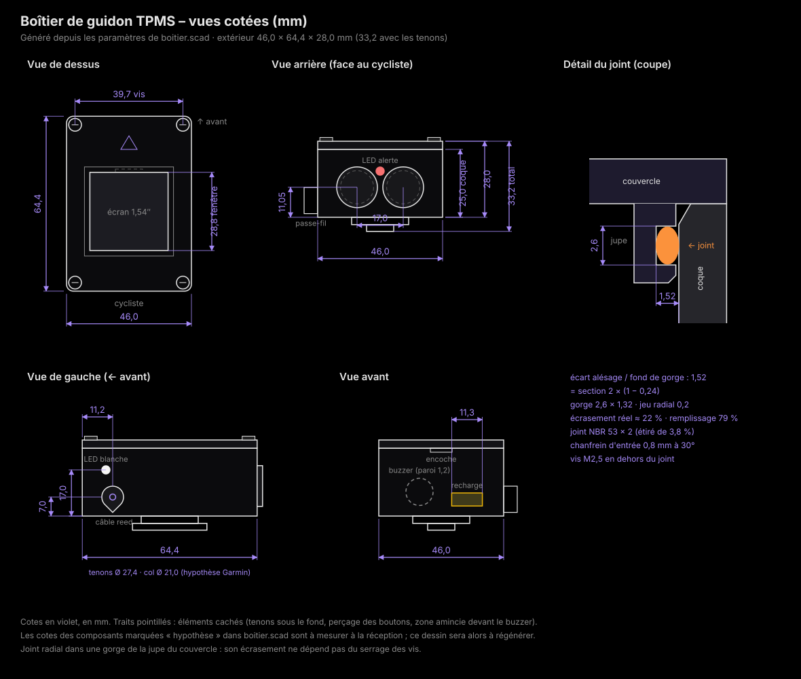

# Boîtier de guidon imprimé en 3D

Projet BTS CIEL option IR – Thibault MORRETTON – Épreuve E6.

Ce dossier contient le boîtier de guidon modélisé avec **OpenSCAD**. Il est prêt à être imprimé sur l'imprimante 3D du lycée.

| Fichier | Contenu |
|---|---|
| `boitier.scad` | Modèle paramétré. Les cotes sont regroupées par composant en tête de fichier, chacune avec sa source. |
| `apercu.svg` | Vues cotées (dessus, arrière, gauche, avant, détail du joint), pour le dossier et la présentation. |
| `stl/` | Pièces prêtes à trancher : `coque.stl`, `couvercle.stl`, `fixation_velo.stl`, `essai_joint.stl` (rendu complet OpenSCAD 2021.01). |
| `rendus/` | Images du rendu complet : boîtier monté, vue éclatée, chaque pièce. |
| `outils/` | Scripts Node.js : export et contrôle des pièces, vérification de la syntaxe et des cotes, aperçu coté. |
| `README.md` | Ce document : choix de conception, impression, quincaillerie, montage, essais, cotes à mesurer. |




**Dimensions extérieures** : 46,0 × 64,4 × 28,0 mm (largeur × longueur × hauteur), et 33,2 mm avec les tenons de fixation. C'est l'encombrement d'un compteur de vélo du commerce (un Garmin Edge 520 mesure 49 × 73 × 21 mm).

---

## 1. Ouvrir le modèle et exporter les STL

OpenSCAD est un logiciel gratuit (Windows, macOS, Linux) : https://openscad.org/downloads.html. Version utilisée : **2021.01** (archive portable officielle, empreinte SHA-256 vérifiée). Les fichiers STL sont déjà exportés dans `stl/` : il suffit de les ouvrir dans le trancheur.

1. Ouvrir `boitier.scad` dans OpenSCAD.
2. **F5** : aperçu rapide, en couleurs, avec les composants en fantôme.
3. Choisir la pièce, soit dans le panneau *Fenêtre > Customizer*, soit en changeant la ligne `piece = "tout";`.

   | `piece` | Ce qui est affiché |
   |---|---|
   | `"tout"` | Boîtier fermé, posé sur sa fixation de guidon, avec les composants |
   | `"eclate"` | Vue éclatée pour la documentation |
   | `"coque"` | Coque seule, posée sur ses tenons (prête à exporter) |
   | `"couvercle"` | Couvercle retourné, dessus à plat (prêt à exporter) |
   | `"fixation_velo"` | Collier de guidon et support quart de tour (prêt à exporter) |
   | `"essai_joint"` | Les 9 mm du haut de la coque, pour essayer le joint et les inserts avant de tout imprimer |

4. Pour l'export, passer `$fn = 96;` (cercles plus lisses), puis **F6** (rendu complet, de quelques secondes à une minute) et *Fichier > Exporter > Exporter en STL*.
5. La console affiche les dimensions calculées et le joint torique conseillé. Si une règle de conception n'est plus respectée après une modification (paroi trop fine, écrou qui touche la jupe, etc.), un message `assert` arrête le calcul et explique pourquoi.

En ligne de commande (invite `cmd`, pas PowerShell) :

```
openscad -o coque.stl -D "piece=\"coque\"" -D "$fn=96" boitier.scad
openscad -o couvercle.stl -D "piece=\"couvercle\"" -D "$fn=96" boitier.scad
openscad -o fixation.stl -D "piece=\"fixation_velo\"" -D "$fn=96" boitier.scad
```

Pour un guidon de 25,4 mm, changer `guidon_d = 25.4;` puis réexporter la fixation.

---

## 2. Les choix de conception (à expliquer au jury)

### 2.1 Le boîtier est calculé à partir des composants

Les dimensions ne sont pas choisies « à l'œil ». Elles sont calculées dans `boitier.scad`, dans la partie *DIMENSIONS CALCULÉES* :

- **Largeur et longueur.** L'écran (circuit WeAct de 50,0 × 32,6 mm) se loge dans la jupe du couvercle, avec 0,5 à 1 mm de jeu. Viennent ensuite la jupe (2,8 mm), le jeu du joint (0,2 mm), puis la paroi (3,2 mm). On obtient 39,6 × 58,0 mm à l'intérieur et 46,0 × 64,4 mm à l'extérieur.
- **Hauteur.** Ce sont les **écrous des boutons étanches** qui l'imposent. Un écrou de 16,5 mm sur les angles doit tenir entre le fond et le bas de la jupe : 2,5 (fond) + 16,5 + garde + 5,3 (jupe) = 25,0 mm pour la coque. Avec le couvercle de 3 mm, on arrive à 28 mm.
- **Implantation intérieure.** L'électronique est rangée sur deux étages :
  - au fond : la XIAO posée sur un berceau, qui laisse 1,8 mm de garde pour les fils soudés dessous, et la plaquette des MOSFET ;
  - au-dessus : la batterie, posée sur 4 piliers. Elle garde **5 mm de vide sous l'écran**, au cas où elle gonflerait en vieillissant ;
  - à l'arrière : les corps des 2 boutons ;
  - à l'avant : le buzzer couché, le connecteur de recharge, les LED latérales et la sortie du câble reed.

  Les `assert` du fichier contrôlent les règles principales. Pendant la conception, un script de calcul a vérifié en plus 42 règles : aucun chevauchement entre composants, et 1,2 mm de matière au minimum autour des inserts.

### 2.2 Le joint : un joint torique *radial*, pas un joint plat

Deux montages sont possibles :

- **Joint axial (« à plat »).** Le joint est écrasé entre le bord de la coque et le dessous du couvercle. Son écrasement dépend alors du **serrage des vis** et de la **raideur du couvercle**. Un joint NBR de 2 mm écrasé de 22 % pousse sur le couvercle avec environ 1 N par millimètre de joint. Entre deux vis d'angle distantes de 58 mm, un couvercle en PETG de 3 mm fléchirait d'environ **1,4 mm**, soit trois fois l'écrasement voulu (0,45 mm) : le joint ne serait plus serré au milieu des côtés. Pour s'en sortir, il faudrait 8 vis ou plus et un couvercle très épais.
- **Joint radial (choix retenu).** Comme le joint d'un piston de seringue, le joint est posé dans une **gorge creusée tout autour de la jupe** du couvercle. Il est écrasé entre le fond de la gorge et la paroi intérieure de la coque (l'*alésage*). Son écrasement ne dépend que des **dimensions** de ces deux pièces, et pas du serrage. Les 4 vis ne font que retenir le couvercle.

**Calcul de la gorge** (règles usuelles des fabricants de joints, pour un joint statique) :

| Grandeur | Règle | Valeur |
|---|---|---|
| Section du joint *d* | joint NBR 70 Shore A | 2,0 mm (à vérifier dans le kit) |
| Écrasement visé | 15 à 30 % en statique ; viser 20 à 25 % | 24 % sur la section nominale |
| Écart alésage ↔ fond de gorge *h* | *h* = *d* × (1 − écrasement) | 2,0 × 0,76 = **1,52 mm** |
| Jeu radial jupe ↔ alésage | petit, pour que le joint ne file pas dans l'interstice | 0,2 mm |
| Profondeur creusée dans la jupe | *h* − jeu | 1,32 mm |
| Largeur de gorge *b* | environ 1,3 × *d* | 2,6 mm |
| Taux de remplissage | aire du joint / aire de la gorge < 85 % (le caoutchouc doit pouvoir se déformer et gonfler) | π × 2² / 4 ÷ (2,6 × 1,52) = **79 %** |
| Rayon des coins | ≥ 2,5 × *d* (sinon le joint se plie et fuit) | fond de gorge : 5,98 mm |
| Périmètre du fond de gorge | rectangle arrondi | 172,8 mm |
| Étirement du joint posé | 1 à 5 % (il tient dans sa gorge sans rouler) | joint **53 × 2** (diamètre intérieur 53 mm) : π × 53 = 166,5 mm, étiré de 3,8 % |
| Écrasement réel | l'étirement amincit le joint d'environ la moitié de l'étirement : 2,0 × (1 − 0,019) = 1,96 mm | (1,96 − 1,52) / 1,96 = **22,5 %** |

**Tolérance d'impression.** Une erreur de ±0,1 mm sur l'écart *h* fait varier l'écrasement entre 17,5 % et 27,6 % : on reste dans la plage. C'est pour le vérifier qu'existe la pièce `essai_joint`. Si le couvercle force trop ou flotte, on ajuste `jt_jeu_radial` (ou `jt_compression`), puis on réimprime le seul haut de coque.

Un **chanfrein de 0,8 mm à 30°** en haut de l'alésage guide le joint sans le couper. Il finit 1,4 mm sous le bord, au-dessus de la zone où le joint appuie.

Avec un joint de 50 × 2, l'étirement monterait à 10 %, trop pour qu'il tienne en place. Si le kit commandé ne contient pas de 53 × 2 ou de 54 × 2, il faut en acheter un, ou utiliser du cordon torique NBR de 2 mm dont on colle les bouts à la cyanoacrylate.

### 2.3 Vis M2,5 et inserts à chaud

- **Inserts laiton M2,5** (longueur 4 mm, Ø extérieur 3,5 mm), enfoncés au fer à souder dans des trous de **3,3 mm sur 5,5 mm de profondeur**. C'est la valeur de `ins_trou_d`, à adapter à la fiche du vendeur. Une vis directement dans le plastique s'userait aux ouvertures répétées, alors que l'insert a un filetage métallique.
- On a choisi le M2,5 plutôt que le M2 : il est plus robuste, et c'est le plus petit insert courant dont le perçage tient dans les coins.
- **Les vis sont en dehors du joint.** L'eau qui suivrait une vis arrive sous le couvercle, puis bute sur le joint radial.
- La position de l'insert est calculée pour laisser autant de matière vers l'extérieur que vers l'alésage, soit 1,51 mm de chaque côté (formule commentée dans le `.scad`).
- Les colonnes d'angle sont pleines du fond jusqu'en haut. Elles s'impriment sans support.

### 2.4 Fenêtre de l'écran : vitre collée (choix conseillé)

- **Vitre de PMMA (plexiglas) ou de polycarbonate de 1 mm**, découpée à 33 × 33 mm et collée **sous** le couvercle, dans un logement de 1 mm. L'écran, vissé sur 4 entretoises, vient appuyer la dalle contre la vitre. La vitre est donc **serrée entre le couvercle et l'écran**, et la pression de l'eau la plaque contre son cordon de colle au lieu de le décoller.
- La fenêtre s'évase à 45° vers l'extérieur (28,8 mm au ras de la vitre, 32,8 mm dessus) : aucune ombre sur l'écran quand on le regarde de biais.
- **Option `fenetre = "petg"`** : le couvercle entier est imprimé en PETG transparent, avec une peau de 0,8 mm devant l'écran. Cette solution est plus simple et sans collage, mais une pièce imprimée reste **translucide** et non transparente (les couches diffusent la lumière) : l'affichage serait flou. À garder comme solution de secours.

### 2.5 Évent : pas d'évent (justification IPX7)

Un boîtier étanche fermé subit des écarts de pression :

- **Fermeture du couvercle.** La jupe agit comme un piston sur environ 3,2 cm³ d'air pour 32 cm³ d'air libre, d'où **+0,11 bar**. Le couvercle est alors poussé avec environ 25 N, ce que les 4 vis M2,5 tiennent sans difficulté.
- **Refroidissement brutal.** Un boîtier chauffé au soleil (40 °C), puis plongé dans l'eau froide (15 °C), voit son air intérieur se contracter : 1013 hPa × 25 / 313 ≈ **−0,08 bar**. Cela s'ajoute aux 0,1 bar de l'immersion à 1 m.

Le joint radial tient largement ces 0,2 bar ; les points faibles sont les collages (vitre, LED, connecteur). On choisit donc de **ne pas mettre d'évent** : c'est une pièce de plus, un trou de plus et un point de fuite de plus. L'essai IPX7 du § 6 dira si les collages suffisent.

Si l'essai échoue à cause de la dépression, ou par sécurité vis-à-vis de la batterie (une LiPo défaillante dégage du gaz), on pourra ajouter un **évent autocollant à membrane ePTFE** (« évent IP68 », Ø 8 à 10 mm, environ 1 €) sur le fond. Ce type de membrane laisse passer l'air et retient l'eau.

### 2.6 Buzzer, LED, connecteur, câble du reed

- **Buzzer.** Il est couché contre la face avant, où la paroi est amincie à **1,2 mm** sur Ø 10 mm, soit 3 cordons d'impression : c'est encore étanche, et la paroi vibre avec le buzzer. Le son sera atténué, **à mesurer**. S'il est trop faible, on percera un trou de Ø 2 mm recouvert d'une membrane acoustique ePTFE autocollante.
- **LED (3 mm).** Trois LED traversent les parois : la rouge d'alerte au centre de la face arrière (face au cycliste), et les deux blanches sur les flancs, vers l'avant. Chacune est enfoncée depuis l'intérieur jusqu'à ce que sa collerette bute contre la paroi. Le dôme dépasse alors d'environ 1 mm et éclaire aussi de côté. Un point de colle époxy autour de la collerette fait l'étanchéité. Pas de bouchon : la LED est elle-même la fenêtre.
- **Connecteur magnétique.** Il traverse la face avant et affleure à l'extérieur. À l'intérieur, un petit **bac de 3 mm** l'entoure : on le remplit d'époxy, qui colle et étanchéifie le connecteur en une seule opération.
- **Câble du reed.** Il sort par un **passe-fil serré** sur le flanc gauche : le trou fait 0,3 mm de moins que le câble, et un cône extérieur reçoit un cordon de silicone. À l'intérieur, un collier serre-câble autour du câble empêche de l'arracher.
  - Un presse-étoupe M8 a été écarté : son écrou intérieur (13 mm sur plats) ne trouve pas de place à côté de la batterie, et le câble 2 fils est trop fin pour un presse-étoupe PG7 (3 mm minimum).
  - Le bossage extérieur a une forme de goutte (faces à 45°), pour s'imprimer sans support.

### 2.7 Fixation quart de tour « type Garmin »

- **Sous la coque**, un col de Ø 21 mm porte deux tenons (bande de 10 mm à bords droits, Ø 27,4 mm, 2,5 mm d'épaisseur). Ils sont imprimés d'une seule pièce avec la coque : pas de vis dans le fond, donc pas de trou de plus à étanchéifier.
- **Sur le vélo**, on fixe un collier de guidon (31,8 mm, ou 25,4 mm en changeant `guidon_d`), serré par une vis M3 et un écrou prisonnier. Il est surmonté d'une tête qui a :
  - une fente pour les tenons, orientée le long du cintre ;
  - une lèvre sous laquelle les tenons glissent ;
  - **deux butées**, qui limitent la rotation à un quart de tour dans le sens horaire ;
  - **deux crans** de 0,35 mm, que les tenons franchissent juste avant la position verrouillée (point dur). Le boîtier ne se dévisse donc pas sur les pavés.
- **Mise en place** : on présente le boîtier en travers, on l'enfonce, puis on tourne d'un quart de tour dans le sens horaire.
- **Impression du collier sans support** :
  - le trou du cintre est en forme de goutte, pointe en haut ;
  - le piédestal entre collier et tête est à 45° ;
  - les faces du dessous suivent l'enveloppe du collier et des oreilles.
- Les cotes des tenons sont des **hypothèses** proches du système Garmin. Comme on imprime les deux pièces, elles vont toujours ensemble. Pour utiliser un vrai support Garmin, il faudra d'abord mesurer ses cotes (§ 7).

---

## 3. Impression

### 3.1 Matière : PETG (ou ASA), pas de PLA

| Matière | Ramollit vers | Tenue au soleil | Impression | Verdict |
|---|---|---|---|---|
| PLA | 55–60 °C | Mauvaise : se déforme dans une voiture ou au soleil d'été | Facile | **À éviter** : un boîtier sombre au soleil dépasse 60 °C. Le PLA flue alors : l'alésage du joint se déforme et les inserts se desserrent. |
| **PETG** | 75–80 °C | Correcte (choisir une couleur sombre, qui protège des UV) | Facile, sans enceinte fermée | **Conseillé** |
| ASA | 95–100 °C | Excellente (fait pour l'extérieur) | Demande une imprimante fermée et une bonne aération (vapeurs) | Le meilleur si l'imprimante du lycée est fermée et aérée |

Le PLA est très bien pour la **pièce d'essai** (`essai_joint`) et pour un premier prototype d'encombrement.

### 3.2 Orientation et supports

| Pièce | Orientation | Supports | Remarque |
|---|---|---|---|
| Coque | Debout, posée sur ses tenons (déjà orientée par `piece = "coque"`) | **Oui, uniquement sous le fond**, autour des tenons (5,2 mm de haut, « supports touchant le plateau ») | Tout l'intérieur s'imprime sans support : colonnes droites, coins remplis à 45°, passe-fil en goutte, bac du connecteur posé sur le fond. |
| Couvercle | Retourné, dessus à plat sur le plateau (déjà orienté) | Non | Le dessus sera lisse (face plateau). La gorge du joint forme un surplomb de 1,3 mm seulement. |
| Fixation | Debout, sur ses oreilles (déjà orientée) | Non | Si l'imprimante gère mal le surplomb de 3 mm sous la lèvre de la tête, ajouter un support à cet endroit seulement. |
| Essai joint | Bord du haut vers le haut | Non | Environ 20 min. |

### 3.3 Réglages conseillés (buse de 0,4 mm, PETG)

- **Couche** : 0,2 mm (0,16 mm pour le couvercle si l'on veut une gorge plus précise).
- **Périmètres** : 4 ; **dessus et dessous** : 6 couches.
- **Remplissage** :
  - **100 %** pour la coque et le couvercle. Une pièce pleine est étanche et tient les inserts, et il faut peu de matière (environ 45 g pour les deux).
  - 50 % gyroïde avec 5 périmètres pour la fixation.
- **Températures** : buse 235–245 °C, plateau 75–85 °C, ventilation 30–50 %.
- **Débit** calibré, voire légèrement fort (102 %) : des couches bien soudées sont la première condition de l'étanchéité.
- **Compensation de la « patte d'éléphant »** : 0,1 à 0,15 mm (elle élargirait les tenons et le bord du couvercle).
- **Couture** (début des couches) alignée sur l'arrière, loin de l'alésage du joint.
- Ébavurer les trous de 12 mm des boutons au **foret étagé** : le haut d'un trou horizontal s'affaisse un peu à l'impression.

---

## 4. Quincaillerie à acheter

En plus du matériel déjà commandé (`docs/cahier-des-charges.md` § 6).

| Qté | Article | Usage | Prix indicatif |
|---|---|---|---|
| 4 | Inserts laiton à chaud **M2,5 × 4 mm**, Ø ext. 3,5 mm | Fixation du couvercle | ~3 € le lot de 50 |
| 4 | Vis **M2,5 × 6** tête bombée ISO 7380 (ou DIN 912), inox A2 | Couvercle | ~2 € le lot |
| 4 | Vis **M2 × 4** (ou × 5) auto-taraudeuses pour plastique | Écran sur ses entretoises | ~2 € le lot |
| 1 | Vis **M3 × 14** (ou × 16) DIN 912 + 1 écrou M3 | Serrage du collier | <1 € |
| 1 | **Joint torique NBR 70 Shore A, 53 × 2 mm** (ou 54 × 2) | Étanchéité coque / couvercle | <1 € (vérifier d'abord le kit commandé) |
| – | Graisse silicone (tube pour joints, robinetterie) | Lubrifier le joint | ~3 € |
| 1 | Plaque **PMMA (plexiglas) ou polycarbonate transparent 1 mm**, 33 × 33 mm | Vitre de l'écran | chute, ~2 € |
| – | **Colle MS polymère transparente** ou **silicone neutre** (pas de silicone acétique, qui dégage de l'acide et corrode le cuivre) | Collage étanche de la vitre ; cône du passe-fil | ~5 € |
| – | Colle **époxy bi-composant** | LED, connecteur magnétique (bac) | ~4 € |
| – | Ruban Kapton, mousse adhésive double face (2 à 3 mm), mousse EVA de 3 à 5 mm | Isolation et calage de la XIAO et de la batterie | – |
| 1 | Collier serre-câble de 2,5 mm | Anti-arrachement du câble reed | – |
| – | Bande de chambre à air | Adhérence du collier sur le cintre | récupération |
| (option) | Évent autocollant à membrane ePTFE Ø 8–10 mm | Si l'essai d'étanchéité le demande (§ 2.5) | ~1 € |

---

## 5. Montage

1. **Essai.** Imprimer `essai_joint` et le couvercle. Poser les inserts, monter le joint graissé et fermer. Le couvercle doit entrer en poussant franchement, puis rester en place sans les vis. Ajuster `jt_jeu_radial` si besoin.
2. **Finitions.** Ébavurer les trous (foret étagé pour les boutons) et retirer les supports sous le fond. Passer un papier de verre à l'eau (grain 600) sur l'alésage s'il porte une bavure de couture. Nettoyer à l'alcool.
3. **Inserts.** Fer à souder à 230–240 °C, pointe dédiée aux inserts. Enfoncer bien droit jusqu'à affleurer, sans appuyer fort, puis laisser refroidir.
4. **Connecteur magnétique.**
   - Repérer le + et le − **avant** de coller.
   - Le poser depuis l'intérieur, face au ras de l'extérieur, en bouchant la face extérieure avec du ruban adhésif.
   - Remplir le bac d'époxy, puis souder les fils une fois la colle prise.
5. **LED.** Les tester, puis les enfoncer depuis l'intérieur jusqu'à la butée de la collerette, et mettre un cordon d'époxy autour de la collerette.
6. **Boutons.** Le joint plat du bouton va à l'extérieur, sous la collerette ; l'écrou va à l'intérieur. Serrer modérément.
7. **Câble du reed.** L'enfiler dans le passe-fil (en mouillant d'eau savonneuse), poser un collier serre-câble à l'intérieur, puis remplir le cône extérieur de silicone.
8. **Buzzer.** Le coucher dans ses deux selles, face contre la paroi amincie, et le tenir par un point de colle.
9. **XIAO et plaquette.**
   - Poser la XIAO sur son berceau, avec du Kapton dessous. La prise USB-C est tournée vers l'intérieur (côté plaquette) : on peut la reprogrammer en soulevant la batterie. Il n'y a volontairement pas de mise à jour par Bluetooth : elle se fait par USB, avec un accès physique (voir l'analyse de risques).
   - Coller la plaquette des MOSFET et des résistances à droite de la XIAO, avec de la mousse double face.
10. **Batterie.** Kapton dessous, mousse double face sur les piliers. La carte de protection va du côté des fils.
11. **Couvercle.**
    - Déposer un cordon fin de colle MS polymère au bord du logement de la vitre, poser la vitre, appuyer, essuyer. Laisser prendre 24 h.
    - Souder les 8 fils de l'écran (environ 8 cm, pour pouvoir ouvrir) **sans le connecteur à broches**.
    - Visser l'écran sur ses 4 entretoises, dalle contre la vitre, sans colle sur la dalle.
12. **Fermeture.**
    - Graisser légèrement le joint, l'installer dans la gorge et vérifier qu'il n'est pas vrillé.
    - Aligner le détrompeur (petit plot à l'arrière), enfoncer le couvercle et le maintenir : l'air comprimé le repousse un peu.
    - Visser les 4 vis en croix, sans forcer.
    - Pour ouvrir : glisser un tournevis plat dans l'encoche avant.
13. **Sur le vélo.**
    - Collier sur le cintre, avec une bande de chambre à air dessous, la fente de la tête le long du cintre.
    - Présenter le boîtier en travers, l'enfoncer, puis tourner d'un quart de tour dans le sens horaire jusqu'au cran.

---

## 6. Essais d'étanchéité « maison »

L'IPX7 (norme IEC 60529) correspond à une immersion temporaire : point le plus bas du boîtier à 1 m sous la surface, pendant 30 min, sans entrée d'eau en quantité nuisible.

1. **Toujours d'abord à vide**, sans électronique.
2. **Test des bulles** (rapide, il localise la fuite).
   - Fermer le boîtier à température ambiante et le plonger dans une bassine d'eau chaude **à 45–50 °C au plus** : au-delà, le PETG ramollit.
   - L'air intérieur se dilate et s'échappe en bulles par la moindre fuite. Repérer d'où elles sortent : collage de la vitre, LED, connecteur, passe-fil, bouton ou joint.
3. **Essai IPX7.**
   - Mettre à l'intérieur une feuille d'**essuie-tout sec** sur laquelle on a fait quelques traits au **feutre à l'eau** : l'encre bave à la moindre goutte.
   - Fermer, puis lester le boîtier : il flotte (environ 80 cm³, soit 0,8 N de poussée), il faut donc un lest d'environ 150 g, attaché par une ficelle.
   - Le plonger **1 m sous la surface** pendant **30 min** : fût ou tube d'au moins 1,1 m de profondeur, piscine ou lac (une poubelle de 120 L ne fait qu'environ 0,9 m). L'eau doit être à température proche de celle du boîtier, à 5 °C près, comme le demande la norme.
   - Sortir le boîtier, l'essuyer soigneusement **avant** d'ouvrir, puis contrôler l'essuie-tout.
4. Refaire l'essai après **10 ouvertures et fermetures**, puis après une journée au soleil : on vérifie ainsi que le joint et les collages vieillissent bien.
5. Noter les résultats (photo de l'essuie-tout) pour le dossier : c'est la validation de l'exigence ENF-05 du cahier des charges.

---

## 7. Cotes à vérifier au pied à coulisse à la réception

Chaque valeur se corrige dans `boitier.scad`. Le boîtier se recalcule seul, et les `assert` signalent un éventuel conflit.

| Composant | Ce qu'il faut mesurer | Paramètre | Valeur actuelle |
|---|---|---|---|
| Écran WeAct | Largeur et longueur du circuit | `ep_pcb_x`, `ep_pcb_y` | 32,6 × 50,0 (dessin WeAct) |
| | Entraxe et diamètre des 4 trous | `ep_trou_ex`, `ep_trou_ey`, `ep_trou_d` | 27,0 × 44,4 ; Ø 2,2 |
| | **Position de la zone active** (afficher un cadre noir et mesurer) | `ep_aa_decal_y` | −2,86 (hypothèse) |
| | Épaisseur dalle + circuit, hauteur des composants au dos | `ep_dalle_ep`, `ep_pcb_ep`, `ep_dos_h` | 1,05 / 1,2 / 2,0 |
| XIAO nRF52840 | Épaisseur du circuit, hauteur de la prise USB-C | `xiao_pcb`, `xiao_dessus` | 1,2 / 3,3 |
| Batterie 503035 | Épaisseur, largeur, longueur **avec** la carte de protection | `bat_ep`, `bat_larg`, `bat_long` + `bat_pcb` | 5 × 30 × (35 + 3) |
| Buzzer | Diamètre, hauteur | `buz_d`, `buz_h` | 12 / 9,5 |
| Boutons 12 mm | Diamètre du filetage, collerette extérieure, écrou (sur angles), épaisseur de l'écrou, longueur derrière la paroi, épaisseur de paroi maximale | `bt_percage`, `bt_collerette_d`, `bt_ecrou_d`, `bt_ecrou_ep`, `bt_prof` | 12,2 / 15 / 16,5 / 2 / 17 |
| LED 3 mm | Diamètre de la collerette, longueur | `led_collerette`, `led_long` | 3,8 / 5,0 |
| Connecteur magnétique | Largeur et hauteur de la face, profondeur | `cm_l`, `cm_h`, `cm_prof` | 11 × 4,5 × 5 |
| Câble du reed | Diamètre extérieur | `reed_cable_d` | 2,5 |
| Joints toriques du kit | Diamètre intérieur × section disponibles (un 53 × 2 ou 54 × 2 ?) | `jt_d` | 2,0 |
| Inserts | Ø extérieur, longueur, perçage conseillé par le vendeur | `ins_trou_d`, `ins_prof` | 3,3 / 5,5 |
| Guidon | Diamètre du cintre à l'endroit du collier | `guidon_d` | 31,8 |
| Support Garmin (pour la compatibilité seulement) | Ø du col, Ø et largeur des tenons, épaisseur des tenons et de la lèvre | `qt_*` | 21 / 27,4 / 10 / 2,5 / 2,5 |
| Imprimante | Diamètre réel d'un trou de 12 mm et d'un cylindre de 39,6 mm imprimés (pièce `essai_joint`) | `jt_jeu_radial`, `bt_percage` | – |

---

## 8. Ce qui n'a pas pu être vérifié

- **Le rendu, lui, est fait** (OpenSCAD 2021.01, 23/10/2026) : les quatre pièces se rendent sans avertissement, sont fermées (« Simple: yes ») et d'un seul tenant (voir § « Export et contrôles »). Il reste à regarder les épaisseurs dans le trancheur et à imprimer.
- **Les cotes marquées « hypothèse »** (§ 7), en particulier la position de la zone active de l'écran, les dimensions des boutons, du buzzer et du connecteur magnétique.
- **La compatibilité avec un vrai support Garmin** : les cotes des tenons ne viennent d'aucune fiche officielle.
- **Le son du buzzer** à travers 1,2 mm de PETG.
- **La portée radio** de la XIAO dans le boîtier fermé : son antenne est sous la batterie et sous le circuit de l'écran, avec des capteurs situés à environ 1 m.
- **La précision réelle de l'imprimante** sur l'alésage et la gorge, d'où la pièce `essai_joint`.
- **La marge autour des inserts** n'est que de 0,7 mm tout en haut, à cause du chanfrein d'entrée (1,5 mm plus bas). Vérifier que la pose des inserts ne fait pas gonfler la paroi de l'alésage, et poser l'insert avec un fer pas trop chaud.
- **L'étanchéité elle-même**, à valider par les essais du § 6.

## Export et contrôles

```
node boitier-3d/outils/exporter.js                                   # rendu complet + STL + images + contrôles
node boitier-3d/outils/composantes-stl.js boitier-3d/stl/coque.stl   # nombre de morceaux d'un STL
node boitier-3d/outils/verifier-syntaxe.js boitier-3d/boitier.scad   # parenthèses, accolades, points-virgules, modules
node boitier-3d/outils/verifier-cotes.js                             # 42 règles : parois ≥ 2 mm, gorge du joint, écrous, batterie…
node boitier-3d/outils/generer-apercu.js boitier-3d/apercu.svg       # redessine les vues cotées
```

`exporter.js` cherche OpenSCAD dans la variable d'environnement `OPENSCAD` (sinon à l'endroit où il est installé sur le PC de développement). Pour chaque pièce, il fait le rendu complet (comme F6), exporte le STL et vérifie trois choses : aucun avertissement d'OpenSCAD, objet fermé (« Simple: yes »), et pièce d'un seul tenant.

| Pièce | Rendu | Triangles | Contrôles |
|---|---|---|---|
| `coque` | 36 s | 9 924 | fermée, 1 morceau |
| `couvercle` | 25 s | 7 252 | fermée, 1 morceau |
| `fixation_velo` | 12 s | 3 124 | fermée, 1 morceau |
| `essai_joint` | 38 s | 6 268 | fermée, 1 morceau |

Export avec `$fn = 96` (cercles plus lisses que les 64 côtés de l'aperçu), OpenSCAD 2021.01.

**Défaut trouvé au premier rendu, et corrigé.** La coque sortait en **deux morceaux** : les tenons du quart de tour (10 × 27,4 × 2,5 mm) touchaient le col par une seule face, sans le chevaucher. OpenSCAD les gardait séparés ; un trancheur les aurait sans doute recollés, mais une jonction de surface nulle est fragile et ambiguë. Les tenons montent maintenant de 0,01 mm dans le col (module `tenons_garmin`). C'est le même piège que les `+ 0.01` déjà présents ailleurs dans le modèle : toujours faire chevaucher deux volumes à unir.

Avant ce rendu, le modèle avait été vérifié sans OpenSCAD : analyseur de syntaxe (0 problème) et script de calcul des cotes (42 règles). Ces scripts restent utiles : les paramètres y sont recopiés à la main, donc si une cote change dans `boitier.scad`, il faut la changer aussi dans `verifier-cotes.js` et `generer-apercu.js`, puis relancer `exporter.js`.
