# Boîtier de guidon imprimé en 3D (version 2)

Projet BTS CIEL option IR – Thibault MORRETTON – Épreuve E6.

Ce dossier contient le boîtier de guidon modélisé avec **OpenSCAD** : un boîtier étanche (IPX7 visé) en forme de compteur GPS, son collier de cintre et les pièces d'essai. Tout est paramétré dans un seul fichier, `boitier.scad`, et contrôlé par des scripts (rendu, pièces fermées et d'un seul tenant, **absence de collision entre les pièces et les composants**, parois d'au moins 2 mm).

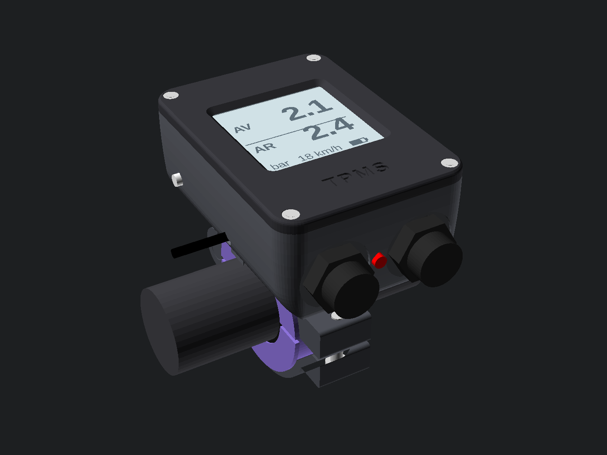

| Fichier | Contenu |
|---|---|
| `boitier.scad` | Modèle paramétré et très commenté. Les cotes sont groupées par composant en tête de fichier, chacune avec sa source. |
| `stl/` | Les 10 pièces prêtes à trancher, déjà dans leur position d'impression (rendu complet OpenSCAD 2021.01, `$fn = 96`). |
| `rendus/` | Images : vues d'ensemble, vue éclatée, coupe, chaque pièce. |
| `outils/exporter.js` | Rendu complet de chaque pièce, export STL, contrôles, images. |
| `outils/verifier-interferences.js` | Contrôle d'interférence (pièces / composants, pièces / pièces) et d'épaisseur de paroi. |
| `outils/composantes-stl.js` | Compte les morceaux séparés d'un STL (une pièce doit être d'un seul tenant). |
| `README.md` | Ce document. |

## Sommaire

1. [Le boîtier en bref](#1-le-boîtier-en-bref)
2. [Les choix de conception](#2-les-choix-de-conception-à-expliquer-au-jury)
3. [Cotes des composants et sources](#3-cotes-des-composants-et-sources)
4. [Tolérances d'impression et pièce test_jeux](#4-tolérances-dimpression-et-pièce-test_jeux)
5. [Impression](#5-impression)
6. [Quincaillerie](#6-quincaillerie-à-acheter)
7. [Montage pas à pas](#7-montage-pas-à-pas)
8. [Essais d'étanchéité](#8-essais-détanchéité)
9. [Contrôles faits avec OpenSCAD](#9-contrôles-faits-avec-openscad)
10. [Cotes à vérifier à la réception du matériel](#10-cotes-à-vérifier-à-la-réception-du-matériel)
11. [Ce qui reste une hypothèse](#11-ce-qui-reste-une-hypothèse)

---

## 1. Le boîtier en bref

| | |
|---|---|
| **Dimensions du boîtier** | **46,0 × 64,0 × 28,0 mm** (largeur × longueur × hauteur), sans le collier. Même encombrement que la version 1 (46,0 × 64,4 × 28,0), mais sans les 5,2 mm de tenons sous le fond. |
| **Forme** | Type compteur GPS : façade plate avec l'écran, coins arrondis (R 5,5 vus de dessus), flancs légèrement bombés (rayon 150 mm), bas très arrondi sur les côtés (aspect « galet » vu de face), rainure en V sur la ligne de joint, deux tons (façade foncée, coque gris anthracite). |
| **Étanchéité** | Joint torique **53 × 1,8 NBR 70** (ISO 3601-1, équivalent AS568-032) monté en **joint radial** sur la jupe de la façade ; vitre PMMA collée ; boutons étanches à joint plat ; connecteur de recharge noyé dans l'époxy ; passe-fil serré pour le câble du reed. |
| **Fermeture** | 4 vis M2 × 6 à tête fraisée dans des inserts laiton à chaud M2, **hors du joint**. |
| **Fixation** | Collier fendu imprimé (collier + bride) serré par **1 vis M3 + écrou noyé**, sur le cintre près des poignées (Ø 22,2 par défaut) ; **cales** imprimées pour 22,2 / 23,8 / 25,4 / 31,8 mm ; bande de chambre à air de 1 mm. |
| **Liaison démontable** | **Glissière en queue d'aronde + languette à cran** : on pousse le boîtier vers l'avant jusqu'à la butée, il se verrouille seul (clic) ; on appuie sur la tirette sous l'avant pour le retirer (recharge, antivol). |
| **Matière** | PETG, buse 0,4 mm, **aucun support** pour aucune pièce. |
| **Masse (volumes des STL × 1,27 g/cm³, pièces pleines)** | Coque 25 g, façade 8 g ; collier 10 g, bride 6 g, 2 demi-cales de 22,2 : 12 g. Boîtier équipé ≈ 65 g. |

| Vue de l'avant (côté roue) | Profil (vu de la droite) |
|---|---|
| 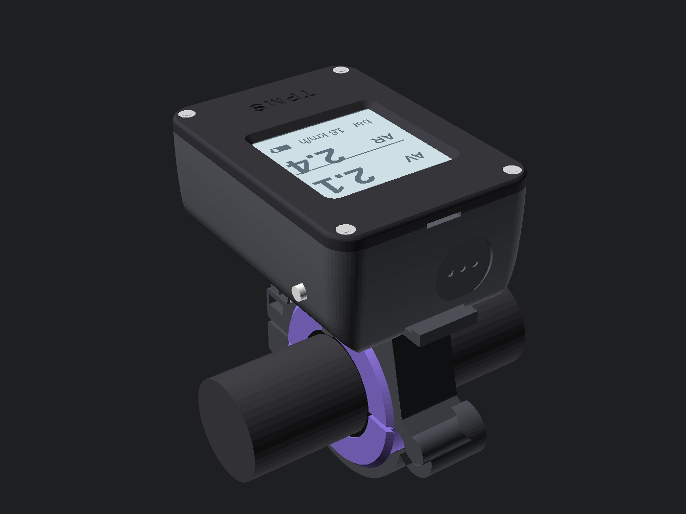 | 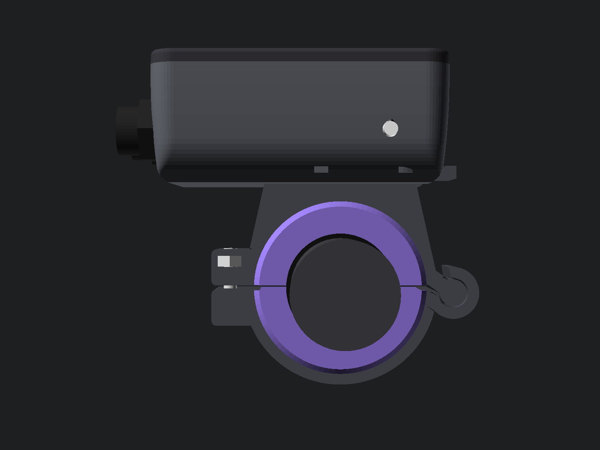 |

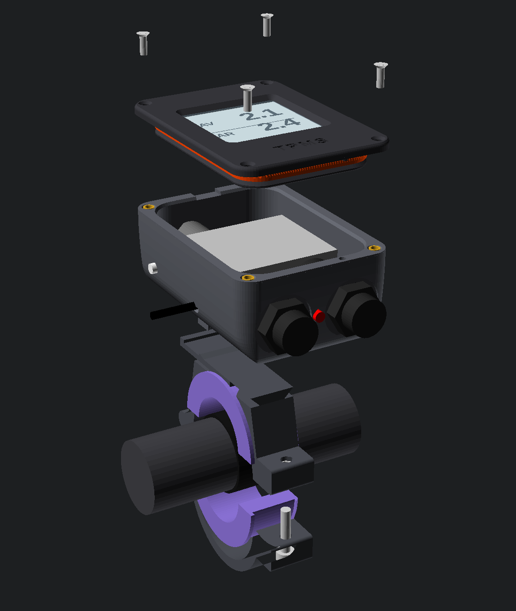

### Ouvrir le modèle et exporter les STL

OpenSCAD est gratuit : https://openscad.org/downloads.html. Version utilisée : **2021.01**. Les STL sont déjà dans `stl/`.

1. Ouvrir `boitier.scad`. **F5** : aperçu en couleurs avec les composants « fantômes ».
2. Choisir la vue ou la pièce avec la variable `piece` (ou *Fenêtre > Customizer*) :

   | `piece` | Ce qui est affiché |
   |---|---|
   | `"tout"` | Boîtier fermé sur son collier, sur un bout de cintre, avec les composants |
   | `"eclate"` | Vue éclatée (vis, façade et écran, coque et électronique, collier, cales, bride) |
   | `"coupe"` | Coupe à plat dans le plan `X = coupe_x` (6 mm), chaque pièce dans sa couleur, avec repères |
   | `"coque"`, `"couvercle"`, `"collier"`, `"bride"` | La pièce seule, **dans sa position d'impression** |
   | `"cale_22_2"`, `"cale_23_8"`, `"cale_25_4"`, `"cale_31_8"` | Une demi-cale (à imprimer en 2 exemplaires) |
   | `"test_jeux"` | Pièce de réglage des tolérances (§ 4) |
   | `"essai_joint"` | Les 8 mm du haut de la coque, pour essayer le joint (§ 4) |

3. **F6** puis *Fichier > Exporter > STL* ; ou, pour tout refaire d'un coup (STL, contrôles et images) :

```
node boitier-3d/outils/exporter.js                 # 10 pièces + 15 images (≈ 14 min)
node boitier-3d/outils/verifier-interferences.js   # collisions et parois (≈ 6 min)
node boitier-3d/outils/composantes-stl.js boitier-3d/stl/coque.stl
```

Les deux premiers scripts cherchent OpenSCAD dans la variable d'environnement `OPENSCAD`, sinon dans `C:/Users/utilisateur/outils/openscad-2021.01/`.

La console d'OpenSCAD affiche les grandeurs calculées :

```
BOÎTIER : 46 x 64 x 28 mm ; alésage 39.2 x 56.6 ; parois 3.4 / 3.7 mm
JOINT : 53 x 1.8 ; périmètre du fond 170.3 mm ; étirement 2.3 % ; écrasement 21.3 % (15.7 à 27 % pour ±0,1 mm) ; remplissage 66 %
INSERTS : centre (19.3, 28.4) ; matière 1.28 mm de chaque côté
CALES : [6, 5.2, 4.4, 1.2] mm pour [22.2, 23.8, 25.4, 31.8] ; collier imprimé pour 31.8 mm
```

Si une modification viole une règle (paroi trop fine, joint mal écrasé, écran qui touche la jupe...), un `assert` arrête le calcul et dit pourquoi.

---

## 2. Les choix de conception (à expliquer au jury)

### 2.1 Les dimensions sont calculées à partir des composants

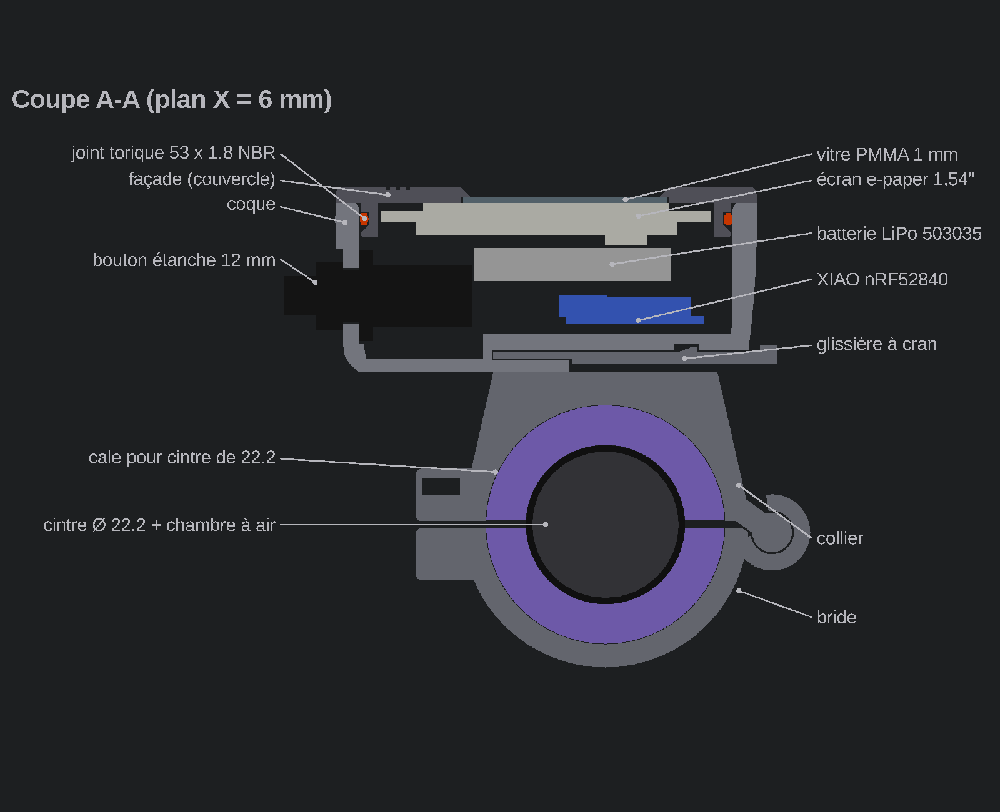

**Vu de dessus**, tout part du circuit de l'écran (50,0 × 32,6 mm) :

| Couche (de l'intérieur vers l'extérieur) | Épaisseur par côté |
|---|---|
| Jeu de pose autour du circuit de l'écran | 0,5 |
| Jupe de la façade (gorge de 1,2 + 1,4 de matière derrière) | 2,6 |
| Jeu radial jupe ↔ alésage (fixe l'écrasement du joint) | 0,2 |
| Paroi de la coque | 3,4 (flancs) / 3,7 (avant, arrière) |

Alésage 39,2 × 56,6 mm, extérieur 46 × 64 mm. La paroi est plus épaisse que les 2 mm minimum parce que les **inserts des vis** doivent tenir dans les coins, hors du joint (§ 2.3).

**En hauteur**, ce sont les **écrous des boutons** (Ø 16,5 mm sur les angles, hypothèse) qui imposent la hauteur : ils sont derrière la paroi arrière, entre le fond et le bas de la jupe.

```
fond 2,0 + chanfrein 1,0 + garde 0,3 + écrou 16,5 + garde 0,3 + jupe 5,2 + façade 2,4 = 27,7 → 28,0 mm
```

**L'intérieur** est rangé en deux étages sous l'écran :

- en bas : la **XIAO** (à droite, vers l'avant : son antenne n'est pas sous la batterie), la **plaquette des MOSFET** (à gauche), le **connecteur de recharge** (dans le fond, à gauche), le **buzzer** couché contre la face avant ;
- au-dessus : la **batterie** (38 × 30 × 5 mm avec sa protection), posée sur des rebords le long des flancs et un plot central, avec **1,5 mm de vide** au-dessus d'elle (gonflement d'une LiPo vieillissante) ;
- à l'arrière : les corps des **2 boutons** et la LED rouge ;
- sur les flancs : les 2 **LED blanches** et, à gauche, la sortie du **câble du reed**.

Le contrôle d'interférence (§ 9) vérifie qu'aucun de ces composants ne touche une pièce.

### 2.2 Le joint torique radial

Deux montages sont possibles :

- **Joint axial (à plat)** : le joint est écrasé entre le bord de la coque et la façade. Son écrasement dépend du **serrage des vis** et de la **raideur de la façade** : entre deux vis distantes de 57 mm, une façade en PETG de 2,4 mm fléchit davantage que l'écrasement voulu, et le joint ne serre plus au milieu des côtés.
- **Joint radial (choix retenu)** : comme le joint d'un piston de seringue, il est posé dans une **gorge creusée autour de la jupe** de la façade et écrasé entre le fond de la gorge et la paroi intérieure de la coque (l'**alésage**). Son écrasement ne dépend que des **dimensions**, pas du serrage ; les 4 vis ne font que retenir la façade.

**Calcul de la gorge** (règles usuelles des fabricants de joints, montage statique) :

| Grandeur | Règle | Valeur |
|---|---|---|
| Joint | taille normalisée, NBR 70 Shore A | **53 × 1,8** (ISO 3601-1) ; équivalent AS568-032 (53,64 × 1,78) |
| Périmètre du fond de gorge | rectangle arrondi 36,4 × 53,8 mm, coins R 5,9 | 170,3 mm |
| Étirement du joint posé | 1 à 5 % (il tient dans sa gorge sans rouler) | 170,3 / (π × 53) − 1 = **2,3 %** (1,0 % avec un AS568-032) |
| Section réelle | un joint étiré s'amincit : d / √(1 + étirement) | 1,78 mm |
| Écart fond de gorge ↔ alésage | profondeur de gorge 1,2 + jeu radial 0,2 | 1,40 mm |
| **Écrasement** | 15 à 25 % en statique | (1,78 − 1,40) / 1,78 = **21,3 %** |
| Tolérance d'impression | ±0,1 mm sur l'écart | 15,7 à 27,0 % : on reste à peu près dans la plage |
| **Remplissage** | < 85 % (le caoutchouc doit pouvoir se déformer et gonfler) | **66 %** |
| Rayon des coins | ≥ 3 × section au fond de gorge | 5,9 ≥ 5,4 mm |
| Forme de la gorge | imprimable façade retournée | flanc haut droit (le joint s'y appuie pendant l'emmanchement), fond droit de 2,0 mm, **flanc bas à 45°** (pas de surplomb) |
| Chanfrein d'entrée de l'alésage | 0,5 mm à 30° | finit 0,4 mm au-dessus de la zone où le joint appuie |

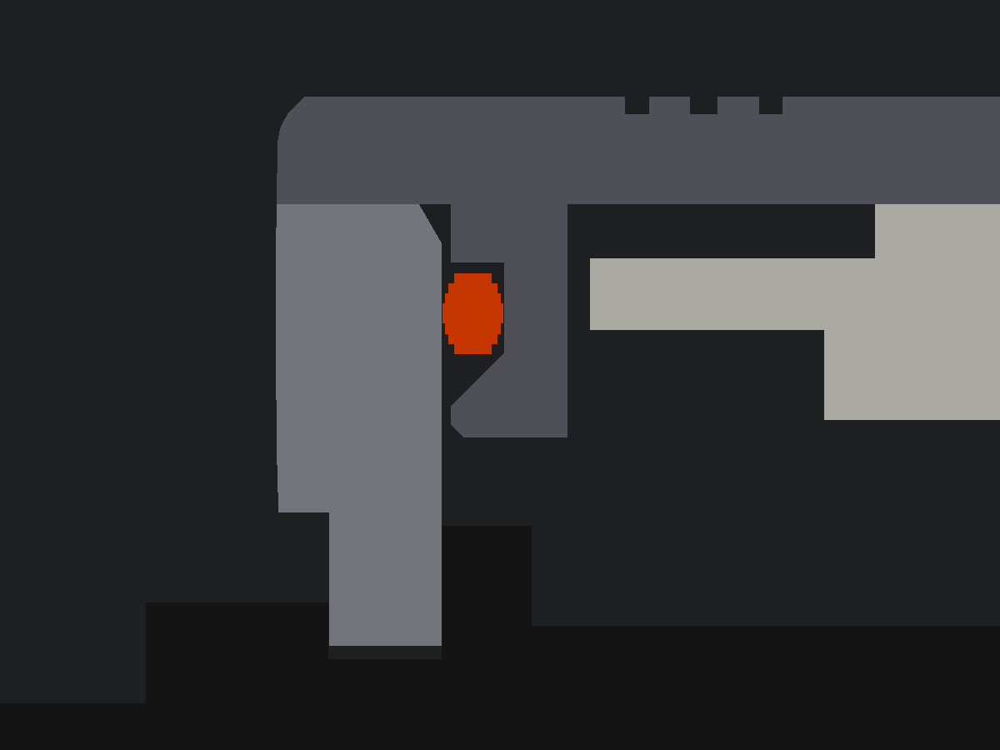

L'essai `essai_joint` (§ 4) permet de régler `jeu_joint` avant d'imprimer la coque entière.

### 2.3 Vis M2 et inserts à chaud, hors du joint

- 4 **inserts laiton M2 × 4** dans les coins de la coque, perçage **3,2 mm** sur 5 mm de profond (cote du fabricant : on ne la compense pas, l'insert chaud fait fondre la matière). Une vis directement dans le plastique s'userait aux ouvertures.
- 4 **vis M2 × 6 à tête fraisée** (DIN 965), affleurantes sur la façade.
- **Les vis sont à l'extérieur du joint** : l'eau qui suivrait une vis arrive sur le haut de la coque, puis bute sur le joint.
- **Position des inserts calculée** : sur la diagonale du coin, au milieu de la matière entre l'arrondi de l'alésage (R 7,3) et l'arrondi extérieur (R 5,5) : 5,77 mm de matière, soit **1,28 mm de chaque côté** de l'insert (règle : ≥ 1,2 mm = 3 cordons). C'est ce calcul qui limite l'arrondi extérieur des coins à 5,5 mm.

### 2.4 Fenêtre de l'écran

- **Vitre PMMA (plexiglas) ou polycarbonate de 1 mm**, 31 × 31 mm, collée **sous** la façade dans un logement de 1 mm. L'écran, vissé sur 4 entretoises, vient appuyer sa dalle contre la vitre : la vitre est **serrée entre la façade et l'écran**, et la pression de l'eau la plaque contre son cordon de colle au lieu de le décoller.
- Fenêtre de 28,8 mm (zone active 27,6 + 0,6 par côté), **évasée à 45°** vers l'extérieur : pas d'ombre sur l'écran vu de biais, et pas de surplomb à l'impression.
- 1,4 mm de façade au-dessus de la vitre : l'écran reste près de la surface.

### 2.5 Boutons, LED, buzzer, recharge, câble du reed

- **Boutons** (face arrière, vers le cycliste) : trou de 12,35 mm en **goutte tronquée** (un trou horizontal imprimé s'affaisse sur le dessus), **lamage plan** Ø 17 sur la face bombée pour que le joint plat du bouton porte bien. Leurs écrous débordent un peu dans les coins arrondis de l'alésage : la paroi épaisse des coins est creusée à cet endroit (elle garde plus de 2 mm).
- **LED** 3 mm : rouge entre les boutons, blanches sur les flancs (éclairage latéral, sous la batterie). Chaque LED est enfoncée de l'intérieur jusqu'à sa collerette ; le dôme dépasse de ≈ 1 mm ; un point d'époxy autour de la collerette fait l'étanchéité.
- **Buzzer** couché contre la face avant, devant une **membrane de 1,2 mm** (3 cordons) dans un plat extérieur, marquée de 3 petites alvéoles. Le son sera atténué : **à mesurer**. Si c'est trop faible : percer Ø 2 mm et coller une membrane acoustique ePTFE autocollante.
- **Connecteur magnétique de recharge** : dans le **fond**, à gauche. Il est protégé de la pluie et des projections quand le boîtier est sur le vélo, et on recharge le boîtier retiré de son support. Un bac de 1,2 mm l'entoure à l'intérieur : on le remplit d'époxy, qui colle et étanchéifie en une seule fois.
- **Câble du reed** (flanc gauche) : trou de 2,2 mm pour un câble de 2,5 mm (passe-fil serré), prolongé par un tube intérieur de 4 mm ; cône extérieur rempli de silicone ; collier serre-câble intérieur contre l'arrachement.

### 2.6 Pas d'évent (justification IPX7)

Volume d'air intérieur ≈ 35 cm³. En fermant, le joint commence à étancher dès le bas du chanfrein d'entrée : la façade descend encore d'≈ 1,5 mm sur 22 cm², soit ≈ 3,3 cm³ comprimés, **+0,09 bar**, une force de ≈ 20 N sur la façade, tenue sans difficulté par les 4 vis. Un boîtier chaud (40 °C) plongé dans l'eau froide (15 °C) voit sa pression baisser de ≈ 0,08 bar, en plus des 0,1 bar de l'immersion à 1 m. Le joint radial tient largement 0,2 bar ; les points faibles sont les collages (vitre, LED, connecteur). On choisit de **ne pas mettre d'évent** (un trou de plus), quitte à ajouter un évent autocollant à membrane ePTFE (Ø 8 mm, ≈ 1 €) si l'essai du § 8 le demande.

### 2.7 Fixation : collier, cales, glissière à cran

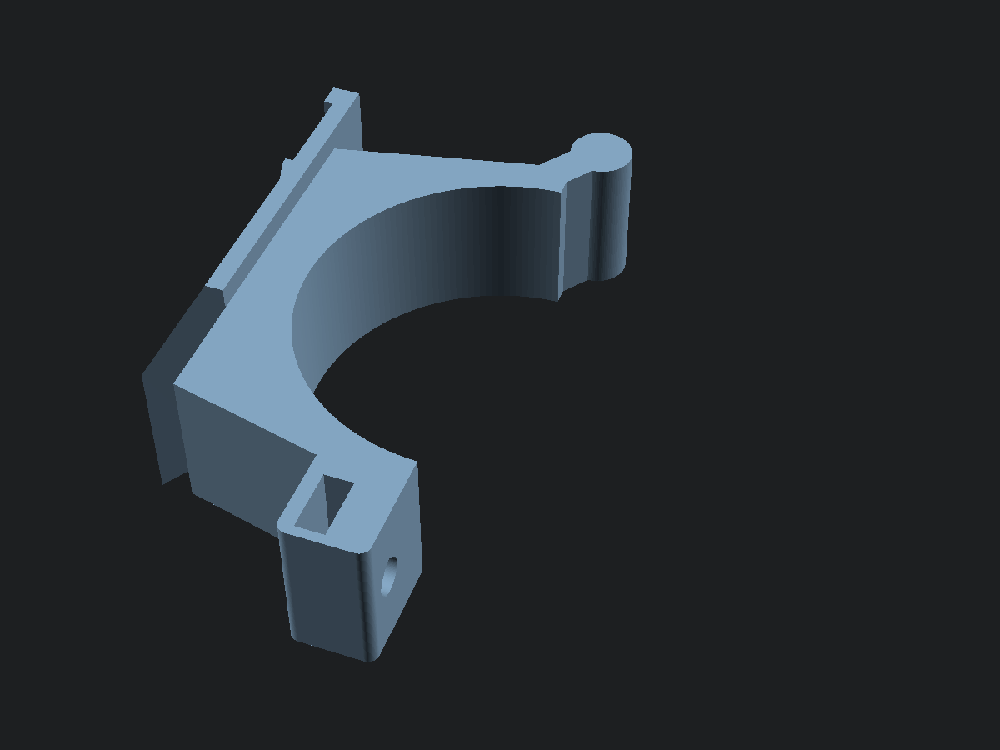

**Le collier** est en deux pièces, toutes deux imprimées **couchées** (l'anneau est dans le plan des couches, le sens le plus solide en impression FDM) :

- le **collier** (haut) porte la **selle** sur laquelle repose le boîtier, le **rail** et un **tenon** cylindrique à l'avant ;
- la **bride** (bas) a une **douille** qu'on **glisse de côté** sur le tenon (le long du cintre), puis elle passe sous le cintre et se serre à l'arrière par une **vis M3 × 14 (ou × 16)** et un **écrou M3 noyé** dans une fente du collier. Pas d'axe ni de charnière à imprimer, et on la pose sans démonter les poignées.

**Les cales** : le collier est imprimé pour le plus gros cintre (31,8 mm). Une cale en deux demi-coquilles (violettes sur les images) l'adapte au cintre : 6,0 mm d'épaisseur pour 22,2 mm (cintre plat, près des poignées : réglage par défaut), 5,2 pour 23,8, 4,4 pour 25,4, 1,2 pour 31,8. Les lèvres des cales les empêchent de glisser. Une **bande de chambre à air** de 1 mm entre la cale et le cintre empêche le boîtier de tourner. Pour un vélo unique à cintre de 22,2 mm, mettre `collier_pour = 22.2` : collier plus petit, boîtier 5,5 mm plus bas, cale de 1,2 mm seulement.

**La liaison démontable** (pas besoin d'être compatible Garmin) :

- sous le boîtier, une **glissière femelle en queue d'aronde** (12 mm à l'arrière), prolongée vers l'avant par un canal ouvert ;
- sur le collier, le **rail mâle** (queue d'aronde de 8 mm à la base, 14 mm en haut, flancs à 45°) prolongé par une **languette élastique** de 1,8 mm qui porte une **bosse** (rampe à l'arrière, face raide à l'avant) et finit par une **tirette** qui dépasse sous l'avant du boîtier ;
- **mise en place** : on présente le boîtier derrière le rail et on le **pousse vers l'avant**. Le bout arrière du rail vient en **butée** au fond de la queue d'aronde ; la bosse remonte dans sa poche : **clic**. Les appuis sur les boutons (vers l'avant) sont repris par la butée, pas par le cran ;
- **retrait** : appuyer sur la tirette (la languette descend de ≈ 1 mm) et tirer le boîtier vers soi ;
- robustesse : la languette est **pleine largeur** (14 mm) et imprimée dans le plan des couches ; flexion de 0,8 mm sur 16 mm, soit ≈ 1 % de déformation (le PETG cède vers 4 %) et ≈ 5 N pour enclencher.

---

## 3. Cotes des composants et sources

Repères dans `boitier.scad` : **[FICHE]** donnée du fabricant, **[MESURÉ AU PLAN]** relevé sur un plan du fabricant, **[HYPOTHÈSE]** à mesurer à la réception, **[CHOIX]** décision de conception.

| Composant | Cotes retenues | Source |
|---|---|---|
| Écran WeAct 1,54″ 200×200 (SSD1681) | Circuit 50,0 × 32,6 mm, coins R 2,8 ; 4 trous à 44,4 × 27,0 mm ; dalle 31,8 × 37,32 × 1,05, centrée sur le circuit ; nappe à un bout, connecteur J2 (pas 1,25) à 12 mm de l'autre côté du centre | **[MESURÉ AU PLAN]** dépôt GitHub [WeActStudio.EpaperModule](https://github.com/WeActStudio/WeActStudio.EpaperModule), fichier `Hardware/WeAct-EpaperModule-1.54 Board Shape 外形.pdf` : échelle étalonnée sur le pas de 0,5 mm du connecteur de nappe (14,40 points/mm, vérifiée sur J2) : 50,03 × 32,6 mm, trous à 44,44 × 26,94 mm. Dalle et zone active 27,6 × 27,6 : **[FICHE]** Good Display GDEY0154D67. Épaisseur du circuit 1,6, hauteur des composants au dos 2,0 (3,5 pour J2), position de la zone active : **[HYPOTHÈSE]** |
| Seeed XIAO nRF52840 | 21 × 17,8 mm ; circuit 1,2 ; composants 3,5 ; prise USB-C 8,94 × 7,35 × 3,26 dépassant de 1 mm | **[FICHE]** wiki Seeed (wiki.seeedstudio.com/XIAO_BLE) pour 21 × 17,8 ; cotes standard de la prise USB-C ; épaisseurs **[HYPOTHÈSE]** (le plan DXF et le modèle 3D sont téléchargeables sur le wiki Seeed : à consulter) |
| LiPo 503035 500 mAh | 5,0 × 30 × 35 mm + 3 mm de carte de protection | **[FICHE]** (le nom 503035 code les cotes), protection **[HYPOTHÈSE]** |
| Boutons étanches 12 mm | perçage 12, tête Ø 15, écrou Ø 16,5 sur angles × 2, corps Ø 13 × 17 | perçage **[FICHE]** (annonce), le reste **[HYPOTHÈSE]** (la fiche AliExpress ne donne pas de plan) |
| Buzzer actif 3 V | Ø 12 × 9,5 mm | **[FICHE]** type TMB12A03 |
| LED 3 mm | Ø 3, collerette Ø 3,8, longueur 5,3 | Ø **[FICHE]**, le reste **[HYPOTHÈSE]** |
| Connecteur magnétique 2 broches | face 11 × 4,5, profondeur 5 | **[HYPOTHÈSE]** |
| Câble du reed | Ø 2,5 | **[HYPOTHÈSE]** |
| Plaquette des MOSFET | 12 × 14 × 1,6 + 2,4 de composants (CMS) | **[HYPOTHÈSE]** (à découper à la taille) |
| Joint torique | 53 × 1,8 NBR 70 | **[FICHE]** ISO 3601-1 / AS568-032 |
| Inserts M2 × 4 | perçage 3,2 | **[FICHE]** PEM IUTB-M2 (3,23 mm), Ruthex M2 (3,2 mm) : à confirmer avec les inserts achetés |
| Vis M2 fraisée | tête Ø 3,8, passage 2,4 | **[FICHE]** DIN 965, ISO 273 série moyenne |
| Vis M3, écrou M3 | passage 3,4 ; tête Ø 5,5 ; écrou 5,5 sur plats × 2,4 | **[FICHE]** ISO 273, DIN 912, DIN 934 |
| Cintres | 22,2 / 23,8 / 25,4 / 31,8 | **[FICHE]** diamètres normalisés (22,2 aux poignées des cintres plats) |

---

## 4. Tolérances d'impression et pièce `test_jeux`

L'imprimante n'est pas encore connue. Toutes les tolérances sont des paramètres groupés en tête de `boitier.scad` (section *Tolérances d'impression*), avec des valeurs usuelles en FDM, buse de 0,4 mm :

| Paramètre | Valeur | Justification |
|---|---|---|
| `jeu_trou` | +0,25 mm sur le diamètre | Les trous imprimés sortent plus petits : le cordon déposé « bave » vers l'intérieur et un cercle est un polygone. Valeur usuelle +0,2 à +0,3. Appliqué au trou du connecteur et au logement de la vitre. |
| `jeu_trou_h` | +0,35 mm | Trou horizontal : il s'affaisse en plus sur le dessus (ponts), d'où +0,1 mm et la **goutte tronquée** (pentes à 45° et plat de 0,4 mm). Boutons, LED. |
| `jeu_glissant` | 0,3 mm par côté | Deux pièces imprimées qui coulissent : glissière, douille de la bride sur le tenon. Usuel : 0,2 à 0,4. |
| `jeu_serre` | 0,1 mm par côté | Ajustement serré sans colle : cale dans le collier, selles du buzzer. |
| `jeu_pose` | 0,5 mm par côté | Autour des composants achetés (cotes à ±0,2-0,3 d'un lot à l'autre) : écran dans la jupe. |
| `jeu_joint` | 0,2 mm par côté | Jupe ↔ alésage. C'est la cote la plus sensible : elle fixe l'écrasement du joint (±0,1 mm ⇒ 16 à 27 %). Réglée avec `essai_joint`. |
| Inserts | perçage 3,2 (non compensé) | Cote du fabricant d'inserts : l'insert chaud fond dans le plastique. |
| Passe-fil du reed | 2,5 − 0,3 = 2,2 mm | Volontairement plus petit que le câble : serrage. |

**Pièce `test_jeux`** (≈ 20 min, 8 g de PETG, à imprimer avec les mêmes réglages que les vraies pièces). 1, 2 ou 3 encoches sur le haut de la paroi repèrent la 1re, la 2e ou la 3e valeur :

| Élément | Valeurs essayées | On garde celle qui... | Paramètre à régler |
|---|---|---|---|
| 3 trous de bouton (goutte tronquée, paroi de 2,6 mm comme la coque) | 12 + 0,15 / 0,35 / 0,55 | laisse passer le filetage sans jeu visible | `jeu_trou_h` |
| 3 trous de LED | 3 + 0,15 / 0,35 / 0,55 | tient la LED serrée à la main | `jeu_trou_h` |
| 3 bossages d'insert M2 | perçage 3,0 / 3,2 / 3,4 | tient l'insert droit, sans bourrelet autour | `ins_trou_d` |
| 3 trous de vis M3 | 3,2 / 3,4 / 3,6 | laisse passer la vis sans forcer | `m3_passage_d` |
| 3 logements d'écrou M3 | 5,6 / 5,8 / 6,0 sur plats | tient l'écrou sans qu'il tourne | (écrou du collier) |
| 3 glissières femelles (entrée sur le plateau, comme sous la coque) + 1 échantillon de rail mâle à détacher | jeu 0,2 / 0,3 / 0,4 par côté | coulisse sans jeu vertical ni point dur | `jeu_glissant` |

**Pièce `essai_joint`** (≈ 30 min) : les 8 mm du haut de la coque (alésage, chanfrein d'entrée, inserts). Avec la vraie façade et le joint graissé : la façade doit entrer en poussant franchement, puis rester en place sans les vis. Trop dur : augmenter `jeu_joint` de 0,05 ; flotte : le diminuer. Mesurer aussi l'alésage au pied à coulisse (39,2 × 56,6 attendu).

---

## 5. Impression

### 5.1 Matière : PETG

| Matière | Ramollit vers | Verdict |
|---|---|---|
| PLA | 55–60 °C | **À éviter** pour le boîtier (un boîtier sombre au soleil dépasse 60 °C : l'alésage se déforme, les inserts se desserrent). Bien pour un prototype d'encombrement. |
| **PETG** | 75–80 °C | **Retenu** : se tient au soleil (couleur sombre contre les UV), pas d'enceinte fermée, assez souple pour la languette du cran. |
| ASA | 95–100 °C | Meilleur à l'extérieur, mais demande une imprimante fermée et aérée. |

### 5.2 Orientation : aucune pièce n'a besoin de support

Les STL de `stl/` sont **déjà orientés** pour l'impression.

| Pièce | Orientation | Pourquoi ça s'imprime sans support |
|---|---|---|
| `coque` | debout, fond sur le plateau | arrondi du bas terminé par un **chanfrein à 45°** ; glissière : entrée étroite au plateau, flancs qui s'écartent en montant puis plafond en pont de 14,6 mm ; trous horizontaux en goutte tronquée ; rebords de batterie et tube du passe-fil dessous à 45° |
| `couvercle` | **retourné**, façade sur le plateau (façade lisse) | gorge du joint avec flanc à 45° ; fenêtre et fraisures évasées à 45° ; logement de la vitre ouvert vers le haut |
| `collier` | couché sur sa face −X | profil extrudé dans le plan du plateau ; flancs du rail à 45° ; fente d'écrou ouverte vers le haut ; trou de vis en goutte |
| `bride` | couchée sur sa face −X | idem |
| `cale_*` | axe vertical, lèvre plate sur le plateau | lèvre du haut à 45° |
| `test_jeux`, `essai_joint` | à plat | — |

### 5.3 Réglages conseillés (PETG, buse 0,4 mm)

- Couche 0,2 mm (0,16 mm pour la façade si l'on veut une gorge plus précise).
- **4 périmètres**, 6 couches dessus et dessous ; remplissage **100 %** pour la coque et la façade (étanchéité, tenue des inserts : ≈ 33 g en tout), 40 % gyroïde avec 5 périmètres pour le collier et la bride.
- Buse 235–245 °C, plateau 75–85 °C, ventilation 30–50 %.
- Débit calibré (couches bien soudées = première condition d'étanchéité).
- **Compensation de la patte d'éléphant** 0,1 à 0,15 mm (elle rétrécirait l'entrée de la glissière).
- Couture alignée sur l'arrière, loin de l'alésage.

---

## 6. Quincaillerie à acheter

En plus du matériel déjà commandé (`docs/cahier-des-charges.md`).

| Qté | Article | Référence | Usage | Prix indicatif |
|---|---|---|---|---|
| 4 | Inserts laiton à chaud M2 × 4 mm | Ruthex RX-M2x4 ou équivalent (perçage 3,2) | Fermeture de la façade | ≈ 3 € le lot |
| 4 | Vis M2 × 6 tête fraisée, inox A2 | DIN 965 (ISO 7046), empreinte cruciforme ou Torx | Façade | ≈ 2 € le lot |
| 4 | Vis autotaraudeuses pour plastique Ø 2 × 5 | « PT 2,2 × 5 » ou vis à tôle ST2,2 × 5 | Écran sur ses entretoises | ≈ 2 € le lot |
| 1 | Vis M3 × 14 (ou × 16) tête cylindrique | DIN 912 (ISO 4762), inox A2 | Serrage du collier | < 1 € |
| 1 | Écrou M3 | DIN 934 (ISO 4032), inox A2 | Écrou noyé du collier | < 1 € |
| 1 | **Joint torique 53 × 1,8 NBR 70** | ISO 3601-1 classe A ; équivalent **AS568-032** (53,64 × 1,78) | Étanchéité façade / coque | < 1 € (vérifier d'abord le kit commandé) |
| – | Graisse silicone pour joints | — | Lubrifier le joint | ≈ 3 € |
| 1 | Plaque PMMA (plexiglas) ou polycarbonate transparent 1 mm, 31 × 31 mm | — | Vitre | chute, ≈ 2 € |
| – | Colle **MS polymère transparente** (ou silicone **neutre**, jamais acétique : il corrode le cuivre) | — | Vitre, cône du passe-fil | ≈ 5 € |
| – | Colle époxy bi-composant | — | LED, connecteur magnétique | ≈ 4 € |
| – | Ruban Kapton, mousse adhésive double face 1 mm, mousse EVA 1,5 mm | — | Isolation, calage de la XIAO et de la batterie | — |
| 1 | Collier serre-câble 2,5 mm | — | Anti-arrachement du câble reed | — |
| – | Chambre à air de vélo | récupération | Bande de 1 mm entre cale et cintre | — |
| (option) | Évent autocollant à membrane ePTFE Ø 8 mm | — | Si l'essai d'étanchéité le demande | ≈ 1 € |

---

## 7. Montage pas à pas

1. **Réglages.** Imprimer `test_jeux`, régler les tolérances (§ 4). Imprimer `essai_joint` et la façade, régler `jeu_joint`.
2. **Impression** des pièces définitives. Retirer la patte d'éléphant à l'entrée de la glissière (cutter). Passer le foret de 12 mm à la main dans les trous des boutons, de 3 mm dans ceux des LED.
3. **Inserts.** Fer à souder à 220–230 °C (PETG), pointe pour inserts : enfoncer bien droit jusqu'à affleurer, sans appuyer fort, laisser refroidir.
4. **Connecteur magnétique.** Repérer le + et le − **avant** de coller. Boucher la face avec du ruban adhésif, poser le connecteur de l'intérieur (face au ras du fond), remplir le bac d'époxy. Souder les fils une fois la colle prise.
5. **LED.** Les tester, les enfoncer de l'intérieur jusqu'à la collerette, cordon d'époxy autour.
6. **Boutons.** Joint plat à l'extérieur, sous la tête, sur le lamage ; écrou à l'intérieur ; serrer modérément.
7. **Câble du reed.** L'enfiler (eau savonneuse), collier serre-câble à l'intérieur, silicone dans le cône extérieur.
8. **Buzzer** dans ses deux selles, face contre la membrane, un point de colle.
9. **XIAO** sur son berceau (Kapton dessous), prise USB-C vers l'arrière : on peut la reprogrammer en soulevant la batterie (pas de mise à jour par Bluetooth : voir l'analyse de risques). **Plaquette** des MOSFET sur ses plots (mousse double face).
10. **Batterie** sur ses rebords, Kapton dessous, mousse EVA dessus (elle sera pressée par l'écran).
11. **Façade.** Cordon fin de colle MS polymère sur le bord du logement de la vitre, poser la vitre, appuyer, essuyer ; 24 h de prise. Souder les 8 fils de l'écran (≈ 8 cm) dans les trous P1, **sans** le connecteur à broches. Visser l'écran sur ses 4 entretoises (vis autotaraudeuses), dalle contre la vitre.
12. **Fermeture.** Graisser légèrement le joint, le poser dans la gorge sans le vriller. Enfoncer la façade, le nom « TPMS » côté cycliste : un petit **détrompeur** (plot Ø 1,5 sous la façade, à l'arrière, décalé de 8 mm) empêche de la monter à l'envers. La maintenir (l'air comprimé la repousse), visser les 4 vis M2 en croix sans forcer. Pour ouvrir : tournevis plat dans l'encoche à l'avant.
13. **Collier.** Bande de chambre à air autour du cintre, les deux demi-cales par-dessus, le collier sur le dessus (rail vers l'avant du vélo). Glisser la bride de côté sur le tenon avant, la rabattre sous le cintre, vis M3 par-dessous, écrou dans sa fente ; serrer jusqu'à ce que le collier ne tourne plus.
14. **Boîtier.** Le présenter derrière le rail et le pousser vers l'avant jusqu'au clic. Pour le retirer : appuyer sur la tirette sous l'avant et tirer vers soi.

---

## 8. Essais d'étanchéité

L'IPX7 (IEC 60529) : point le plus bas du boîtier à 1 m sous la surface, 30 min, sans entrée d'eau en quantité nuisible.

1. **D'abord à vide**, sans électronique.
2. **Test des bulles** (localise une fuite) : fermer à température ambiante, plonger dans de l'eau **à 45–50 °C au plus** (au-delà le PETG ramollit). L'air dilaté s'échappe par la moindre fuite : vitre, LED, connecteur, passe-fil, bouton ou joint.
3. **Essai IPX7** : une feuille d'essuie-tout sec marquée au feutre à l'eau à l'intérieur ; fermer ; lester le boîtier (il flotte : ≈ 70 cm³ pour ≈ 65 g, prévoir ≈ 100 g de lest attaché par une ficelle) ; **1 m sous la surface pendant 30 min** (tube ou fût d'au moins 1,1 m, piscine), eau à ±5 °C de la température du boîtier. Essuyer **avant** d'ouvrir, contrôler l'essuie-tout.
4. Refaire l'essai après **10 ouvertures** et après une journée au soleil.
5. Photographier l'essuie-tout pour le dossier (validation de l'exigence d'étanchéité du cahier des charges).

---

## 9. Contrôles faits avec OpenSCAD

Tous les contrôles sont refaits par les deux scripts de `outils/` (OpenSCAD 2021.01, sans Manifold : uniquement `hull()` de tranches et de cercles, aucun `minkowski()` sur les pièces).

### 9.1 Rendu complet des pièces (`exporter.js`)

Résultat du 23/10/2026 (OpenSCAD 2021.01, `$fn = 96`, 5 rendus en parallèle) :

| Pièce | Rendu CGAL | Triangles | Contrôles | Taille (impression) | PETG plein |
|---|---|---|---|---|---|
| `coque` | 301 s | 15 954 | fermée, 1 morceau, sans avertissement | 46,0 × 64,0 × 25,6 | 25 g |
| `couvercle` | 320 s | 12 952 | idem | 46,0 × 64,0 × 7,6 | 8 g |
| `collier` | 14 s | 1 608 | idem | 31,4 × 57,1 × 14,0 | 10 g |
| `bride` | 15 s | 2 084 | idem | 26,3 × 59,9 × 14,0 | 6 g |
| `cale_22_2` / `23_8` / `25_4` / `31_8` | 29 s chacune | 1 536 | idem | 19,0 × 39,2 × 16,8 | 6,1 / 5,5 / 4,8 / 1,6 g (× 2) |
| `test_jeux` | 79 s | 5 640 | idem | 66,0 × 44,5 × 17,5 | 8 g |
| `essai_joint` | 299 s | 6 436 | idem | 46,0 × 64,0 × 8,0 | 7 g |

Export complet avec les 15 images : 825 s. Les images d'ensemble sont des aperçus en couleurs (≈ 35 s chacune) ; les deux coupes sont des projections exactes (rendu CGAL de chaque pièce : 5 à 7 min).

Contrôles pour chaque pièce : aucun `WARNING` ni `ERROR` d'OpenSCAD, objet **« Simple: yes »** (fermé, chaque arête partagée par deux faces exactement), **un seul morceau** (`composantes-stl.js`).

### 9.2 Interférences et épaisseurs (`verifier-interferences.js`)

Chaque composant est modélisé en volume « fantôme » à ses cotes nominales. Le script :

1. exporte chaque pièce et chaque fantôme **à sa place dans l'assemblage** (boîtier fermé sur son collier, cales comprises) pour connaître sa boîte englobante ;
2. calcule, pour chaque pièce, l'**intersection** (rendu CGAL exact) de la pièce et de tous les fantômes proches : un résultat **vide** (« *Current top level object is empty* ») prouve qu'il n'y a pas de collision ; sinon il teste chaque fantôme seul pour trouver le coupable ;
3. fait la même chose entre les pièces deux à deux (un contact franc, de volume nul, est accepté : façade posée sur la coque, boîtier posé sur la selle) ;
4. vérifie l'**épaisseur des parois** : la cavité de la coque « grossie » de 2 mm (minkowski d'un volume convexe et d'une sphère) ne doit jamais sortir de l'enveloppe extérieure.

Les composants qui s'appuient sur une pièce (batterie sur ses rebords, dalle contre la vitre...) sont dessinés à 0,01 mm de leur appui. Le joint est représenté écrasé dans sa gorge (ellipse de même section, 1,4 mm de large).

Résultat du 23/10/2026 (`$fn = 32`, 6 calculs en parallèle, 370 s) :

| Contrôle | Composants ou pièces | Résultat |
|---|---|---|
| coque / composants | écran, vitre, XIAO, batterie, buzzer, boutons, LED rouge, LED blanches, connecteur, plaquette, câble reed, joint, vis, inserts, vis de l'écran | **intersection vide** |
| façade / composants | écran, vitre, joint, vis, inserts, vis de l'écran | **volume nul** (contacts francs seulement) |
| collier / composants | cintre, chambre à air, vis et écrou M3, boutons | **intersection vide** |
| bride, cales / composants | cintre, chambre à air, vis et écrou M3 | **intersection vide** |
| coque / façade | — | **volume nul** (la façade repose sur la coque) |
| coque / collier | glissière, rail, languette, bosse du cran | **intersection vide** |
| collier / bride, collier et bride / cales | — | **intersection vide** |
| parois de la coque | cavité grossie de 2 mm | **aucune paroi < 2 mm** |

**Conclusion : aucune collision, parois ≥ 2 mm.**

**Défauts trouvés par ces contrôles pendant la conception, et corrigés** (c'est la preuve que les contrôles servent) :

| Défaut trouvé | Correction |
|---|---|
| La gorge du joint n'était pas rectangulaire : une enveloppe convexe mal construite laissait de la matière en biais dans la gorge ; le joint écrasé débordait de 95 mm³ dans la façade | gorge refaite en deux volumes (fond droit + flanc à 45°) |
| Les écrous des boutons (Ø 16,5) débordaient dans les coins arrondis de l'alésage (122 mm³) | logements creusés dans la paroi épaisse des coins (elle garde plus de 2 mm) |
| La collerette des LED blanches touchait l'arrondi des coins | LED reculées et descendues sous la batterie, rebord de batterie raccourci |
| Une selle du buzzer touchait le circuit de la XIAO (1,7 mm³) | selle raccourcie |
| La languette du collier touchait la fin de la queue d'aronde (1,1 mm³) | queue d'aronde de la coque raccourcie de 1 mm |
| La bride touchait l'âme du tenon du collier | dégagement de 0,3 mm autour de l'âme |
| Parois de 1,4 à 1,8 mm au bas des flancs (arrondi extérieur trop fort) | arrondi réduit à l'avant et à l'arrière, chanfrein intérieur agrandi sur les flancs |

### 9.3 Images

| Vue | Image |
|---|---|
| Ensemble (côté cycliste), avant, profil | `rendus/tout.png`, `tout_avant.png`, `tout_profil.png` |
| Vue éclatée | `rendus/eclate.png` |
| Coupe à plat, détail du joint | `rendus/coupe.png`, `coupe_joint.png` |
| Pièces dans leur position d'impression | `rendus/coque.png`, `coque_dessous.png`, `couvercle.png`, `couvercle_dessous.png`, `collier.png`, `bride.png`, `cale_22_2.png`, `test_jeux.png`, `essai_joint.png` |

| Coque | Dessous de la coque (glissière, connecteur) |
|---|---|
| 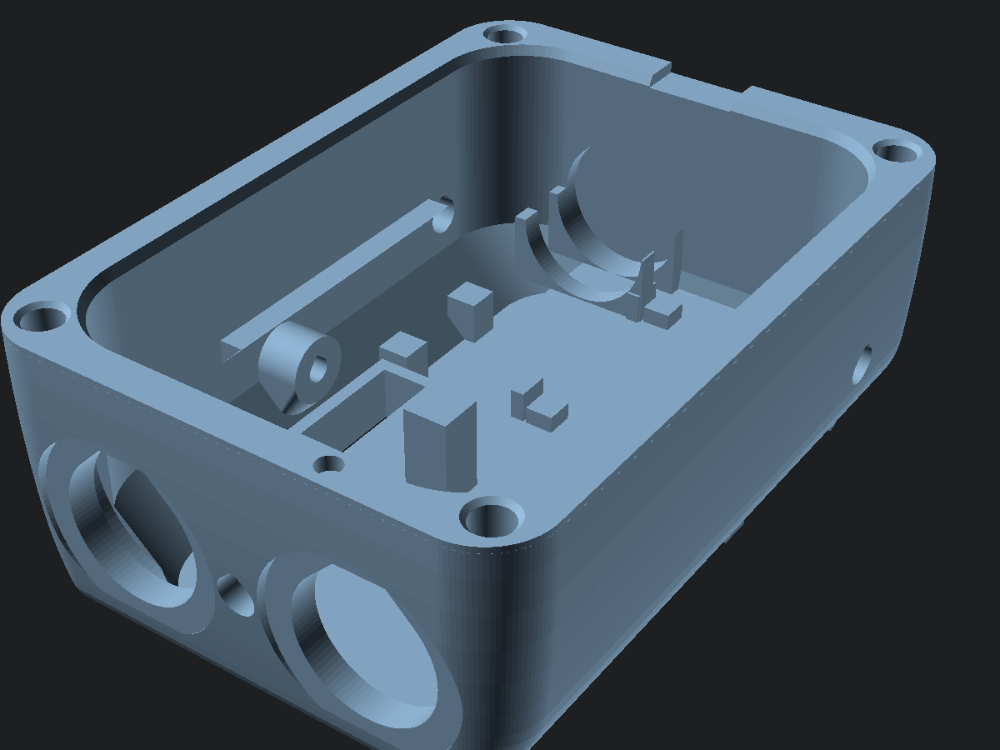 | 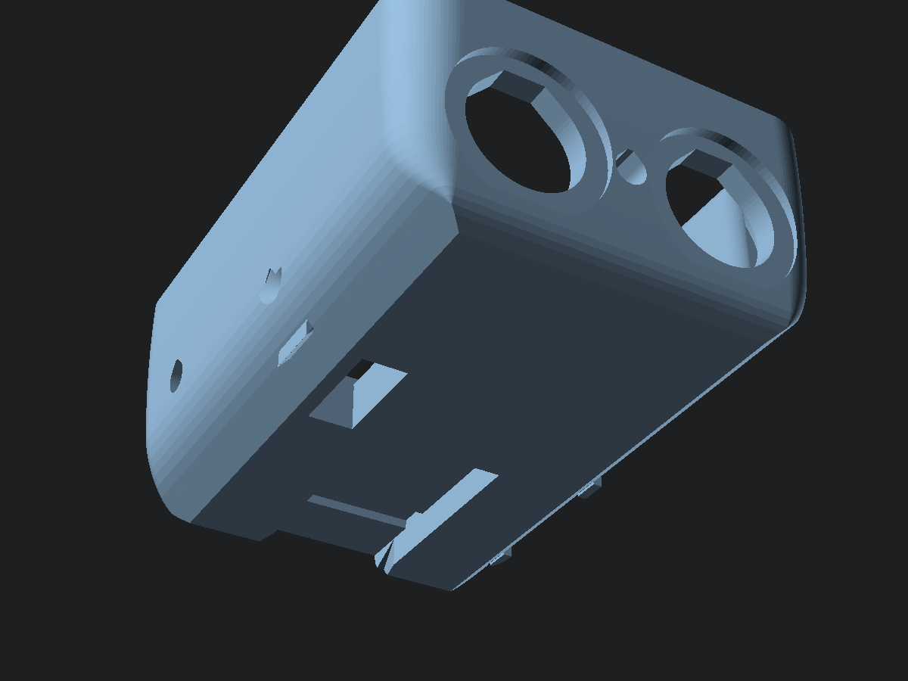 |
| **Façade (intérieur, jupe et gorge)** | **Façade (côté visible)** |
| 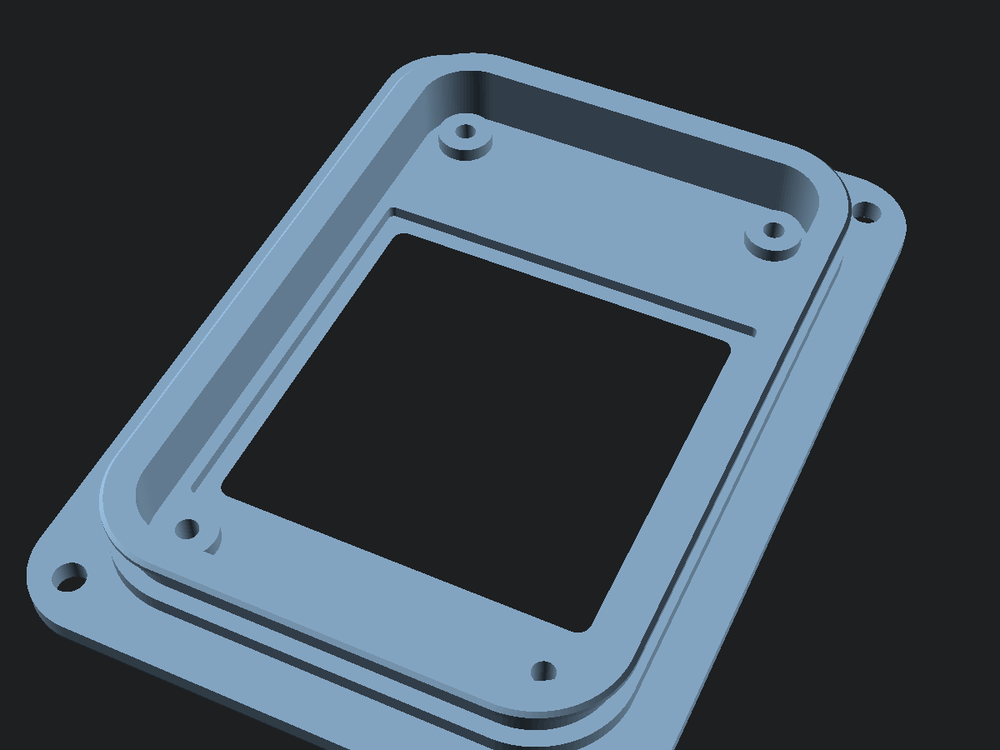 | 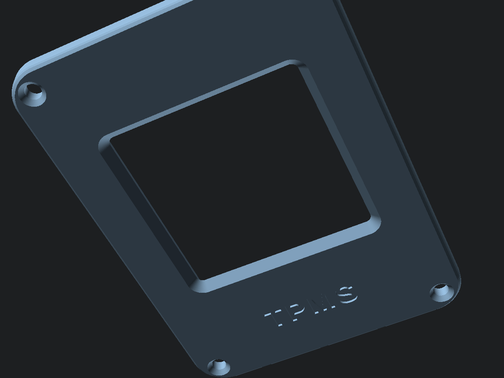 |

---

## 10. Cotes à vérifier à la réception du matériel

Chaque valeur se corrige dans `boitier.scad` ; le boîtier se recalcule et les `assert` signalent un conflit. Relancer ensuite `exporter.js` et `verifier-interferences.js`.

| Composant | À mesurer | Paramètre | Valeur actuelle |
|---|---|---|---|
| Écran WeAct | Circuit, entraxe et Ø des trous | `ep_pcb_x`, `ep_pcb_y`, `ep_trou_ex`, `ep_trou_ey`, `ep_trou_d` | 32,6 × 50,0 ; 27,0 × 44,4 ; Ø 2,2 |
| | **Position de la zone active** (afficher un cadre noir) | `ep_aa_decal` | 2,86 vers l'avant |
| | Épaisseur du circuit, hauteur des composants au dos et du connecteur J2 | `ep_pcb_ep`, `ep_dos_h`, `ep_wafer_h` | 1,6 / 2,0 / 3,5 |
| XIAO nRF52840 | Épaisseur du circuit, hauteur des composants, dépassement de la prise USB-C | `xiao_pcb`, `xiao_haut`, `usb_depasse` | 1,2 / 3,5 / 1,0 |
| Batterie | Épaisseur, largeur, longueur **avec** la protection | `bat_ep`, `bat_larg`, `bat_long`, `bat_pcb` | 5 × 30 × (35 + 3) |
| Boutons 12 mm | **Écrou sur les angles** (il fixe la hauteur du boîtier), tête, corps, longueur, épaisseur de panneau admise | `bt_ecrou_d`, `bt_tete_d`, `bt_corps_d`, `bt_prof` | 16,5 / 15 / 13 / 17 |
| Buzzer | Diamètre, hauteur | `buz_d`, `buz_h` | 12 / 9,5 |
| LED | Collerette, longueur | `led_collerette`, `led_long` | 3,8 / 5,3 |
| Connecteur magnétique | Face, profondeur | `cm_l`, `cm_h`, `cm_prof` | 11 × 4,5 × 5 |
| Câble du reed | Diamètre | `reed_cable_d` | 2,5 |
| Plaquette | Taille une fois câblée | `plaq` | 12 × 14 × 4 |
| Joints du kit | Y a-t-il un 53 × 1,8 (ou 52–54 × 1,78–2) ? | `jt_di`, `jt_d` | 53 × 1,8 |
| Inserts | Ø extérieur, longueur, perçage conseillé | `ins_trou_d`, `ins_long` | 3,2 / 4 |
| Cintre | Diamètre à l'endroit du collier | `cintre_d` | 22,2 |
| Imprimante | Résultats de `test_jeux` et `essai_joint` | `jeu_*` | § 4 |

---

## 11. Ce qui reste une hypothèse

- **Les cotes marquées [HYPOTHÈSE]** (§ 3), surtout l'**écrou des boutons** (il fixe la hauteur : avec un écrou de 15 mm au lieu de 16,5, le boîtier perd 1,5 mm), la position de la zone active de l'écran et le connecteur magnétique.
- **La précision de l'imprimante** sur l'alésage et la gorge : d'où `essai_joint`.
- **L'étanchéité réelle** (collages compris), à valider par les essais du § 8.
- **Le son du buzzer** à travers 1,2 mm de PETG.
- **La portée radio** de la XIAO dans le boîtier fermé (antenne sous le circuit de l'écran, capteurs à ≈ 1 m).
- **La tenue du cran** dans le temps (fluage du PETG) et la force de déverrouillage : à essayer avec l'échantillon de rail de `test_jeux`.
- **Le collier** n'a pas été essayé sur un vrai cintre (serrage, rotation sous les chocs) : la bande de chambre à air est indispensable.
