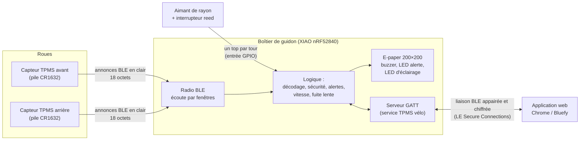

# Architecture du projet

Projet BTS CIEL option IR – Thibault MORRETTON – Épreuve E6 « Valorisation de la donnée et cybersécurité ».

Ce document présente les trois parties du kit (capteurs, boîtier, application), le simulateur qui permet de tout mettre au point avant d'avoir le matériel, et le principe qui relie le tout : **la logique est séparée des sources de données**.

---

## 1. Vue d'ensemble du système

Le kit comprend trois parties matérielles et logicielles :

| Partie | Matériel | Rôle | Programme |
|---|---|---|---|
| Capteurs de roue | 2 capteurs TPMS BLE du commerce, vissés sur les valves Schrader | Mesurer pression, température et niveau de pile, puis les diffuser en annonces BLE (en clair) | Programme du fabricant, non modifiable |
| Boîtier de guidon | Seeed XIAO nRF52840, écran e-paper 1,54″ 200×200 (SSD1681), LiPo 500 mAh, reed + aimant, 2 boutons, buzzer, LED | Recevoir les trames, calculer vitesse/distance, déclencher les alertes, afficher, dialoguer avec l'application | `firmware/` (à écrire à la réception du matériel) |
| Application | Téléphone ou PC : Chrome (PC, Android) ou Bluefy (iPhone) | Affichage des mesures, réglages, historique des pressions, détection de fuite très lente | `app/` (en cours) |

Le téléphone de Thibault est un iPhone. Safari n'implémente pas Web Bluetooth ; l'application web sera donc utilisée sur iPhone avec le navigateur gratuit **Bluefy**, qui implémente Web Bluetooth, et sur PC ou Android avec **Chrome**. Une application Flutter a été écartée parce que compiler pour iOS exige un Mac.



Deux liaisons radio très différentes coexistent :

- **Capteurs → boîtier** : annonces BLE diffusées par les capteurs du commerce, sans connexion, sans chiffrement ni signature. Le boîtier ne peut que trier ce qu'il reçoit (voir `analyse-de-risques.md`).
- **Boîtier ↔ application** : connexion BLE que nous maîtrisons, appairée par un code à 6 chiffres affiché sur l'e-paper, puis chiffrée (voir `protocole-ble.md`).

---

## 2. Principe : la logique séparée des sources de données

### 2.1 L'idée

Tout ce qui « réfléchit » (décoder une trame, décider qu'un pneu est en crevaison, calculer une vitesse, détecter une fuite, refuser une trame suspecte) est écrit **une seule fois**, sous forme de fonctions pures :

- elles reçoivent des données (octets d'une trame, instant en millisecondes, réglages) et renvoient un résultat ;
- elles ne touchent ni à la page web, ni à l'horloge, ni à la radio.

Ce qui fournit les données (un capteur simulé dans le navigateur, ou une vraie annonce BLE reçue par le nRF52840) est une **source de données**, interchangeable. Le boîtier ne fait pas la différence entre une trame produite par le capteur simulé (`simulateur/monde/capteur.js`) et une trame venant d'un vrai capteur : ce sont les mêmes 18 octets.

Conséquence pratique : le temps est toujours passé en paramètre (`maintenantMs`). Dans le simulateur, c'est l'horloge simulée (qui peut être accélérée × 600) ; dans le firmware, ce sera `millis()`. C'est ce qui permet de tester en une fraction de seconde un scénario de 20 minutes (fuite lente) ou une attaque complète.

### 2.2 Les trois niveaux de code

| Niveau | Dossier | Contenu | Utilisé par |
|---|---|---|---|
| Logique pure | `logique/` | Fonctions sans état global ni accès matériel | Simulateur, application, firmware (traduit en C++) |
| Comportement du boîtier | `simulateur/boitier/` | Boucle principale, liaison avec l'app, dessin de l'écran | Simulateur ; traduit en C++ dans le firmware |
| Monde simulé | `simulateur/monde/`, `simulateur/moteur.js`, `simulateur/sources/` | Physique du pneu, capteurs TPMS, vélo et cycliste, parcours, météo, radio BLE, LiPo et circuit, pirate | Simulateur uniquement |
| Interface | `simulateur/app.js`, `simulateur/vues/` | Affichage : boîtier, carte, graphes, schéma animé | Simulateur uniquement |

### 2.3 Les fichiers de `logique/`

| Fichier | Rôle | Fonctions principales |
|---|---|---|
| `logique/trame.js` | Codage et décodage des trames TPMS de 18 octets (format supposé) | `encoderTrame`, `decoderTrame`, `lireInt32LE`, `trameEnHexa` |
| `logique/vitesse.js` | Vitesse, distance, moyenne, maximum à partir des tops du reed ; anti-rebond 40 ms ; arrêt après 3 s sans top | `creerCompteur`, `compteurTop`, `compteurVitesseKmh`, `compteurDistanceKm` |
| `logique/fuite.js` | Historique (1 point / 30 s, 40 points = 20 min) et pente par régression linéaire (moindres carrés), en bar/h, après au moins 10 min de données ; la fonction de calcul de pente est réutilisée par l'application | `historiqueAjouter`, `historiquePenteBarH` |
| `logique/alertes.js` | État de chaque pneu, du plus grave au moins grave : INTRUSION, ATTENTE, PERDU, CREVAISON, BASSE, HAUTE, FUITE, OK | `evaluerRoue`, `seuilsParDefaut`, `estAlerte`, `texteEtat` |
| `logique/securite.js` | Protections contre les faux capteurs : liste blanche, vraisemblance, rythme | `positionCapteur`, `verifierVraisemblance`, `controlerRythme` |
| `logique/protocole.js` | Format des caractéristiques BLE boîtier ↔ app ; contrôle des réglages | `encoderMesures`, `decoderMesures`, `encoderReglages`, `decoderReglages`, `verifierReglages` |
| `logique/energie.js` | Consommations par état et bilan d'une journée type ; durée de vie des piles des capteurs | `consoInstantaneeMa`, `bilanJournee`, `dureeViePileCapteurJours` |

### 2.4 Les fichiers de `simulateur/`

| Fichier | Rôle |
|---|---|
| `simulateur/boitier/boitier.js` | Le « cerveau » du boîtier, équivalent de `loop()` : écoute radio par fenêtres (2 s toutes les 5 s), passage des trames dans les protections, évaluation des alertes, sorties (bip, LED), rafraîchissement de l'écran seulement si l'image change, mise en veille |
| `simulateur/boitier/liaison.js` | Côté boîtier de la liaison avec l'app : code d'appairage affiché, blocage après 3 codes faux, refus des réglages sans appairage, contrôle des réglages reçus |
| `simulateur/boitier/ecran.js` | Mise en page de l'écran 200×200 à partir d'une « vue » (valeurs à afficher) |
| `simulateur/boitier/epaper.js` | Mémoire d'image et primitives de dessin, nommées comme Adafruit GFX (`fillRect`, `drawRect`…) |
| `simulateur/boitier/police5x7.js` | Police bitmap 5×7, la même table sera copiée en C |
| `simulateur/monde/atmosphere.js` | Pression atmosphérique selon l'altitude, météo heure par heure (température, soleil, vent, pluie) |
| `simulateur/monde/pneu.js` | Chambre à air : loi des gaz parfaits, échauffement, perméation (butyle, latex, tubeless), écoulement par les trous (crevaison, fuite lente), pompe |
| `simulateur/monde/capteur.js` | Électronique du capteur TPMS : mesure absolue moins 1013 hPa (erreur en altitude), décalage et bruit, plage limitée à 3,5 bar, détection du roulage, pile CR1632 |
| `simulateur/monde/parcours.js` | 4 parcours réels approchés autour de Lyon : altitude, pente, virages, revêtement, feux |
| `simulateur/monde/velo.js` | Dynamique du vélo (poids, roulement selon la pression, air, freins), cycliste (puissance, feux, virages, crevaison), rotation des roues et passages de l'aimant |
| `simulateur/monde/radio.js` | Propagation BLE (distance, ombrage, évanouissement, masquage par la jante), canaux 37/38/39, collisions, Wi-Fi, brouillage |
| `simulateur/monde/lipo.js`, `circuit.js` | Batterie LiPo et chargeur ; tensions et courants de chaque composant du schéma |
| `simulateur/monde/alea.js` | Hasard reproductible (graine) : même graine et mêmes actions donnent la même sortie |
| `simulateur/moteur.js` | Assemble le monde et le fait avancer pas à pas ; journal des actions pour le rejeu |
| `simulateur/vues/` | Graphes, carte et profil, vue radio de dessus, schéma électrique animé |
| `simulateur/sources/pirate.js` | Attaquant : usurpation d'identité (fausse pression) ou rejeu de trames enregistrées |
| `simulateur/app.js`, `index.html`, `style.css` | Interface du simulateur : fait avancer le monde au rythme choisi, transmet les actions, affiche le résultat |
| `simulateur/tests/` | 399 tests automatiques en 6 suites (`node simulateur/tests/tout.js`) |

### 2.5 Portage vers le firmware et l'application

Le code JavaScript est volontairement écrit dans un style proche du C :

- pas de modules ES : toutes les fonctions sont rangées dans un objet global `TPMS`, pour que la page s'ouvre par double-clic, sans serveur ;
- des tableaux d'octets (`Uint8Array`) qui deviendront des `uint8_t[]` ;
- des objets d'état simples (`creerCompteur`, `creerRythme`…) qui deviendront des `struct` ;
- des durées en millisecondes comme `millis()` ;
- les commentaires donnent l'équivalent C quand il n'est pas évident (par exemple `memcmp(nouvelle, ancienne, 5000)` pour comparer deux images).

| Cible | Ce qui est repris | Comment |
|---|---|---|
| Firmware (`firmware/`) | `logique/*.js` sauf `energie.js`, et `simulateur/boitier/*.js` | Traduction en C++ sans changer le fonctionnement ; les sources simulées sont remplacées par le scan BLE, l'interruption du reed et les boutons |
| Application (`app/`) | `logique/protocole.js` (décodage de MESURES, codage de REGLAGES, contrôle des réglages avant envoi), `logique/fuite.js` (calcul de pente), `logique/alertes.js`, `logique/trame.js` | Fichiers JavaScript inclus tels quels par `app/index.html` |
| Simulateur | Tout | Chargement par balises `<script>` |

`logique/energie.js` ne sert qu'au simulateur et au dossier (`bilan-energetique.md`) : il n'a pas sa place dans le firmware.

---

## 3. Le simulateur : une simulation complète

Le projet est devenu un **logiciel de simulation complète** : tout ce qui se passerait dans la réalité est calculé, sans matériel. Le boîtier simulé exécute la même logique que le firmware ; autour de lui, `simulateur/moteur.js` fait vivre un monde physique.

À chaque pas de temps (50 ms quand il se passe quelque chose, 1 s vélo garé), le moteur enchaîne :

1. heure du jour et météo, position sur le parcours (altitude, pente, revêtement) ;
2. commande du cycliste, puis dynamique du vélo : vitesse, rotation des roues, passages de l'aimant devant le reed ;
3. pneus : température de l'air, pression par la loi des gaz, fuites par les trous ;
4. capteurs TPMS : mesure, pile, annonces BLE ; vélos voisins équipés ; pirate ;
5. radio : position de chaque émetteur (la valve tourne avec la roue), affaiblissement, collisions, fenêtres d'écoute du boîtier ;
6. boîtier : trames reçues, tops du reed, mise à jour chaque seconde ;
7. électronique : courants de chaque composant selon l'état du boîtier, décharge ou recharge de la LiPo ; batterie vide, boîtier éteint ;
8. enregistrement d'un point (chaque seconde en roulant, chaque minute vélo garé).

Toutes les actions de l'utilisateur passent par `TPMS.mondeAction`, qui les horodate : une sortie peut être sauvée en fichier (réglages + actions) et rejouée à l'identique.

La page comporte huit sections, à côté du boîtier toujours visible :

| Section | Contenu |
|---|---|
| §1 Sortie | Choix du parcours, de la météo, de l'heure, des chambres, des pressions et de la graine ; carte, profil d'altitude, mesures instantanées |
| §2 Pneus | État physique de chaque pneu et de son capteur, crevaisons (épine, pincement, valve), fuite lente, réparation, pompe ; courbe pression réelle / pression retenue ; trames décodées |
| §3 Radio | Vue de dessus (vélo ou alentours), devenir des annonces (reçue, radio coupée, trop faible, collision, corrompue, brouillée), RSSI, trafic |
| §4 Boîtier | Réglages, compteurs (dont circonférence réglée / réelle), journal |
| §5 Électronique | Schéma animé (courants, tensions), batterie LiPo et recharge, courants par composant, bilan d'une journée type |
| §6 Application | L'application de `app/` reliée au boîtier simulé |
| §7 Cybersécurité | Pirate (usurpation, rejeu, brouillage ; position, puissance, cadence), protections, vérité terrain |
| §8 Données | Courbes de tout l'enregistrement, statistiques, export CSV, sauvegarde et rejeu de scénario |

### Application intégrée au simulateur

L'application (`app/`) ne parle jamais directement à la radio : elle passe par un **transport** qui offre les mêmes fonctions (`connecter`, `saisirCode`, `lireReglages`, `ecrireReglages`, `commande`, `surMesures`…) dans deux versions :

| Transport | Fichier | Utilisation |
|---|---|---|
| Bluetooth réel | `app/transport-ble.js` | Web Bluetooth (Chrome, Bluefy) ; l'appairage par code est géré par le système du téléphone |
| Simulé | `app/transport-simule.js` | Application ouverte dans le simulateur (`app/index.html?transport=simule`) ; échange de messages `postMessage` avec le boîtier virtuel, en transportant **les mêmes octets** que la vraie liaison |

C'est le même principe que pour les capteurs : la source de données change, la logique reste identique.

---

## 4. Organisation du dépôt

```
projet-tpms-velo/
├── README.md              présentation générale
├── CLAUDE.md              contexte de travail (décisions prises)
├── logique/               logique pure, partagée (simulateur, app, firmware)
│   ├── trame.js
│   ├── vitesse.js
│   ├── fuite.js
│   ├── alertes.js
│   ├── securite.js
│   ├── protocole.js
│   └── energie.js
├── simulateur/            simulation complète (page web)
│   ├── index.html, app.js, style.css, moteur.js
│   ├── boitier/           boitier.js, liaison.js, ecran.js, epaper.js, police5x7.js
│   ├── monde/             alea, atmosphere, pneu, capteur, parcours, velo, radio, lipo, circuit
│   ├── sources/           pirate.js
│   ├── vues/              graphe.js, carte.js, schema.js
│   └── tests/             tout.js et 6 suites
├── app/                   application Web Bluetooth (en cours)
│   ├── index.html, app.js, app.css
│   └── transport-ble.js, transport-simule.js
├── firmware/              programme du boîtier (à la réception du matériel)
└── docs/                  ce dossier
```

---

## 5. Lancer le simulateur et les tests

### Simulateur

Ouvrir `simulateur/index.html` dans un navigateur (double-clic). Rien à installer : aucune bibliothèque JavaScript externe, aucun serveur. Seules les polices de caractères sont chargées depuis Google Fonts ; sans connexion Internet, le navigateur utilise une police de remplacement.

### Application

- Dans le simulateur : section §3.
- Avec le vrai boîtier : la page `app/index.html` doit être servie en HTTPS (exigence de Web Bluetooth), puis ouverte dans Chrome (PC, Android) ou dans Bluefy (iPhone).

### Tests

Les tests sont répartis en 6 suites, 399 au total : logique et boîtier (102), pneu, météo et capteur (72), vélo et parcours (62), radio (62), électronique (80), monde complet de bout en bout (21). Pour tout lancer : `node simulateur/tests/tout.js`. Le détail ci-dessous concerne la première suite.

En ligne de commande, depuis la racine du dépôt (Node.js requis) :

```
node simulateur/tests/tests.js
```

La dernière ligne affiche le bilan, par exemple `102 réussis, 0 en échec`. En cas d'échec, le code de sortie vaut 1 et la ligne fautive est marquée `ÉCHEC` avec la valeur obtenue.

Dans le navigateur : ouvrir `simulateur/tests/tests.html`. Le titre de l'onglet indique si tous les tests passent.

Répartition des tests :

| Domaine | Nombre |
|---|---|
| Trames TPMS | 14 |
| Vitesse et distance | 8 |
| Fuite lente | 4 |
| Alertes | 9 |
| Boîtier complet | 12 |
| Sécurité (dont scénarios pirate) | 20 |
| Protocole boîtier ↔ application | 13 |
| Liaison (appairage par code) | 11 |
| Énergie | 5 |
| Écran | 5 |
| **Total** | **101** |

---

## 6. Documents liés

- `cahier-des-charges.md` : besoin, exigences et critères de validation.
- `analyse-de-risques.md` : menaces, protections et risques résiduels.
- `bilan-energetique.md` : consommation et autonomie.
- `protocole-ble.md` : format des trames et de la liaison boîtier ↔ application.
