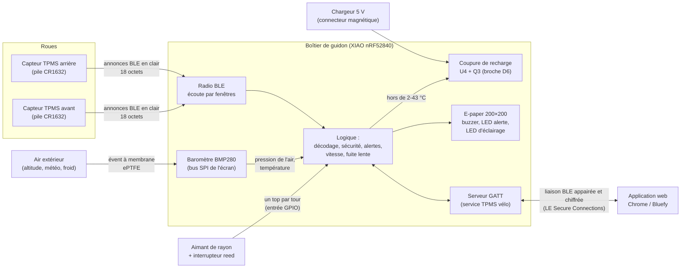
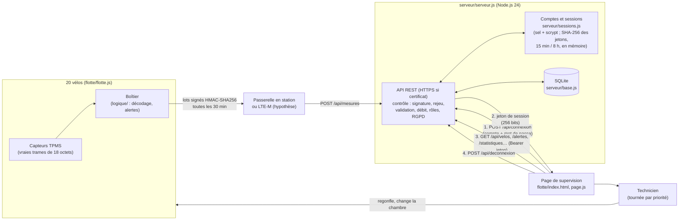

# Architecture du projet

Projet BTS CIEL option IR – Thibault MORRETTON – Épreuve E6 « Valorisation de la donnée et cybersécurité ».

Ce document présente les trois parties du kit (capteurs, boîtier, application), le simulateur qui permet de tout mettre au point avant d'avoir le matériel, le mode flotte (serveur pour une entreprise de location), le boîtier imprimé en 3D, et le principe qui relie le tout : **la logique est séparée des sources de données**.

---

## 1. Vue d'ensemble du système

Le kit comprend trois parties matérielles et logicielles :

| Partie | Matériel | Rôle | Programme |
|---|---|---|---|
| Capteurs de roue | 2 capteurs TPMS BLE du commerce, vissés sur les valves Schrader | Mesurer pression, température et niveau de pile, puis les diffuser en annonces BLE (en clair) | Programme du fabricant, non modifiable |
| Boîtier de guidon | Seeed XIAO nRF52840, écran e-paper 1,54″ 200×200 (SSD1681), baromètre BMP280 sous un évent à membrane, LiPo 500 mAh avec coupure de la recharge par grand froid, reed + aimant, 2 boutons sur une seule broche, buzzer, LED | Recevoir les trames, corriger l'erreur d'altitude des capteurs, calculer vitesse/distance, déclencher les alertes, afficher, dialoguer avec l'application, protéger la batterie | `firmware/` (traduction C++ de la logique, testée sur PC par 136 tests ; à essayer sur la carte à la réception du matériel) |
| Application | Téléphone ou PC : Chrome (PC, Android) ou Bluefy (iPhone) | Affichage des mesures, réglages, historique des pressions, détection de fuite très lente | `app/` (en cours) |

Le téléphone de Thibault est un iPhone. Safari n'implémente pas Web Bluetooth ; l'application web sera donc utilisée sur iPhone avec le navigateur gratuit **Bluefy**, qui implémente Web Bluetooth, et sur PC ou Android avec **Chrome**. Une application Flutter a été écartée parce que compiler pour iOS exige un Mac.



Deux liaisons radio très différentes coexistent :

- **Capteurs → boîtier** : annonces BLE diffusées par les capteurs du commerce, sans connexion, sans chiffrement ni signature. Le boîtier ne peut que trier ce qu'il reçoit (voir `analyse-de-risques.md`).
- **Boîtier ↔ application** : connexion BLE que nous maîtrisons, appairée par un code à 6 chiffres affiché sur l'e-paper, puis chiffrée (voir `protocole-ble.md`).

---

## 2. Principe : la logique séparée des sources de données

### 2.1 L'idée

Tout ce qui « réfléchit » (décoder une trame, décider qu'un pneu est en crevaison, calculer une vitesse, détecter une fuite, refuser une trame suspecte) est écrit **une seule fois**, sous forme de fonctions pures :

- elles reçoivent des données (octets d'une trame, instant en millisecondes, réglages) et renvoient un résultat ;
- elles ne touchent ni à la page web, ni à l'horloge, ni à la radio.

Ce qui fournit les données (un capteur simulé dans le navigateur, ou une vraie annonce BLE reçue par le nRF52840) est une **source de données**, interchangeable. Le boîtier ne fait pas la différence entre une trame produite par le capteur simulé (`simulateur/monde/capteur.js`) et une trame venant d'un vrai capteur : ce sont les mêmes 18 octets.

Conséquence pratique : le temps est toujours passé en paramètre (`maintenantMs`). Dans le simulateur, c'est l'horloge simulée (qui peut être accélérée jusqu'à × 3 600) ; dans le firmware, ce sera `millis()`. C'est ce qui permet de tester en une fraction de seconde un scénario de 20 minutes (fuite lente) ou une attaque complète.

### 2.2 Les quatre niveaux de code

| Niveau | Dossier | Contenu | Utilisé par |
|---|---|---|---|
| Logique pure | `logique/` | Fonctions sans état global ni accès matériel | Simulateur, application, firmware (traduit en C++) |
| Comportement du boîtier | `simulateur/boitier/` | Boucle principale, liaison avec l'app, dessin de l'écran | Simulateur ; traduit en C++ dans le firmware |
| Monde simulé | `simulateur/monde/`, `simulateur/moteur.js`, `simulateur/sources/` | Physique du pneu, capteurs TPMS, vélo et cycliste, parcours, météo, radio BLE, LiPo et circuit, pirate | Simulateur uniquement |
| Interface | `simulateur/app.js`, `simulateur/vues/` | Affichage : boîtier, carte, graphes, schéma animé | Simulateur uniquement |

### 2.3 Les fichiers de `logique/`

| Fichier | Rôle | Fonctions principales |
|---|---|---|
| `logique/trame.js` | Codage et décodage des trames TPMS de 18 octets (format supposé) | `encoderTrame`, `decoderTrame`, `lireInt32LE`, `trameEnHexa` |
| `logique/vitesse.js` | Vitesse, distance, moyenne, maximum à partir des tops du reed ; anti-rebond 40 ms ; arrêt après 3 s sans top | `creerCompteur`, `compteurTop`, `compteurVitesseKmh`, `compteurDistanceKm` |
| `logique/fuite.js` | Historique (1 point / 30 s, 40 points = 20 min) de la pression ramenée à 20 °C (loi des gaz parfaits), et pente par régression linéaire (moindres carrés), en bar/h, après au moins 10 min de données. **Prévision du prochain regonflage** : un relevé au plus toutes les 3 h (30 au plus), perte en bar/jour, jours avant le seuil bas. Les fonctions de pente et de jours restants sont réutilisées par l'application | `pressionCompenseeBar`, `historiqueAjouter`, `historiquePenteBarH`, `creerReleves`, `relevesAjouter`, `predireRegonflage`, `joursAvantSeuil`, `texteJours` |
| `logique/alertes.js` | État de chaque pneu, du plus grave au moins grave : INTRUSION, ATTENTE, PERDU, CREVAISON, BASSE, HAUTE, FUITE, OK ; capteur perdu après 60 s sans trame en mouvement, 600 s sinon (c'est le boîtier qui décide « en mouvement » : au-dessus de 10 km/h) ; hystérésis de 0,05 bar sur les alertes basse et haute (`HYSTERESIS_ALERTE_BAR`), pour qu'une pression qui oscille autour d'un seuil ne rallume pas l'alerte en boucle | `evaluerRoue`, `seuilsParDefaut`, `estAlerte`, `texteEtat` |
| `logique/securite.js` | Protections contre les faux capteurs : liste blanche, vraisemblance, rythme (deux trames rapprochées ne comptent pas si la pression baisse : rafale d'une vraie crevaison) | `positionCapteur`, `verifierVraisemblance`, `controlerRythme` |
| `logique/protocole.js` | Format des caractéristiques BLE boîtier ↔ app ; contrôle des réglages ; repérage des changements « sensibles » (protection coupée, capteur changé) qui demandent un appui long sur le bouton 2 du boîtier | `encoderMesures`, `decoderMesures`, `encoderReglages`, `decoderReglages`, `verifierReglages`, `changementSensible`, `lignesSensibles` |
| `logique/barometre.js` | Ce que le boîtier tire de son baromètre BMP280 : **correction d'altitude** des capteurs (qui retirent 1 013,25 hPa fixes : (1 013,25 − air) / 1 000 bar), **recharge refusée** hors de 2 à 43 °C (hystérésis de 3 °C), **attente fixe** de fin de rafraîchissement de l'écran, plus longue au froid (le fil BUSY est supprimé) | `correctionAltitudeBar`, `pressionCorrigeeBar`, `blocageCharge`, `attenteEcranMs` |
| `logique/boutons.js` | Les deux boutons sur une seule broche (D5), lue en analogique : SW1 à 0 V, SW2 à ≈ 0,48 V à travers 2,2 kΩ ; seuils en proportion de VDD | `boutonDepuisTension` |
| `logique/energie.js` | Consommations par état et bilan d'une journée type ; durée de vie des piles des capteurs | `consoInstantaneeMa`, `bilanJournee`, `dureeViePileCapteurJours` |
| `logique/statistiques.js` | Statistiques par jour et par semaine à partir de l'enregistrement : distance, minutes de roulage, pression moyenne en roulant et minimale, regonflages, minutes en alerte, énergie consommée par le boîtier | `statistiquesParJour`, `statistiquesParSemaine` |
| `logique/conseil.js` | Pression conseillée selon le poids du cycliste, la largeur du pneu et la répartition du poids (pression proportionnelle à la charge de la roue ; **hypothèse** : ordre de grandeur) | `pressionReferenceBar`, `pressionConseillee` |
| `logique/sha256.js` | SHA-256 et HMAC-SHA256 écrits sans bibliothèque, vérifiés avec les vecteurs officiels (FIPS 180-4, RFC 4231) | `sha256`, `hmacSha256`, `texteEnOctets`, `enHexa` |
| `logique/journal.js` | Journal de sécurité chaîné : chaque ligne contient l'empreinte SHA-256 de la précédente ; 64 lignes et une « ancre » | `creerJournalSecurise`, `journalAjouter`, `journalVerifier`, `journalDerniereEmpreinte` |
| `logique/trame2.js` | **Proposition** de trame « version 2 » de 26 octets : adresse privée changée toutes les 15 min, compteur anti-rejeu, signature HMAC (voir `protocole-ble.md`, § 2.7) | `adressePrivee`, `adresseResolue`, `encoderTrameV2`, `decoderTrameV2`, `signatureValide` |

### 2.4 Les fichiers de `simulateur/`

| Fichier | Rôle |
|---|---|
| `simulateur/boitier/boitier.js` | Le « cerveau » du boîtier, équivalent de `loop()` : écoute radio par fenêtres (3 s toutes les 5 s, position de la fenêtre changée à chaque période par `melangerEntier`), écoute renforcée de 15 s après une trame douteuse (`boitierEcouteRenforcee`), passage des trames dans les protections (ou, avec des capteurs v2, vérification de l'adresse privée, de la signature et du compteur), détection d'inondation (`boitierSurveillerSaturation`), historique compensé en température et relevés pour la prévision du regonflage, évaluation des alertes (délai de perte « en roulant » seulement au-dessus de 10 km/h, `VITESSE_ROULAGE_SURE_KMH`), journal recopié dans le journal chaîné, sorties (bip, LED), rafraîchissement de l'écran seulement si l'image change, mise en veille ; depuis le 24/10/2026 : mesure du baromètre toutes les 10 s (`boitierBarometre` : pression affichée et alertes corrigées de l'altitude, historique gardé en pression du capteur), coupure de la recharge par grand froid relâchée avant la veille, réveil par le 5 V du chargeur (`boitierChargeurBranche`) et radio coupée sur un chargeur bloqué, confirmation des changements sensibles par appui long sur le bouton 2 (`boitierBouton` ; les commandes de l'app passent par `boitierAction` et ne peuvent pas confirmer) |
| `simulateur/boitier/liaison.js` | Côté boîtier de la liaison avec l'app : code d'appairage affiché, blocage après 3 codes faux, refus des réglages sans appairage, contrôle des réglages reçus ; attaque de l'homme du milieu à l'appairage, avec ou sans code (`liaisonAttaqueHommeDuMilieu`) |
| `simulateur/boitier/ecran.js` | Mise en page de l'écran 200×200 à partir d'une « vue » (valeurs à afficher) |
| `simulateur/boitier/epaper.js` | Mémoire d'image et primitives de dessin, nommées comme Adafruit GFX (`fillRect`, `drawRect`…) |
| `simulateur/boitier/police5x7.js` | Police bitmap 5×7, la même table sera copiée en C |
| `simulateur/monde/atmosphere.js` | Pression atmosphérique selon l'altitude, météo heure par heure (température, soleil, vent, pluie) |
| `simulateur/monde/pneu.js` | Chambre à air : loi des gaz parfaits, échauffement, perméation (butyle, latex, tubeless), écoulement par les trous (crevaison, fuite lente), pompe |
| `simulateur/monde/capteur.js` | Électronique du capteur TPMS : mesure absolue moins 1013 hPa (erreur en altitude), décalage et bruit, plage réglable (0-3,5 bar par défaut, 0-5 ou 0-8 bar) avec saturation au-delà, détection du roulage (annonce toutes les 3 s en roulant, toutes les 60 s à l'arrêt ou sous 4,4 km/h, tout de suite en cas de chute brutale), pile CR1632 ; en option, capteur « v2 » (trame signée, adresse privée) |
| `simulateur/monde/parcours.js` | 4 parcours réels approchés autour de Lyon : altitude, pente, virages, revêtement, feux |
| `simulateur/monde/velo.js` | Dynamique du vélo (poids, roulement selon la pression, air, freins), cycliste (puissance, feux, virages, crevaison), rotation des roues et passages de l'aimant |
| `simulateur/monde/radio.js` | Propagation BLE (distance, ombrage, évanouissement, masquage par la jante), canaux 37/38/39, collisions, Wi-Fi, brouillage |
| `simulateur/monde/lipo.js`, `circuit.js` | Batterie LiPo et chargeur ; tensions et courants de chaque composant du schéma (34 repères depuis la révision C, dont le baromètre U3, l'interrupteur de recharge U4, Q3 et R10 à R12) |
| `simulateur/monde/barometre.js` | Le BMP280 dans le boîtier étanche et l'air autour de lui : avec évent (l'air du boîtier suit l'extérieur, τ ≈ 5 s, **hypothèse**), sans évent (l'air piégé ne voit pas l'altitude) ou absent ; erreur propre à chaque exemplaire (±1 hPa, ±1 °C) et bruit | 
| `simulateur/moteur.js` (baromètre et recharge) | Température du boîtier qui suit l'air avec retard (τ ≈ 20 min, **hypothèse**) ; sur son chargeur, le boîtier est « à la maison » à 19 °C, sauf option « recharge dehors » ; options « Baromètre du boîtier » et « Recharge du boîtier » de la page Configuration |
| `simulateur/monde/alea.js` | Hasard reproductible (graine) : même graine et mêmes actions donnent la même sortie |
| `simulateur/moteur.js` | Assemble le monde et le fait avancer pas à pas ; à la création, règle la circonférence du boîtier sur la vraie roue et les seuils à 80 % et 125 % des pressions choisies ; poids du cycliste ; capteurs du commerce ou v2 (clés de 16 octets partagées avec le boîtier) ; réseau de récepteurs espions ; attaques « synchro » (pirate synchronisé) et « inondation » ; planning « semaine type » (`genererPlanning`) ; vélo garé tenu sur sa béquille ; journal des actions pour le rejeu |
| `simulateur/vues/` | Graphes, carte et profil, vue radio de dessus, schéma électrique animé, carte du pistage (`pistage.js` : récepteurs espions et trajet reconstitué) |
| `simulateur/sources/pirate.js` | Attaquant : usurpation d'identité (fausse pression) ou rejeu de trames enregistrées |
| `simulateur/sources/mouchards.js` | Espion de la vie privée : 20 récepteurs BLE posés le long des rues (environ tous les 700 m), qui notent chaque passage d'une adresse (`mouchardsEcouter`) ; reconstitution des trajets, des heures et du départ habituel (`mouchardsAnalyser`) |
| `simulateur/app.js`, `index.html`, `style.css` | Interface du simulateur : fait avancer le monde au rythme choisi, transmet les actions, affiche le résultat |
| `simulateur/tests/` | Tests automatiques : 6 suites, plus celles du serveur (`serveur/serveur.tests.js`) et de la version industrielle (`entrepot/entrepot.tests.js`), lancées ensemble par `node simulateur/tests/tout.js` (717 tests) |

### 2.5 Portage vers le firmware et l'application

Le code JavaScript est volontairement écrit dans un style proche du C :

- pas de modules ES : toutes les fonctions sont rangées dans un objet global `TPMS`, pour que la page s'ouvre par double-clic, sans serveur ;
- des tableaux d'octets (`Uint8Array`) qui deviendront des `uint8_t[]` ;
- des objets d'état simples (`creerCompteur`, `creerRythme`…) qui deviendront des `struct` ;
- des durées en millisecondes comme `millis()` ;
- les commentaires donnent l'équivalent C quand il n'est pas évident (par exemple `memcmp(nouvelle, ancienne, 5000)` pour comparer deux images).

| Cible | Ce qui est repris | Comment |
|---|---|---|
| Firmware (`firmware/`) | `logique/*.js` sauf `energie.js`, `statistiques.js` et `conseil.js`, et `simulateur/boitier/*.js` | Traduction en C++ sans changer le fonctionnement ; les sources simulées sont remplacées par le scan BLE, l'interruption du reed et les boutons |
| Application (`app/`) | `logique/protocole.js` (décodage de MESURES, codage de REGLAGES, contrôle des réglages avant envoi), `logique/fuite.js` (calcul de pente, jours avant le seuil bas), `logique/alertes.js`, `logique/trame.js` | Fichiers JavaScript inclus tels quels par `app/index.html` |
| Simulateur | Tout | Chargement par balises `<script>` |
| Flotte et serveur (`flotte/`, `serveur/`) | `logique/trame.js`, `fuite.js`, `alertes.js`, `securite.js` (et `sha256.js` pour le banc d'essai de la page), avec le modèle de pneu et de capteur du simulateur | Dans Node par `flotte/node.js` (le serveur utilise `node:crypto` pour le HMAC), dans la page par balises `<script>` |

Fichiers ajoutés au firmware le 24/10/2026 : `firmware/tpms_boitier/src/logique/barometre.h` et `barometre.cpp` (traduction de `logique/barometre.js`), `boutons.h` et `boutons.cpp` (traduction de `logique/boutons.js`), et, côté matériel, `firmware/tpms_boitier/src/materiel/barometre_bmp280.h` et `barometre_bmp280.cpp` (lecture du BMP280 sur le bus SPI partagé avec l'écran, bibliothèque Adafruit BMP280). Le câblage correspondant est dans `firmware/tpms_boitier/config.h` et `schema-electrique.md` (révision C).

`logique/energie.js` ne sert qu'au simulateur et au dossier (`bilan-energetique.md`) : il n'a pas sa place dans le firmware. `logique/statistiques.js` et `logique/conseil.js` travaillent sur des semaines de mesures ou sur le profil du cycliste : ils servent au simulateur et pourront servir à l'application, pas au boîtier.

---

## 3. Le simulateur : une simulation complète

Le projet est devenu un **logiciel de simulation complète** : tout ce qui se passerait dans la réalité est calculé, sans matériel. Le boîtier simulé exécute la même logique que le firmware ; autour de lui, `simulateur/moteur.js` fait vivre un monde physique.

À chaque pas de temps (50 ms quand il se passe quelque chose, 1 s vélo garé), le moteur enchaîne :

1. heure du jour et météo, position sur le parcours (altitude, pente, revêtement) ;
2. commande du cycliste, puis dynamique du vélo : vitesse, rotation des roues, passages de l'aimant devant le reed ;
3. pneus : température de l'air, pression par la loi des gaz, fuites par les trous ;
4. capteurs TPMS : mesure, pile, annonces BLE ; vélos voisins équipés ; pirate ;
5. radio : position de chaque émetteur (la valve tourne avec la roue), affaiblissement, collisions, fenêtres d'écoute du boîtier ;
6. boîtier : trames reçues, tops du reed, mise à jour chaque seconde ;
7. électronique : courants de chaque composant selon l'état du boîtier, décharge ou recharge de la LiPo ; batterie vide, boîtier éteint ;
8. enregistrement d'un point (chaque seconde en roulant, chaque minute vélo garé).

Toutes les actions de l'utilisateur passent par `TPMS.mondeAction`, qui les horodate : une sortie peut être sauvée en fichier (réglages + actions) et rejouée à l'identique. Les pas de temps sont fixes : le résultat ne dépend pas du découpage du temps, ce qui rend le rejeu exact.

**Planning « semaine type »** (option `planning: "semaine"`, 4 semaines) : du lundi au vendredi, trajet domicile-travail à 7 h 45 et à 17 h 30 ; samedi à 10 h et dimanche à 9 h 30, une sortie sur le parcours choisi ; dimanche de 20 h à 23 h, boîtier en charge, soit 14 événements par semaine. Le bouton « Avancer jusqu'à … » fait une avance rapide jusqu'au prochain événement, et s'arrête si une alerte apparaît. C'est cette simulation sur plusieurs jours qui a révélé les défauts décrits au § 6.5 de `analyse-de-risques.md` et au § 4.6 de `bilan-energetique.md`.

L'interface est un tableau de bord avec une barre latérale et huit pages :

| Page | Contenu |
|---|---|
| Vue d'ensemble | Démarrer la sortie ou avancer jusqu'à la prochaine ; pneus avant et arrière (pression, pression conseillée, prochain regonflage, mini-courbe, boutons Crevaison, Fuite lente, Regonfler) ; vélo (vitesse, avancement) ; boîtier de guidon (écran e-paper au pixel près, LED, buzzer, boutons 1 et 2) ; carte ; batterie ; sécurité ; événements |
| Configuration | Nouvelle simulation (parcours, déroulement : une sortie ou semaine type, météo, heure, chambres à air, pressions, poids du cycliste et pression conseillée, plage des capteurs, capteurs du commerce ou version 2, baromètre du boîtier avec évent, sans évent ou absent, recharge à la maison ou dehors, vélos équipés autour, graine) ; réglages du boîtier (circonférence, seuils, écoute radio, écran, veille, protections) |
| Pneus | Pression réelle et pression affichée par le boîtier ; dernières trames des capteurs (18 octets, ou 26 octets en version 2) |
| Radio et sécurité | Vue de dessus, devenir des annonces (reçue, radio coupée, trop faible, collision…), attaquant (usurpation, rejeu, brouillage, pirate synchronisé, inondation), protections du boîtier, journal de sécurité chaîné (vérifier, falsifier une ligne, copier l'empreinte sur le téléphone), trafic radio |
| Vie privée | Carte de ce que voient les récepteurs espions, trajet reconstitué, ce que l'espion a appris (trajets, heures, départ habituel), passages notés ; bouton « Relancer avec des capteurs v2 » |
| Électronique | Schéma électrique animé (courants, tensions), batterie LiPo 500 mAh, répartition du courant, autonomie sur une journée type ; température du boîtier, état de la recharge (coupée par grand froid ou non), baromètre et correction d'altitude |
| Application | L'application de `app/` reliée au boîtier simulé ; échanges de la liaison boîtier ↔ téléphone ; attaque de l'homme du milieu à l'appairage, avec ou sans code |
| Données | Courbes de tout l'enregistrement (pressions, températures, vitesse, altitude, batterie, piles des capteurs), bilan, statistiques par jour et par semaine, export CSV, sauvegarde et rejeu de scénario |

### Application intégrée au simulateur

L'application (`app/`) ne parle jamais directement à la radio : elle passe par un **transport** qui offre les mêmes fonctions (`connecter`, `saisirCode`, `lireReglages`, `ecrireReglages`, `commande`, `surMesures`…) dans deux versions :

| Transport | Fichier | Utilisation |
|---|---|---|
| Bluetooth réel | `app/transport-ble.js` | Web Bluetooth (Chrome, Bluefy) ; l'appairage par code est géré par le système du téléphone |
| Simulé | `app/transport-simule.js` | Application ouverte dans le simulateur (`app/index.html?transport=simule`) ; échange de messages `postMessage` avec le boîtier virtuel, en transportant **les mêmes octets** que la vraie liaison |

C'est le même principe que pour les capteurs : la source de données change, la logique reste identique.

---

## 4. Le mode flotte : architecture « entreprise »

### 4.1 L'histoire

Une entreprise de location équipe 20 vélos du kit. Les boîtiers envoient leurs mesures à un serveur, qui les garde, repère ce qu'un boîtier seul ne peut pas voir, et prépare la tournée du technicien. Le boîtier réel n'a pas de modem : le passage du boîtier au serveur se ferait par une passerelle dans chaque station ou par un module LTE-M (**hypothèse**). Le format des lots ne dépend pas de ce choix.

Ce que le serveur apporte (valorisation de la donnée) : le boîtier ne voit que les fuites rapides (−0,15 bar/h sur 20 min). Le serveur calcule une pente sur plusieurs jours (moindres carrés sur la pression ramenée à 20 °C, une mesure par demi-heure, 14 jours au plus depuis le dernier regonflage). Il repère ainsi des fuites de −0,15 à −0,5 bar/jour, en général en moins d'un jour et demi, sans fausse alerte sur 6 graines × 21 jours (pentes naturelles de −0,02 à −0,056 bar/jour, seuil à −0,10 bar/jour). La priorité de chaque vélo trie la tournée du technicien, qui regonfle ou change la chambre : la boucle est fermée.

### 4.2 Schéma



Sans serveur (GitHub Pages : https://titilyonnais.github.io/tpms-velo/flotte/, ou fichier ouvert directement), la page passe en **mode démo** : la même flotte tourne dans le navigateur, et un « serveur en mémoire » (`flotte/registre.js`) donne les mêmes réponses que l'API. Un bandeau le signale. Un test envoie 10 jours de flotte au vrai serveur et vérifie que les statistiques calculées en SQL sont identiques à celles du registre JavaScript : une seule logique, deux sources de données.

Les règles RGPD sont, elles aussi, écrites une seule fois dans `flotte/flotte-logique.js` et appliquées par les deux sources de données (`serveur/base.js` et `flotte/registre.js`) :
- **minimisation** (`TPMS.flotteMinimiserPosition`) : pendant une location, la position du vélo est celle du client ; elle n'est pas envoyée par le boîtier simulé, et le serveur la met à `null` avant stockage si un boîtier l'envoie quand même. La page liste les vélos en location sous la carte (« En location · position non conservée (RGPD) ») ;
- **durée de conservation** (`TPMS.FLOTTE_CONSERVATION`) : mesures et alertes 30 jours, journal des refus (adresses IP) 6 mois ; la limite est comptée depuis la mesure la plus récente reçue (`TPMS.flotteLimiteConservation`), car la simulation compresse le temps ; statistiques agrégées et regonflages conservés.

Accès (depuis le 24/10/2026) : on se **connecte** par `POST /api/connexion` avec un compte et un mot de passe ; le serveur ne garde que le sel et l'empreinte scrypt de chaque mot de passe, et répond de la même façon, dans le même temps, pour un compte inconnu. Il rend un **jeton de session** de 256 bits tiré au hasard, dont il ne garde que l'empreinte SHA-256, en mémoire. Toutes les lectures `GET /api/*` exigent ce jeton (`Authorization: Bearer`). La session se ferme après 15 min sans requête et au plus tard 8 h après la connexion ; 3 sessions au plus par compte ; `POST /api/deconnexion` la détruit côté serveur. Rôles « technicien » et « gestionnaire » (seul le second lit le journal des refus). La page de supervision affiche un formulaire compte + mot de passe quand elle parle au vrai serveur ; le mode démo fonctionne sans compte. Le serveur passe en HTTPS (port 8443, TLS 1.2 minimum, HSTS) dès qu'un certificat est présent dans `serveur/certificats/`, sinon il reste en HTTP (port 8080) avec un avertissement.

### 4.3 Les fichiers

| Fichier | Rôle |
|---|---|
| `flotte/flotte.js` | Simulation de la flotte : 20 vélos, 6 stations à Lyon, locations tirées au hasard (reproductibles par graine), modèle de pneu du simulateur au pas de 60 s, fuites lentes et crevaisons, boîtier qui décode de vraies trames, technicien qui passe chaque matin |
| `flotte/flotte-logique.js` | Règles pures partagées entre le serveur et la page : validation d'un lot, contrôle de la signature et du rejeu, minimisation de la position et durée de conservation (RGPD), tendance sur plusieurs jours, statut et priorité de chaque vélo, indicateurs |
| `flotte/registre.js` | « Serveur en mémoire » du mode démo, mêmes réponses que l'API, même minimisation et même purge (`registrePurger`) |
| `flotte/index.html`, `page.js`, `flotte.css` | Page de supervision : formulaire de connexion compte + mot de passe (jeton de session gardé en `sessionStorage`, « Se déconnecter » qui appelle `/api/deconnexion`, avertissement en HTTP), indicateurs, carte schématique des stations, vélos en location listés sans position, tournée triable par priorité, détail d'un vélo (courbe AV/AR ramenée à 20 °C, seuils), journal des alertes, statistiques, refus, banc d'essai de sécurité |
| `serveur/serveur.js` | Serveur HTTP ou HTTPS sans dépendance : routes de l'API (dont `/api/connexion` et `/api/deconnexion`), authentification des lots, rôles, limitation de débit (mots de passe faux compris), en-têtes de sécurité (HSTS en HTTPS), fichiers statiques (403 sur `serveur/` et les fichiers cachés) |
| `serveur/sessions.js` | Comptes à mot de passe (sel + scrypt, N = 2¹⁴, ≈ 50 ms et 16 Mo par essai ; compte fictif pour un compte inconnu) et sessions qui expirent (jeton de 256 bits, empreinte SHA-256, 15 min d'inactivité, 8 h au plus, 3 par compte) ; l'heure est passée en paramètre, comme dans la logique du boîtier, pour que les tests puissent « avancer l'horloge » |
| `serveur/base.js` | Schéma SQL commenté (tables `velos`, `mesures`, `alertes`, `regonflages`, `refus`) ; requêtes toujours paramétrées ; purge RGPD (`DELETE … WHERE t < ?`, index sur `t`) ; migration d'une ancienne base ; statistiques en SQL (`GROUP BY`, jointure sur `MAX(t)`, fonction `LAG` pour le temps moyen entre regonflages) |
| `serveur/flotte-vers-serveur.js` | Client : simule la flotte en accéléré et envoie des lots signés, en HTTP ou en HTTPS (`--https`, confiance explicite au certificat de démo) ; se connecte pour lire l'API (`--compte`, `--mot-de-passe`) ; options d'attaque (`--attaque-rejeu`, `--attaque-signature`) |
| `serveur/cles-demo.json`, `generer-cles-demo.js` | Clés HMAC des 20 vélos et mots de passe des comptes **de démonstration** (publics, hachés dès la lecture) ; `--nouveaux-mots-de-passe` en tire d'autres |
| `serveur/generer-certificat.js` | Certificat HTTPS **auto-signé** de démonstration pour `localhost` (openssl), dans `serveur/certificats/`, exclu de Git |
| `serveur/serveur.tests.js` | 133 tests : sécurité de l'API, débit, simulation de la flotte, bout en bout, connexion, sessions et rôles, RGPD (minimisation, conservation, migration), HTTPS |

Lancement, API et format des lots signés : `serveur/README.md`. Sécurité du serveur : `analyse-de-risques.md`, § 5.6 et § 6.14.

**Version industrielle (24/10/2026).** Le même principe s'étend à l'entrepôt : `entrepot/chariots.js` (modèle du monde : chariots, pneus, radio), `entrepot/passerelle.js` et `entrepot/mqtt.js` (sources de données : la passerelle écoute la radio et publie en MQTT), `entrepot/reception.js` (logique pure de réception des lots, sans base, utilisée par `serveur/chariots.js` qui enregistre en SQLite et par la page `flotte/chariots.html` en mode démo). Conception : `orientation-industrielle.md` ; maquette Docker : `entrepot/README.md`.

---

## 5. Le boîtier imprimé en 3D

`boitier-3d/boitier.scad` est un modèle OpenSCAD paramétré du boîtier de guidon (version 2 du 23/10/2026). Il produit 10 pièces : la coque et la façade du boîtier, le collier de cintre et sa bride, 4 demi-cales (cintres de 22,2 / 23,8 / 25,4 / 31,8 mm), la pièce de réglage des tolérances `test_jeux` et la pièce d'essai du joint `essai_joint` ; ainsi que des vues (ensemble, éclatée, coupe).

- **Dimensions** calculées à partir des composants : boîtier de 46,0 × 64,0 × 28,0 mm sans le collier, hauteur imposée par les écrous des boutons. Chaque cote indique sa source ([FICHE], [MESURÉ AU PLAN], [HYPOTHÈSE] ou [CHOIX]), et des `assert` arrêtent le calcul si une règle de conception n'est plus respectée.
- **Étanchéité** visée IPX7 : joint torique radial 53 × 1,8 NBR 70 dans une gorge de la jupe de la façade, 4 vis M2 dans des inserts laiton, hors du joint.
- **Fixation** : collier fendu et bride serrés par une vis M3 ; le boîtier glisse sur le collier par une queue d'aronde et se verrouille par une languette à cran ; il s'enlève sans outil.
- **Tolérances d'impression** en paramètres (`jeu_trou`, `jeu_glissant`, `jeu_joint`…), à régler avec `test_jeux` une fois l'imprimante connue.

Le modèle est rendu avec OpenSCAD 2021.01. `boitier-3d/outils/exporter.js` fait le rendu complet de chaque pièce, exporte les STL (`boitier-3d/stl/`) et les images (`boitier-3d/rendus/`), et vérifie que chaque pièce est fermée et d'un seul tenant (avec `outils/composantes-stl.js`). `boitier-3d/outils/verifier-interferences.js` place chaque pièce et chaque composant « fantôme » à sa position de montage et calcule leurs intersections (elles doivent être vides), puis vérifie que les parois de la coque font au moins 2 mm. Détails, impression, montage et essais : `boitier-3d/README.md`.

---

## 6. Organisation du dépôt

```
projet-tpms-velo/
├── README.md              présentation générale
├── CLAUDE.md              contexte de travail (décisions prises)
├── .github/workflows/     tests.yml : tests automatiques à chaque push (GitHub Actions)
├── logique/               logique pure, partagée (simulateur, app, firmware)
│   ├── trame.js, trame2.js        trames des capteurs (v1 du commerce, v2 proposée)
│   ├── vitesse.js
│   ├── fuite.js                   fuite lente et prévision du regonflage
│   ├── alertes.js
│   ├── securite.js
│   ├── sha256.js, journal.js      empreintes, HMAC, journal chaîné
│   ├── protocole.js
│   ├── barometre.js, boutons.js   correction d'altitude, recharge par grand froid, attente de l'écran ; deux boutons sur une broche
│   ├── statistiques.js, conseil.js
│   └── energie.js
├── simulateur/            simulation complète (page web)
│   ├── index.html, app.js, style.css, moteur.js
│   ├── boitier/           boitier.js, liaison.js, ecran.js, epaper.js, police5x7.js
│   ├── monde/             alea, atmosphere, pneu, capteur, parcours, velo, radio, lipo, circuit, barometre
│   ├── sources/           pirate.js, mouchards.js
│   ├── vues/              graphe.js, carte.js, schema.js, pistage.js
│   └── tests/             tout.js et 6 suites
├── app/                   application Web Bluetooth (en cours)
│   ├── index.html, app.js, app.css
│   └── transport-ble.js, transport-simule.js
├── firmware/              programme du boîtier (XIAO nRF52840), traduction C++ de la logique
│   └── tests_pc/          main.cpp : lance les tests de la logique C++ sur un PC
├── serveur/               serveur de flotte (Node.js 24, SQLite), API REST, comptes et sessions, tests
├── flotte/                simulation de 20 vélos de location et page de supervision
├── boitier-3d/            boîtier imprimé en 3D (OpenSCAD), STL, rendus, outils d'export et de contrôle
├── presentation/          présentation pour la soutenance (page web)
└── docs/                  ce dossier (dont le rapport E6)
```

---

## 7. Lancer le simulateur et les tests

### Simulateur

Ouvrir `simulateur/index.html` dans un navigateur (double-clic). Rien à installer : aucune bibliothèque JavaScript externe, aucun serveur. Seules les polices de caractères sont chargées depuis Google Fonts ; sans connexion Internet, le navigateur utilise une police de remplacement.

### Application

- Dans le simulateur : page Application.
- Avec le vrai boîtier : la page `app/index.html` doit être servie en HTTPS (exigence de Web Bluetooth), puis ouverte dans Chrome (PC, Android) ou dans Bluefy (iPhone).

### Serveur et flotte

```
node serveur/serveur.js                  # puis http://localhost:8080/flotte/ (compte et mot de passe demandés)
node serveur/flotte-vers-serveur.js      # 20 vélos, 14 jours simulés et envoyés (≈ 30 s)

node serveur/generer-certificat.js       # en HTTPS : certificat auto-signé de démo, puis
node serveur/serveur.js                  # https://localhost:8443/flotte/
node serveur/flotte-vers-serveur.js --https
```

Sans serveur, `flotte/index.html` (ou https://titilyonnais.github.io/tpms-velo/flotte/) fonctionne en mode démo, sans compte. Les mots de passe des comptes de démonstration et toutes les options sont dans `serveur/README.md`.

### Tests

Les tests JavaScript sont répartis en 8 suites, 717 au total, tous réussis :

| Suite | Fichier | Nombre |
|---|---|---|
| Logique et boîtier | `tests.js` | 208 |
| Pneu, météo et capteur | `pneu.tests.js` | 72 |
| Vélo et parcours | `velo.tests.js` | 62 |
| Radio | `radio.tests.js` | 62 |
| Électronique (dont deux boutons sur D5 et coupure de la recharge) | `electronique.tests.js` | 86 |
| Monde complet, de bout en bout | `moteur.tests.js` | 45 |
| Serveur et flotte (sécurité de l'API, débit, simulation de la flotte, bout en bout, connexion, sessions et rôles, RGPD, HTTPS, fichiers secrets jamais servis) | `serveur/serveur.tests.js` | 135 |
| Version industrielle (client MQTT, SNTP et syslog, entrepôt simulé, réception des lots, API des chariots) | `entrepot/entrepot.tests.js` | 47 |
| **Total** | | **717** |

La suite « monde complet » fait tourner tout le simulateur : sortie normale, crevaison, reproductibilité et rejeu, deux jours garé, pirate, arrêt sans fausse alerte « capteur perdu », découpage du temps sans effet, fin d'attaque, pistage par des récepteurs espions (capteurs du commerce et v2), semaine type (dont la prévision du regonflage), baromètre avec et sans évent, recharge par grand froid (dehors et à la maison).

En ligne de commande, depuis la racine du dépôt (Node.js requis), pour tout lancer :

```
node simulateur/tests/tout.js
```

Chaque suite affiche son bilan sur une ligne (par exemple `tests.js  208 réussis, 0 en échec`), puis « Toutes les suites passent. ». Une suite peut aussi être lancée seule, par exemple `node simulateur/tests/tests.js`. En cas d'échec, le code de sortie vaut 1 et la ligne fautive est marquée `ÉCHEC` avec la valeur obtenue. Le détail ci-dessous concerne la première suite.

Dans le navigateur : ouvrir `simulateur/tests/tests.html`. Le titre de l'onglet indique si tous les tests passent.

Répartition des tests :

| Domaine | Nombre |
|---|---|
| Trames TPMS | 14 |
| Vitesse et distance | 8 |
| Fuite lente | 4 |
| Alertes | 9 |
| Boîtier complet | 12 |
| Sécurité (dont scénarios pirate) | 21 |
| Protocole boîtier ↔ application (dont séquence sur 1 octet, recharge coupée, correction d'altitude) | 15 |
| Liaison (appairage par code) | 11 |
| Énergie | 5 |
| Écran | 5 |
| Hystérésis des alertes | 3 |
| Délai de perte selon la vitesse (montée lente) | 2 |
| Prévision du prochain regonflage | 9 |
| Statistiques | 8 |
| Pression conseillée | 5 |
| SHA-256, HMAC et journal chaîné | 10 |
| Capteurs v2 (adresse privée, signature, compteur) | 12 |
| Rythme (rafale d'une vraie crevaison), inondation, homme du milieu | 7 |
| Confirmation par bouton des changements sensibles | 20 |
| Baromètre : correction d'altitude (logique et boîtier), baromètre muet | 10 |
| Recharge coupée par grand froid (logique et boîtier) | 12 |
| Écran sans fil BUSY (attente plus longue au froid) | 1 |
| Deux boutons sur une broche | 5 |
| **Total** | **208** |

### Tests de la logique C++ sur PC

La logique du boîtier traduite en C++ (`firmware/tpms_boitier/src/logique/`) n'utilise que du C++ standard : on peut donc la compiler et la tester sur un ordinateur, sans la carte. `firmware/tests_pc/main.cpp` appelle les mêmes tests que ceux que la carte rejoue au démarrage (`lancerTestsLogique`, dans `tests_logique.cpp`) : **136 tests**, tous réussis. Depuis la racine du dépôt, avec g++ (sous Linux, comme sur GitHub ; sous Windows il faut installer un compilateur g++, par exemple MinGW, ce qui n'a pas encore été essayé) :

```
g++ -std=c++11 -Wall -I firmware/tpms_boitier/src/logique firmware/tests_pc/main.cpp firmware/tpms_boitier/src/logique/*.cpp -o tests_pc -lm
./tests_pc
```

Avant, la traduction C++ était seulement compilée (vérification de syntaxe) ; elle est maintenant **exécutée** sur un vrai processeur, avec les mêmes valeurs attendues qu'une partie des tests JavaScript.

### Tests automatiques sur GitHub (intégration continue)

`.github/workflows/tests.yml` : à chaque envoi de code (push), à chaque demande de fusion (pull request), ou à la main (bouton « Run workflow »), GitHub Actions lance deux tâches sur une machine Ubuntu :

| Tâche | Ce qu'elle fait |
|---|---|
| « Simulateur et logique JS » | Installe Node 24 et lance `node simulateur/tests/tout.js` (717 tests, dont ceux du serveur et de l'entrepôt) |
| « Logique C++ du firmware » | Compile les tests C++ avec g++ (C++11) et les exécute (136 tests) |

Si un seul test échoue, le commit est marqué d'une croix rouge sur GitHub et le badge « Tests » du README passe au rouge. L'historique des exécutions, visible sur GitHub, montre que chaque version du dépôt a passé les tests.

---

## 8. Documents liés

- `cahier-des-charges.md` : besoin, exigences et critères de validation.
- `analyse-de-risques.md` : menaces, protections et risques résiduels.
- `bilan-energetique.md` : consommation et autonomie.
- `protocole-ble.md` : format des trames et de la liaison boîtier ↔ application.
- `schema-electrique.md` : schéma du boîtier et calculs.
- `rapport-e6.md` : rapport de l'épreuve E6.
- `../serveur/README.md` : serveur de flotte, API, format des lots signés, sécurité.
- `../boitier-3d/README.md` : boîtier imprimé en 3D (conception, impression, montage, essais d'étanchéité).
