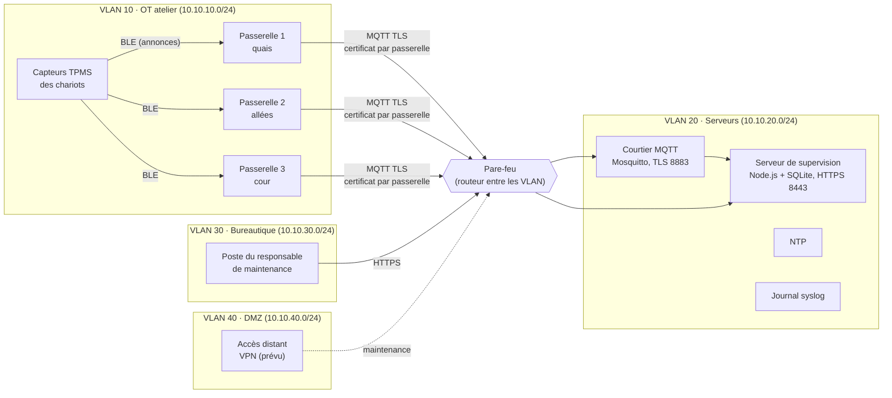

# Orientation industrielle : surveillance des pneus d'une flotte de chariots élévateurs

Projet BTS CIEL option IR – Thibault MORRETTON – Épreuve E6. Document de conception du 24/10/2026.

**Pourquoi ce document.** Un professeur a jugé le projet « pas assez industriel », avec trop peu de réseau : le seul réseau était la liaison Bluetooth entre les capteurs et le boîtier. Ce document décrit l'adaptation retenue. **On garde tout ce qui existe** (capteurs, boîtier, logique, cybersécurité, simulateur, tests) et on lui donne un vrai contexte industriel et une vraie infrastructure réseau. Il sert aussi à faire valider l'orientation par le professeur référent avant la suite.

---

## 1. Le besoin industriel

Une entreprise de logistique utilise une **flotte de chariots élévateurs à pneus gonflables** : chariots tout-terrain et chariots qui roulent dans une cour de stockage, entre les quais et les zones extérieures. Un pneu sous-gonflé :

- rend le chariot **instable**, surtout avec une charge levée (risque de renversement) : c'est d'abord un sujet de **sécurité au travail** ;
- s'use plus vite et de travers, et peut éclater ;
- augmente la résistance au roulement, donc la consommation (batterie de traction ou carburant).

Aujourd'hui, la pression est contrôlée à la main, quand on y pense. Le système proposé la surveille **en continu**, alerte le cariste sur son chariot, et donne au responsable de maintenance une vue de toute la flotte, avec la liste des chariots à traiter en priorité.

**Point à dire au jury.** Beaucoup de chariots d'intérieur roulent sur des **bandages pleins** (pas de pression à surveiller). Le système vise les chariots à **pneus gonflables**, gonflés en général entre **7 et 10 bar** (à lire sur la plaque du chariot). Les capteurs de vélo commandés plafonnent probablement à 3,5 bar : pour de vrais chariots, il faut des capteurs TPMS **« poids lourd »** (plage 0 à 13 bar, même principe de bouchon de valve). Le format de leurs trames reste à vérifier.

## 2. Le vélo devient le démonstrateur

Le vélo n'est plus le produit : c'est la **maquette à petite échelle**. Il a les mêmes valves Schrader, accepte les capteurs déjà commandés, et permet une démonstration réelle devant le jury. Tout le travail fait reste valable :

| Existant | Rôle dans la version industrielle |
|---|---|
| Capteurs TPMS BLE (bouchons de valve) | Les mêmes, en version « poids lourd » sur les chariots ; les capteurs de vélo pour le démonstrateur |
| Boîtier de guidon (e-paper, bip, LED) | **Afficheur embarqué du cariste**, fixé dans la cabine : pressions, alertes, temps de roulage |
| Capteur de roue (aimant et reed), vitesse, distance | Le **temps de roulage** compte pour la maintenance (les chariots se révisent toutes les N heures) ; la vitesse passe au second plan |
| Cybersécurité du boîtier (liste blanche, vraisemblance, rythme, confirmation par bouton, journal chaîné) | Inchangée |
| Mode flotte (serveur, base SQLite, tendances, priorités, sessions) | Devient la **supervision de la flotte de chariots** |
| Simulateur | Garde le vélo (démonstrateur) ; la flotte simulée devient une flotte de chariots dans un entrepôt |

## 3. La nouvelle infrastructure réseau

### 3.1 Vue d'ensemble

Le boîtier du chariot n'a pas de réseau : il affiche et alerte. La **remontée des données** se fait par des **passerelles fixes** posées dans l'entrepôt (au plafond, une par zone). Chacune écoute en Bluetooth les annonces des capteurs des chariots qui passent à sa portée, et les envoie au serveur par le réseau filaire de l'usine. La passerelle qui entend le mieux un chariot donne en plus **la zone où il se trouve**.

### 3.2 Pourquoi découper le réseau en zones

Le découpage suit la logique de la norme **IEC 62443** (cybersécurité des systèmes industriels) et du guide de l'ANSSI sur les systèmes industriels : on regroupe les équipements de même niveau de confiance dans des **zones**, et on ne laisse passer entre les zones que des **conduits** explicitement autorisés.

- La zone **OT** (passerelles, et plus tard d'autres capteurs de l'atelier) est la plus exposée physiquement : des boîtiers au plafond, accessibles avec une échelle. Elle ne doit pouvoir parler **qu'au courtier MQTT** (et à l'heure, et au journal).
- La zone **serveurs** contient ce qui a de la valeur : la base, le courtier, les secrets.
- La zone **bureautique** (IT) est celle où arrivent les courriels piégés et les clés USB : elle ne doit **jamais** pouvoir joindre les passerelles. Elle ne voit que la page de supervision, en HTTPS, avec un compte.
- La **DMZ** recevra l'accès distant d'un prestataire de maintenance, sans lui ouvrir tout le réseau.

### 3.3 Plan d'adressage

| VLAN | Nom | Réseau | Équipements |
|---|---|---|---|
| 10 | OT atelier | 10.10.10.0/24 | passerelles 10.10.10.11 à .13 ; pare-feu .254 |
| 20 | Serveurs | 10.10.20.0/24 | courtier MQTT .10 ; serveur de supervision .20 ; NTP .30 ; syslog .40 ; pare-feu .254 |
| 30 | Bureautique | 10.10.30.0/24 | poste du responsable .50 ; pare-feu .254 |
| 40 | DMZ | 10.10.40.0/24 | accès distant (prévu) .10 ; pare-feu .254 |

### 3.4 Matrice des flux (règles du pare-feu)

Politique par défaut : **tout est refusé et journalisé**. Seuls ces flux passent :

| # | Source | Destination | Port | Pourquoi |
|---|---|---|---|---|
| 1 | Passerelles (VLAN 10) | Courtier 10.10.20.10 | 8883/TCP (MQTT sur TLS) | Remontée des trames des capteurs |
| 2 | Passerelles (VLAN 10) | NTP 10.10.20.30 | 123/UDP | Heure exacte (horodatage des trames, anti-rejeu, validité des certificats) |
| 3 | Passerelles (VLAN 10) | Syslog 10.10.20.40 | 514/UDP | Journal centralisé |
| 4 | Poste (VLAN 30) | Serveur 10.10.20.20 | 8443/TCP (HTTPS) | Page de supervision, avec un compte |
| 5 | Accès distant (VLAN 40) | Serveur 10.10.20.20 | 8443/TCP | Maintenance à distance (prévu) |

Tout le reste est refusé : bureautique vers OT, OT vers bureautique, OT vers Internet, bureautique vers le courtier, etc. Dans la zone serveurs, le serveur de supervision lit le courtier sans passer par le pare-feu (même VLAN).

Dans la maquette seulement, une **règle n° 6** laisse le PC de démonstration (l'hôte Docker) joindre la supervision : il envoie sa requête au port 8443 du pare-feu, qui la redirige (traduction d'adresse). Les règles réelles sont dans `entrepot/pare-feu/regles.nft`.

### 3.5 MQTT : les messages des passerelles

MQTT est le protocole de messagerie le plus utilisé dans l'IoT industriel : les passerelles **publient** sur des sujets, le serveur s'**abonne**, et le **courtier** fait le lien. Il est léger, il tient les coupures (QoS 1 : le message est redonné tant que le courtier n'en a pas accusé réception) et il prévient quand une passerelle disparaît (« testament » envoyé par le courtier).

| Sujet | Qui publie | Contenu |
|---|---|---|
| `entrepot/<site>/passerelle/<id>/trames` | la passerelle `<id>` | lot des annonces entendues : adresse, puissance reçue (RSSI), 18 octets de la trame en hexadécimal, heure |
| `entrepot/<site>/passerelle/<id>/etat` | la passerelle (et le courtier si elle disparaît) | « en ligne » ou « hors ligne », version, heure NTP, nombre d'annonces |

Sécurité du courtier :

- **TLS** sur le port 8883 : personne ne lit ni ne modifie les messages sur le câble ;
- **un certificat par passerelle** (authentification mutuelle) : une passerelle volée se révoque seule, sans changer les autres ;
- **droits par sujet (ACL)** : la passerelle 1 ne peut publier que sous `.../passerelle/1/...` ; elle ne peut ni lire les autres, ni se faire passer pour une autre ;
- le serveur, lui, ne peut que lire.

### 3.6 Ce que fait le serveur des trames

Le serveur décode les trames avec **la même logique** que le boîtier (`logique/trame.js`), qui sert donc à trois endroits : boîtier, application et serveur. Il applique les mêmes protections : **liste blanche** des capteurs de chaque chariot, **contrôle de vraisemblance**. Une même annonce entendue par plusieurs passerelles n'est comptée qu'une fois, et la passerelle qui l'a entendue le plus fort donne la zone du chariot. Ensuite, rien ne change : tendances, fuites lentes, priorités, statistiques, sessions, RGPD.

## 4. La maquette : tout le réseau sur un PC, avec Docker

La maquette se lance avec une seule commande (`docker compose up`) et reproduit l'infrastructure. Mode d'emploi, conteneurs et pièges rencontrés : [`entrepot/README.md`](../entrepot/README.md).

- un **réseau Docker par VLAN** ; chaque conteneur supprime sa route par défaut et n'a qu'une route « 10.10.0.0/16 via le pare-feu » : pas d'Internet, un seul passage entre les zones ;
- un conteneur **pare-feu** relié aux quatre réseaux, qui route entre eux avec les règles du § 3.4 (nftables) et compte les paquets refusés ;
- le **courtier** Mosquitto avec TLS, certificats et ACL ;
- trois **passerelles** : elles écoutent le réseau « air », qui simule la radio Bluetooth (un conteneur « monde » y diffuse les annonces des chariots simulés), ne gardent que ce qui est à leur portée et publient les vraies trames de 18 octets ;
- le **serveur de supervision** existant, qui s'abonne au courtier ;
- un serveur **NTP**, un **syslog** ;
- un **poste bureautique** d'où l'on montre, en direct, ce qui passe et ce qui est bloqué.

Images téléchargées depuis Docker Hub (officielles) : `node`, `eclipse-mosquitto`, `alpine`.

**Démonstration devant le jury** : `node entrepot/demonstration.js` enchaîne **13 essais** commentés (13 / 13 conformes le 24/10/2026) : balayage de ports du bureau vers l'atelier bloqué, client MQTT sans certificat ou signé par une AC pirate refusé, certificat volé qui publie au nom d'une autre passerelle jeté par les ACL, lots piégés (capteur inconnu, 20 bar, rejeu) rejetés par le serveur, testament d'une passerelle coupée, courtier arrêté 30 s sans perte de mesures (stocker puis transmettre). La page `flotte/chariots.html` montre le tout côté supervision.

## 5. Ce qui reste hypothétique

- Les capteurs « poids lourd » et le format de leurs trames ; la portée Bluetooth dans un entrepôt métallique (à mesurer avec le démonstrateur).
- Le nombre de passerelles nécessaire (une par zone de 30 à 50 m dans la maquette).
- Les pressions et les seuils réels des chariots (plaque du constructeur).
- La maquette Docker reproduit le découpage et le filtrage, mais tous ses « VLAN » tournent sur le même PC : elle ne remplace pas un vrai commutateur ni un vrai pare-feu. Le même plan peut être refait dans **Packet Tracer**.

## 6. Étapes

Toutes faites le 24/10/2026 :

1. Client MQTT (écrit sans bibliothèque, pour pouvoir l'expliquer) et passerelles simulées, avec leurs tests.
2. Réception des trames par le serveur (MQTT), chariots, capteurs, zones ; logique de réception partagée avec la page (`entrepot/reception.js`).
3. Maquette Docker : réseaux, pare-feu, courtier, certificats, NTP, syslog.
4. Démonstration d'attaques réseau (13 essais).
5. Page de supervision `flotte/chariots.html` (mode serveur ou démo) et documentation en version « chariots ».

Restent à faire avec le matériel : mesurer la portée Bluetooth réelle (démonstrateur vélo), choisir des capteurs « poids lourd », refaire le plan dans Packet Tracer si le professeur le demande.
