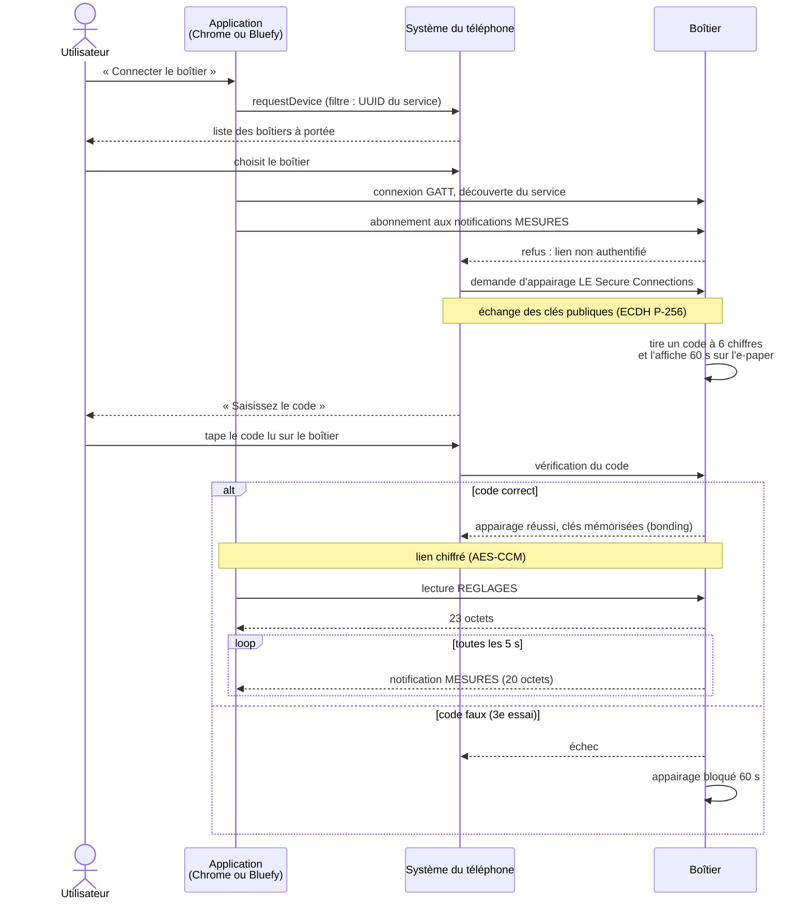

# Protocole BLE

Projet BTS CIEL option IR – Thibault MORRETTON – Épreuve E6 « Valorisation de la donnée et cybersécurité ».

Ce document décrit les deux échanges radio du kit :

1. **Boîtier ↔ application** : connexion BLE (GATT) que nous avons spécifiée. Référence : `logique/protocole.js` (format des octets) et `simulateur/boitier/liaison.js` (comportement du boîtier).
2. **Capteurs → boîtier** : annonces BLE diffusées par les capteurs TPMS du commerce. Format **supposé**, à confirmer à la réception. Référence : `logique/trame.js`. Le § 2.7 décrit en plus un format « version 2 » (privé et signé), qui n'est qu'une **proposition** pour une future version du produit : les capteurs du commerce restent en version 1.

Le mode flotte ajoute un troisième échange, boîtier → serveur (lots de mesures en JSON, signés HMAC-SHA256, par HTTP) : il n'utilise pas BLE et son format est décrit dans `serveur/README.md`.

Tous les exemples hexadécimaux ont été calculés en exécutant les fonctions de codage du dépôt avec Node.js. Tous les nombres sur plusieurs octets sont en **little-endian** : l'octet de poids faible est transmis en premier (exemple : 2 105 = 0x0839 s'écrit `39 08`).

---

## Partie 1 – Liaison boîtier ↔ application

### 1.1 Rôles

| Rôle BLE | Appareil |
|---|---|
| Périphérique, serveur GATT | Boîtier (XIAO nRF52840, firmware) |
| Central, client GATT | Application web : Chrome (PC, Android) ou Bluefy (iPhone), via Web Bluetooth (`app/transport-ble.js`) |

L'application trouve le boîtier avec `navigator.bluetooth.requestDevice({ filters: [{ services: [UUID du service] }] })` : le boîtier doit donc annoncer l'UUID de son service dans ses annonces. En veille (System OFF), le boîtier n'émet rien : il faut le réveiller (un bouton ou un tour de roue) avant de se connecter, comme l'indique l'écran de connexion de l'application.

### 1.2 Service et caractéristiques

UUID 128 bits tirés au hasard pour ce projet (`TPMS.UUID`) :

| Élément | UUID | Taille | Propriétés | Sécurité |
|---|---|---|---|---|
| Service « TPMS vélo » | `6e7a0001-5a1e-4b8f-9c3d-2f1e0a9b8c7d` | – | – | – |
| MESURES | `6e7a0002-5a1e-4b8f-9c3d-2f1e0a9b8c7d` | 20 octets | Lecture, notification (toutes les 5 s) | Chiffré et appairé |
| REGLAGES | `6e7a0003-5a1e-4b8f-9c3d-2f1e0a9b8c7d` | 23 octets | Lecture, écriture avec réponse | Chiffré et appairé |
| COMMANDE | `6e7a0004-5a1e-4b8f-9c3d-2f1e0a9b8c7d` | 1 octet | Écriture avec réponse | Chiffré et appairé |

### 1.3 Caractéristique MESURES (20 octets)

Envoyée par notification toutes les 5 s quand l'application est connectée. Construite par `TPMS.liaisonMesures` (`liaison.js`) avec `TPMS.encoderMesures`, décodée par `TPMS.decoderMesures`.

| Octets | Champ | Type | Unité / codage |
|---|---|---|---|
| 0-1 | Pression AV | uint16 | mbar ; `FF FF` = inconnue (aucune trame reçue) |
| 2-3 | Pression AR | uint16 | mbar ; `FF FF` = inconnue |
| 4 | Température AV | int8 | °C, arrondie à l'unité (−128 à 127) |
| 5 | Température AR | int8 | °C |
| 6 | Pile capteur AV | uint8 | % |
| 7 | Pile capteur AR | uint8 | % |
| 8 | État AV | uint8 | Index dans `TPMS.CODES_ETAT` (tableau ci-dessous) |
| 9 | État AR | uint8 | Idem |
| 10-11 | Vitesse | uint16 | 0,1 km/h |
| 12-15 | Distance du trajet | uint32 | mètres |
| 16 | Batterie du boîtier | uint8 | % |
| 17 | Drapeaux | bits | bit 0 : veille ; bit 1 : en charge ; bit 2 : éclairage allumé |
| 18-19 | Numéro de séquence | uint16 | +1 à chaque notification, repart à 0 après 65 535 |

Codes d'état (`TPMS.CODES_ETAT`) :

| Code | État | Texte sur l'e-paper |
|---|---|---|
| 0 | ATTENTE | EN ATTENTE |
| 1 | INTRUSION | SIGNAL SUSPECT |
| 2 | PERDU | CAPTEUR PERDU |
| 3 | CREVAISON | CREVAISON |
| 4 | BASSE | PRESSION BASSE |
| 5 | HAUTE | PRESSION HAUTE |
| 6 | FUITE | FUITE LENTE |
| 7 | OK | OK |

Le numéro de séquence permet à l'application de compter les notifications perdues : `app/app.js` calcule l'écart entre deux numéros successifs (modulo 65 536) et affiche le nombre de notifications perdues.

La taille de 20 octets correspond à la charge utile maximale d'une notification avec la taille de paquet ATT par défaut (MTU de 23 octets, moins 3 octets d'en-tête) : la caractéristique tient dans une seule notification sans négociation.

#### Exemple 1 – en roulant, alerte « pression basse » à l'arrière

Valeurs : AV 2,15 bar, 18 °C, pile 95 %, OK ; AR 1,85 bar, 17,6 °C, pile 94 %, BASSE ; 23,4 km/h ; 12,345 km ; batterie 87 % ; éclairage allumé ; séquence 42.

```
66 08 3A 07 12 12 5F 5E 07 04 EA 00 39 30 00 00 57 04 2A 00
```

| Octets | Hexa | Valeur décodée |
|---|---|---|
| 0-1 | `66 08` | 0x0866 = 2 150 mbar → 2,15 bar |
| 2-3 | `3A 07` | 0x073A = 1 850 mbar → 1,85 bar |
| 4 | `12` | 18 °C |
| 5 | `12` | 18 °C (17,6 °C arrondi : la température est transmise à l'unité près) |
| 6 | `5F` | 95 % |
| 7 | `5E` | 94 % |
| 8 | `07` | OK |
| 9 | `04` | BASSE |
| 10-11 | `EA 00` | 0x00EA = 234 → 23,4 km/h |
| 12-15 | `39 30 00 00` | 0x3039 = 12 345 m → 12,345 km |
| 16 | `57` | 87 % |
| 17 | `04` | 0b100 : éclairage allumé, pas en veille, pas en charge |
| 18-19 | `2A 00` | séquence 42 |

#### Exemple 2 – boîtier en veille et en charge, capteur avant jamais reçu, signal suspect à l'arrière

Valeurs : AV inconnue, ATTENTE ; AR 2,3 bar, −4 °C, pile 80 %, INTRUSION ; vitesse et distance nulles ; batterie 100 % ; veille et en charge ; séquence 65 535.

```
FF FF FC 08 00 FC 00 50 00 01 00 00 00 00 00 00 64 03 FF FF
```

| Octets | Hexa | Valeur décodée |
|---|---|---|
| 0-1 | `FF FF` | pression AV inconnue |
| 2-3 | `FC 08` | 0x08FC = 2 300 mbar → 2,3 bar |
| 4 | `00` | (sans objet, pression inconnue) |
| 5 | `FC` | 0xFC = 252 → 252 − 256 = −4 °C |
| 6 | `00` | (sans objet) |
| 7 | `50` | 80 % |
| 8 | `00` | ATTENTE |
| 9 | `01` | INTRUSION |
| 10-15 | `00 …` | 0 km/h, 0 m |
| 16 | `64` | 100 % |
| 17 | `03` | 0b011 : veille et en charge |
| 18-19 | `FF FF` | séquence 65 535 (la suivante sera 0) |

### 1.4 Caractéristique REGLAGES (23 octets)

Lue par `TPMS.liaisonLireReglages`, écrite par `TPMS.liaisonEcrireReglages` ; format défini par `TPMS.encoderReglages` et `TPMS.decoderReglages`.

| Octets | Champ | Type | Unité / codage | Plage acceptée par le boîtier |
|---|---|---|---|---|
| 0-1 | Circonférence de roue | uint16 | mm | 1 000 à 3 000 |
| 2-3 | Seuil bas AV | uint16 | mbar | ≥ 500, et < seuil haut AV |
| 4-5 | Seuil haut AV | uint16 | mbar | ≤ 6 000 |
| 6-7 | Seuil bas AR | uint16 | mbar | ≥ 500, et < seuil haut AR |
| 8-9 | Seuil haut AR | uint16 | mbar | ≤ 6 000 |
| 10-11 | Délai avant veille | uint16 | secondes | 10 à 3 600 |
| 12 | Protections | bits | bit 0 : liste blanche ; bit 1 : vraisemblance ; bit 2 : rythme | non contrôlé |
| 13-17 | Adresse du capteur AV | 5 octets | identique aux octets 3-7 de la trame TPMS | non contrôlé |
| 18-22 | Adresse du capteur AR | 5 octets | idem | non contrôlé |

Le seuil de crevaison (0,5 bar), le seuil de fuite (−0,15 bar/h), le délai de perte (60 s au-dessus de 10 km/h, 600 s en dessous et à l'arrêt), la fenêtre d'écoute et la période d'écran ne font pas partie de cette caractéristique : ils ne sont pas réglables depuis l'application.

**Contrôle à l'écriture.** Le boîtier ne fait pas confiance aveuglément à ce qu'on lui écrit, même sur un lien chiffré : `TPMS.verifierReglages` (`logique/protocole.js`) renvoie la raison du refus si une valeur est hors plage, et rien n'est appliqué. L'application fait le même contrôle avant d'envoyer (`app/app.js`). Si l'adresse d'un capteur change, le boîtier oublie tout ce qu'il savait de l'ancien (`TPMS.creerRoue`).

#### Exemple 3 – réglages par défaut (`TPMS.creerBoitier`)

```
39 08 08 07 80 0C D0 07 48 0D 2C 01 07 EA CA 3F 1B 07 EA CA 3F 1B 08
```

| Octets | Hexa | Valeur décodée |
|---|---|---|
| 0-1 | `39 08` | 2 105 mm (pneu 700×25C) |
| 2-3 | `08 07` | 1 800 mbar → seuil bas AV 1,8 bar |
| 4-5 | `80 0C` | 3 200 mbar → seuil haut AV 3,2 bar |
| 6-7 | `D0 07` | 2 000 mbar → seuil bas AR 2,0 bar |
| 8-9 | `48 0D` | 3 400 mbar → seuil haut AR 3,4 bar |
| 10-11 | `2C 01` | 300 s → veille après 5 min |
| 12 | `07` | 0b111 : les trois protections actives |
| 13-17 | `EA CA 3F 1B 07` | capteur AV `EA:CA:3F:1B:07` |
| 18-22 | `EA CA 3F 1B 08` | capteur AR `EA:CA:3F:1B:08` |

#### Exemple 4 – réglages d'un VTT 29 pouces (acceptés)

Circonférence 2 288 mm, AV 1,6 à 2,4 bar, AR 1,8 à 2,6 bar, veille après 1 min :

```
F0 08 40 06 60 09 08 07 28 0A 3C 00 07 EA CA 3F 1B 07 EA CA 3F 1B 08
```

#### Exemple 5 – réglages refusés

Seuil bas AV ramené à 0,1 bar (octets 2-3 = `64 00`, soit 100 mbar) :

```
39 08 64 00 80 0C D0 07 48 0D 2C 01 07 EA CA 3F 1B 07 EA CA 3F 1B 08
```

Réponse de `TPMS.verifierReglages` : « seuils hors plage (0,5 à 6 bar) ». Autres refus possibles : « circonférence hors plage (1000 à 3000 mm) », « seuil bas supérieur au seuil haut », « délai de veille hors plage (10 s à 1 h) ».

### 1.5 Caractéristique COMMANDE (1 octet)

Traitée par `TPMS.liaisonCommande`. Elle reproduit les appuis longs sur les boutons du boîtier.

| Valeur | Constante | Effet | Équivalent bouton |
|---|---|---|---|
| `01` | `TPMS.COMMANDE.RAZ_TRAJET` | Remise à zéro du trajet (distance, moyenne, maximum, durée) | Bouton 1, appui long |
| `02` | `TPMS.COMMANDE.ACQUITTER` | Acquitter les alertes en cours (plus de bip, LED fixe) | Bouton 2, appui long |
| autre | – | Refusée (« commande inconnue ») | – |

### 1.6 Sécurité de la liaison

| Mesure | Détail | Où |
|---|---|---|
| Appairage LE Secure Connections | Échange de clés par Diffie-Hellman sur courbe elliptique (P-256) ; méthode « Passkey Entry » : code à 6 chiffres affiché par le boîtier, saisi sur le téléphone. Le boîtier doit se déclarer « affichage seul » (DisplayOnly) pour que cette méthode soit choisie. | Pile BLE du nRF52840 (firmware) ; simulée par `TPMS.liaisonConnexion` / `TPMS.liaisonSaisirCode` |
| Code aléatoire | Jamais de code fixe ; valable 60 s (`TPMS.CODE_DUREE_MS`) ; un code encore valide n'est pas remplacé par une nouvelle demande, pour qu'un tiers ne puisse pas le changer sous les yeux du cycliste ; affiché par-dessus l'écran (`TPMS.dessinerCodeAppairage`) | `liaison.js`, `ecran.js` |
| Blocage | 3 codes faux → appairage bloqué 60 s (`CODE_ESSAIS_MAX`, `CODE_BLOCAGE_MS`) | `TPMS.liaisonSaisirCode` |
| Mémorisation (bonding) | Un téléphone déjà appairé se reconnecte directement sur un lien chiffré, sans nouveau code | `TPMS.liaisonConnexion` (retourne `"connecte"`) |
| Chiffrement | AES-CCM de la couche liaison BLE ; le compteur de paquets intégré empêche le rejeu d'un paquet | Pile BLE |
| Accès réservé | MESURES, REGLAGES et COMMANDE réservés à un téléphone appairé | `TPMS.liaisonLireReglages`, `TPMS.liaisonEcrireReglages`, `TPMS.liaisonCommande` |
| Oubli | Le boîtier peut oublier le téléphone (`TPMS.liaisonOublier`) ; côté iPhone ou Android, il faut aussi supprimer l'appareil dans les réglages Bluetooth du système (une page web ne peut pas effacer une clé d'appairage) | `liaison.js`, `app/transport-ble.js` |

**Niveau de sécurité visé pour les trois caractéristiques** : mode de sécurité LE 1, niveau 4 (appairage Secure Connections authentifié, chiffrement avec clé de 128 bits). Une écriture sur un lien qui n'atteint pas ce niveau doit être refusée par la pile BLE (erreur ATT « authentification insuffisante »).

**Pourquoi chiffrer aussi MESURES ?** La pression n'est pas secrète, mais la vitesse, la distance et les horaires de connexion renseignent sur les déplacements et les habitudes du cycliste (en-tête de `logique/protocole.js`). Dans le simulateur, `TPMS.liaisonMesures` n'envoie rien à un téléphone qui n'est pas connecté, donc pas appairé.

**Erreurs à renvoyer par le firmware (proposition)** :

| Situation | Réponse ATT |
|---|---|
| Lien non chiffré ou non authentifié | 0x05 « Insufficient Authentication » (géré par la pile BLE) |
| Taille incorrecte | 0x0D « Invalid Attribute Value Length » |
| Réglages hors plage | Code d'erreur applicatif (plage 0x80 à 0x9F), la raison détaillée étant écrite dans le journal |
| Commande inconnue | Code d'erreur applicatif |

**Point à vérifier** (noté « À VÉRIFIER » dans `logique/protocole.js`) : avec la MTU par défaut, la valeur d'une écriture simple est limitée à 20 octets. REGLAGES en fait 23 : le firmware demandera une MTU plus grande, sinon il faudra une écriture longue. À vérifier avec Chrome et Bluefy sur le boîtier réel.

### 1.7 Déroulé de la connexion et de l'appairage



Correspondance avec le code du simulateur :

| Étape | Fonction simulée | Résultat possible |
|---|---|---|
| Demande de connexion | `TPMS.liaisonConnexion(b, t)` | `"connecte"` (téléphone déjà appairé), `"code-requis"` (nouveau code, ou code déjà affiché et encore valide), `"bloque"` |
| Saisie du code | `TPMS.liaisonSaisirCode(b, code, t)` | `"ok"`, `"faux"`, `"expire"`, `"bloque"` |
| Notification | `TPMS.liaisonMesures(b, t)` | 20 octets, ou `null` si non connecté |
| Écriture des réglages | `TPMS.liaisonEcrireReglages(b, octets, t)` | `"ok"`, `"refuse"`, `"format invalide"` ou la raison du refus |
| Commande | `TPMS.liaisonCommande(b, octet, t)` | `"ok"`, `"refuse"`, `"commande inconnue"` |
| Déconnexion / oubli | `TPMS.liaisonDeconnexion`, `TPMS.liaisonOublier` | – |

Sur un vrai téléphone, la saisie du code se fait dans une fenêtre du système, pas dans la page web ; c'est pourquoi `saisirCode` ne fait rien dans `app/transport-ble.js`. Ce comportement est attendu sur Android et sur iPhone avec Bluefy, et reste à confirmer sur le matériel.

Tests correspondants (`simulateur/tests/tests.js`) : « Protocole boîtier ↔ application » (13 tests) et « Liaison (appairage par code) » (11 tests).

---

## Partie 2 – Trames des capteurs TPMS (format supposé)

### 2.1 Origine et statut

Les capteurs TPMS BLE du commerce ne se connectent à personne : ils diffusent leurs mesures dans le champ « manufacturer data » de leurs **annonces BLE**, en clair. Le format ci-dessous est celui documenté pour des capteurs similaires (github.com/schlumpf2009/TPMS). **C'est une hypothèse** : il sera vérifié à la réception des capteurs, en capturant les annonces avec une application de scan BLE et en les comparant à une pression connue.

### 2.2 Format (18 octets)

| Octets | Champ | Codage |
|---|---|---|
| 0-1 | Identifiant fabricant | Valeur supposée `00 01` (`TPMS.ID_FABRICANT`) |
| 2 | Numéro du capteur | `0x80` = capteur 1, `0x81` = capteur 2… |
| 3-4 | Préfixe d'adresse | 2 octets |
| 5-7 | Adresse du capteur | 3 octets ; avec le préfixe, forme l'identifiant fixe du capteur, noté `EA:CA:3F:1B:07` |
| 8-11 | Pression | int32 little-endian, en pascals (÷ 100 000 → bar) |
| 12-15 | Température | int32 little-endian signé, en centièmes de °C |
| 16 | Niveau de pile | % |
| 17 | Alarme | `00` = OK, `01` = pas de pression |

Le décodage (`TPMS.decoderTrame`) refuse une trame qui n'a pas 18 octets, dont l'identifiant fabricant ne correspond pas, ou dont l'octet 2 est inférieur à `0x80`.

### 2.3 Exemple décodé – capteur avant, 2,1 bar, 20,5 °C

```
00 01 80 EA CA 3F 1B 07 50 34 03 00 02 08 00 00 5F 00
```

| Octets | Hexa | Valeur décodée |
|---|---|---|
| 0-1 | `00 01` | identifiant fabricant attendu |
| 2 | `80` | capteur n° 1 |
| 3-7 | `EA CA 3F 1B 07` | adresse `EA:CA:3F:1B:07` (capteur avant appairé par défaut) |
| 8-11 | `50 34 03 00` | 0x00033450 = 210 000 Pa → 2,1 bar |
| 12-15 | `02 08 00 00` | 0x00000802 = 2 050 → 20,50 °C |
| 16 | `5F` | pile 95 % |
| 17 | `00` | pas d'alarme |

### 2.4 Exemple décodé – capteur arrière à plat, par grand froid

```
00 01 81 EA CA 3F 1B 08 00 00 00 00 F3 FD FF FF 28 01
```

| Octets | Hexa | Valeur décodée |
|---|---|---|
| 2 | `81` | capteur n° 2 |
| 3-7 | `EA CA 3F 1B 08` | adresse `EA:CA:3F:1B:08` |
| 8-11 | `00 00 00 00` | 0 Pa → 0 bar |
| 12-15 | `F3 FD FF FF` | 0xFFFFFDF3 = −525 (complément à 2) → −5,25 °C |
| 16 | `28` | pile 40 % |
| 17 | `01` | alarme : pas de pression |

Ces deux exemples sont vérifiés par les tests « Trames » de `simulateur/tests/tests.js` (14 tests, dont le codage de 2,1 bar en `50 34 03 00` et de −5,25 °C en `F3 FD FF FF`).

### 2.5 Ce que ce format implique pour la sécurité

- Aucun champ de **compteur** ni de **signature** : une trame ne peut pas être authentifiée, et une trame rejouée est identique à l'originale.
- L'**adresse fixe** (octets 3-7) est transmise dans chaque trame : elle permet de reconnaître le vélo, et de le suivre de récepteur en récepteur (pistage, § 6.9 de `analyse-de-risques.md`).
- Le numéro de capteur (octet 2) n'identifie pas un vélo : le capteur n° 1 d'un autre vélo porte le même numéro. D'où la **liste blanche par adresse** (`TPMS.positionCapteur`).

Ces points sont développés dans `analyse-de-risques.md`.

### 2.6 À prévoir dans le firmware

- Une annonce BLE est émise sur 3 canaux en quelques millisecondes : le boîtier peut recevoir 3 copies identiques. Il faudra ignorer les copies reçues à moins de 100 ms d'écart, sinon la protection « rythme » (`TPMS.controlerRythme`) les prendrait pour un second émetteur.
- L'intervalle d'annonce réel (supposé de 3 s) devra être mesuré : la protection « rythme » considère comme anormales deux trames de la même adresse à moins de 2 s d'écart (`TPMS.RYTHME_MIN_MS`), sauf si la pression baisse (rafale d'une vraie crevaison).

### 2.7 Proposition pour une version 2 : trame privée et signée (26 octets)

**Statut : proposition, simulée seulement.** Les capteurs du commerce ne peuvent pas émettre ce format, car leur programme n'est pas modifiable. Il faudrait des capteurs dont nous écrivons le programme. Le format sert à montrer, dans le simulateur, ce qu'apporterait une version 2 du produit contre le pistage, l'usurpation et le rejeu (`analyse-de-risques.md`, § 5.5). Référence : `logique/trame2.js`, traduit dans `firmware/tpms_boitier/src/logique/trame2.cpp`.

**Clé.** Chaque capteur v2 a une clé secrète de 16 octets, partagée avec le boîtier à l'appairage (par exemple par un QR code dans la boîte). Cette clé ne fait pas partie de la caractéristique REGLAGES ; sa transmission au boîtier reste à spécifier.

**Format :**

| Octets | Champ | Codage |
|---|---|---|
| 0-1 | Identifiant fabricant | Comme la v1 (`00 01`) |
| 2 | Numéro du capteur | `0xC0` = capteur 1, `0xC1` = capteur 2 : `0xC0 + numéro − 1` (le bit de poids `0x40` distingue la v2 de la v1) |
| 3-7 | Adresse privée | 2 octets tirés au hasard, puis les 3 premiers octets de HMAC-SHA256(clé, `01` ‖ ces 2 octets). Nouvelle adresse toutes les 15 min (`TPMS.ROTATION_ADRESSE_MS`) |
| 8-17 | Pression, température, pile, alarme | Comme la v1 (octets 8 à 17 du § 2.2), **en clair** |
| 18-21 | Compteur | uint32 little-endian, +1 à chaque trame |
| 22-25 | Signature | 4 premiers octets de HMAC-SHA256(clé, `02` ‖ octets 0 à 21) |

La trame fait 26 octets. Avec les 2 octets d'en-tête du champ « manufacturer data », elle tient dans une annonce BLE classique de 31 octets.

**Ce que fait le boîtier** (branche « capteurs v2 » de `TPMS.boitierRecevoirTrame`) :
1. il recalcule le HMAC de l'adresse avec la clé de chaque capteur appairé (`TPMS.adresseResolue`) : c'est la même idée que les « adresses privées résolubles » de la norme Bluetooth, qui utilisent AES. Une adresse qui ne correspond à aucune clé est « inconnue » ;
2. il vérifie la signature (`TPMS.signatureValide`) : sinon, trame refusée « mal signée (usurpation ?) ». Sans la clé, un pirate a 1 chance sur 2³² (environ 4 milliards) par essai de deviner une signature valide ;
3. il vérifie que le compteur est plus grand que le dernier accepté pour ce capteur : sinon, trame refusée « rejouée (compteur déjà vu) » ;
4. les trames en clair (v1) sont ignorées, et le contrôle du rythme n'est plus nécessaire : l'origine de la trame est prouvée par la signature.

**Exemple** (calculé avec `TPMS.encoderTrameV2`) : clé `00 01 02 … 0F`, octets tirés au hasard `3A 7C`, capteur avant, 2,1 bar, 20,5 °C, pile 95 %, compteur 1 234.

```
00 01 C0 3A 7C 1C 42 B8 50 34 03 00 02 08 00 00 5F 00 D2 04 00 00 E4 26 0B 27
```

| Octets | Hexa | Valeur décodée |
|---|---|---|
| 0-1 | `00 01` | identifiant fabricant |
| 2 | `C0` | capteur n° 1, version 2 |
| 3-7 | `3A 7C 1C 42 B8` | adresse privée : `3A 7C` au hasard, `1C 42 B8` = début de HMAC(clé, `01 3A 7C`) |
| 8-17 | `50 34 03 00 02 08 00 00 5F 00` | 2,1 bar, 20,50 °C, pile 95 %, pas d'alarme (comme l'exemple du § 2.3) |
| 18-21 | `D2 04 00 00` | 0x04D2 = compteur 1 234 |
| 22-25 | `E4 26 0B 27` | signature |

Changer un seul bit de cette trame rend la signature fausse, et une autre clé ne reconnaît pas l'adresse (tests « v2 » de `simulateur/tests/tests.js`, 12 tests).

**Limites.** La signature protège l'intégrité et l'origine, pas la confidentialité : pression, température et niveau de pile restent lisibles. Le dernier compteur accepté pour chaque capteur est gardé en RAM : la veille du boîtier (System OFF) l'efface, et au réveil la première trame rejouée serait acceptée. Remédiation proposée, non implémentée : sauvegarder ce compteur en mémoire flash à la mise en veille, avec les réglages (qui contiennent déjà les clés) et le trajet, puis le relire au réveil. Enfin, le firmware actuel ne transmet à la logique que les annonces de 18 octets (`firmware/README.md`).
