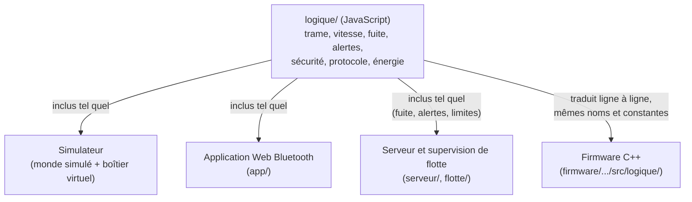
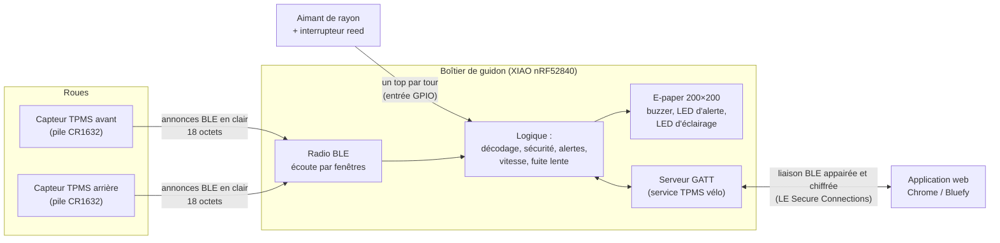
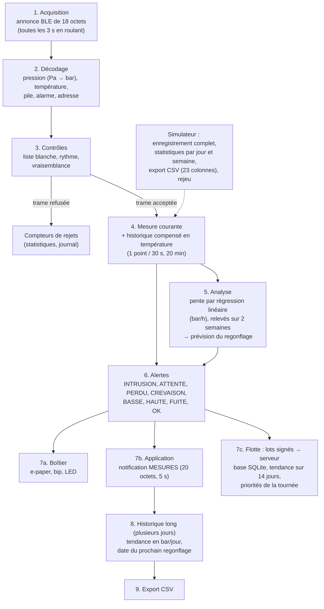

# Rapport de projet – Épreuve E6

<br>

| | |
|---|---|
| **Diplôme** | BTS Cybersécurité, Informatique et réseaux, Électronique (CIEL), option IR (Informatique et Réseaux) |
| **Épreuve** | E6 « Valorisation de la donnée et cybersécurité » |
| **Projet** | Kit de surveillance de la pression des pneus de vélo (capteurs TPMS BLE, boîtier de guidon à écran e-paper, application Web Bluetooth) et son logiciel de simulation complète |
| **Candidat** | Thibault MORRETTON – projet réalisé seul |
| **Établissement** | [Établissement] |
| **Professeur référent** | [Professeur référent] |
| **Session** | [Session] |
| **Date de soutenance** | [Date de soutenance] |
| **Dépôt du projet** | github.com/titilyonnais/tpms-velo |
| **Simulateur en ligne** | https://titilyonnais.github.io/tpms-velo/simulateur/ |
| **Application en ligne** | https://titilyonnais.github.io/tpms-velo/app/ |
| **Supervision de flotte (démo)** | https://titilyonnais.github.io/tpms-velo/flotte/ |

<br>

> **Note sur l'état du projet.** Le matériel a été commandé mais n'est pas encore reçu au moment où j'écris ce rapport (mis à jour le 23/10/2026). Tout ce qui concerne le comportement réel des capteurs, les consommations électriques et l'étanchéité est donc une **hypothèse** ou un **résultat de simulation**, et je le signale à chaque fois. Les chiffres de ce rapport viennent du code du dépôt : je les ai obtenus en exécutant les fonctions avec Node.js ou en lançant les tests, pas en les recopiant à la main.

---

## Sommaire

1. [Contexte et besoin](#1-contexte-et-besoin)
2. [Cahier des charges](#2-cahier-des-charges)
3. [Démarche : simuler avant d'avoir le matériel](#3-démarche--simuler-avant-davoir-le-matériel)
4. [Architecture et réalisation](#4-architecture-et-réalisation)
   - [4.7 Le boîtier imprimé en 3D](#47-le-boîtier-imprimé-en-3d)
5. [Valorisation de la donnée](#5-valorisation-de-la-donnée)
   - [5.5 Prévision du prochain regonflage](#55-prévision-du-prochain-regonflage)
   - [5.6 Pression conseillée](#56-pression-conseillée-hypothèse-assumée)
   - [5.10 Le mode flotte : la donnée au service d'une entreprise](#510-le-mode-flotte--la-donnée-au-service-dune-entreprise)
6. [Cybersécurité](#6-cybersécurité)
   - [6.8 Les failles révélées par la simulation, puis corrigées](#68-les-failles-révélées-par-la-simulation-puis-corrigées)
   - [6.10 Vie privée : le pistage du cycliste](#610-vie-privée--le-pistage-du-cycliste-s12)
   - [6.11 Proposition : des capteurs « version 2 »](#611-proposition--des-capteurs--version-2--à-adresse-privée-et-signés)
   - [6.12 Le journal de sécurité chaîné](#612-traçabilité--le-journal-de-sécurité-chaîné-s15)
   - [6.13 La sécurité du serveur de flotte](#613-la-sécurité-du-serveur-de-flotte)
7. [Énergie](#7-énergie)
8. [Tests et validation](#8-tests-et-validation)
   - [8.1 Les tests automatiques et l'intégration continue](#81-les-tests-automatiques)
9. [Gestion de projet](#9-gestion-de-projet)
10. [Bilan et perspectives](#10-bilan-et-perspectives)
- [Annexe A – Glossaire](#annexe-a--glossaire)
- [Annexe B – Documents du dépôt et liens](#annexe-b--documents-du-dépôt-et-liens)
- [Annexe C – Commandes utiles](#annexe-c--commandes-utiles)

---

## 1. Contexte et besoin

### 1.1 Le constat

Un pneu de vélo perd de l'air avec le temps. Une crevaison lente ne se remarque souvent que lorsque le pneu est déjà presque à plat. Rouler sous-gonflé augmente la résistance au roulement, use le pneu et expose au pincement de la chambre à air. Pour vérifier la pression, il faut un manomètre et du temps, et en pratique beaucoup de cyclistes ne le font pas avant chaque sortie.

Les voitures récentes ont un système qui surveille la pression des pneus : le **TPMS** (*Tire Pressure Monitoring System*). Des capteurs TPMS existent aussi pour le vélo, sous forme de bouchons de valve qui émettent leurs mesures par Bluetooth Low Energy (BLE). Mon projet part de ces capteurs.

### 1.2 Le besoin

Le cycliste veut **connaître en permanence la pression de ses deux pneus** et être **prévenu** en cas de pression anormale, de crevaison ou de fuite lente, **sans dépendre de son smartphone** pendant qu'il roule.

| Question (bête à cornes) | Réponse |
|---|---|
| À qui le produit rend-il service ? | Au cycliste (tous types de vélos) |
| Sur quoi agit-il ? | Sur l'information de pression et de température des pneus |
| Dans quel but ? | Rouler avec une pression correcte et détecter tôt une crevaison ou une fuite |

### 1.3 Le produit, présenté comme celui d'une entreprise

J'ai traité le projet comme le développement d'un produit par une petite entreprise. Le produit est un **kit vendu environ 89 €** qui comprend :

- **2 capteurs de pression** TPMS BLE du commerce, vissés sur les valves ;
- **1 boîtier de guidon** avec un écran e-paper, une alarme sonore et lumineuse, un compteur de vitesse et de distance, et un éclairage latéral de nuit ;
- **1 application** (page web) pour les réglages, l'historique des pressions et la détection des fuites très lentes.

### 1.4 La concurrence

| Produit | Prix indicatif | Afficheur dédié | Remarque |
|---|---|---|---|
| SKS Airspy | environ 100 € la paire de capteurs | Non | Lecture sur smartphone ou compteur compatible |
| Quarq TyreWiz | environ 250 £ la paire | Non | Lecture sur smartphone ou compteur compatible |
| **Mon kit** | environ 89 € le kit complet | **Oui (e-paper)** | Fonctionne sans smartphone |

Les prix sont des relevés indicatifs faits pendant la préparation du projet.

### 1.5 Ce qui différencie le kit

- **Un afficheur dédié lisible en plein soleil.** L'écran e-paper (papier électronique) réfléchit la lumière comme du papier ; il n'a pas de rétroéclairage. Plus il y a de soleil, mieux on le lit.
- **Une très basse consommation.** Un écran e-paper ne consomme rien pour garder une image affichée. Le boîtier dort quand le vélo ne roule pas.
- **Aucun smartphone nécessaire en roulant.** L'application ne sert qu'aux réglages et à l'historique.
- **Vitesse et distance intégrées**, grâce à un aimant fixé sur un rayon et un interrupteur magnétique (reed) sur la fourche.

### 1.6 Ce que j'ai réalisé

Le matériel n'étant pas encore arrivé, j'ai décidé le 22/10/2026 de faire du cœur du projet un **logiciel de simulation complète et réaliste** du kit, sous forme de page web. Le dépôt contient :

| Partie | Dossier | État |
|---|---|---|
| Logique partagée (trames, vitesse, fuite, alertes, sécurité, protocole BLE, énergie) | `logique/` | Terminée, testée |
| Simulateur (monde physique, boîtier virtuel, interface) | `simulateur/` | Terminé, testé, en ligne |
| Application Web Bluetooth | `app/` | Fonctionne avec le boîtier simulé ; à essayer avec le vrai boîtier |
| Programme du boîtier (Arduino, C++) | `firmware/` | Écrit ; la partie logique est testée sur PC à chaque envoi de code ; jamais chargé sur la carte |
| Serveur de flotte et supervision (vélos de location) | `serveur/`, `flotte/` | Terminé, testé ; démo en ligne sans serveur |
| Boîtier imprimé en 3D (OpenSCAD) | `boitier-3d/` | Modèle paramétré écrit ; jamais rendu ni imprimé |
| Dossier technique | `docs/` | Cahier des charges, architecture, protocole BLE, analyse de risques, bilan énergétique, schéma électrique |

---

## 2. Cahier des charges

Le cahier des charges complet, avec un critère de validation mesurable pour chaque exigence, est dans [cahier-des-charges.md](cahier-des-charges.md). Je n'en donne ici que la synthèse.

### 2.1 Composition du kit retenue

| Élément | Choix | Justification |
|---|---|---|
| Capteurs de roue | 2 capteurs TPMS BLE du commerce (bouchon de valve, pile CR1632) | Concevoir un capteur de pression étanche qui tourne avec la roue dépasse le temps et le budget d'un projet de BTS. Ces capteurs coûtent 22,19 € la paire. |
| Microcontrôleur | Seeed XIAO nRF52840 | Radio BLE intégrée, chargeur de batterie LiPo intégré, très petite taille (21 × 17,5 mm), mode veille à quelques µA |
| Écran | E-paper WeAct 1,54″, 200 × 200 pixels, contrôleur SSD1681, bus SPI | Lisible au soleil, ne consomme rien entre deux images |
| Batterie | LiPo 3,7 V 500 mAh | Tient dans un boîtier de guidon ; la carte XIAO sait la recharger |
| Recharge | Connecteur magnétique 2 broches | Pas de prise USB à ouvrir : meilleure étanchéité |
| Vitesse | Aimant de rayon + interrupteur reed filaire | Solution simple et classique des compteurs de vélo |
| Alertes | Buzzer + LED rouge | Le cycliste entend l'alerte sans regarder l'écran |
| Éclairage | 2 LED blanches latérales | Être vu de côté la nuit ; un vrai éclairage avant coûterait trop cher |
| Boîtier | Imprimé en 3D en PETG, visé IPX7, joint torique, fixation quart de tour (§ 4.7) | Imprimante 3D disponible au lycée |
| Application | Page web Web Bluetooth | Rien à installer. Mon téléphone est un iPhone : Safari ne gère pas Web Bluetooth, j'utilise donc le navigateur **Bluefy**. J'ai écarté Flutter parce que compiler une application iOS exige un Mac. |

### 2.2 Exigences fonctionnelles (synthèse)

| N° | Exigence | Critère principal |
|---|---|---|
| EF-01 | Recevoir et décoder les annonces BLE des deux capteurs | Trame de 18 octets décodée sans erreur |
| EF-02 | Afficher pression AV/AR, température, pile des capteurs, batterie du boîtier | Tout visible sur l'écran 200 × 200 sans changer de page |
| EF-03 | Vitesse et distance par aimant et reed, circonférence réglable | Un tour de 2 100 mm en 300 ms donne 25,2 km/h ; circonférence de 1 000 à 3 000 mm |
| EF-04 | Statistiques du trajet et remise à zéro | Bouton 1 : page suivante (appui court), remise à zéro (appui long) |
| EF-05 | Signaler crevaison, pression basse ou haute, capteur perdu, signal suspect | États évalués du plus grave au moins grave |
| EF-06 / EF-07 | Bip + LED à l'apparition d'une alerte ; acquittement | Bouton 2 appui long : plus de bip, LED fixe |
| EF-08 | Détecter une fuite lente | Pente par régression linéaire sur 20 min ; alerte sous −0,15 bar/h |
| EF-09 | Détecter une crevaison rapidement | Alerte CREVAISON moins de 10 s après le passage sous 0,5 bar |
| EF-10 | Éclairage latéral de nuit | Bouton 2 appui court |
| EF-11 | Veille quand le vélo ne roule plus, réveil seul | Veille après 5 min par défaut ; réveil par la roue ou un bouton |
| EF-12 | Fonctionner sans smartphone | Toutes les fonctions précédentes sans application |
| EF-13 à EF-15 | Application : mesures en temps réel, réglages, historique, fuite sur plusieurs jours, export CSV | Chrome (PC, Android) et Bluefy (iPhone) |
| EF-16 | Simulateur reproduisant le kit avant l'arrivée du matériel | Tous les modules manipulables dans le navigateur, y compris la vie privée |
| EF-17 | Prévoir le prochain regonflage | « REGONFLER AV 12J AR 15J » sur l'écran ; erreur de 2 jours au plus à l'approche du seuil |
| EF-18 | Statistiques par jour et par semaine (simulateur) | Distance, roulage, pression moyenne et minimale, regonflages, minutes en alerte, énergie |
| EF-19 | Pression conseillée selon le cycliste et le pneu | Règle de Berto, ordre de grandeur signalé comme hypothèse |

### 2.3 Exigences non fonctionnelles (synthèse)

| Domaine | Exigences |
|---|---|
| Énergie | Autonomie du boîtier **≥ 1 semaine** (ENF-01), en visant plusieurs semaines ; piles des capteurs ≥ 1 an (ENF-02) |
| Robustesse | Écran lisible au soleil, rafraîchi seulement si nécessaire ; boîtier étanche IPX7 ; fixation sans outil ; recharge sans ouvrir |
| Logiciel | Logique séparée des sources de données et portable en C++ ; tests automatiques lancés à chaque modification ; code commenté en français ; rien à installer |
| Cybersécurité | Liste blanche des capteurs ; rejet des valeurs impossibles ; détection d'un second émetteur sans confondre une vraie crevaison ; liaison app ↔ boîtier appairée et chiffrée ; code d'appairage résistant aux essais successifs ; contrôle des réglages reçus ; données gardées sur les appareils de l'utilisateur ; journal de sécurité traçable (ENF-19) ; détection d'une inondation d'annonces (ENF-20) ; capteurs « v2 » contre le pistage, **à l'état de proposition** (ENF-21) |

Le mode flotte (§ 5.10) et le serveur qui l'accompagne sont une **extension** pour un client professionnel : ils ne remplacent pas l'exigence ENF-18 (« pas de compte, pas de serveur ») du kit vendu au particulier.

### 2.4 Contraintes

| Type | Contrainte |
|---|---|
| Organisation | Projet réalisé seul |
| Budget | Matériel commandé pour **86,61 € TTC** |
| Matériel | Capteurs du commerce : je ne peux modifier ni le format des trames ni leur sécurité |
| Vélo de test | Valves Schrader, chambre à air |
| Téléphone | iPhone → navigateur Bluefy |
| Web Bluetooth | La page doit être servie en HTTPS (ou depuis `localhost`) |
| Outillage | Imprimante 3D, fer à souder fin/CMS, oscilloscope ; **pas** de mesureur de consommation dédié (PPK2) |
| Calendrier | Matériel pas encore reçu : la conception se fait en simulation |

### 2.5 Budget du matériel

Commande AliExpress, total du panier relevé le 20/10/2026.

| # | Article | Prix |
|---|---|---|
| 1 | Lot de 2 capteurs TPMS BLE | 22,19 € |
| 2 | Seeed XIAO nRF52840 | 11,99 € |
| 3 | Écran e-paper WeAct 1,54″ 200×200 (SSD1681) | 8,49 € |
| 4 | Batterie LiPo 3,7 V 500 mAh (503035) | 5,59 € |
| 5 | Connecteur magnétique 2 broches | 1,23 € |
| 6 | Interrupteur reed PS-3150 | 1,26 € |
| 7 | Aimant de rayon | 2,69 € |
| 8 | 2 boutons étanches 12 mm | 2 × 1,18 € = 2,36 € |
| 9 | Buzzer actif 3 V | 0,81 € |
| 10 | Kit de 100 LED 3 mm | 2,27 € |
| 11 | Joints toriques NBR | 0,85 € |
| | **Sous-total articles** | **59,73 €** |
| | Frais de port | 26,88 € |
| | **Total TTC** | **86,61 €** |

C'est le coût d'un prototype unique, au prix de détail et avec les frais de port : ce n'est pas un coût de revient en série. En dessinant le schéma électrique, j'ai vu qu'il manquait des composants à la commande : 2 MOSFET canal N (AO3400A ou 2N7002), une diode 1N4148, une diode Schottky SS14, des résistances (270 Ω, 2 × 100 Ω, 2 × 100 kΩ, 2 × 150 Ω, 1 kΩ), deux condensateurs (10 µF et 100 nF) et un connecteur pour le câble du reed (liste dans [schema-electrique.md](schema-electrique.md), § 7).

### 2.6 Hypothèses à confirmer à la réception

| Hypothèse | Valeur retenue | Comment la confirmer |
|---|---|---|
| Format des trames des capteurs | 18 octets de « manufacturer data », format documenté pour des capteurs similaires (github.com/schlumpf2009/TPMS) | Capturer les annonces avec une application de scan BLE et comparer avec une pression connue |
| Unité de la pression | Pa, little-endian | Comparer avec un manomètre à plusieurs pressions |
| Plage de mesure | 0 à 3,5 bar par défaut (souvent annoncée pour ce type de capteur) ; la fiche AliExpress ne l'indique pas (vérifié le 22/10/2026) | Essai au gonfleur |
| Intervalle d'annonce | 3 s en roulant, 60 s à l'arrêt | Mesurer l'écart entre deux annonces |
| Vitesse à partir de laquelle le capteur sent la rotation | 4,4 km/h dans le simulateur ; le boîtier prend une marge (10 km/h, § 6.8) | Rouler de plus en plus vite et noter quand l'intervalle passe de 60 s à 3 s |
| Consommations du boîtier | Valeurs des fiches techniques | Mesure à l'oscilloscope avec une résistance de shunt |
| Appairage avec code sur iPhone | Fonctionne dans Bluefy | Essai avec le boîtier réel |

---

## 3. Démarche : simuler avant d'avoir le matériel

### 3.1 Pourquoi un logiciel de simulation

Le matériel est commandé mais pas encore arrivé. Plutôt que d'attendre pour écrire le programme, j'ai choisi de tout mettre au point en simulation, pour trois raisons :

1. **Le délai de livraison.** Je ne le maîtrise pas (commande AliExpress) ; attendre aurait bloqué tout le travail logiciel.
2. **Les situations difficiles à reproduire en vrai.** Une crevaison, une fuite lente sur plusieurs jours, un pirate qui imite un capteur, une batterie qui se vide en deux mois : en réel, il faudrait abîmer des chambres à air, attendre des jours ou fabriquer un émetteur pirate. En simulation, je peux rejouer chaque situation autant de fois que je veux, avec des centaines de variantes.
3. **Trouver les erreurs de conception avant de souder.** Une erreur trouvée dans le simulateur se corrige en modifiant quelques lignes. La même erreur trouvée sur le vélo demande de comprendre ce qui se passe dans un boîtier fermé, sans écran de débogage.

J'ai donc construit un **jumeau numérique** : un logiciel qui reproduit le kit et son environnement. Il fait en numérique tout ce qui sera faisable en réel : régler les capteurs, voir les trames radio, utiliser le boîtier, l'application, attaquer le système, mesurer l'autonomie. Le 22/10/2026, j'ai décidé d'aller plus loin : **tout simuler « comme la réalité »**, c'est-à-dire calculer la physique du pneu et du vélo, la propagation radio et l'électronique, au lieu de laisser l'utilisateur fixer les valeurs à la main.

Le simulateur est mon **outil de travail** : je m'en sers pour concevoir et vérifier. C'est une page web, sans rien à installer : elle s'ouvre par double-clic ou en ligne sur GitHub Pages.

La simulation s'est révélée utile : elle a fait apparaître **onze défauts de conception**, tous corrigés avant d'avoir le matériel (voir § 6.8).

### 3.2 Le principe : la logique est séparée des sources de données

C'est le choix d'architecture le plus important du projet.

Tout ce qui « réfléchit » est écrit **une seule fois**, sous forme de fonctions pures, dans le dossier `logique/` : décoder une trame, décider qu'un pneu est crevé, calculer une vitesse, détecter une fuite, refuser une trame suspecte. Une fonction pure reçoit des données (les octets d'une trame, l'instant présent en millisecondes, les réglages) et renvoie un résultat. Elle ne touche ni à la page web, ni à l'horloge, ni à la radio.

Ce qui fournit les données est une **source de données** interchangeable :

| Donnée | Source simulée | Source réelle |
|---|---|---|
| Trame d'un capteur (18 octets) | `simulateur/monde/capteur.js` | Annonce BLE reçue par le nRF52840 |
| Passage de l'aimant | `simulateur/monde/velo.js` (instant exact du passage) | Interruption de l'entrée reliée au reed |
| Appui sur un bouton | Clic dans la page | Interruption de l'entrée du bouton |
| Instant présent | Horloge simulée, accélérable | `millis()` |
| Liaison avec l'application | `app/transport-simule.js` (messages entre deux pages) | `app/transport-ble.js` (Web Bluetooth) |
| Mesures des vélos d'une flotte | `flotte/registre.js` (mode démo, dans le navigateur) | `serveur/` (Node.js + base SQLite) |

Le boîtier ne fait pas la différence entre une trame produite par le capteur simulé et une trame d'un vrai capteur : ce sont les mêmes 18 octets.

Comme le temps est toujours passé en paramètre (`maintenantMs`), je peux tester en une fraction de seconde un scénario de 20 minutes ou une semaine entière.

### 3.3 La même logique en JavaScript et en C++

Le code JavaScript de `logique/` est écrit dans un style proche du C, pour être traduit facilement :

- toutes les fonctions sont rangées dans un objet global `TPMS`, sans modules, pour que la page s'ouvre par double-clic ;
- les trames sont des tableaux d'octets (`Uint8Array`), qui deviennent des `uint8_t[]` en C ;
- les objets d'état (`creerCompteur`, `creerRythme`…) deviennent des `struct` ;
- les durées sont en millisecondes, comme `millis()`.

Le firmware (`firmware/tpms_boitier/src/logique/`) est une traduction fidèle de ces fichiers : mêmes noms de fonctions, mêmes constantes. L'application (`app/`) réutilise directement les fichiers JavaScript (protocole, calcul de pente, alertes, trames).



Avantage : quand je corrige un défaut dans la logique, la correction vaut pour les trois. Les défauts révélés par la simulation qui touchent le boîtier ont tous été corrigés aussi dans le C++, et les tests C++ le vérifient à chaque envoi de code (§ 8.1).

### 3.4 Une simulation reproductible

Une simulation réaliste contient du hasard : bruit de mesure, évanouissements radio, comportement du cycliste. Si j'utilisais `Math.random()`, je ne pourrais jamais rejouer deux fois la même sortie, donc jamais vérifier qu'une correction a fonctionné.

J'utilise un **générateur pseudo-aléatoire** (PRNG, algorithme mulberry32) initialisé par une **graine** : même graine, même suite de nombres. Chaque modèle (pneu, radio, cycliste) a son propre générateur, dérivé de la graine et du nom du modèle : ajouter un tirage dans la radio ne change pas le bruit du capteur de pression.

Le moteur avance par **pas fixes** (50 ms quand le vélo roule, 1 s au calme). Le résultat ne dépend donc pas de la vitesse de l'ordinateur ni du découpage du temps par le navigateur. Toutes les actions de l'utilisateur sont horodatées : une sortie peut être sauvée (réglages + actions) et **rejouée à l'identique**. C'est vérifié par des tests (§ 8).

### 3.5 Les limites de la démarche

La simulation ne remplace pas le matériel. Elle ne vaut que ce que valent ses hypothèses : si le vrai capteur n'utilise pas le format de trame supposé, ou consomme plus que prévu, il faudra corriger les modèles. J'ai donc rangé à part tout ce qui devra être confirmé (§ 2.6 et § 8.6), et prévu pour chaque point la mesure qui le confirmera.

---

## 4. Architecture et réalisation

Le détail de l'architecture logicielle est dans [architecture.md](architecture.md), le protocole radio dans [protocole-ble.md](protocole-ble.md) et le câblage dans [schema-electrique.md](schema-electrique.md).

### 4.1 Vue d'ensemble du système



Deux liaisons radio très différentes coexistent, et cette différence structure toute la partie cybersécurité :

| Liaison | Nature | Ce que je maîtrise |
|---|---|---|
| Capteurs → boîtier | **Annonces** BLE diffusées à tout le monde, sans connexion, sans chiffrement ni signature | Rien dans les capteurs. Le boîtier peut seulement **trier** ce qu'il reçoit. |
| Boîtier ↔ application | **Connexion** BLE (GATT) que j'ai spécifiée | Tout : appairage par code, chiffrement, contrôle des réglages |

### 4.2 Les capteurs TPMS et le format des trames (hypothèse)

Un capteur TPMS BLE ne se connecte à personne. Il diffuse ses mesures dans le champ *manufacturer data* (données libres du fabricant) de ses **annonces** BLE. Le format que j'utilise est celui documenté pour des capteurs similaires (github.com/schlumpf2009/TPMS). **C'est une hypothèse** : je la vérifierai à la réception en capturant les annonces avec une application de scan BLE.

| Octets | Champ | Codage |
|---|---|---|
| 0-1 | Identifiant fabricant | Valeur supposée `00 01` |
| 2 | Numéro du capteur | `0x80` = capteur 1, `0x81` = capteur 2 |
| 3-7 | Adresse du capteur | 5 octets, identifiant fixe |
| 8-11 | Pression | entier 32 bits little-endian, en pascals |
| 12-15 | Température | entier 32 bits signé little-endian, en centièmes de °C |
| 16 | Pile | % |
| 17 | Alarme | `00` = OK, `01` = pas de pression |

*Little-endian* veut dire que l'octet de poids faible est transmis en premier.

**Exemple décodé** (calculé avec `TPMS.encoderTrame` puis `TPMS.decoderTrame`) : capteur avant, 2,1 bar, 20,5 °C, pile 95 %.

```
00 01 80 EA CA 3F 1B 07 50 34 03 00 02 08 00 00 5F 00
```

- `80` → capteur n° 1 ;
- `EA CA 3F 1B 07` → adresse `EA:CA:3F:1B:07` ;
- `50 34 03 00` → 0x00033450 = 210 000 Pa = 2,1 bar ;
- `02 08 00 00` → 0x00000802 = 2 050 centièmes = 20,50 °C ;
- `5F` → 95 % ; `00` → pas d'alarme.

Ce format a deux conséquences pour la sécurité : il n'y a **ni compteur ni signature** (une trame rejouée est identique à l'originale), et l'**adresse est fixe** (elle permet de reconnaître un vélo). J'y reviens au § 6.

### 4.3 Le boîtier de guidon

#### Matériel et câblage

Le schéma complet, la nomenclature et les calculs sont dans [schema-electrique.md](schema-electrique.md). Le schéma est dessiné par le même code (`simulateur/vues/schema.js`) que celui qui l'anime dans le simulateur : il n'y a qu'un seul dessin à tenir à jour.


Les choix que je dois savoir justifier :

| Choix | Justification |
|---|---|
| Les plots NFC sous la carte servent de sorties | Le XIAO n'a que 11 broches (D0 à D10) et il m'en faut 13. Les plots NFC (P0.09, P0.10) deviennent des sorties ordinaires ; j'y mets le buzzer et l'éclairage, qui sont à 0 au repos, pour éviter un courant de fuite entre ces deux broches. |
| Buzzer et éclairage commandés par un MOSFET canal N (AO3400A) | Le buzzer demande environ 25 mA, plus qu'une broche ne peut fournir. L'AO3400A est « niveau logique » : son seuil VGS(th) est de 0,65 à 1,45 V, donc 3,3 V sur la grille suffisent à le rendre passant. Un MOSFET ordinaire (seuil jusqu'à 4 V) ne conviendrait pas. |
| Résistance de 100 kΩ entre grille et masse | Au démarrage et en veille, la broche est en haute impédance. Sans cette résistance, la grille « flotte » et le MOSFET peut conduire à moitié : le buzzer sifflerait et l'éclairage viderait la batterie. |
| Diode 1N4148 aux bornes du buzzer | Le buzzer contient une bobine. À la coupure, le courant de la bobine ne peut pas s'arrêter net et ferait monter la tension du drain. La diode lui offre un chemin et limite la tension à environ 4 V. |
| Diode Schottky SS14 sur l'entrée de recharge | La broche 5V du XIAO est reliée à l'USB. Sans diode, brancher l'USB pour programmer mettrait 5 V sur les contacts à nu du connecteur magnétique. Une Schottky perd environ 0,3 V seulement, ce qui laisse assez de tension au chargeur. |

Les calculs des résistances des LED (150 Ω par LED blanche sur la batterie, 270 Ω et « sortie forte » pour la LED d'alerte) et la protection du câble du reed (1 kΩ) sont détaillés dans [schema-electrique.md](schema-electrique.md).

**Le piège de l'aimant arrêté devant le reed.** Si le vélo s'arrête avec l'aimant pile devant le reed, le contact reste fermé et un courant traverse en permanence la résistance de tirage interne (environ 13 kΩ). D'après le modèle du circuit, la consommation en veille passe de 5 µA à 241 µA. J'ai prévu une parade logicielle (au-delà de 3 s fermé, le programme débranche la résistance de tirage et revient vérifier une fois par seconde) et une parade matérielle en option (tirage externe de 1 MΩ, soit 3,3 µA).

#### Écran et interface

L'écran fait 200 × 200 pixels en noir et blanc. La mise en page (`simulateur/boitier/ecran.js`) est la suivante :

```
┌──────────────────────────────┐
│ TPMS  ECLAIRAGE     87% [▮▮ ]│  barre d'état (éclairage, app connectée, batterie)
├──────────────┬───────────────┤
│    AVANT     │    ARRIERE    │
│    2.10      │     2.35      │  gros chiffres : police 5×7 agrandie 4 fois (28 px)
│     bar      │      bar      │
│ 21°C PILE 95%│ 21°C PILE 94% │
│      OK      │ PRESSION BASSE│  colonne en négatif si alerte
├──────────────┴───────────────┤
│        23.4 km/h             │  page 1 : vitesse + distance
│ DIST  12.34 km               │  page 2 : statistiques du trajet
└──────────────────────────────┘
```

La police bitmap 5×7 est la même table dans le simulateur et dans le firmware : l'écran réel sera identique au pixel près à celui du simulateur.

| Commande | Appui court | Appui long |
|---|---|---|
| Bouton 1 | Page suivante | Remise à zéro du trajet (la circonférence est conservée) |
| Bouton 2 | Éclairage allumé ou éteint | Acquitter l'alerte (plus de bip, LED fixe) |

#### Comportement (la « boucle principale »)

Le comportement du boîtier est écrit dans `simulateur/boitier/boitier.js`, l'équivalent de la fonction `loop()` du programme Arduino :

1. **Écoute radio par fenêtres** : la radio écoute 3 s toutes les 5 s, à une position pseudo-aléatoire dans chaque période ; elle passe en écoute continue pendant 15 s quand une trame est douteuse (choix expliqué au § 7.3).
2. **Filtrage des trames** : décodage, liste blanche, contrôle du rythme, vraisemblance (§ 6.6) ; comptage des annonces inconnues pour détecter une inondation ; chaque événement de sécurité est noté dans un journal chaîné (§ 6.12).
3. **Évaluation des alertes** pour chaque roue, du plus grave au moins grave.
4. **Sorties** : bip à l'apparition d'une alerte, LED clignotante tant que l'alerte n'est pas acquittée.
5. **Écran** : au plus un rafraîchissement toutes les 2 s en roulant, et **seulement si l'image a changé** (comparaison des deux images) ; un rafraîchissement complet toutes les 20 mises à jour partielles pour effacer les traces ; une hystérésis de 0,03 bar évite de redessiner pour le bruit du capteur.
6. **Veille** après 5 min sans tour de roue ni appui (réglable de 10 s à 1 h) ; réveil par un tour de roue ou un bouton.

### 4.4 Le simulateur : une simulation complète

#### Les modèles du monde

Autour du boîtier virtuel, `simulateur/moteur.js` fait vivre un monde physique. Chaque modèle est dans un fichier de `simulateur/monde/`, avec ses sources et ses hypothèses écrites en commentaire.

| Modèle | Fichier | Ce qui est calculé |
|---|---|---|
| Atmosphère et météo | `atmosphere.js` | Pression atmosphérique selon l'altitude (atmosphère standard : 1 013 hPa au niveau de la mer, 846 hPa à 1 500 m) ; température, soleil, vent et pluie heure par heure |
| Pneu | `pneu.js` | Loi des gaz parfaits **P·V = n·R·T** : le modèle ne stocke pas la pression mais la quantité d'air (n, en moles) et la température ; la pression en découle. Échauffement en roulant, au soleil, au freinage ; perméation de la chambre (butyle, latex, tubeless) ; écoulement de l'air par les trous (épine, pincement, valve, micro-trou de fuite lente) ; pompe |
| Capteur TPMS | `capteur.js` | Une mesure par seconde, une annonce toutes les 3 s en roulant et toutes les 60 s à l'arrêt (immédiate en cas de changement brusque) ; décalage d'étalonnage et bruit ; plage limitée (3,5, 5 ou 8 bar, au-delà la mesure sature) ; pile CR1632 |
| Parcours | `parcours.js` | 4 parcours réels approchés autour de Lyon (berges du Rhône, col de la Luère, VTT dans les monts d'Or, trajet domicile-travail) : altitude, pente, virages, revêtement, feux |
| Vélo et cycliste | `velo.js` | Bilan des forces (propulsion, poids en pente, roulement qui dépend de la pression, traînée de l'air, freins), 2e loi de Newton ; rotation des roues et instants de passage de l'aimant |
| Radio BLE | `radio.js` | Affaiblissement selon la distance et l'environnement, ombrage par les obstacles, évanouissements rapides, masquage par la jante, canaux d'annonce 37/38/39, collisions entre paquets, Wi-Fi, brouillage, sensibilité du récepteur (−95 dBm), vélos voisins équipés des mêmes capteurs |
| Batterie | `lipo.js` | Modèle de Thévenin (tension à vide selon l'état de charge, résistance interne, polarisation), effet du froid, autodécharge, protection, chargeur (courant constant puis tension constante) |
| Circuit | `circuit.js` | Tension de chaque nœud et courant de chaque composant du schéma (LED par méthode de Newton, MOSFET, régulateur) |
| Attaquant | `sources/pirate.js` | Émetteur BLE pirate : usurpation d'adresse, rejeu de trames enregistrées, brouillage, pirate synchronisé, inondation |
| Espion | `sources/mouchards.js` | 20 récepteurs BLE posés le long des rues, qui notent chaque passage d'adresse (§ 6.10) |

**Un exemple de réalisme utile : l'erreur en altitude.** Un capteur TPMS mesure la pression absolue et lui retire une pression atmosphérique **fixe** de 1 013,25 hPa, parce qu'il ne connaît pas l'altitude. À 1 500 m, l'air ne pèse plus que 846 hPa : le capteur annonce environ 0,17 bar de moins que ce que lirait un manomètre sur place. Le simulateur reproduit cet écart ; le vrai boîtier aura le même, faute de baromètre.

#### Le moteur pas à pas

À chaque pas de temps (50 ms quand il se passe quelque chose, 1 s vélo garé), le moteur enchaîne : heure et météo, position sur le parcours, commande du cycliste et dynamique du vélo, pneus, capteurs et annonces, propagation radio et fenêtres d'écoute, boîtier, électronique et batterie, enregistrement d'un point.

Un pas en roulant prend environ 12,7 µs de calcul. Le temps peut être accéléré jusqu'à ×3 600 ; en roulant, le calcul plafonne entre ×1 400 et ×2 700 selon l'ordinateur, et la barre du haut l'indique (« calcul limité à ×… »). Vélo garé, c'est beaucoup plus rapide.

Le planning « semaine type » enchaîne automatiquement, du lundi au vendredi, un trajet domicile-travail à 7 h 45 et à 17 h 30, le samedi à 10 h et le dimanche à 9 h 30 une sortie, et le dimanche de 20 h à 23 h une recharge du boîtier (14 événements par semaine). Le bouton « Avancer jusqu'à … » avance rapidement jusqu'au prochain événement et s'arrête si une alerte apparaît.

#### L'interface

L'interface est un tableau de bord sombre, avec une barre latérale et huit pages :

| Page | Contenu |
|---|---|
| Vue d'ensemble | Pneus AV/AR avec courbe, pression conseillée et prochain regonflage ; vélo, boîtier virtuel, carte, batterie, sécurité, événements |
| Configuration | Nouvelle simulation (parcours, météo, heure, chambres, pressions, poids du cycliste, plage des capteurs, capteurs du commerce ou « v2 », graine, planning) ; réglages du boîtier |
| Pneus | Pression réelle et pression affichée par le boîtier ; dernières trames, en hexadécimal et décodées |
| Radio et sécurité | Vue de dessus, devenir de chaque annonce (reçue, radio coupée, trop faible, collision, corrompue, brouillée), attaques, protections, journal chaîné, trafic |
| Vie privée | Réseau de récepteurs espions et trajets qu'ils reconstituent (§ 6.10) |
| Électronique | Schéma animé (courants, tensions), batterie LiPo et recharge, répartition du courant, autonomie d'une journée type |
| Application | L'application de `app/` reliée au boîtier simulé ; attaque de l'homme du milieu |
| Données | Courbes de tout l'enregistrement, statistiques par jour et par semaine, export CSV, sauvegarde et rejeu de scénario |

### 4.5 L'application Web Bluetooth

L'application (`app/`) est une page web. **Web Bluetooth** est une interface des navigateurs qui permet à une page de se connecter à un appareil BLE. Elle fonctionne dans Chrome (PC, Android) et, sur iPhone, dans le navigateur **Bluefy** ; Safari ne l'implémente pas. La page doit être servie en HTTPS, ce que fait GitHub Pages.

| Vue | Rôle |
|---|---|
| Pneus | Pressions, températures, piles, états ; vitesse, trajet, batterie du boîtier |
| Historique | Courbes des pressions, tendance depuis le dernier regonflage (en bar par jour), date estimée du prochain regonflage (même fonction `TPMS.joursAvantSeuil` que le boîtier, § 5.5), export CSV |
| Réglages | Circonférence, seuils, délai de veille, protections, adresses des capteurs (lien chiffré obligatoire) |

**Deux transports, une seule application.** L'application ne parle jamais directement à la radio. Elle passe par un « transport » qui offre les mêmes fonctions (`connecter`, `lireReglages`, `ecrireReglages`, `commande`, `surMesures`…) en deux versions : `transport-ble.js` (vraie radio) et `transport-simule.js` (boîtier virtuel du simulateur, par messages entre deux pages). Les deux transportent **les mêmes octets**. C'est le même principe que pour les capteurs : la source change, la logique reste.

**Le protocole boîtier ↔ application** (détail dans [protocole-ble.md](protocole-ble.md)) : un service GATT avec trois caractéristiques, identifiées par des UUID de 128 bits tirés au hasard pour le projet.

| Caractéristique | Taille | Rôle |
|---|---|---|
| MESURES | 20 octets | Notification toutes les 5 s : pressions (mbar), températures, piles, états, vitesse, distance, batterie, drapeaux, numéro de séquence |
| REGLAGES | 23 octets | Lecture et écriture : circonférence, seuils, délai de veille, protections, adresses des capteurs appairés |
| COMMANDE | 1 octet | Remise à zéro du trajet, acquittement des alertes |

J'ai choisi 20 octets pour MESURES parce que c'est la charge utile maximale d'une notification avec la taille de paquet par défaut (MTU de 23 octets moins 3 octets d'en-tête) : pas besoin de négociation. REGLAGES en fait 23 : le firmware demandera une MTU plus grande, point à vérifier sur le vrai téléphone.

### 4.6 Le firmware C++

Le programme du boîtier (`firmware/`) est écrit pour l'environnement Arduino du XIAO nRF52840. Il est organisé comme le simulateur :

```
firmware/tpms_boitier/
  tpms_boitier.ino   setup() et loop() : relient la logique au matériel
  config.h           broches et constantes matérielles
  src/logique/       traduction fidèle en C++ de la logique JS (aucun appel Arduino)
  src/materiel/      radio BLE, écran, reed, boutons, sorties, batterie, veille, mémoire flash
```

Choix principaux :

- **Image de 1 bit par pixel** : 5 000 octets par image. Le boîtier garde l'image affichée et celle en préparation ; une comparaison `memcmp` dit s'il faut rafraîchir.
- **Pas d'allocation dynamique** : les tableaux qui grandissent en JavaScript deviennent des tableaux de taille fixe avec un compteur.
- **Files d'attente** : l'interruption du reed, le scanner BLE et la liaison avec l'application ne touchent jamais à la logique ; ils déposent un événement que `loop()` transmet. Deux morceaux de programme ne modifient donc jamais l'état en même temps.
- **Veille en mode System OFF** (environ 5 µA) : réglages et trajet sauvegardés en flash avant l'extinction.
- **Copies d'annonce ignorées** : une annonce BLE est émise sur 3 canaux en quelques millisecondes ; le firmware ignore les copies reçues à moins de 100 ms d'écart, sinon le contrôle du rythme les prendrait pour un second émetteur.
- **Tests embarqués** : avec `AUTOTEST 1`, les tests de la logique sont rejoués sur la carte au démarrage.

**État de vérification.** La logique C++ (`src/logique/`, 16 fichiers `.cpp`, dont `sha256.cpp`, `journal.cpp` et `trame2.cpp` ajoutés le 23/10/2026) est compilée avec g++ sur PC et ses **109 tests sont exécutés** à chaque envoi de code par GitHub Actions (§ 8.1). Jusqu'au 22/10/2026, je ne pouvais que vérifier sa syntaxe avec le compilateur pour ESP32 installé sur mon PC : les tests C++ n'avaient jamais tourné. Le programme complet n'a en revanche **jamais été compilé avec le cœur Arduino de Seeed ni chargé sur la carte**, puisque je ne l'ai pas encore. Les points incertains sont marqués `// À VÉRIFIER :` dans le code et listés dans [../firmware/README.md](../firmware/README.md).

### 4.7 Le boîtier imprimé en 3D

Le boîtier est décrit dans [../boitier-3d/README.md](../boitier-3d/README.md). Je l'ai dessiné avec **OpenSCAD**, un logiciel de CAO où la pièce est écrite comme un programme (`boitier-3d/boitier.scad`). J'ai choisi cet outil pour trois raisons : chaque cote est une variable commentée, donc justifiable ; les dimensions extérieures sont **calculées** à partir de celles des composants ; et le fichier se suit avec git comme le reste du code.

Chaque cote est marquée de sa source : **[FICHE]** (fiche du composant), **[DESSIN WeAct]** (plan officiel de l'écran), **[HYPOTHÈSE]** (à mesurer) ou **[CHOIX]**. Des `assert` arrêtent le calcul si une règle est violée (épaisseur de paroi, matière autour des inserts…). Le fichier produit cinq pièces : coque, couvercle, fixation au vélo, vue éclatée, et `essai_joint`, les 9 mm du haut de la coque, pour tester le joint en 20 min d'impression au lieu d'imprimer tout le boîtier.

| Caractéristique | Valeur | Justification |
|---|---|---|
| Dimensions extérieures | **46,0 × 64,4 × 28,0 mm** (33,2 mm avec les tenons quart de tour) | La hauteur est imposée par les écrous des boutons de 12 mm |
| Écran | Circuit 50,0 × 32,6 mm, trous à 44,4 × 27,0 mm | Relevé sur le plan officiel (dépôt GitHub WeActStudio) ; certains sites donnent 48 × 33 mm, ce qui aurait été faux |
| Étanchéité coque / couvercle | Joint torique NBR 53 × 2 **radial**, dans une gorge de la jupe du couvercle | Voir ci-dessous |
| Fermeture | 4 vis M2,5 dans des inserts laiton posés à chaud, hors du joint | Un filetage dans le plastique s'userait aux ouvertures |
| Vitre | PMMA 1 mm collé **sous** le couvercle | La pression de l'eau plaque la vitre contre sa colle au lieu de la décoller |
| Buzzer, LED, recharge | Paroi amincie à 1,2 mm devant le buzzer ; LED collées à l'époxy ; connecteur magnétique noyé dans l'époxy ; passe-fil serré pour le reed | Aucun trou ouvert vers l'extérieur |
| Évent | Aucun | Calcul : +0,11 bar à la fermeture, environ −0,08 bar au refroidissement ; une membrane ePTFE (environ 1 €) est prévue si l'essai échoue |
| Fixation | Quart de tour (butées, crans de 0,35 mm) + collier de cintre 31,8 ou 25,4 mm | Démontable sans outil |
| Matière | **PETG** (ou ASA), remplissage 100 % | Le PLA se déforme vers 55–60 °C : un boîtier sombre au soleil dépasse cette température, le logement du joint se déformerait |

**Pourquoi un joint radial et pas un joint plat.** Avec un joint plat écrasé entre la coque et le couvercle, l'écrasement dépend du serrage et de la raideur du couvercle. Entre deux vis distantes de 58 mm, un couvercle en PETG de 3 mm fléchirait d'environ **1,4 mm** pour un écrasement voulu de 0,45 mm : le joint ne serait plus serré au milieu des côtés. Un joint radial, comme celui d'un piston de seringue, est écrasé entre le fond de sa gorge et la paroi intérieure de la coque : son écrasement ne dépend que des dimensions des pièces, pas du serrage.

**Calcul de la gorge** (règles usuelles des fabricants de joints, joint statique, section *d* = 2,0 mm) :

| Grandeur | Calcul | Résultat |
|---|---|---|
| Écart fond de gorge ↔ paroi | *h* = *d* × (1 − 0,24) | 1,52 mm |
| Largeur de gorge | environ 1,3 × *d* | 2,6 mm |
| Remplissage (< 85 % pour que le caoutchouc puisse se déformer) | π × 2² / 4 ÷ (2,6 × 1,52) | 79 % |
| Étirement du joint 53 × 2 sur un fond de gorge de 172,8 mm (1 à 5 % conseillé) | 172,8 / (π × 53) − 1 | 3,8 % |
| Écrasement réel (l'étirement amincit le joint : 1,96 mm) | (1,96 − 1,52) / 1,96 | **22,5 %** |
| Avec ±0,1 mm d'erreur d'impression sur *h* | | 17,5 % à 27,6 % |

Le jeu radial entre la jupe et la paroi est de 0,2 mm, pour que le joint ne file pas dans l'interstice.

**Vérifications faites sans OpenSCAD.** OpenSCAD n'est pas installé sur le PC où j'ai travaillé : le modèle n'a **jamais été rendu**. Pour limiter le risque, trois scripts Node.js (`boitier-3d/outils/`) vérifient la syntaxe du fichier (0 problème), contrôlent 42 règles de cotes (aucun chevauchement entre composants, 1,2 mm de matière au moins autour des inserts : toutes respectées) et dessinent un aperçu coté (`apercu.svg`).

**Ce qui reste à vérifier :** le rendu dans OpenSCAD et l'impression ; l'essai du joint (pièce `essai_joint`) ; l'étanchéité réelle (bulles, puis immersion 1 m pendant 30 min, d'abord à vide avec un papier absorbant) ; le volume du buzzer à travers 1,2 mm ; la portée BLE dans le boîtier fermé ; la compatibilité de la fixation avec un vrai support de type Garmin, dont je n'ai pas trouvé les cotes officielles.

---

## 5. Valorisation de la donnée

Le kit produit une donnée brute (des octets diffusés par radio toutes les 3 s) et doit en tirer une information utile au cycliste : « ton pneu arrière fuit, regonfle-le d'ici jeudi ». Cette partie décrit chaque étape de cette transformation.

### 5.1 La chaîne de la donnée



### 5.2 Acquisition et décodage

Le décodage (`TPMS.decoderTrame`, `logique/trame.js`) refuse une trame qui n'a pas 18 octets, dont l'identifiant fabricant ne correspond pas, ou dont le numéro de capteur est incohérent. La pression est un entier en pascals : 1 bar = 100 000 Pa. La température est un entier signé en centièmes de degré : `F3 FD FF FF` vaut −525, soit −5,25 °C (complément à 2). Ces conversions sont vérifiées par 14 tests.

### 5.3 Contrôle de la qualité de la donnée

Une donnée fausse présentée comme vraie est pire qu'une donnée absente. Avant d'être utilisée, chaque trame passe trois contrôles (détaillés au § 6.6) :

| Contrôle | Question posée | Exemple de rejet |
|---|---|---|
| Liste blanche | La trame vient-elle d'un capteur appairé ? | Capteur n° 1 d'un vélo voisin |
| Rythme | Deux émetteurs utilisent-ils la même adresse ? | Deux trames de la même adresse à moins de 2 s |
| Vraisemblance | La valeur est-elle physiquement possible ? | Pression > 8 bar, température hors −40/+85 °C, chute de 2 bar en 1 s non confirmée |

Ces contrôles servent à la fois la **cybersécurité** (un pirate) et la **qualité de la donnée** (un vélo voisin, une trame corrompue). Chaque rejet est compté par motif ; le simulateur affiche ces compteurs, ce qui permet de voir pourquoi une donnée a été écartée.

### 5.4 Historique et détection de fuite lente

#### La régression linéaire

Une fuite lente fait baisser la pression de quelques centièmes de bar par heure, noyés dans le bruit du capteur. Une mesure isolée ne dit rien. Le boîtier garde donc un **historique** : un point toutes les 30 s, 40 points au plus (20 minutes). Il calcule la **pente** de la droite qui passe au plus près de ces points (régression linéaire par la méthode des moindres carrés), en bar par heure.

- Pente < −0,15 bar/h → alerte « FUITE LENTE ».
- Il faut au moins 10 min de données pour conclure.
- Une hausse brusque de plus de 0,2 bar signifie que le cycliste a regonflé : l'historique repart de zéro.

Exemple vérifié : un historique qui baisse régulièrement de 0,3 bar/h donne une pente calculée de −0,300 bar/h.

**Pourquoi 10 minutes ?** Avec 5 min, une simulation de 2 000 sorties de 30 min sur un pneu parfaitement stable, avec un bruit de ±0,01 bar, donnait environ 1 % de fausses alertes : sur cinq minutes, le bruit suffit parfois à dessiner une pente. Avec 10 min, la même simulation n'en donne plus aucune (0 sur 2 000). Le prix est une détection plus tardive (environ 10 min pour une fuite de 0,3 bar/h). J'ai choisi d'éviter les fausses alertes : un cycliste qui en reçoit trop finit par les ignorer.

#### La compensation en température

La pression d'un pneu dépend de sa température. À quantité d'air constante, la loi des gaz parfaits à volume constant dit que P / T est constant (P en pression **absolue**, T en kelvins).

**Exemple chiffré** (calculé avec `TPMS.pressionCompenseeBar`) : un pneu gonflé à 2,5 bar, chauffé à 35 °C au soleil, refroidit à 15 °C à l'ombre sans perdre d'air.

- Pression absolue à 35 °C : 2,5 + 1,013 = 3,513 bar.
- À 15 °C : 3,513 × 288,15 / 308,15 = 3,285 bar absolus, soit **2,272 bar** relatifs.
- La pression a baissé de 0,23 bar **sans aucune fuite**.

La simulation d'une semaine a montré que ce cas déclenchait une fausse alerte « FUITE LENTE ». Depuis, l'historique ne stocke plus la pression brute mais la pression **ramenée à 20 °C** :

P20 = (P + 1,013) × 293,15 / (T + 273,15) − 1,013

Dans l'exemple, les deux mesures (2,5 bar à 35 °C et 2,272 bar à 15 °C) donnent la même valeur compensée : **2,329 bar**. La pente est nulle, il n'y a plus de fausse alerte.

Limite : la température mesurée est celle du capteur, dans le bouchon de valve, à l'extérieur du pneu. Elle suit l'air du pneu imparfaitement ; la correction est donc partielle. Je le vérifierai sur le vélo.

#### Dans l'application : la fuite très lente sur plusieurs jours

L'historique de 20 minutes ne voit pas une fuite de quelques centièmes de bar **par jour**. L'application garde un historique long, dans le stockage local du navigateur, et applique **la même fonction de pente** (`TPMS.penteMoindresCarresParHeure`, `logique/fuite.js`), exprimée en bar par jour, depuis le dernier regonflage. Elle signale une fuite en dessous de −0,05 bar/jour (une chambre à air perd naturellement de l'ordre de 0,02 bar/jour, d'après le commentaire de `app/app.js`) et estime la date à laquelle il faudra regonfler.

### 5.5 Prévision du prochain regonflage

Même une chambre à air en bon état perd de l'air. Le cycliste ne veut pas une courbe, il veut savoir **quand** regonfler. Depuis le 23/10/2026, le boîtier le calcule lui-même, sans téléphone (EF-17), et l'affiche en page 2 de l'écran : `REGONFLER AV 12J  AR 15J`.

**Méthode** (`TPMS.relevesAjouter`, `TPMS.predireRegonflage`, `logique/fuite.js`) :

1. le boîtier garde un **relevé** de pression compensée en température au plus toutes les 3 h, soit en pratique un par sortie ; 30 relevés au plus, environ 2 semaines ;
2. il calcule la perte en bar par jour par la **même régression linéaire** que pour la fuite lente ;
3. il prolonge la droite : **jours restants = (pression actuelle − seuil bas) / perte par jour**.

Garde-fous : pas de prévision avant 4 relevés et 2 jours de recul (« -- » à l'écran) ; une perte inférieure à 0,005 bar/jour est considérée comme nulle, car elle est noyée dans le bruit du capteur (±0,01 bar) ; au-delà de 60 jours, l'écran affiche « >60J » ; un regonflage (+0,2 bar) efface les relevés.

**Exemple vérifié avec Node.js.** Quatre relevés d'un jour d'écart (2,20, 2,17, 2,14 et 2,11 bar), seuil bas 1,8 bar : la pente calculée est −0,030 bar/jour, et (2,11 − 1,80) / 0,030 = 10,3 jours ; l'écran affiche « 10J ».

**Mesure sur 3 semaines simulées** (chambre butyle, perte d'environ 0,03 bar/jour, gonflage à 2,2 bar, seuil 1,8 bar) : au 3e jour, le boîtier annonce 16 jours ; le seuil est atteint vers le 18e jour. La prévision se resserre ensuite jusqu'au jour J, avec une erreur de 1 à 2 jours. La fonction `TPMS.joursAvantSeuil` est partagée avec l'application, qui applique le même calcul à son historique long.

Limite : la droite suppose une perte régulière. Une crevaison n'est pas « prévue » : elle est détectée par les alertes (§ 5.7).

### 5.6 Pression conseillée (hypothèse assumée)

Pour que les seuils aient un sens, il faut d'abord savoir à quelle pression gonfler. Le simulateur propose une pression avant et arrière selon le poids du cycliste, le vélo et la largeur des pneus (`logique/conseil.js`, EF-19).

**Principe : la règle de Frank Berto.** Un pneu bien gonflé s'écrase d'environ 15 % de sa hauteur sous la charge. Comme la charge est portée par l'air (charge ≈ pression × surface de contact), garder le même écrasement demande une pression **proportionnelle à la charge** de la roue. Je pars d'une courbe de référence pour 50 kg sur la roue (6,5 bar pour un pneu de 25 mm, 3,9 bar pour 38 mm, 2,4 bar pour 57 mm), puis j'applique une règle de trois avec la vraie charge ; garde-fous de 1 à 9 bar, arrondi au dixième.

| Vélo (cycliste de 75 kg) | Avant | Arrière |
|---|---|---|
| Route, 25 mm | 4,3 bar | 6,5 bar |
| Ville, 38 mm | 2,5 bar | 4,7 bar |
| VTT, 57 mm | 1,7 bar | 2,6 bar |

(Valeurs recalculées avec Node.js. L'arrière est plus gonflé parce qu'il porte 60 à 65 % du poids.)

**C'est une hypothèse, et je la présente comme telle.** La courbe de référence est celle du simulateur ; je n'ai pas trouvé de source fiable pour les constantes de la formule de Berto qui circule. Le résultat est un **ordre de grandeur**, pas la recommandation d'un fabricant : il faut rester dans la plage écrite sur le flanc du pneu. Le conseil a aussi révélé une contrainte du produit : pour un vélo de ville, 4,7 bar à l'arrière dépassent la plage de 3,5 bar supposée pour les capteurs. Le simulateur l'affiche, et le bouton « Utiliser les pressions conseillées » choisit alors des capteurs de 0-5 ou 0-8 bar.

### 5.7 Les alertes

Chaque roue est évaluée du plus grave au moins grave (`TPMS.evaluerRoue`, `logique/alertes.js`). Le premier état qui s'applique l'emporte.

| Ordre | État | Condition | Affichage |
|---|---|---|---|
| 1 | INTRUSION | Deux émetteurs sur la même adresse (quarantaine de 60 s) | SIGNAL SUSPECT, pression « -.-- » |
| 2 | ATTENTE | Aucune trame reçue depuis le démarrage | EN ATTENTE |
| 3 | PERDU | Silence de plus de 60 s au-dessus de 10 km/h, de plus de 10 min en dessous et à l'arrêt | CAPTEUR PERDU |
| 4 | CREVAISON | Pression < 0,5 bar ou alarme du capteur | CREVAISON |
| 5 | BASSE | Pression sous le seuil bas | PRESSION BASSE |
| 6 | HAUTE | Pression au-dessus du seuil haut | PRESSION HAUTE |
| 7 | FUITE | Pente < −0,15 bar/h | FUITE LENTE |
| 8 | OK | Aucun des cas précédents | OK |

Seuils par défaut du boîtier : avant 1,8 à 3,2 bar, arrière 2,0 à 3,4 bar (l'arrière porte plus de poids). Dans le simulateur, à la création d'une sortie, les seuils sont réglés à 80 % et 125 % des pressions choisies.

**Pourquoi deux délais de perte, et pourquoi 10 km/h ?** Un capteur qui ne sent pas la rotation de la roue n'annonce plus qu'une fois par minute. Avec un délai unique de 60 s, chaque arrêt déclenchait une fausse alerte « capteur perdu ». Puis la semaine simulée a montré le même problème dans une montée à 4 km/h : le boîtier voyait la roue tourner, mais le capteur, sous son seuil de détection, se croyait à l'arrêt (défauts n° 3 et 10, § 6.8). Le délai de 60 s n'est donc appliqué qu'au-dessus de 10 km/h, vitesse à laquelle je suis sûr que le capteur est en mode roulage. Le silence se compte depuis le plus récent de ces instants : dernière trame acceptée, réveil du boîtier, fin d'une quarantaine.

**Hystérésis des alertes de pression.** La simulation de la flotte (§ 5.10) a montré qu'une pression qui oscille autour du seuil bas, la nuit ou à cause du bruit du capteur, rallumait l'alerte en boucle (défaut n° 11). Une alerte « pression basse » ne s'éteint plus qu'au-dessus du seuil + 0,05 bar (`TPMS.HYSTERESIS_ALERTE_BAR`), et inversement pour la pression haute. Exemple vérifié par les tests : seuil 1,8 bar ; 1,78 bar → BASSE ; 1,82 bar → reste BASSE ; 1,86 bar → OK.

### 5.8 La restitution

| Support | Ce qui est montré | Choix |
|---|---|---|
| Écran e-paper | Pressions, températures, piles, états, vitesse, distance, statistiques du trajet, prochain regonflage, batterie, « SATURE » si la radio est inondée | Colonne de la roue en alerte en négatif ; pression inconnue « -.-- » plutôt qu'une valeur douteuse ; hystérésis de 0,03 bar |
| Buzzer et LED | Apparition d'une alerte | Bip une fois, LED clignotante jusqu'à l'acquittement, puis fixe tant que le problème dure |
| Application | Mesures en temps réel, courbes, tendance, date de regonflage | Le numéro de séquence de MESURES permet de compter et d'afficher les notifications perdues |
| Export CSV de l'application | Date, pression avant, pression arrière | Les données sortent du téléphone seulement à la demande de l'utilisateur |

### 5.9 Les données du simulateur : enregistrement, statistiques, rejeu

Le simulateur enregistre un point par seconde en roulant et un par minute vélo garé. La page « Données » affiche les courbes, un bilan, et permet :

- l'**export CSV** de 23 colonnes : instant, jour, heure, latitude, longitude, altitude, vitesse, distance, température, pressions réelles, températures d'air, pressions affichées par le boîtier, états, tension et état de charge de la batterie, courant, veille, piles des capteurs ;
- la **sauvegarde d'un scénario** en JSON (options de la simulation + actions horodatées) et son **rejeu identique** : même pression et même distance au même instant (vérifié dans le navigateur et par les tests) ;
- des **statistiques par jour et par semaine** (`logique/statistiques.js`, EF-18) : distance, minutes de roulage, pression moyenne en roulant (pondérée par le temps, car les points ne sont pas enregistrés à intervalle régulier), pression minimale, regonflages repérés (hausse brusque de plus de 0,2 bar), minutes en alerte, énergie consommée par le boîtier (baisses de l'état de charge × 500 mAh). Ce tableau répond à des questions qu'une courbe pose mal : « est-ce que je roule souvent sous-gonflé ? », « combien de fois ai-je regonflé ce mois-ci ? ».

Le rejeu est ce qui m'a permis de corriger les défauts : je reproduis exactement la situation fautive, je corrige, je rejoue et je compare.

**Exemple chiffré : une semaine simulée** (parcours « lyon-ville », planning « semaine type », graine 8). J'ai relancé ce calcul le 22/10/2026 pour vérifier les chiffres (environ 43 s de calcul) :

| Indicateur | Valeur |
|---|---|
| Sorties effectuées | 12 |
| Temps de roulage | 462 min |
| Boîtier en veille | 94,9 % du temps |
| Minutes en alerte | 0 |
| Trames acceptées par le boîtier | 8 685 |
| Batterie avant la recharge du dimanche | 92,6 % (environ 37 mAh consommés en 6,6 jours, soit environ 5,6 mAh/jour sans éclairage) |
| Batterie après la recharge | 99,6 % |

Ces chiffres sont utilisés au § 7.5 pour vérifier le bilan énergétique.

### 5.10 Le mode flotte : la donnée au service d'une entreprise

#### Le cas d'usage

Pour un particulier, la donnée sert à **un** cycliste. Je me suis demandé à qui elle pourrait servir à plus grande échelle. Réponse : à une **entreprise de location de vélos**. Prenons une société lyonnaise (fictive) qui loue 20 vélos depuis 6 stations. Aujourd'hui, son technicien fait le tour des stations et vérifie les pneus « au pouce » : il voit un pneu à plat, mais pas une chambre qui fuit lentement ; il regonfle des pneus qui n'en ont pas besoin et en oublie d'autres ; un client part avec un vélo mou.

Avec le kit sur chaque vélo, les boîtiers envoient leurs mesures à un **serveur**. Le serveur garde des **semaines** de mesures, là où le boîtier n'en garde que 20 minutes ; il voit donc les fuites lentes, prévoit les regonflages et **trie la tournée** du technicien par priorité. La donnée brute (une pression toutes les 10 min) devient une décision : « commence par ce vélo ; la chambre avant de celui-ci fuit, change-la ».

La liaison du boîtier vers le serveur est une **hypothèse** : le boîtier n'a pas de modem. Je suppose une passerelle BLE dans chaque station, ou un module LTE-M ; le format des envois ne dépend pas de ce choix.

#### L'architecture

| Partie | Fichier | Rôle |
|---|---|---|
| Simulation de la flotte | `flotte/flotte.js` | 20 vélos, 6 stations à Lyon, locations tirées au hasard (reproductibles par graine), modèle de pneu du simulateur au pas de 60 s, fuites lentes et crevaisons tirées au hasard, technicien qui regonfle ou change la chambre |
| Règles communes | `flotte/flotte-logique.js` | Validation d'un lot, contrôle d'authentification, tendance sur plusieurs jours, statut et priorité de chaque vélo, indicateurs |
| Serveur | `serveur/serveur.js` | Node.js 24 **sans aucune dépendance** (`node:http`, `node:sqlite`, `node:crypto`) ; API REST en JSON ; sert aussi la page |
| Base de données | `serveur/base.js` | SQLite : tables `velos`, `mesures`, `alertes`, `regonflages`, `refus` ; schéma commenté |
| Supervision | `flotte/index.html`, `page.js` | Indicateurs, carte schématique des stations, tournée triée par priorité, détail d'un vélo (courbes AV/AR ramenées à 20 °C, seuils), journal des alertes, statistiques, refus |

L'**API REST** (JSON) compte une route d'écriture, `POST /api/mesures`, qui reçoit le lot **signé** d'un vélo, et quatre routes de lecture : `GET /api/velos` (dernier état, statut, priorité et prochain regonflage de chaque vélo), `GET /api/velos/:id/historique`, `GET /api/alertes` et `GET /api/statistiques`.

J'ai choisi **SQLite** parce que la base est un simple fichier, intégré à Node 24 : rien à installer, ce qui respecte la règle du projet. Un **lot** regroupe plusieurs heures de mesures : un boîtier ne réveille pas sa liaison pour chaque mesure. Chaque lot est enregistré dans une **transaction** : si une erreur survient au milieu, aucune mesure du lot n'est gardée.

**Essai réel** (`node serveur/flotte-vers-serveur.js`, qui simule la flotte en accéléré et envoie les lots au serveur) : 14 jours simulés en 31 s, **1 120 lots acceptés sur 1 120**, soit 40 356 mesures.

#### La tendance sur plusieurs jours, compensée à 20 °C

Le boîtier ne voit que les fuites rapides (−0,15 bar par **heure** sur 20 min). Le serveur calcule une pente en bar par **jour** (`TPMS.flotteTendance`) :

- il remonte le temps depuis la dernière mesure jusqu'au dernier regonflage (14 jours au plus) ;
- il garde **une mesure par demi-heure** (672 points au plus, assez pour une droite et rapide à calculer) ;
- il ramène chaque pression à **20 °C** avec la même formule que le boîtier (§ 5.4). Sans cela, le soleil de l'après-midi ressemblerait à un regonflage et la nuit à une fuite. Exemple mesuré sur un vélo de la flotte simulée (V02, graine 42) : sur 24 h, la pression brute varie de 0,120 bar, la pression ramenée à 20 °C de 0,048 bar ;
- il exige au moins 24 h de mesures (un cycle jour/nuit complet) et 10 points ;
- il calcule la pente par la **même fonction** de moindres carrés que le boîtier.

Une chambre butyle perd naturellement environ 1,5 % de sa pression par jour (environ −0,04 bar/jour à 2,6 bar, d'après le commentaire des réglages de `flotte-logique.js`). Je parle de fuite lente au-delà de **−0,10 bar/jour**, plus du double. Résultats en simulation : les fuites de −0,15 à −0,5 bar/jour sont repérées en général en moins d'un jour et demi, et il n'y a **aucune fausse alerte** de fuite sur 6 graines × 21 jours (pentes naturelles de −0,02 à −0,056 bar/jour).

#### Les priorités de la tournée

Chaque vélo reçoit un statut et une priorité de 0 à 100 (`TPMS.flotteResume`), du plus grave au moins grave :

| Statut | Condition | Priorité |
|---|---|---|
| Immobilisé | Crevaison | 100 |
| Urgent | Sous le seuil bas du boîtier | 80 à 95 selon l'écart |
| À regonfler | Fuite lente, ou pression à 20 °C sous 90 % du gonflage nominal | 50 à 85 |
| Muet | Aucune nouvelle depuis 26 h (boîtier déchargé ?) | 45 |
| À surveiller | Capteur sans mesure, boîtier à recharger (< 25 %), regonflage prévu dans moins de 3 jours | 20 à 37 |
| OK | Rien de ce qui précède | 0 à 10 |

**Pourquoi 90 % ?** Le boîtier alerte à 80 % du gonflage nominal. Le technicien doit passer **avant** : un vélo de location ne doit jamais partir sous-gonflé. Exemple (flotte simulée, graine 7, après 14 jours) : 13 vélos OK, 7 « à surveiller », la tournée commence par le V20, « Regonflage à prévoir dans 0,9 j ». La boucle est fermée : la donnée mesurée trie le travail du technicien, dont les regonflages apparaissent à leur tour dans les mesures.

#### Les statistiques calculées en SQL

`GET /api/statistiques` répond aux questions du gestionnaire : vélos à regonfler, fuites lentes en cours, alertes par type, kilomètres de la semaine, temps moyen entre deux regonflages. Les calculs sur l'historique sont écrits en SQL : `GROUP BY` pour compter les alertes par type, une jointure sur `MAX(t)` pour obtenir la dernière mesure de chaque vélo en une requête, et la fonction de fenêtre `LAG` pour l'écart entre deux regonflages d'une même roue. Dans l'essai réel, le temps moyen entre deux regonflages vaut **8,7 jours** : c'est un chiffre qui sert à planifier les tournées.

#### Une seule logique pour deux sources de données

La page de supervision fonctionne de deux façons :

- **avec le serveur** (`node serveur/serveur.js`) : elle interroge l'API, les données viennent de la base SQLite ;
- **sans serveur** (GitHub Pages) : un bandeau l'indique, la flotte tourne dans le navigateur et un « registre en mémoire » (`flotte/registre.js`) donne les mêmes réponses que l'API.

C'est le principe du § 3.2 appliqué à la donnée : les règles (validation, tendance, priorité) sont écrites une fois dans `flotte-logique.js`, et seule la source change. Un test le prouve : il envoie 10 jours de flotte au serveur, puis vérifie que les statistiques calculées en SQL sont **identiques** à celles du registre JavaScript (même nombre de mesures, mêmes kilomètres…).

### 5.11 La donnée personnelle

La pression d'un pneu n'est pas sensible. En revanche, la vitesse, la distance et les horaires de sortie renseignent sur les habitudes du cycliste. Pour le kit vendu au particulier, j'en ai tiré trois règles :

- la caractéristique MESURES est **chiffrée** et réservée à un téléphone appairé, comme les réglages ;
- **pas de compte, pas de serveur** : l'historique reste dans le navigateur du téléphone ;
- l'export CSV n'a lieu qu'à la demande de l'utilisateur.

Ces règles ne suffisent pas : les **capteurs eux-mêmes** diffusent une adresse fixe qui permet de suivre le vélo dans la ville (§ 6.10).

**Dans le mode flotte**, le serveur garde la position GPS de chaque vélo, y compris pendant une location. Rattachée à un contrat de location, c'est une **donnée personnelle** du client au sens du RGPD. Mon prototype ne traite pas encore ce point. Je propose (non réalisé) : n'envoyer la position qu'au dépôt du vélo en station, fixer une durée de conservation, et réserver la lecture de l'API à des comptes identifiés (§ 6.13).

---

## 6. Cybersécurité

L'analyse complète est dans [analyse-de-risques.md](analyse-de-risques.md). Je résume ici la méthode, les résultats, et surtout les failles que la simulation m'a permis de trouver.

### 6.1 Méthode

J'ai suivi une version **simplifiée** de la méthode **EBIOS Risk Manager** de l'ANSSI, en cinq étapes : cadrage (ce qu'on protège), sources de risque (qui attaque, avec quel matériel), scénarios (comment), évaluation (gravité × vraisemblance, avant et après les mesures), traitement (mesures et risques résiduels assumés).

Point de départ : l'étude de Rouf et al. (USENIX Security 2010) sur les TPMS automobiles a montré que leurs messages n'étaient ni chiffrés ni authentifiés, que leur identifiant fixe permettait de suivre un véhicule, et que de faux messages pouvaient allumer le voyant d'alerte. Les capteurs TPMS BLE du commerce ont le même défaut de conception.

### 6.2 Ce que je protège

| Bien essentiel | Besoin principal |
|---|---|
| Pression affichée | **Intégrité** : la valeur doit être vraie, ou signalée comme douteuse |
| Alertes | **Intégrité et disponibilité** : pas de fausse alerte, pas d'alerte masquée |
| Réglages | **Intégrité** : seul le propriétaire peut les modifier |
| Historique | **Confidentialité** (vie privée) |
| Trajets et habitudes du cycliste, déductibles des annonces des capteurs | **Confidentialité** (donnée personnelle au sens du RGPD) |
| Journal de sécurité du boîtier | **Intégrité** : une trace modifiée ou effacée doit se voir |

| Bien support | Faiblesse |
|---|---|
| Capteurs du commerce | Émettent en clair, identifiant fixe, aucune authentification, programme non modifiable |
| Capteurs « v2 » (**proposition**, simulés) | Programme écrit par nous ; reposent sur une clé secrète partagée à l'appairage |
| Liaison capteurs → boîtier | N'importe qui peut lire et émettre des annonces BLE |
| Liaison boîtier ↔ application | Maîtrisée : appairage et chiffrement possibles |
| Boîtier | Stocke les réglages et les clés d'appairage |
| Téléphone | Hors de mon contrôle |

### 6.3 Les sources de risque

Hypothèse réaliste : l'attaquant dispose d'une carte ESP32 ou nRF52 à quelques euros, programmée avec l'environnement Arduino, à moins d'une dizaine de mètres du vélo. Une telle carte sait écouter les annonces BLE et en émettre avec un contenu choisi. C'est ce que simule `simulateur/sources/pirate.js`. Les sources considérées sont le curieux, la personne malveillante qui cible un cycliste, le voleur de vélo, et les sources non malveillantes (vélo voisin équipé, Wi-Fi). J'ai ajouté le 23/10/2026 une source d'un autre genre : l'**espion**, qui ne pirate rien mais pose des récepteurs BLE (type Raspberry Pi, environ 40 € pièce) le long des rues pour noter les passages des vélos (`simulateur/sources/mouchards.js`). Il n'a besoin d'aucune compétence en piratage.

### 6.4 Les scénarios

| N° | Scénario | Description |
|---|---|---|
| S1 | Écoute et traçage | Lire les trames en clair ; l'adresse fixe permet de reconnaître le vélo |
| S2 | Vélo voisin | Son capteur n° 1 porte le même numéro que mon capteur avant |
| S3 | Usurpation d'adresse | Le pirate émet avec l'identité de mon capteur et la pression de son choix (fausse crevaison, ou pression normale pour masquer un dégonflage) |
| S4 | Rejeu | Le pirate renvoie octet pour octet des trames enregistrées |
| S5 | Brouillage | Bruit sur la bande 2,4 GHz : plus aucune mesure |
| S6 | Brouillage + imitation du rythme | Le pirate brouille le vrai capteur et émet à sa place, au même rythme |
| S7 | Appairage malveillant, homme du milieu | Se connecter au boîtier pour modifier les réglages |
| S8 | Recherche du code par essais successifs | Essayer des codes à 6 chiffres |
| S9 | Réglages absurdes | Une application défectueuse écrit une circonférence nulle, un seuil bas > seuil haut |
| S10 | Vol des données | Lire les mesures ou l'historique |
| S11 | Déni de service par fausse intrusion | Maintenir volontairement le boîtier en « SIGNAL SUSPECT » (créé par ma propre protection) |
| S12 | Pistage par un réseau de récepteurs | Noter chaque passage de l'adresse fixe le long des rues et reconstituer trajets, horaires et quartier de départ |
| S13 | Pirate synchronisé | Émettre la fausse trame en même temps que la vraie, plus fort, pour que le rythme paraisse normal |
| S14 | Inondation d'annonces | Des centaines d'annonces par seconde à adresses aléatoires, pour occuper la radio |
| S15 | Effacement des traces | Modifier ou supprimer les lignes du journal qui décrivent une attaque |

### 6.5 Évaluation : matrice gravité × vraisemblance

Échelles à 4 niveaux. **Gravité** : 1 mineure, 2 significative (information fausse ou absente mais **signalée**), 3 grave (information fausse **non signalée**, ou réglages modifiés par un tiers), 4 critique (atteinte directe à la sécurité physique). **Vraisemblance** : 1 peu vraisemblable, 2 vraisemblable, 3 très vraisemblable (matériel à quelques euros et tutoriels publics), 4 quasi certain. Niveau = G × V : faible de 1 à 3, moyen de 4 à 6, élevé de 8 à 16.

La gravité 3 couvre aussi une atteinte importante à la vie privée (trajets, horaires et quartier du domicile reconstitués). La dernière colonne n'est **pas** le produit actuel : c'est l'effet mesuré en simulation de la **proposition** de capteurs v2 (§ 6.11) ; « = » signifie « inchangé ».

| Scénario | Avant | Mesures | Après | Avec capteurs v2 (proposition) |
|---|---|---|---|---|
| S1 Écoute et reconnaissance | 2 × 3 = **6 moyen** | Aucune possible côté capteurs | 2 × 3 = **6 moyen** (résiduel assumé) | 2 × 1 = **2 faible** |
| S2 Vélo voisin | 2 × 3 = **6 moyen** | Liste blanche | 2 × 1 = **2 faible** | = |
| S3 Usurpation | 3 × 3 = **9 élevé** | Vraisemblance avec confirmation, rythme, quarantaine, écoute renforcée | 3 × 1 = **3 faible** | 3 × 1, trame refusée (signature) |
| S4 Rejeu | 3 × 3 = **9 élevé** | Rythme et quarantaine ; vraisemblance | 3 × 1 = **3 faible** | 3 × 1, trame refusée (compteur) |
| S5 Brouillage | 2 × 2 = **4 moyen** | « CAPTEUR PERDU » avec bip et LED | 1 × 2 = **2 faible** | = |
| S6 Brouillage + imitation | 3 × 1 = **3 faible** | Seule la vraisemblance limite les variations brusques | 3 × 1 = **3 faible** (résiduel assumé) | 1 × 2 = **2 faible** |
| S7 Appairage malveillant, homme du milieu | 3 × 2 = **6 moyen** | BLE Secure Connections, code affiché sur l'e-paper | 3 × 1 = **3 faible** | = |
| S8 Essais de codes | 3 × 2 = **6 moyen** | Code aléatoire valable 60 s, blocage après 3 codes faux | 3 × 1 = **3 faible** | = |
| S9 Réglages absurdes | 2 × 2 = **4 moyen** | Vérification des réglages par le boîtier et par l'app | 2 × 1 = **2 faible** | = |
| S10 Vol des données | 1 × 2 = **2 faible** | Liaison chiffrée, données locales | 1 × 1 = **1 faible** | = |
| S11 Fausse intrusion | – | Aucune : c'est le prix de la détection | 2 × 3 = **6 moyen** (résiduel assumé) | sans objet |
| S12 Pistage | 3 × 3 = **9 élevé** | Aucune possible avec ces capteurs ; information dans la notice | 3 × 3 = **9 élevé** (résiduel assumé) | 3 × 1 = **3 faible** |
| S13 Pirate synchronisé | 3 × 1 = **3 faible** | Rythme et quarantaine | 3 × 1 = **3 faible** (résiduel : crevaison masquée par moments) | 1 × 1 = **1 faible** |
| S14 Inondation | 2 × 3 = **6 moyen** | Liste blanche, détection « radio saturée », journal | 1 × 3 = **3 faible** | = |
| S15 Effacement des traces | 2 × 1 = **2 faible** | Journal chaîné SHA-256, empreinte copiée sur le téléphone | 1 × 1 = **1 faible** | = |

Matrice **après** mesures, produit actuel avec les capteurs du commerce (les scénarios sont placés dans la case de leur gravité et de leur vraisemblance) :

| Gravité \ Vraisemblance | 1 – peu vraisemblable | 2 – vraisemblable | 3 – très vraisemblable | 4 – quasi certain |
|---|---|---|---|---|
| **4 – critique** | | | | |
| **3 – grave** | S3, S4, S6, S7, S8, S13 | | **S12** | |
| **2 – significative** | S2, S9 | | S1, S11 | |
| **1 – mineure** | S10, S15 | S5 | S14 | |

Aucun scénario n'est critique : le kit est une aide, le cycliste garde la sensation du pneu, et le boîtier n'agit sur rien d'autre que son affichage. Pour S3 et S4, la vraisemblance « après » porte sur une attaque **réussie sans être signalée** : la tentative reste facile, mais elle déclenche « SIGNAL SUSPECT ».

Le seul risque **élevé** qui reste est le **pistage (S12)**. Il ne vient pas d'une erreur de conception du boîtier mais des capteurs du commerce, et aucune mesure côté boîtier ou application ne peut le réduire. C'est ce qui justifie la proposition de capteurs v2. Les risques propres au serveur de flotte sont traités à part (§ 6.13).

### 6.6 Les protections : une défense en profondeur

Les capteurs ne permettent pas de **prouver** qu'une trame vient du vrai capteur : il n'y a ni signature ni compteur. Le boîtier ne peut que **trier** ce qu'il reçoit. Aucune protection ne suffit seule ; c'est leur empilement qui arrête le pirate. La première protection qui refuse arrête la trame (`TPMS.boitierRecevoirTrame`) :

```
trame reçue
  → décodage (format, identifiant fabricant)          sinon « invalide »
  → 1. liste blanche (adresse appairée ?)             sinon « inconnue »
  → 2. rythme (deux émetteurs sur la même adresse ?)  sinon « intrusion »
  → 3. vraisemblance (valeur physiquement possible ?) sinon « hors-limites » / « suspecte »
  → acceptée : mise à jour de la mesure, de l'historique et de la pente
```

| Protection | Paramètres | Contre |
|---|---|---|
| **Liste blanche** | Seules les adresses des deux capteurs appairés sont acceptées | S2, S3 en partie |
| **Vraisemblance** | Rejet si > 8 bar ou température hors −40/+85 °C ; variation max 0,3 bar/s et 1 °C/s, écart divisé par un temps plafonné à 5 s ; au-delà, confirmation par 3 trames concordantes à 0,1 bar près ; aucune confirmation tant que le rythme est douteux ; tout changement de plus de 0,1 bar refusé pendant le doute | S3, S4 |
| **Contrôle du rythme** | Deux trames d'une même adresse à moins de 2 s = anomalie, **sauf si la pression baisse** de plus de 0,05 bar (rafale d'une vraie crevaison) ; 3 anomalies en 60 s = intrusion → « SIGNAL SUSPECT » pendant 60 s, pression affichée « -.-- » | S3, S4, S13 |
| **Écoute renforcée** | 15 s d'écoute continue dès qu'une trame est suspecte ou qu'un second émetteur est détecté | S3, S4 (et latence d'alerte) |
| **Capteur perdu** | 60 s sans trame au-dessus de 10 km/h, 10 min en dessous et à l'arrêt | S5 |
| **Détection d'inondation** | Plus de 50 annonces inconnues par seconde pendant 5 s → « SATURE » sur l'écran et ligne au journal, sans bip ; fin après 10 s de calme | S14 |
| **Journal chaîné** | Chaque ligne contient l'empreinte SHA-256 de la précédente ; dernière empreinte copiable sur le téléphone (§ 6.12) | S15 |
| **Appairage BLE Secure Connections** | Échange de clés par courbe elliptique (P-256) ; code à 6 chiffres tiré au hasard, affiché 60 s sur l'e-paper, non remplaçable tant qu'il est valide ; chiffrement AES-CCM | S7, S10 |
| **Blocage** | 3 codes faux → appairage bloqué 60 s | S8 |
| **Accès réservé** | MESURES, REGLAGES, COMMANDE refusés sans appairage | S7, S10 |
| **Contrôle des réglages** | Circonférence 1 000 à 3 000 mm ; seuils 0,5 à 6 bar avec bas < haut ; veille 10 s à 1 h ; contrôle côté app **et** côté boîtier | S9 |
| **Données locales** | Kit du particulier : pas de compte, pas de serveur | S10 |

**Pourquoi 3 confirmations ?** Le contrôle du rythme demande 3 anomalies pour conclure à une intrusion. Avec 3 confirmations exigées par la vraisemblance, le rythme détecte le pirate **avant** que ses fausses valeurs ne soient confirmées. En contrepartie, un vrai regonflage est accepté avec quelques secondes de retard (test « regonflage réel : suspect puis accepté »).

**Pourquoi un code affiché et pas un code fixe ?** Sans code (mode « Just Works »), l'appairage BLE ne protège pas d'un homme du milieu : la simulation le montre (§ 6.7). Le code n'est visible que par la personne qui a le boîtier sous les yeux : c'est ce qui authentifie le téléphone. Avec 3 essais au plus par minute contre un code parmi 1 000 000, il faudrait environ 231 000 minutes, soit environ 160 jours (un peu plus de 5 mois) d'essais ininterrompus à côté du boîtier, pour avoir une chance sur deux (calcul : ln 0,5 / ln(1 − 3 × 10⁻⁶)). Et chaque tentative fait apparaître un code sur l'écran, donc se remarque.

### 6.7 Les attaques simulées et leurs résultats

Le simulateur (page Radio et sécurité) permet de lancer chaque attaque, d'activer ou non chaque protection, et de comparer avec la « vérité terrain » (la vraie pression du pneu).

**Usurpation, protections ajoutées une à une.** Le test « Scénario complet » rejoue la même attaque : le vrai capteur annonce 2,2 bar toutes les 3 s, le pirate annonce 0,3 bar avec la même identité toutes les secondes.

| Protections actives | Résultat |
|---|---|
| Liste blanche seule | Fausses trames acceptées : le pirate a recopié l'adresse |
| Liste blanche + vraisemblance | Le pirate finit par passer : il émet 3 fois entre deux vraies trames, ce qui « confirme » sa fausse valeur |
| Les trois protections | « SIGNAL SUSPECT », aucune fausse pression acceptée |

Ce tableau montre pourquoi il faut plusieurs protections : chacune seule est contournable.

**Usurpation avec l'écoute par fenêtres réelle** (pirate à 1 trame/s, 300 décalages entre le pirate et le vrai capteur) : **0 fausse valeur acceptée** pour une fausse crevaison à 0,3 bar.

Pour une **fausse pression proche de la vraie**, j'ai refait la mesure le 22/10/2026 (fenêtre de 3 s, écoute renforcée, avant la correction du défaut n° 9 du § 6.8), avec 300 combinaisons de décalages, le pirate commençant à t = 30 s :

| Fausse pression (vraie : 2,2 bar) | Fausse valeur acceptée au moins une fois | Durée maximale d'un affichage trompeur | « SIGNAL SUSPECT » déclenché | Délai maximal de détection |
|---|---|---|---|---|
| 0,3 bar (fausse crevaison) | 0 / 300 | 0 s | 300 / 300 | 4 s |
| 0,8 bar | 65 / 300 | 2 s | 300 / 300 | 4 s |
| 1,0 bar | 125 / 300 | 2 s | 300 / 300 | 4 s |
| 1,5 bar | 230 / 300 | 3 s | 300 / 300 | 4 s |

Une fausse pression modérée peut donc être affichée 3 s au plus, mais le boîtier passe **toujours** en « SIGNAL SUSPECT » en 4 s au plus. Ce reste vient de la toute première fausse trame après un silence : le contrôle du rythme n'a encore vu aucune anomalie.

**Rejeu pour masquer une vraie crevaison** (le pirate rejoue 2,2 bar pendant que le pneu se vide) : alerte dans tous les cas (0 cas sans alerte sur 120 combinaisons), au plus **5 s** après le début de la chute (4 s avant la correction du défaut n° 9, § 6.8).

**Brouillage** : plus aucune trame n'arrive ; après 60 s au-dessus de 10 km/h, le boîtier affiche « CAPTEUR PERDU » avec bip et LED. Le cycliste perd l'information mais **le sait**.

**Recherche du code** : test « 3 codes faux → bloqué », puis « toujours bloqué 30 s après ».

**Réglages absurdes** : test « seuil bas > seuil haut refusé » ; le boîtier renvoie la raison du refus et n'applique rien.

**Attaques ajoutées le 23/10/2026.** Je les ai ajoutées pour tester les limites de mes protections, et pas seulement leurs points forts.

| Attaque | Résultat mesuré | Limite |
|---|---|---|
| **Pirate synchronisé** (S13) : fausse trame émise en même temps que la vraie, à 1 m du vélo, à +10 et +20 dBm | La norme BLE ajoute un délai aléatoire de 0 à 10 ms à chaque annonce : les deux trames ne se superposent jamais exactement, le boîtier reçoit souvent les deux. « SIGNAL SUSPECT » 1 s après le début de l'attaque | Entre deux quarantaines, une vraie crevaison peut rester masquée : **98 s sur 240 s** dans notre essai. Avec capteurs v2 : trames du pirate ignorées, crevaison signalée en 4 s |
| **Inondation** (S14) : 500 annonces par seconde, adresses tirées au hasard | « Radio saturée » détectée en 16 s, « SATURE » affiché, ligne au journal. Le boîtier reçoit toujours ses capteurs : 22 à 24 trames acceptées en 60 s. **Sans liste blanche**, les fausses trames passent pour nos roues (0 trame acceptée correctement, état INTRUSION) : la liste blanche est indispensable | On ne peut pas empêcher une inondation (c'est physique), seulement la détecter. Pas de bip : une rue très fréquentée pourrait aussi dépasser le seuil de 50 annonces/s, à mesurer |
| **Homme du milieu à l'appairage** (S7), **sans code** (« Just Works ») | Attaque **réussie** : le pirate écrit un seuil bas de 0,5 bar, plus aucune alerte de pression basse, le cycliste ne voit rien | C'est pourquoi le mode sans code est refusé |
| **Homme du milieu**, **avec le code** à 6 chiffres affiché sur l'e-paper (mon choix) | **Échec** : 3 essais faux, puis appairage bloqué 1 min | Le code doit être tiré au hasard à chaque appairage |
| **Rejeu face aux capteurs v2** pendant une crevaison | 163 à 173 trames rejouées refusées en 4 min (« compteur déjà vu »), crevaison signalée | Le dernier compteur devra être sauvegardé en flash avant la veille |

### 6.8 Les failles révélées par la simulation, puis corrigées

C'est, à mon avis, le résultat le plus intéressant du projet : la simulation a trouvé des défauts que je n'avais pas vus en écrivant le code. Pour chacun, j'ai suivi la même démarche : constat, analyse de la cause, correction (dans le JavaScript **et** dans le C++), preuve par un test ou une campagne de simulation.

| # | Défaut constaté | Cause | Correction | Preuve |
|---|---|---|---|---|
| 1 | Avec l'écoute par fenêtres, un pirate faisait accepter une fausse valeur dans 145 décalages sur 300 | L'écart de pression était divisé par le temps écoulé sans limite : après un silence radio, 1,9 bar en 8,9 s passait sous 0,3 bar/s. Et le pirate réunissait ses 3 confirmations avant que le rythme ait vu 3 anomalies. | Temps de division plafonné à 5 s ; aucune confirmation tant que le rythme a un doute | 0 / 300 ; test « pirate + écoute par fenêtres : aucun décalage ne trompe le boîtier » |
| 2 | Un capteur garé n'était parfois **jamais** entendu → fausse alerte « capteur perdu » | **Verrouillage de phase** : le capteur garé annonce toutes les 60 s, un multiple de la période d'écoute de 5 s. Avec une fenêtre toujours au même endroit, si l'annonce tombait hors fenêtre une fois, elle y tombait toujours. | Position de la fenêtre pseudo-aléatoire dans chaque période (`TPMS.melangerEntier`) | Semaine simulée sans fausse alerte |
| 3 | Fausse alerte « capteur perdu » à chaque arrêt, et à la fin d'une quarantaine | À l'arrêt, une annonce par minute seulement ; pendant la quarantaine, le boîtier rejette tout, y compris le vrai capteur | Délai de perte de 600 s à l'arrêt ; silence compté depuis la fin de la quarantaine | Tests « arrêt : aucune fausse alerte », « fin d'attaque : pas de fausse alerte » |
| 4 | Avec la fenêtre variable de 2 s, une vraie crevaison pouvait n'être signalée qu'après 34 s | Les trames de confirmation tombaient hors fenêtre | Fenêtre de 3 s + écoute renforcée de 15 s | Pire délai 9 s (§ 7.3) |
| 5 | Fausse « fuite lente » sur un pneu qui refroidit | La pression baisse avec la température sans fuite | Historique compensé en température (§ 5.4) | Semaine simulée sans fausse alerte |
| 6 | Le vélo garé en pente dévalait la pente et réveillait le boîtier | Le modèle n'avait pas de béquille | Vélo garé tenu sur sa béquille | Tests « deux jours garés » : boîtier en veille, batterie presque pleine |
| 7 | Vitesse affichée 4 % trop basse ; seuils fixes inadaptés à un vélo de route | Circonférence par défaut différente de la vraie roue | À la création d'une simulation, circonférence = vraie roue, seuils à 80 % / 125 % des pressions | Test « distance du boîtier = distance réelle × circonférence réglée / réelle (< 1 %) » ; vérification dans l'interface |
| 8 | Un freinage à l'arrêt chauffait la jante | La chaleur de freinage ne dépendait pas de la vitesse | Chaleur proportionnelle à la vitesse | Modèle corrigé |
| 9 | Pendant une **vraie** crevaison, « SIGNAL SUSPECT » au lieu de « CREVAISON » pendant 60 s (1 cas sur 6 : trou de 1,5 mm, graine 8) | Quand la pression varie vite, le capteur annonce tout de suite, environ une fois par seconde : le contrôle du rythme prenait cette rafale pour un second émetteur | Deux trames rapprochées ne sont une anomalie que si la pression ne **baisse** pas de plus de 0,05 bar. Un pirate mêlé au vrai capteur fait forcément remonter la valeur une fois sur deux : il reste détecté | 0 fausse intrusion sur 12 crevaisons (3 graines × 2 tailles × capteurs v1 et v2) ; pirate : 0 / 300 décalages trompent le boîtier ; EF-09 inchangé ; rejeu masquant : 5 s au pire au lieu de 4 s |
| 10 | 8 fausses alertes « capteur perdu » en 60 h, dans la montée de la Croix-Rousse (3,5 à 4,3 km/h) | Sous son seuil de détection de rotation (4,4 km/h dans le simulateur), le capteur se croit à l'arrêt et n'annonce plus qu'une fois par minute ; le boîtier, qui voit la roue tourner, gardait le délai de 60 s | Délai de 60 s seulement au-dessus de 10 km/h (`VITESSE_ROULAGE_SURE_KMH`), 10 min en dessous | 0 fausse perte sur les mêmes 60 h ; test « 90 s sans trame à 5 km/h → pas capteur perdu ; à 20 km/h → capteur perdu ». Contrepartie : un vrai capteur perdu sous 10 km/h est signalé en 10 min |
| 11 | Alerte « pression basse » rallumée en boucle (flotte simulée) | La pression oscillait autour du seuil (refroidissement nocturne, bruit du capteur) | Hystérésis de 0,05 bar (§ 5.7) | 3 tests « hystérésis » |

Le défaut n° 1 est détaillé pas à pas dans [analyse-de-risques.md](analyse-de-risques.md), § 6.4, avec la séquence exacte des trames avant et après correction.

Les défauts 2 à 5 et 10 sont apparus en simulant **une semaine complète** d'utilisation, le défaut 9 en rejouant de nombreuses crevaisons pour préparer les nouvelles attaques, le défaut 11 en simulant 20 vélos pendant plusieurs semaines. Aucun test unitaire ne les aurait trouvés : ils naissent de la combinaison de plusieurs comportements normaux (un capteur qui ralentit à l'arrêt ou dans une montée, une radio qui n'écoute qu'une partie du temps, le soleil qui chauffe un pneu, la nuit qui le refroidit). Les corrections 9 à 11 sont faites dans le JavaScript **et** dans le C++.

### 6.9 Un compromis entre sécurité et sûreté

Plafonner le temps de division à 3 s au lieu de 5 s supprimait presque tous les cas de fausse pression modérée, mais retardait l'alerte d'une **vraie** crevaison de plus de 30 s (mesure faite avec l'écoute de 2 s, avant les corrections suivantes). J'ai gardé 5 s : prévenir vite d'une vraie crevaison passe avant quelques secondes d'affichage faux, toujours suivies d'une alerte. Le cas le plus dangereux, **masquer** une vraie crevaison, échoue toujours.

### 6.10 Vie privée : le pistage du cycliste (S12)

Jusqu'ici, je considérais l'adresse fixe des capteurs comme un risque moyen (S1 : reconnaître un vélo près d'un local). J'ai voulu mesurer ce qu'un espion pourrait en faire à l'échelle d'une ville.

**La simulation** (`simulateur/sources/mouchards.js`, page « Vie privée ») : 20 récepteurs posés environ tous les 700 m le long des parcours en ville (Lyon et trajet domicile-travail), antenne de 5 dBi, sensibilité de −98 dBm ; la réception est calculée avec le modèle radio du simulateur. Chaque récepteur note l'adresse, son numéro et l'heure. L'espion découpe les passages en trajets (un trou de plus de 30 min sépare deux trajets) et en déduit les heures de départ et le « départ habituel du matin ».

**Résultat sur 5 jours de semaine type** (graine 8) :

| | Capteurs du commerce (produit actuel) | Capteurs v2 (proposition) |
|---|---|---|
| Adresses suivies | 2 (une par capteur), 89 passages chacune | 77 adresses différentes |
| Trajets reliés à un même vélo | **10 trajets sur 5 jours** | aucune adresse vue sur plus d'un trajet |
| Ce que l'espion en déduit | Départ chaque matin à 7 h 46 près du même récepteur (M13), retour à 17 h 31 | Des passages isolés, impossibles à relier |

Des trajets et des horaires rattachés à un vélo, donc à une personne, sont des **données personnelles au sens du RGPD**. Le départ du matin désigne en général le domicile ; les absences régulières intéressent un cambrioleur. J'ai donc classé S12 en gravité 3 × vraisemblance 3 = **9, élevé** : l'espion n'a besoin d'aucune compétence, seulement de récepteurs à environ 40 €.

**Ce que je peux faire.** Avec les capteurs du commerce : **rien** côté boîtier ou application, puisque l'adresse est émise en clair par le capteur lui-même. Il reste à informer l'utilisateur dans la notice (dévisser les capteurs s'il ne veut pas être suivi) et à proposer des capteurs v2. Le risque reste **élevé et assumé** pour le produit actuel.

### 6.11 Proposition : des capteurs « version 2 » à adresse privée et signés

La vraie correction de S1, S3, S4, S12 et S13 demande des capteurs dont **j'écris le programme**. C'est une **proposition pour une version 2 du produit**, simulée mais pas réalisée : les capteurs commandés restent en version 1. Le principe (`logique/trame2.js`, traduit dans `trame2.cpp`) :

- chaque capteur a une **clé secrète de 16 octets**, partagée avec le boîtier à l'appairage (par exemple par un QR code dans la boîte) ;
- **adresse privée** changée toutes les 15 min : 2 octets tirés au hasard, suivis de 3 octets de HMAC(clé, 01 ‖ ces 2 octets). C'est l'idée des « adresses privées résolubles » de la norme Bluetooth, qui utilisent AES. Le boîtier, qui a la clé, recalcule le HMAC et reconnaît son capteur ; l'espion voit une adresse nouvelle tous les quarts d'heure ;
- **compteur** de 4 octets, augmenté à chaque trame : une trame dont le compteur n'est pas plus grand que le dernier accepté est un rejeu, refusée ;
- **signature** de 4 octets = HMAC(clé, 02 ‖ octets 0 à 21) tronqué : sans la clé, un pirate a une chance sur 2³² (environ 4 milliards) par essai.

La trame passe de 18 à 26 octets (les 18 octets de la v1, le compteur et la signature) et tient encore dans une annonce BLE de 31 octets. Avec des capteurs v2, le boîtier ignore les trames en clair et n'a plus besoin du contrôle du rythme : l'origine de chaque trame est **prouvée** par sa signature, au lieu d'être devinée par son comportement. Dans le simulateur : option « Capteurs » de la Configuration et bouton « Relancer avec des capteurs v2 » de la page Vie privée.

**Pourquoi HMAC-SHA256 tronqué ?** HMAC est la méthode standard pour signer avec une clé partagée, et SHA-256 était déjà écrit pour le journal (§ 6.12). Une signature complète ferait 32 octets et ne tiendrait pas dans l'annonce ; 4 octets suffisent ici, car un faussaire doit **émettre** chacun de ses essais par radio à quelques mètres du vélo.

**Limites de la proposition :** il faut fabriquer nos propres capteurs (hors budget et hors calendrier) ; tout repose sur la clé ; la signature protège l'**intégrité**, pas la confidentialité : un espion plus habile que celui du simulateur pourrait essayer de relier deux adresses par les pressions lisibles ou par le moment où l'une disparaît et l'autre apparaît (cas non simulé) ; le firmware devra sauvegarder en flash le dernier compteur de chaque capteur avant la veille.

### 6.12 Traçabilité : le journal de sécurité chaîné (S15)

Le boîtier note ses événements de sécurité : intrusion, trame rejouée ou mal signée, code d'appairage faux, réglages reçus, radio saturée. Pour qu'on puisse prouver après coup qu'une attaque a eu lieu, une modification de ce journal doit **se voir**. Chaque ligne est donc chaînée à la précédente (`logique/journal.js`, `journal.cpp`) :

```
empreinte(n) = SHA256( n | instant | texte | empreinte(n−1) )
```

Si quelqu'un modifie une ligne, son empreinte change et ne correspond plus à celle notée dans la ligne suivante : la vérification s'arrête sur la ligne trafiquée. C'est le principe d'une chaîne de blocs, sans le réseau. Le boîtier garde 64 lignes (environ 15 Ko en C++, sur 256 Ko de RAM) ; l'empreinte de la dernière ligne oubliée sert d'« ancre ». SHA-256 et HMAC-SHA256 sont écrits sans bibliothèque, en JavaScript et en C++, et vérifiés avec les vecteurs officiels : FIPS 180-4 (message vide, « abc », message de 2 blocs) et RFC 4231 (cas 2).

**La limite, et sa parade.** Quelqu'un qui peut réécrire **tout** le journal peut recalculer toutes les empreintes : la vérification seule ne voit rien (un test le montre volontairement). La parade est de copier régulièrement la dernière empreinte **ailleurs**, sur le téléphone : un journal réécrit ne la contient plus. Dans le simulateur, la tuile « Journal de sécurité chaîné » propose « Vérifier », « Falsifier une ligne » et « Copier l'empreinte sur le téléphone ». Reste à prévoir dans le firmware : le journal est en RAM et serait effacé à chaque veille ; il faudra le sauvegarder en flash ou le recopier sur le téléphone à chaque connexion.

### 6.13 La sécurité du serveur de flotte

Le serveur (§ 5.10) est exposé sur un réseau : c'est un second système, avec ses propres menaces. Je les ai traitées à part de l'analyse du kit ; dans `analyse-de-risques.md`, ce sont les scénarios S16 à S22.

| Menace | Protection | Preuve |
|---|---|---|
| Faux vélo, mesures inventées | Chaque vélo a une clé secrète ; chaque lot est signé par **HMAC-SHA256** sur l'identifiant, l'horodatage, le numéro de séquence et le corps ; comparaison des signatures **à temps constant** (une comparaison qui s'arrête au premier caractère faux permettrait de deviner la signature en mesurant le temps de réponse) | Lot signé avec la clé d'un autre vélo : refusé |
| Lot modifié en chemin | Le corps fait partie du texte signé | Pression modifiée : `401 signature` |
| Rejeu d'une requête capturée | **Deux couches** : horodatage à ±60 s de l'horloge du serveur, **et** numéro de séquence strictement croissant, gardé en base (tient après un redémarrage). La fenêtre seule laisserait rejouer pendant 60 s ; la séquence seule ne suffirait pas si la base était réinitialisée | Rejeu : `401 rejeu` ; lot vieux de 2 min : `401` |
| Valeurs absurdes ou piégées | Validation par **liste blanche** : champs prévus, types, plages reprises de `logique/securite.js` (pression ≤ 8 bar…), dates croissantes ; corps ≤ 64 Kio | Pression à 12 bar : `400` |
| Injection SQL | Identifiant de forme `V` + 2 chiffres, puis requêtes **toujours paramétrées** (`?`) : la valeur n'est jamais collée dans le texte SQL | L'identifiant `V01'; DROP TABLE…` est refusé (`400`) et sans effet ; `V01' OR '1'='1` ne renvoie aucune mesure ; tables intactes |
| Inondation de requêtes | 120 requêtes/min au plus par vélo authentifié ; adresse IP bloquée 5 min après 30 refus/min | Tests (seuils réduits) : requêtes en trop → `429` ; un vélo n'est pas pénalisé par un autre ; IP bloquée après des signatures fausses |
| Page piégée, fuite de fichiers | En-têtes de sécurité (CSP, `nosniff`, `X-Frame-Options`) ; textes reçus échappés dans la page ; dossier `serveur/` (clés, base) et fichiers cachés jamais servis ; `../` impossible | Tests : clés de démo et `.git` non servis, sortie du dépôt par `../` impossible |
| Traçabilité | Chaque refus est noté (heure, IP, vélo annoncé, motif) dans la table `refus`, affichée par la supervision | Journal des refus |

L'essai réel avec `flotte-vers-serveur.js --attaque-rejeu --attaque-signature` donne les refus attendus. En mode démo, un « banc d'essai de sécurité » rejoue ces cas dans le navigateur : lot valide `201`, rejeu `401`, pression modifiée `401`, mauvaise clé `401`, lot vieux de 2 min `401`, pression à 12 bar `400`.

**Limites, que j'assume pour une démonstration :**

- **HTTP en démo** : la signature protège l'intégrité, pas la confidentialité ; en production, HTTPS est obligatoire ;
- **clés de démo publiques** dans le dépôt (`serveur/cles-demo.json`, marquées « DÉMONSTRATION ») : en vrai, une clé par boîtier gravée à la fabrication et un coffre à secrets côté serveur, ou une signature à clé publique (ECDSA) pour que le serveur ne détienne pas de quoi signer ;
- **lecture de l'API sans compte** : il faudrait au moins un compte « technicien » et un compte « gestionnaire » ; c'est aussi une condition du respect du RGPD (§ 5.11) ;
- limitation de débit en mémoire : remise à zéro au redémarrage, valable pour un seul serveur ;
- liaison boîtier → serveur supposée (passerelle ou LTE-M), non réalisée.

### 6.14 Les risques résiduels assumés

| Risque | Pourquoi je l'accepte |
|---|---|
| **Pas d'anti-rejeu cryptographique sur les capteurs du commerce** | Les trames n'ont ni compteur ni signature, et leur programme n'est pas modifiable. Mes protections détectent des **comportements anormaux**, pas des trames falsifiées. L'anti-rejeu cryptographique existe sur la liaison boîtier ↔ application (AES-CCM et son compteur de paquets), sur le serveur, et dans la proposition v2. |
| **S12 et S1 : pistage par l'adresse fixe** | Seul risque **élevé** restant. Rien dans le boîtier ne peut l'empêcher ; à signaler dans la notice ; corrigé seulement par des capteurs v2. |
| **S6 : brouillage du vrai capteur + imitation de son rythme** | Le rythme ne voit qu'un émetteur ; une pression qui varie lentement est acceptée. Mais l'attaque demande un brouillage ciblé et une synchronisation : peu vraisemblable. |
| **S13 : pirate synchronisé** | Toujours repéré, mais une crevaison peut rester masquée par moments ; l'attaque demande de suivre le cycliste à 1 m. |
| **S11, S14 et S5 : déni de service** | L'information est perdue, mais le cycliste le sait. C'est préférable à une fausse valeur présentée comme vraie. |
| **Capteur perdu signalé en 10 min sous 10 km/h** | Prix de la correction des fausses pertes en montée lente (défaut n° 10). |
| **Un téléphone appairé peut désactiver les protections** | Utile pour la démonstration ; mais sans liste blanche, une inondation fait accepter de fausses trames. Dans un produit commercial, il faudrait une confirmation par bouton sur le boîtier. |
| **Hors périmètre** | Lecture de la mémoire du boîtier par accès physique ; téléphone compromis ; mise à jour du firmware (prévue par USB uniquement, donc avec accès physique). |

---

## 7. Énergie

Objectif du cahier des charges (ENF-01) : **autonomie du boîtier d'au moins une semaine**, en visant plusieurs semaines. Le détail est dans [bilan-energetique.md](bilan-energetique.md). Toutes les valeurs ci-dessous viennent de `logique/energie.js` : je les ai obtenues en exécutant `TPMS.bilanJournee` avec Node.js. Les consommations sont des **hypothèses** tirées des fiches techniques, tant que je n'ai pas pu les mesurer.

### 7.1 Les consommations retenues

| État ou organe | Courant ou charge | Source |
|---|---|---|
| Veille (System OFF) | 0,005 mA (5 µA) | Ordre de grandeur annoncé pour le XIAO |
| Éveillé, radio coupée | 0,02 mA | Processeur entre deux fenêtres |
| Écoute radio BLE | 5 mA | Réception ≈ 4,6 mA (fiche nRF52840) + processeur |
| Liaison avec l'application | 0,25 mA | Intervalle de connexion de 100 ms |
| 2 LED d'éclairage | 10 mA | 2 × 5 mA |
| Rafraîchissement partiel / complet de l'e-paper | 1,5 / 6 mA·s par rafraîchissement | ≈ 3 mA pendant 0,5 s / 2 s |
| Bip | 9 mA·s | 25 mA pendant 3 × 0,12 s |
| Batterie | 500 mAh, dont 90 % utilisables (450 mAh) | On ne vide pas une LiPo complètement |

Pour les événements brefs (rafraîchir l'écran, biper), je raisonne en **charge par événement** (courant × durée, en mA·s), puis je convertis : 1 mAh = 3 600 mA·s.

### 7.2 Le bilan d'une journée type

Journée type : 1 h de roulage en 2 sorties, 15 min d'éclairage, 6 min d'application connectée, aucune alerte, veille 5 min après chaque sortie, fenêtre d'écoute de 3 s toutes les 5 s.

- Heures d'éveil = 1 h + 2 × 5 min = 1,1667 h ; heures de veille = 22,833 h.
- Écran : au plus un rafraîchissement toutes les 2 s en roulant, soit 1 800 par heure ; hypothèse pessimiste : l'image change à chaque fois. Charge moyenne : 1,5 + 6 / 20 = 1,8 mA·s.

| Poste | Calcul | mAh/jour | Part |
|---|---|---|---|
| Veille | 22,833 h × 0,005 mA | 0,114 | 1,6 % |
| Processeur éveillé | 1,1667 h × 0,02 mA | 0,023 | 0,3 % |
| Écoute radio des capteurs | 1,1667 h × 60 % × 5 mA | 3,500 | 49,6 % |
| Écran e-paper | 1 800 × 1,8 mA·s / 3 600 | 0,900 | 12,7 % |
| Éclairage | 0,25 h × 10 mA | 2,500 | 35,4 % |
| Liaison avec l'app | 0,1 h × 0,25 mA | 0,025 | 0,4 % |
| Alertes | 0 | 0,000 | 0 % |
| **Total** | | **7,063** | 100 % |

**Autonomie = 450 mAh / 7,063 mAh par jour = 63,7 jours**, soit environ 9 semaines. L'exigence d'une semaine est tenue avec une marge d'un facteur 9 environ, **selon le modèle**.

Deux postes font 85 % de la consommation : l'**écoute radio** et l'**éclairage**. Ce sont eux que je mesurerai en priorité.

### 7.3 Le choix de la fenêtre d'écoute : consommation contre rapidité d'alerte

La radio est le premier poste de consommation. Écouter moins longtemps économise de l'énergie, mais retarde l'arrivée des trames, donc l'alerte. J'ai mesuré les deux dans le simulateur.

Mesure de la latence : crevaison à 0,15 bar/s à partir de 2,2 bar, capteur qui annonce toutes les 3 s, 60 décalages entre le capteur et la radio ; délai entre le début de la chute et la première alerte.

| Stratégie d'écoute | Temps d'écoute | Total (mAh/j) | Autonomie | Latence médiane | Latence au pire |
|---|---|---|---|---|---|
| Écoute permanente | 100 % | 9,396 | 47,9 jours | 5 s | 6 s |
| Fenêtre fixe de 2 s | 40 % | 5,896 | 76,3 jours | 7 s | 11 s |
| Fenêtre de 2 s à position variable, sans écoute renforcée | 40 % | 5,896 | 76,3 jours | 9 s | 34 s |
| **Fenêtre de 3 s à position variable + écoute renforcée (retenu)** | **60 %** | **7,063** | **63,7 jours** | **8 s** | **9 s** |

(Les lignes 1 et 4 ont été remesurées sur le code actuel le 22/10/2026. Les lignes 2 et 3 sont les mesures faites sur la version précédente du boîtier. L'écoute renforcée n'est pas comptée dans le bilan : elle ne dure que 15 s après une trame douteuse.)

Pour une fenêtre de 1 s, le modèle donne 4,729 mAh/j, soit 95,2 jours, mais le boîtier raterait la plupart des annonces.

**Pourquoi 3 s ?** Le capteur annonce toutes les 3 s en roulant. Une fenêtre de 3 s contient donc **forcément** au moins une annonce : chaque fenêtre entend le capteur.

**Pourquoi une position variable ?** Un capteur garé n'annonce plus que toutes les 60 s, un multiple exact de la période de 5 s. Avec une fenêtre toujours placée au même endroit dans la période, une annonce qui tombe hors fenêtre une fois y tombe toujours : le capteur n'est **jamais** entendu (verrouillage de phase, défaut n° 2 du § 6.8). En déplaçant la fenêtre de façon pseudo-aléatoire à chaque période, ce cas disparaît. Une fenêtre fixe de 3 s donne une latence un peu meilleure (7 s médiane, 8 s au pire, mesuré sans écoute renforcée), mais garde ce défaut.

**Pourquoi l'écoute renforcée ?** Avec une fenêtre variable, les 3 trames qui confirment un changement brutal pouvaient tomber hors fenêtre : c'est ce qui donnait 34 s au pire. Dès qu'une trame est suspecte, le boîtier écoute en continu pendant 15 s.

**Ce que je gagne et ce que je perds.** Par rapport à la fenêtre de 2 s, je perds 12,6 jours d'autonomie (76,3 → 63,7 jours), qui restent très au-dessus de l'exigence d'une semaine. Je gagne une alerte de crevaison en 9 s au pire au lieu de 34 s, et la fin des fausses alertes « capteur perdu » à l'arrêt. Pour l'exigence EF-09 (alerte CREVAISON moins de 10 s après le passage sous 0,5 bar), j'obtiens **0,7 s au mieux, 1,7 s en médiane et 6,7 s au pire** sur 60 décalages : l'objectif est tenu.

### 7.4 Influence des autres réglages

Chaque ligne modifie un seul paramètre de la journée type.

| Variante | Total (mAh/j) | Autonomie |
|---|---|---|
| Veille après 10 s | 6,577 | 68,4 jours |
| **Veille après 5 min (défaut)** | **7,063** | **63,7 jours** |
| Veille après 15 min | 8,068 | 55,8 jours |
| Écran rafraîchi au plus toutes les 5 s | 6,523 | 69,0 jours |
| Sans éclairage | 4,563 | 98,6 jours |
| 2 h d'éclairage par jour | 24,563 | 18,3 jours |
| 2 h de roulage par jour | 10,977 | 41,0 jours |
| **Cas défavorable** : 2 h de roulage, 2 h d'éclairage, écoute continue | **32,811** | **13,7 jours** |

L'exigence d'une semaine est tenue dans tous les cas, y compris le plus défavorable. L'éclairage est le paramètre le plus sensible : il dépend de l'usage du cycliste, pas de mes choix de conception.

J'ai gardé 5 min avant la veille : une veille plus rapide ne gagnerait que quelques jours, et le boîtier s'endormirait pendant les arrêts courts (feu rouge, pause). Or, dans le firmware, le réveil est un redémarrage : les pressions repassent « EN ATTENTE » jusqu'à la première trame.

### 7.5 Vérification par la semaine simulée

Le bilan précédent est un calcul. Pour le vérifier, j'ai fait tourner une semaine complète dans le simulateur, où le courant de chaque composant est calculé par le modèle du circuit et la batterie par le modèle de la LiPo (chiffres du § 5.9).

- La batterie descend de 100 % à **92,6 %** en 6,6 jours, soit environ 37 mAh, donc **environ 5,6 mAh/jour** (sans éclairage, environ 1,1 h de roulage par jour).
- Le modèle `energie.js`, avec le même profil (462 min de roulage et 12 sorties sur 7 jours, pas d'éclairage, pas d'application), donne **4,86 mAh/jour**.
- L'écart (environ 15 %) s'explique en grande partie par les postes que `energie.js` ne compte pas et que le circuit simulé prend en compte : autodécharge de la LiPo (environ 0,5 mAh/jour), circuit de protection de la batterie (3 µA) et pont de mesure de la tension (2,5 µA), soit environ 0,63 mAh/jour au total.

Les deux méthodes concordent à 15 % près. Le modèle simple sous-estime un peu la consommation ; c'est à garder en tête, mais la marge par rapport à l'exigence d'une semaine reste très grande.

### 7.6 Les piles des capteurs

La consommation des capteurs du commerce n'est pas connue. Avec des valeurs typiques d'un émetteur BLE (2 µA en sommeil, 0,025 mA·s par annonce), une pile CR1632 de 130 mAh dure 201 jours avec une annonce par seconde, 374 jours toutes les 2 s, **524 jours (1,4 an) toutes les 3 s** (hypothèse en roulant), 1 204 jours toutes les 10 s et 2 241 jours toutes les 60 s (à l'arrêt). Le calcul à 3 s suppose que le capteur annonce toutes les 3 s en permanence. Si, comme le suppose le simulateur, il ralentit à une annonce par minute à l'arrêt, la durée réelle sera plus longue. L'exigence ENF-02 (≥ 1 an) est tenue selon ce modèle, à confirmer.

### 7.7 Comment je mesurerai les consommations

Le lycée n'a pas de mesureur de consommation dédié (PPK2). Le protocole prévu, détaillé dans [bilan-energetique.md](bilan-energetique.md) § 8, utilise le matériel disponible :

- une **résistance de shunt** en série dans le fil de masse de la batterie (10 Ω pour 3 à 5 mA, 1 Ω pour 10 à 25 mA) et l'**oscilloscope** : la tension aux bornes du shunt donne le courant (I = U / R) ;
- le boîtier alimenté **uniquement par la LiPo**, câble USB débranché, sinon la masse de l'oscilloscope et celle du PC se retrouvent en parallèle sur le shunt ;
- le **multimètre** en série, calibre µA, pour le courant de veille (5 µA donneraient 50 µV sur 10 Ω, trop peu pour l'oscilloscope) ;
- pour un événement bref (rafraîchissement, bip), la **charge** Q = (1/R) × ∫U dt, par la fonction d'intégration de l'oscilloscope ou par export des points dans un tableur.

Les valeurs mesurées remplaceront les hypothèses de `logique/energie.js` ; le bilan, les tests et le simulateur seront alors recalculés automatiquement.

---

## 8. Tests et validation

### 8.1 Les tests automatiques

Le dépôt contient **539 tests JavaScript en 7 suites** et **109 tests C++**, tous réussis. Les tests JavaScript se lancent par une seule commande : `node simulateur/tests/tout.js` (environ 20 s sur mon ordinateur). La première suite s'ouvre aussi dans le navigateur (`simulateur/tests/tests.html`).

| Suite | Fichier | Tests | Ce qui est vérifié |
|---|---|---|---|
| Logique et boîtier | `tests.js` | 158 | Trames, vitesse et distance, fuite lente, prévision du regonflage (9), statistiques (8), pression conseillée (5), alertes et hystérésis, délais de perte, boîtier complet, sécurité et scénarios pirate, inondation (3), SHA-256, HMAC et journal chaîné, capteurs v2 (12), protocole boîtier ↔ application, appairage par code et homme du milieu, énergie, écran |
| Pneu, météo, capteur | `pneu.tests.js` | 72 | Atmosphère et météo, loi des gaz, altitude, échauffement (soleil, freinage), crevaisons, fuite lente, perméation, mesure du capteur |
| Vélo et parcours | `velo.tests.js` | 62 | Parcours (longueurs, dénivelés, revêtements, feux), vitesse selon la puissance, la pente, le vent et la pression |
| Radio | `radio.tests.js` | 62 | Affaiblissement et portée, masquage par la jante, paquets sur les canaux 37/38/39, fenêtre d'écoute, collisions |
| Électronique | `electronique.tests.js` | 80 | LiPo et protection, recharge (CC puis CV), tensions, LED, MOSFET, accord avec `energie.js` à 10 % près |
| Monde complet | `moteur.tests.js` | 38 | Scénarios de bout en bout : sortie normale, crevaison, reproductibilité et rejeu, deux jours garé, pirate, arrêt sans fausse perte, découpage du temps, fin d'attaque, semaine type (avec prévision du regonflage), pistage avec capteurs du commerce et v2 |
| Serveur de flotte | `serveur/serveur.tests.js` | 67 | Signature, rejeu, horodatage, validation, injection SQL, taille et type du corps, en-têtes, fichiers protégés, limitation de débit ; simulation de la flotte ; tendances ; statistiques SQL identiques au registre JavaScript ; vélo qui fuit en tête de la tournée |
| **Total JavaScript** | | **539** | |

**Les tests C++ et l'intégration continue.** La logique traduite en C++ a sa propre série de **109 tests** (`firmware/tpms_boitier/src/logique/tests_logique.cpp`). Jusqu'au 22/10/2026, ils n'avaient jamais tourné : je n'avais sur mon PC qu'un compilateur pour ESP32, qui vérifie la syntaxe mais produit un programme impossible à lancer sur le PC. Depuis le 23/10/2026, **GitHub Actions** (`.github/workflows/tests.yml`) lance automatiquement, à chaque envoi de code (push) et sur une machine Linux :

1. toutes les suites JavaScript, avec Node 24 ;
2. la compilation de la logique C++ avec g++ (C++11, avertissements activés) et l'exécution de ses tests (`firmware/tests_pc/main.cpp`).

Si un seul test échoue, le commit est marqué d'une croix rouge et le badge « Tests » du README passe au rouge. J'ai choisi cette solution parce qu'elle ne demande rien d'installer sur mon PC et qu'elle laisse une **preuve datée** sur chaque commit, consultable par le jury.

### 8.2 Ce que les tests prouvent

Quelques tests représentatifs, avec ce qu'ils garantissent :

| Test | Ce qu'il garantit |
|---|---|
| « trame : pression en Pa little-endian » | 2,1 bar est codé `50 34 03 00` : le décodage suit le format supposé |
| « pirate + toutes protections : fausse pression jamais acceptée » | L'empilement des protections arrête l'usurpation |
| « pirate + vraisemblance seule : le pirate rapide finit par passer » | Une protection seule ne suffit pas (test d'une faiblesse connue) |
| « rejeu pour masquer une vraie crevaison : alerte en moins de 10 s » | Le cas le plus dangereux est couvert |
| « regonflage réel : suspect puis accepté » | Les protections ne bloquent pas un usage normal |
| « REGLAGES : seuil bas > seuil haut refusé » | Le boîtier ne fait pas confiance aux réglages reçus |
| « énergie : autonomie supérieure à 1 semaine » | L'exigence ENF-01 est tenue par le modèle |
| « rejeu → même distance », « rejeu → même pression arrière » | Un scénario sauvegardé se rejoue à l'identique |
| « semaine : aucune minute en alerte » | Pas de fausse alerte sur une semaine d'usage normal |
| « rythme : la rafale d'une vraie crevaison n'est pas une intrusion » | Le défaut n° 9 ne reviendra pas |
| « perte : 90 s sans trame à 5 km/h → pas « capteur perdu » » (et à 20 km/h → perdu) | La correction du défaut n° 10 fonctionne dans les deux sens |
| « journal : réécriture complète invisible à la vérification seule (limite) » | La limite du journal chaîné est connue et documentée par un test |
| « pistage : capteurs v2 → aucune adresse vue sur plus d'un trajet » | La proposition v2 empêche le pistage simulé |
| « injection SQL : tables intactes » | Les requêtes paramétrées protègent la base |
| « statistiques : temps moyen entre regonflages identique (SQL LAG = JavaScript) » | Les deux sources de données de la flotte donnent les mêmes résultats |

Un test qui vérifie qu'une faiblesse existe (« le pirate rapide finit par passer ») peut surprendre. Je l'ai gardé exprès : il prouve que la protection « rythme » est nécessaire, et il échouerait si quelqu'un changeait le comportement sans s'en rendre compte.

### 8.3 Les campagnes de simulation

Certains résultats ne viennent pas d'un test unique mais d'une **campagne** : la même situation rejouée avec des dizaines ou des centaines de décalages entre le capteur, la fenêtre d'écoute et le pirate. C'est nécessaire parce que le résultat dépend du moment exact où chaque trame arrive.

| Campagne | Variantes | Résultat |
|---|---|---|
| Pirate à 0,3 bar, 1 trame/s, écoute par fenêtres | 300 décalages | 0 fausse valeur acceptée |
| Rejeu pour masquer une crevaison | 120 combinaisons | 0 cas sans alerte, pire délai 5 s |
| Crevaison réelle, EF-09 | 60 décalages | 0,7 s / 1,7 s / 6,7 s (mini / médiane / maxi) |
| Fausse pression modérée (0,8 à 1,5 bar) | 300 décalages | Détection en 4 s au plus dans tous les cas (§ 6.7 ; mesure faite avant la correction du défaut n° 9) |
| Fuite lente sur pneu stable | 2 000 sorties de 30 min | 0 fausse alerte avec 10 min minimum |
| Vraies crevaisons, fausse intrusion | 12 crevaisons (3 graines × 2 tailles de trou × capteurs v1 et v2) | 0 fausse intrusion |
| Montée lente (trajet domicile-travail) | 60 h simulées | 0 fausse perte de capteur (8 avant correction) |
| Pistage | 5 jours de semaine type | 10 trajets reliés (capteurs du commerce) ; aucun (capteurs v2) |
| Fuite lente vue par le serveur de flotte | 6 graines × 21 jours | Fuites de −0,15 à −0,5 bar/jour repérées en général en moins d'un jour et demi ; 0 fausse alerte |
| Prévision du regonflage | 3 semaines simulées | 16 jours annoncés au 3e jour, seuil atteint vers le 18e ; erreur finale de 1 à 2 jours |

### 8.4 Les vérifications manuelles de l'interface

J'ai vérifié dans le navigateur ce que les tests automatiques ne voient pas :

- **Buzzer** : 3 bips de 2,7 kHz produits par le navigateur (Web Audio), coupés quand le temps est accéléré au-delà de ×60 ;
- **Export CSV** : fichier de 23 colonnes, ouvert dans un tableur ;
- **Sauvegarde et chargement d'un scénario** JSON : le rejeu donne la même pression et la même distance au même instant ;
- **Accélération ×3 600** : en roulant, le calcul plafonne entre ×1 400 et ×2 700 selon la machine, ce que la barre du haut affiche ; vélo garé, c'est beaucoup plus rapide ;
- l'**application** dans la page « Application », reliée au boîtier simulé : appairage par code, lecture et écriture des réglages, notifications.

### 8.5 État des exigences

| Exigence | État |
|---|---|
| EF-01 à EF-12 (boîtier) | Vérifiées en simulation et par les tests ; à confirmer sur le matériel |
| EF-09 (crevaison < 10 s) | 6,7 s au pire en simulation |
| EF-13 à EF-15 (application) | Fonctionnent avec le boîtier simulé ; à essayer avec le vrai boîtier sur Bluefy |
| EF-16 (simulateur) | Réalisé, en ligne |
| EF-17 (prévision du regonflage) | Erreur de 1 à 2 jours à l'approche du seuil, en simulation |
| EF-18, EF-19 (statistiques, pression conseillée) | Réalisées dans le simulateur ; la pression conseillée reste un ordre de grandeur |
| ENF-01 (≥ 1 semaine) | 63,7 jours selon le modèle ; 13,7 jours dans le cas défavorable |
| ENF-02 (piles ≥ 1 an) | 524 jours selon le modèle, intervalle d'annonce à confirmer |
| ENF-05 à ENF-07 (étanchéité, fixation, recharge) | Boîtier dessiné et calculé (§ 4.7) ; non vérifiables avant l'impression et l'essai |
| ENF-08 à ENF-11 (logiciel) | Vérifiées (539 tests JavaScript, 109 tests C++, lancés à chaque envoi de code ; aucune installation) |
| ENF-12 à ENF-20 (cybersécurité) | Vérifiées en simulation ; appairage réel à essayer sur iPhone |
| ENF-21 (capteurs v2) | Proposition simulée seulement ; non réalisable avec les capteurs commandés |

### 8.6 Ce qui reste à valider sur le matériel réel

| Point | Pourquoi c'est important | Comment je le vérifierai |
|---|---|---|
| **Format exact des trames** | Tout le décodage en dépend | Mode découverte du firmware et application de scan BLE ; comparaison avec un manomètre |
| **Plage de mesure des capteurs** | Si elle plafonne à 3,5 bar, le kit ne convient pas aux pneus de route ; la limite de vraisemblance (8 bar) serait à ajuster | Essai au gonfleur |
| **Intervalle d'annonce** (3 s supposé en roulant, 60 s à l'arrêt) | S'il est inférieur à 2 s, le contrôle du rythme déclencherait de fausses intrusions ; la fenêtre de 3 s est calée dessus | Mesurer l'écart entre deux annonces |
| **Copies d'une même annonce** sur les 3 canaux | Sans filtre, fausses intrusions | Vérifier le filtre de 100 ms |
| **Consommations** | L'autonomie annoncée en dépend | Protocole du § 7.7 |
| **Appairage avec code sur Bluefy** | Sans lui, pas de liaison chiffrée et authentifiée | Essai réel ; vérifier avec nRF Connect que l'appairage est bien « LE Secure Connections » |
| **MTU** pour écrire les 23 octets de REGLAGES | Sinon il faudra une écriture longue | Lire la MTU obtenue sur le moniteur série |
| **Bruit réel des capteurs** | Il conditionne la durée minimale de 10 min pour la fuite lente, et le seuil « stable » de la prévision | Enregistrer un pneu stable pendant une heure |
| **Vitesse de détection de la rotation** des capteurs | Si elle dépasse 10 km/h, les fausses pertes en montée reviennent (défaut n° 10) | Rouler de plus en plus vite et noter quand l'intervalle passe de 60 s à 3 s |
| **Nombre d'annonces BLE inconnues en ville** | Le seuil d'inondation (50/s) pourrait donner de fausses détections | Compter les annonces reçues dans une rue fréquentée |
| **Journal chaîné** | En RAM, il serait effacé à chaque veille | Le sauvegarder en flash ou le recopier sur le téléphone |
| **Boîtier imprimé** | Étanchéité, son du buzzer, portée radio (§ 4.7) | Pièce `essai_joint`, bulles puis immersion 1 m 30 min, mesure du RSSI boîtier fermé |

---

## 9. Gestion de projet

### 9.1 Organisation du dépôt

```
projet-tpms-velo/
├── logique/        logique partagée : trames (v1 et v2), vitesse, fuite et prévision, alertes,
│                   sécurité, SHA-256 et journal, statistiques, conseil, protocole BLE, énergie
├── simulateur/     jumeau numérique : boitier/, monde/, sources/, vues/, tests/
├── app/            application Web Bluetooth (transport réel ou simulé)
├── firmware/       programme du boîtier (Arduino, XIAO nRF52840), traduction C++ de la logique, tests_pc/
├── serveur/        serveur de flotte (Node.js, SQLite, API REST)
├── flotte/         simulation de 20 vélos de location et page de supervision
├── boitier-3d/     boîtier paramétré OpenSCAD, outils de vérification
├── presentation/   diaporama de soutenance
├── .github/        tests automatiques (GitHub Actions)
└── docs/           cahier des charges, architecture, protocole, analyse de risques,
                    bilan énergétique, schéma électrique, ce rapport
```

| Dossier | Fichiers suivis par git | Lignes (code et documents) |
|---|---|---|
| `logique/` | 12 | 1 437 |
| `simulateur/` | 32 | 11 867 |
| `app/` | 6 | 965 |
| `firmware/` | 56 | 5 682 |
| `serveur/` | 8 | 1 351 |
| `flotte/` | 7 | 2 213 |
| `boitier-3d/` | 6 | 1 706 |

(Comptage fait le 23/10/2026 sur le commit `f088154` ; les lignes sont celles des fichiers .js, .cpp, .h, .ino, .html, .css, .md et .scad.)

Règles que je me suis données :

- **le code est commenté en français**, chaque fichier commence par un en-tête qui explique son rôle, et chaque constante est justifiée (source ou hypothèse) ;
- **aucune bibliothèque JavaScript externe** : tout s'ouvre par double-clic ; le serveur n'utilise que les modules intégrés à Node.js ;
- **les hypothèses sont marquées** (« hypothèse », « À VÉRIFIER ») pour savoir quoi contrôler à la réception du matériel.

### 9.2 Git, GitHub et GitHub Pages

J'ai initialisé git dès le départ : l'historique des commits est la trace de l'avancement du projet. Chaque commit a un message en français qui explique ce qui a changé et pourquoi, y compris les défauts trouvés.

Le dépôt est public sur GitHub (`titilyonnais/tpms-velo`). **GitHub Pages** publie le simulateur et l'application en HTTPS, ce qu'exige Web Bluetooth :

- simulateur : https://titilyonnais.github.io/tpms-velo/simulateur/
- application : https://titilyonnais.github.io/tpms-velo/app/
- supervision de flotte (mode démo) : https://titilyonnais.github.io/tpms-velo/flotte/

J'ai désactivé le traitement Jekyll de GitHub Pages pour que les fichiers soient servis tels quels. Depuis le 23/10/2026, **GitHub Actions** lance tous les tests à chaque envoi de code (§ 8.1) : chaque commit porte la preuve que les tests passaient à ce moment-là.

### 9.3 Chronologie

Le panier de matériel a été relevé le 20/10/2026. Les commits du dépôt datent du 22 et du 23/10/2026 (sortie de `git log`) :

| Date et heure | Commit | Contenu |
|---|---|---|
| 22/10, 14:02 | `a19f264` | Premier simulateur : capteurs, trames BLE, boîtier virtuel (écran au pixel près), 52 tests |
| 14:29 | `1b4af24` | Cybersécurité (pirate, protections), protocole boîtier ↔ application, application Web Bluetooth, modèle d'autonomie ; 100 tests |
| 14:38 | `69f5774` | Faille du pirate avec l'écoute par fenêtres trouvée et corrigée ; fuite lente portée à 10 min minimum |
| 14:47 | `ed7b31c` | Documents E6 ; durcissement face aux fausses pressions modérées ; 102 tests |
| 14:49 | `4868290` | Firmware C++ du boîtier |
| 15:26 – 15:27 | `80fcaa1`, `507a0e7` | Publication sur GitHub Pages, liens dans le README |
| 16:17 | `b676f04` | **Simulation complète et réaliste** : météo, pneu, vélo, radio, LiPo, circuit, schéma électrique ; 399 tests en 6 suites |
| 16:34 | `4aed9c3` | Interface en tableau de bord ; correction d'une fausse alerte « capteur perdu » à l'arrêt |
| 16:56 | `ed75cac` | Vérification de chaque page : rejeu exact (pas fixes), circonférence et seuils réglés automatiquement, calcul plus rapide (20,4 → 12,7 µs par pas) |
| 18:03 | `ad163e6` | Plage des capteurs réglable ; veille plus légère à simuler |
| 20:04 | `e8220a1` | Semaine type ; fenêtre de 3 s à position variable, écoute renforcée ; compensation en température ; béquille ; corrections reportées dans le C++ |
| 20:28 | `4f2f504` | Rapport E6, présentation de soutenance, documentation à jour ; 412 tests |
| 23/10, 08:17 | `791fcff` | Tests automatiques sur GitHub : suites JavaScript et, pour la première fois, exécution des tests C++ |
| 08:26 | `bb796ed` | Prévision du regonflage, statistiques par jour et par semaine, pression conseillée |
| 08:45 | `e306b30` | Cybersécurité : pistage et capteurs v2, journal chaîné, pirate synchronisé, inondation, homme du milieu ; défauts n° 9 et 10 corrigés |
| 08:50 | `70195b7` | Mode flotte : serveur, base SQLite, API, supervision de 20 vélos ; hystérésis des alertes (défaut n° 11) |
| 09:01 | `f088154` | Boîtier 3D paramétré (OpenSCAD) |

À venir : réception du matériel, mesures, impression et essai du boîtier. Le nombre de tests JavaScript est passé de 52 au premier commit à 539 aujourd'hui, auxquels s'ajoutent 109 tests C++.

### 9.4 Outils utilisés

| Outil | Usage |
|---|---|
| Node.js | Lancer les tests et les calculs (bilan énergétique, campagnes de simulation) ; serveur de flotte |
| SQLite (intégré à Node.js 24, module `node:sqlite`) | Base de données du serveur de flotte, sans rien à installer |
| Navigateur (Chrome) | Simulateur, application, supervision, vérifications de l'interface |
| Bluefy (iPhone) | Application Web Bluetooth sur mon téléphone |
| git, GitHub, GitHub Pages | Historique, sauvegarde, publication en HTTPS |
| GitHub Actions | Tests JavaScript et C++ lancés à chaque envoi de code, sur une machine Linux avec g++ |
| OpenSCAD | Modèle 3D paramétré du boîtier (pas encore installé sur le PC de travail : modèle vérifié par des scripts, jamais rendu) |
| Arduino IDE 2 (ou PlatformIO) | Compilation et téléversement du firmware, à la réception de la carte |
| Assistant de programmation (Claude Code, Anthropic) | Écriture d'une grande partie du code et des documents à partir de mes décisions ; les commits concernés portent la mention « Co-Authored-By » |
| Oscilloscope, multimètre, fer à souder, imprimante 3D | Mesures, montage et boîtier (à la réception du matériel) |

**Mon rôle par rapport à l'assistant.** Je l'indique clairement, l'historique git le montre. J'ai défini le besoin, le produit et le cahier des charges, et j'ai pris les décisions (matériel, application web plutôt que Flutter, passage à la simulation complète, niveau de sécurité visé, style de l'interface). J'ai demandé un code simple, commenté en français, avec chaque choix justifié, parce que je dois pouvoir expliquer chaque mécanisme et refaire chaque calcul de ce rapport devant le jury. Les vérifications (tests, campagnes, contrôle de l'interface) sont décrites au § 8 et se relancent avec les commandes de l'annexe C.

### 9.5 Difficultés rencontrées

| Difficulté | Ce que j'ai fait |
|---|---|
| Matériel pas encore reçu | Simulation complète ; toutes les hypothèses listées avec leur méthode de vérification |
| Pas d'iPhone compatible Web Bluetooth par défaut | Navigateur Bluefy ; Flutter écarté (Mac obligatoire pour iOS) |
| Plage des capteurs inconnue (absente de la fiche du vendeur) | Plage réglable dans le simulateur (3,5, 5 ou 8 bar), 3,5 bar par défaut |
| Pas de mesureur de consommation | Protocole avec shunt et oscilloscope |
| Défauts invisibles aux tests unitaires | Simulation d'une semaine complète et campagnes de décalages |
| Composants oubliés dans la commande | Identifiés en dessinant le schéma électrique ; liste prête pour une commande complémentaire |
| Pas de compilateur C++ capable de lancer les tests sur mon PC | Tests C++ exécutés par GitHub Actions |
| OpenSCAD absent du PC | Scripts Node.js de vérification de la syntaxe et des cotes, aperçu coté en SVG ; rendu et impression à faire |
| Cotes de l'écran différentes selon les sites | Relevé sur le plan officiel du fabricant (WeActStudio) |

---

## 10. Bilan et perspectives

### 10.1 Bilan

| Objectif | Résultat |
|---|---|
| Concevoir un kit complet (capteurs, boîtier, application) | Conception terminée ; schéma électrique, firmware, application et boîtier 3D écrits |
| Tout mettre au point avant le matériel | Simulateur complet en ligne ; 539 tests JavaScript et 109 tests C++ lancés à chaque envoi de code ; 11 défauts de conception trouvés et corrigés |
| Valoriser la donnée | Chaîne complète : trame → contrôles → historique compensé en température → fuite lente et prévision du regonflage → alertes → écran, application, CSV ; statistiques et rejeu dans le simulateur ; mode flotte : serveur, base SQLite, tendance sur plusieurs jours et tournée triée par priorité |
| Sécuriser le système | Analyse de risques EBIOS RM simplifiée (15 scénarios) ; protections démontrées par des attaques simulées ; pistage mesuré ; journal chaîné ; serveur signé et protégé contre le rejeu et l'injection ; risques résiduels identifiés et justifiés |
| Autonomie ≥ 1 semaine | 63,7 jours selon le modèle, concordance à 15 % près avec la semaine simulée |

Ce qui n'est **pas** fait : rien n'a encore été vérifié sur le matériel réel, et le boîtier 3D n'a été ni rendu ni imprimé. Les résultats de ce rapport sont des résultats de simulation, appuyés sur des hypothèses que j'ai listées. Le pistage (S12) reste un risque élevé avec les capteurs du commerce ; les capteurs v2 et la liaison boîtier → serveur ne sont que des propositions.

### 10.2 Ce que j'ai appris

- **Séparer la logique des sources de données** permet de tester sans matériel, d'accélérer le temps et de partager le même code entre trois programmes.
- **La sécurité d'un objet connecté dépend de ses composants les plus faibles.** Je ne peux pas rendre les capteurs sûrs ; je peux seulement détecter les comportements anormaux et signaler le doute à l'utilisateur.
- **Sécurité et sûreté peuvent s'opposer** : une protection plus stricte retardait l'alerte d'une vraie crevaison. Il faut mesurer les deux avant de choisir.
- **Économiser l'énergie peut créer des failles** : l'écoute par fenêtres a ouvert une faille de sécurité, puis un défaut de verrouillage de phase.
- **Les défauts les plus intéressants viennent de la combinaison de comportements normaux**, et ne se voient qu'en simulant longtemps et avec beaucoup de variantes.
- **Une protection peut créer un défaut** : mon contrôle du rythme prenait une vraie crevaison pour une attaque. Il faut tester une protection contre les situations normales autant que contre les attaques.
- **La vie privée ne se règle pas après coup** : aucun réglage du boîtier ne corrige une adresse fixe émise par le capteur. Elle se décide dans la conception des composants.
- **La même donnée vaut plus quand on l'agrège** : une pression toutes les 10 min ne dit rien seule ; sur 14 jours et 20 vélos, elle trie la journée d'un technicien.

### 10.3 Les étapes à la réception du matériel

L'ordre de mise en service est prévu dans [../firmware/README.md](../firmware/README.md) :

1. **Carte seule** : téléverser le programme, vérifier que les tests embarqués finissent par « 0 en échec ».
2. **Capteurs TPMS** : mode découverte, relevé des adresses et du contenu des annonces, comparaison avec le format supposé, mesure de l'intervalle d'annonce et de la plage. Corriger `trame.h` et `logique/trame.js` si besoin, puis relancer les tests.
3. **Écran** : sens, couleurs, propreté des rafraîchissements partiels.
4. **Reed, boutons, LED, buzzer**, puis la veille et le réveil.
5. **Application** sur l'iPhone avec Bluefy : appairage par code, MTU, écriture des réglages.
6. **Consommations** à l'oscilloscope (§ 7.7), report des valeurs dans `logique/energie.js`.
7. **Commande complémentaire** des composants passifs, des MOSFET et des diodes, et d'un joint 53 × 2 si le kit commandé n'en contient pas.
8. **Boîtier** : rendu dans OpenSCAD, impression de `essai_joint`, puis du boîtier ; essais d'étanchéité à vide avant d'y mettre l'électronique (§ 4.7).

### 10.4 Évolutions possibles

- **Capteurs v2** (§ 6.11) : c'est l'évolution la plus importante, la seule qui corrige le pistage. Elle demande de concevoir nos propres capteurs.
- **Mode flotte en production** : HTTPS, une clé par boîtier gravée à la fabrication, comptes « technicien » et « gestionnaire », position envoyée seulement au dépôt du vélo, durée de conservation des données ; réalisation de la liaison boîtier → serveur.
- **Mesure de l'altitude** par un baromètre dans le boîtier, pour corriger l'erreur des capteurs en montagne (0,17 bar à 1 500 m).
- **Confirmation par bouton** sur le boîtier avant de désactiver une protection depuis l'application.
- **Refus de la charge par grand froid** (la charge d'une LiPo sous 0 °C l'abîme), en utilisant la température mesurée.

---

## Annexe A – Glossaire

| Terme | Définition |
|---|---|
| **Adresse privée (résoluble)** | Adresse BLE qui change régulièrement ; seul l'appareil qui a la clé reconnaît qu'elle appartient à un appareil connu |
| **AES-CCM** | Algorithme de chiffrement et d'authentification utilisé par BLE une fois l'appairage fait ; son compteur de paquets empêche le rejeu |
| **API REST** | Interface d'un serveur où chaque ressource a une adresse (`/api/velos`) et où l'on agit par les méthodes HTTP (GET pour lire, POST pour envoyer) ; ici en JSON |
| **Annonce (BLE)** | Court message diffusé à tous les appareils à portée, sans connexion (*advertising*). Les capteurs TPMS transmettent leurs mesures ainsi |
| **Appairage, bonding** | Échange de clés entre deux appareils BLE pour chiffrer la liaison ; le *bonding* mémorise ces clés pour les connexions suivantes |
| **BLE** | Bluetooth Low Energy : version basse consommation du Bluetooth |
| **Caractéristique (GATT)** | Valeur exposée par un appareil BLE, que l'on peut lire, écrire ou recevoir en notification |
| **dBm** | Puissance en décibels par rapport à 1 mW (0 dBm = 1 mW, −90 dBm = 1 picowatt) |
| **E-paper** | Écran à papier électronique : il réfléchit la lumière, se lit au soleil et ne consomme rien pour garder une image |
| **EBIOS Risk Manager** | Méthode d'analyse de risques de l'ANSSI |
| **GATT** | Organisation des données d'un appareil BLE en services et caractéristiques |
| **HMAC-SHA256** | Signature calculée avec une clé secrète partagée et la fonction SHA-256 : sans la clé, on ne peut ni fabriquer ni modifier un message signé |
| **Hystérésis** | Écart minimal à franchir avant de changer d'état (affichage, alerte), pour ne pas réagir au bruit |
| **Injection SQL** | Attaque qui glisse du code SQL dans une donnée envoyée au serveur ; empêchée par les requêtes paramétrées, où la donnée est transmise à part du texte SQL |
| **Intégration continue** | Lancement automatique des tests à chaque envoi de code (ici GitHub Actions) |
| **IPX7** | Indice de protection (IEC 60529) : étanche à une immersion temporaire à 1 m pendant 30 min |
| **Joint torique radial** | Joint écrasé entre le fond d'une gorge et une paroi cylindrique, comme celui d'un piston : son écrasement ne dépend pas du serrage des vis |
| **Jumeau numérique** | Logiciel qui reproduit un système réel et son environnement pour le concevoir et le tester |
| **LE Secure Connections (LESC)** | Méthode d'appairage BLE à base de courbe elliptique ; avec un code affiché (*Passkey*), elle protège de l'homme du milieu |
| **Little-endian** | Ordre des octets où l'octet de poids faible est transmis en premier |
| **LiPo** | Batterie lithium-polymère (3,0 à 4,2 V) |
| **Liste blanche** | Liste des seuls émetteurs acceptés (ici, les adresses des deux capteurs appairés) |
| **Manufacturer data** | Champ libre d'une annonce BLE où le fabricant place ses données |
| **MOSFET canal N** | Transistor utilisé ici comme interrupteur commandé par une broche du microcontrôleur |
| **MTU** | Taille maximale d'un paquet de données BLE ; 23 octets par défaut, soit 20 octets utiles |
| **OpenSCAD** | Logiciel de CAO 3D où la pièce est décrite par un programme |
| **PETG** | Plastique d'impression 3D qui supporte environ 75–80 °C, contre 55–60 °C pour le PLA |
| **PRNG, graine** | Générateur de nombres pseudo-aléatoires : il produit toujours la même suite à partir de la même graine, ce qui rend une simulation reproductible |
| **Quarantaine** | Période de 60 s pendant laquelle le boîtier refuse toutes les trames d'une adresse suspecte |
| **Reed (ILS)** | Interrupteur à lame souple qui se ferme quand un aimant passe devant |
| **Régression linéaire** | Calcul de la droite qui passe au plus près d'un nuage de points (méthode des moindres carrés) ; sa pente donne la vitesse de perte de pression |
| **Rejeu** | Attaque qui consiste à renvoyer des messages enregistrés auparavant |
| **RGPD** | Règlement européen sur la protection des données personnelles ; des trajets rattachés à une personne en sont |
| **RSSI** | Puissance du signal reçu, en dBm |
| **SHA-256, empreinte** | Fonction qui résume n'importe quel message en 32 octets ; changer un seul bit du message change toute l'empreinte |
| **SQLite** | Base de données SQL contenue dans un simple fichier, sans serveur de base séparé |
| **Shunt** | Résistance de faible valeur placée en série pour mesurer un courant par la tension à ses bornes |
| **SOC** | *State of charge* : état de charge de la batterie, en % |
| **System OFF** | Mode de veille le plus profond du nRF52840 (quelques µA) ; le réveil est un redémarrage |
| **TPMS** | *Tire Pressure Monitoring System* : système de surveillance de la pression des pneus |
| **Usurpation d'adresse** | Attaque où le pirate émet avec l'identité d'un capteur légitime |
| **UUID** | Identifiant unique de 128 bits d'un service ou d'une caractéristique BLE |
| **Web Bluetooth** | Interface des navigateurs qui permet à une page web de dialoguer avec un appareil BLE |

## Annexe B – Documents du dépôt et liens

| Document | Contenu |
|---|---|
| [cahier-des-charges.md](cahier-des-charges.md) | Besoin, exigences avec critères de validation, contraintes, budget, hypothèses |
| [architecture.md](architecture.md) | Principe logique / sources de données, rôle de chaque fichier, simulateur, portage |
| [protocole-ble.md](protocole-ble.md) | Service GATT boîtier ↔ application (octet par octet, exemples), format des trames TPMS |
| [analyse-de-risques.md](analyse-de-risques.md) | Analyse EBIOS RM simplifiée, scénarios S1 à S22 (S16 à S22 : serveur de flotte), mesures, capteurs v2, récit des défauts corrigés, pistage, risques résiduels |
| [bilan-energetique.md](bilan-energetique.md) | Consommations, journée type, influence des réglages, piles, protocole de mesure |
| [schema-electrique.md](schema-electrique.md) | Schéma, liaisons broche par broche, nomenclature, calculs justifiés |
| [../firmware/README.md](../firmware/README.md) | Organisation du firmware, compilation, câblage, mise en service, points à vérifier |
| [../app/README.md](../app/README.md) | Vues et transports de l'application |
| [../serveur/README.md](../serveur/README.md) | Serveur de flotte : lancement, API, format des envois signés, sécurité, limites |
| [../boitier-3d/README.md](../boitier-3d/README.md) | Boîtier 3D : cotes, joint, impression, quincaillerie, montage, essais d'étanchéité |

En ligne :

- Simulateur : https://titilyonnais.github.io/tpms-velo/simulateur/
- Application : https://titilyonnais.github.io/tpms-velo/app/
- Supervision de flotte (mode démo) : https://titilyonnais.github.io/tpms-velo/flotte/
- Format de trame supposé des capteurs : github.com/schlumpf2009/TPMS

Références :

- ANSSI, *EBIOS Risk Manager – Le guide*.
- I. Rouf et al., « Security and Privacy Vulnerabilities of In-Car Wireless Networks: A Tire Pressure Monitoring System Case Study », *19th USENIX Security Symposium*, 2010.
- Bluetooth SIG, *Bluetooth Core Specification* (annonces, Security Manager).
- Nordic Semiconductor, fiche technique du nRF52840.
- NIST, *FIPS 180-4, Secure Hash Standard* (SHA-256) ; IETF, *RFC 2104* (HMAC) et *RFC 4231* (vecteurs de test HMAC-SHA256).
- Règlement (UE) 2016/679 (RGPD).
- WeActStudio, plan de l'écran e-paper 1,54″ (dépôt GitHub du fabricant).

## Annexe C – Commandes utiles

Depuis la racine du dépôt (Node.js requis) :

```
node simulateur/tests/tout.js              # les 539 tests JavaScript, 7 suites
node simulateur/tests/tests.js             # suite « logique et boîtier » (158 tests)
node docs/schema/genere-schema.js          # régénère docs/schema/schema-boitier.svg
node serveur/serveur.js                    # serveur de flotte : http://localhost:8080/flotte/
node serveur/flotte-vers-serveur.js        # 20 vélos, 14 jours simulés et envoyés au serveur
node serveur/flotte-vers-serveur.js --attaque-rejeu --attaque-signature
```

Tests C++ sur PC (avec g++, comme sur GitHub Actions) :

```
g++ -std=c++11 -Wall -I firmware/tpms_boitier/src/logique firmware/tests_pc/main.cpp firmware/tpms_boitier/src/logique/*.cpp -o tests_pc -lm
./tests_pc                                 # 109 tests
```

Simulateur hors ligne : ouvrir `simulateur/index.html` par double-clic. Application avec le vrai boîtier : page servie en HTTPS (GitHub Pages), ouverte dans Chrome ou Bluefy.
