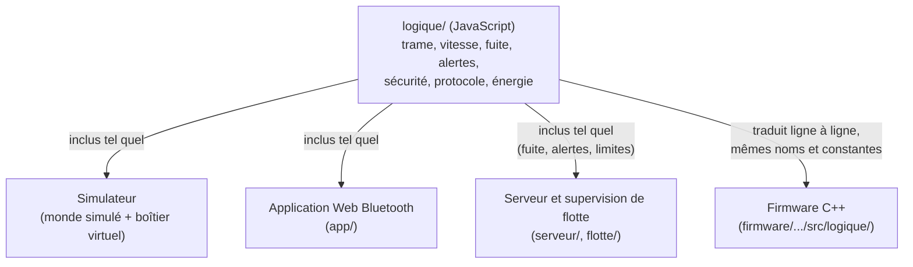
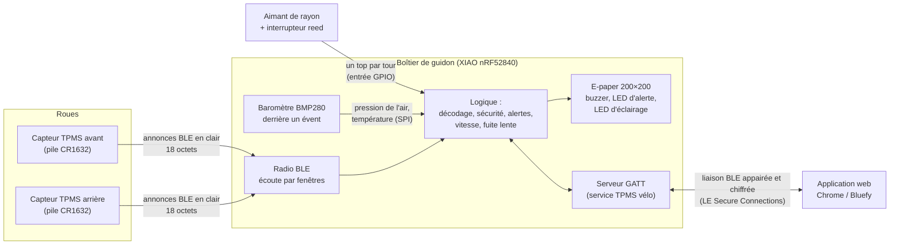
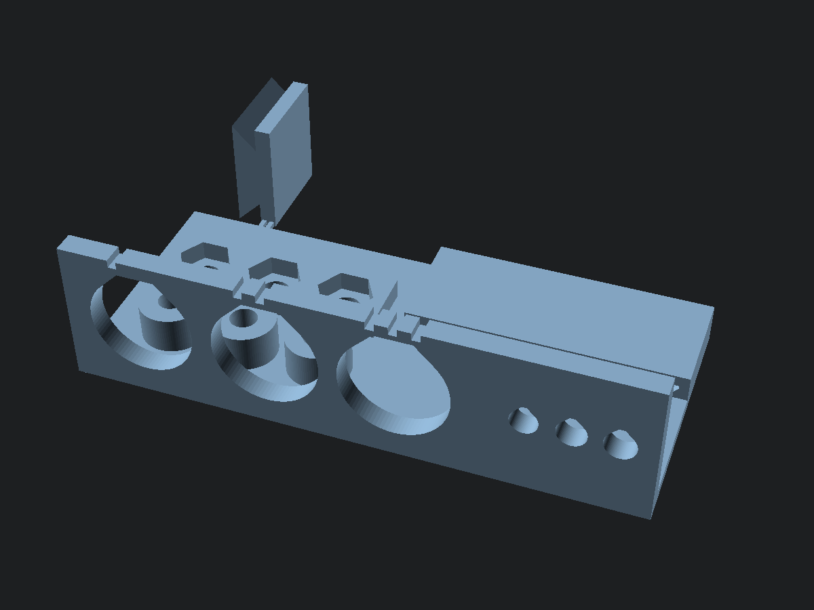
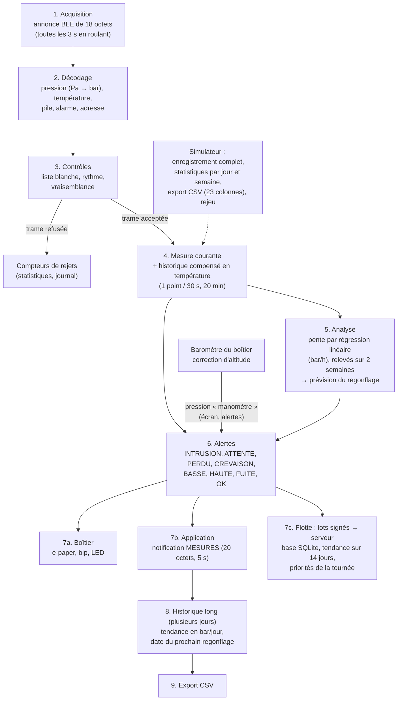

# Rapport de projet – Épreuve E6

<br>

| | |
|---|---|
| **Diplôme** | BTS Cybersécurité, Informatique et réseaux, Électronique (CIEL), option IR (Informatique et Réseaux) |
| **Épreuve** | E6 « Valorisation de la donnée et cybersécurité » |
| **Projet** | Surveillance de la pression des pneus par capteurs TPMS BLE : flotte de chariots élévateurs d'un entrepôt (passerelles BLE → MQTT, réseau d'usine segmenté, supervision), avec un kit vélo comme démonstrateur (boîtier de guidon à écran e-paper, application Web Bluetooth) et un logiciel de simulation complète |
| **Candidat** | Thibault MORRETTON – projet réalisé seul |
| **Établissement** | [Établissement] |
| **Professeur référent** | [Professeur référent] |
| **Session** | [Session] |
| **Date de soutenance** | [Date de soutenance] |
| **Dépôt du projet** | github.com/titilyonnais/tpms-velo |
| **Simulateur en ligne** | https://titilyonnais.github.io/tpms-velo/simulateur/ |
| **Application en ligne** | https://titilyonnais.github.io/tpms-velo/app/ |
| **Supervision de l'entrepôt (démo)** | https://titilyonnais.github.io/tpms-velo/flotte/chariots.html |
| **Supervision de flotte (démo)** | https://titilyonnais.github.io/tpms-velo/flotte/ |

<br>

> **Note sur l'état du projet.** Le matériel a été commandé mais n'est pas encore reçu au moment où j'écris ce rapport (mis à jour le 24/10/2026). Tout ce qui concerne le comportement réel des capteurs, les consommations électriques et l'étanchéité est donc une **hypothèse** ou un **résultat de simulation**, et je le signale à chaque fois. Les chiffres de ce rapport viennent du code du dépôt : je les ai obtenus en exécutant les fonctions avec Node.js ou en lançant les tests, pas en les recopiant à la main.

---

## Sommaire

1. [Contexte et besoin](#1-contexte-et-besoin)
2. [Cahier des charges](#2-cahier-des-charges)
3. [Démarche : simuler avant d'avoir le matériel](#3-démarche--simuler-avant-davoir-le-matériel)
4. [Architecture et réalisation](#4-architecture-et-réalisation)
   - [4.7 Le boîtier imprimé en 3D](#47-le-boîtier-imprimé-en-3d)
5. [Valorisation de la donnée](#5-valorisation-de-la-donnée)
   - [5.5 Prévision du prochain regonflage](#55-prévision-du-prochain-regonflage)
   - [5.6 Pression conseillée](#56-pression-conseillée-hypothèse-assumée)
   - [5.10 Le mode flotte : la donnée au service d'une entreprise](#510-le-mode-flotte--la-donnée-au-service-dune-entreprise)
6. [Cybersécurité](#6-cybersécurité)
   - [6.8 Les failles révélées par la simulation, puis corrigées](#68-les-failles-révélées-par-la-simulation-puis-corrigées)
   - [6.10 Vie privée : le pistage du cycliste](#610-vie-privée--le-pistage-du-cycliste-s12)
   - [6.11 Proposition : des capteurs « version 2 »](#611-proposition--des-capteurs--version-2--à-adresse-privée-et-signés)
   - [6.12 Le journal de sécurité chaîné](#612-traçabilité--le-journal-de-sécurité-chaîné-s15)
   - [6.13 La sécurité du serveur de flotte](#613-la-sécurité-du-serveur-de-flotte)
7. [Énergie](#7-énergie)
   - [7.8 La recharge par grand froid](#78-la-recharge-par-grand-froid-24102026)
8. [Tests et validation](#8-tests-et-validation)
   - [8.1 Les tests automatiques et l'intégration continue](#81-les-tests-automatiques)
9. [Gestion de projet](#9-gestion-de-projet)
10. [Version industrielle : l'entrepôt et son réseau](#10-version-industrielle--lentrepôt-et-son-réseau)
   - [10.6 La démonstration de sécurité du réseau](#106-la-démonstration-de-sécurité-du-réseau)
   - [10.7 Une faille trouvée dans ma propre maquette](#107-une-faille-trouvée-dans-ma-propre-maquette)
   - [10.9 Le simulateur de l'usine](#109-le-simulateur-de-lusine)
11. [Bilan et perspectives](#11-bilan-et-perspectives)
- [Annexe A – Glossaire](#annexe-a--glossaire)
- [Annexe B – Documents du dépôt et liens](#annexe-b--documents-du-dépôt-et-liens)
- [Annexe C – Commandes utiles](#annexe-c--commandes-utiles)

---

## 1. Contexte et besoin

### 1.1 Le constat

Un pneu de vélo perd de l'air avec le temps. Une crevaison lente ne se remarque souvent que lorsque le pneu est déjà presque à plat. Rouler sous-gonflé augmente la résistance au roulement, use le pneu et expose au pincement de la chambre à air. Pour vérifier la pression, il faut un manomètre et du temps, et en pratique beaucoup de cyclistes ne le font pas avant chaque sortie.

Les voitures récentes ont un système qui surveille la pression des pneus : le **TPMS** (*Tire Pressure Monitoring System*). Des capteurs TPMS existent aussi pour le vélo, sous forme de bouchons de valve qui émettent leurs mesures par Bluetooth Low Energy (BLE). Mon projet part de ces capteurs.

### 1.2 Le besoin

Le cycliste veut **connaître en permanence la pression de ses deux pneus** et être **prévenu** en cas de pression anormale, de crevaison ou de fuite lente, **sans dépendre de son smartphone** pendant qu'il roule.

| Question (bête à cornes) | Réponse |
|---|---|
| À qui le produit rend-il service ? | Au cycliste (tous types de vélos) |
| Sur quoi agit-il ? | Sur l'information de pression et de température des pneus |
| Dans quel but ? | Rouler avec une pression correcte et détecter tôt une crevaison ou une fuite |

### 1.3 Le produit, présenté comme celui d'une entreprise

J'ai traité le projet comme le développement d'un produit par une petite entreprise. Le produit est un **kit vendu environ 89 €** qui comprend :

- **2 capteurs de pression** TPMS BLE du commerce, vissés sur les valves ;
- **1 boîtier de guidon** avec un écran e-paper, une alarme sonore et lumineuse, un compteur de vitesse et de distance, et un éclairage latéral de nuit ;
- **1 application** (page web) pour les réglages, l'historique des pressions et la détection des fuites très lentes.

### 1.4 La concurrence

| Produit | Prix indicatif | Afficheur dédié | Remarque |
|---|---|---|---|
| SKS Airspy | environ 100 € la paire de capteurs | Non | Lecture sur smartphone ou compteur compatible |
| Quarq TyreWiz | environ 250 £ la paire | Non | Lecture sur smartphone ou compteur compatible |
| **Mon kit** | environ 89 € le kit complet | **Oui (e-paper)** | Fonctionne sans smartphone |

Les prix sont des relevés indicatifs faits pendant la préparation du projet.

### 1.5 Ce qui différencie le kit

- **Un afficheur dédié lisible en plein soleil.** L'écran e-paper (papier électronique) réfléchit la lumière comme du papier ; il n'a pas de rétroéclairage. Plus il y a de soleil, mieux on le lit.
- **Une très basse consommation.** Un écran e-paper ne consomme rien pour garder une image affichée. Le boîtier dort quand le vélo ne roule pas.
- **Aucun smartphone nécessaire en roulant.** L'application ne sert qu'aux réglages et à l'historique.
- **Vitesse et distance intégrées**, grâce à un aimant fixé sur un rayon et un interrupteur magnétique (reed) sur la fourche.

### 1.6 Ce que j'ai réalisé

Le matériel n'étant pas encore arrivé, j'ai décidé le 22/10/2026 de faire du cœur du projet un **logiciel de simulation complète et réaliste** du kit, sous forme de page web. Le dépôt contient :

| Partie | Dossier | État |
|---|---|---|
| Logique partagée (trames, vitesse, fuite, alertes, sécurité, protocole BLE, énergie, baromètre, boutons) | `logique/` | Terminée, testée |
| Simulateur (monde physique, boîtier virtuel, interface) | `simulateur/` | Terminé, testé, en ligne |
| Application Web Bluetooth | `app/` | Fonctionne avec le boîtier simulé ; à essayer avec le vrai boîtier |
| Programme du boîtier (Arduino, C++) | `firmware/` | Écrit ; la partie logique est testée sur PC à chaque envoi de code ; jamais chargé sur la carte |
| Serveur de flotte et supervision (vélos de location) | `serveur/`, `flotte/` | Terminé, testé (lots signés, comptes de lecture par mot de passe et sessions qui expirent, HTTPS en option, règles RGPD) ; démo en ligne sans serveur |
| Boîtier imprimé en 3D (OpenSCAD) | `boitier-3d/` | Version 2 : modèle paramétré de 10 pièces, avec un évent à membrane pour le baromètre, rendu, contrôlé (aucune interférence aux cotes nominales), STL prêts ; pas encore imprimé |
| Version industrielle : passerelles BLE → MQTT, réception par le serveur, maquette réseau Docker, supervision de l'entrepôt | `entrepot/`, `flotte/chariots.html` | Terminée le 24/10/2026, testée (47 tests) ; maquette lancée sur mon PC, 14 essais de sécurité sur 14 conformes ; supervision en ligne en mode démo |
| Dossier technique | `docs/` | Cahier des charges, architecture, protocole BLE, analyse de risques, bilan énergétique, schéma électrique, orientation industrielle |

### 1.7 L'adaptation industrielle

En présentant le projet, un de mes professeurs l'a jugé **pas assez industriel** et trop pauvre en **réseau** : le seul réseau était la liaison Bluetooth entre les capteurs et le boîtier. J'ai gardé tout ce qui existait et je lui ai donné un contexte industriel : la **surveillance des pneus gonflables d'une flotte de chariots élévateurs** dans un entrepôt. Un pneu de chariot sous-gonflé rend la machine instable, surtout charge levée : c'est d'abord une question de **sécurité au travail**.

Le système devient une vraie chaîne de collecte industrielle : capteurs TPMS sur les pneus, **passerelles** au plafond qui écoutent les capteurs en Bluetooth et publient leurs trames en **MQTT sur TLS**, **réseau d'usine découpé en zones** par un pare-feu (atelier, serveurs, bureautique, DMZ), serveurs **NTP** et **syslog**, et **supervision** de la flotte. Le kit vélo devient le **démonstrateur** à petite échelle : mêmes capteurs, même logique, même cybersécurité. Le chapitre 10 décrit cette version ; la conception est dans `docs/orientation-industrielle.md`.

---

## 2. Cahier des charges

Le cahier des charges complet, avec un critère de validation mesurable pour chaque exigence, est dans [cahier-des-charges.md](cahier-des-charges.md). Je n'en donne ici que la synthèse.

### 2.1 Composition du kit retenue

| Élément | Choix | Justification |
|---|---|---|
| Capteurs de roue | 2 capteurs TPMS BLE du commerce (bouchon de valve, pile CR1632) | Concevoir un capteur de pression étanche qui tourne avec la roue dépasse le temps et le budget d'un projet de BTS. Ces capteurs coûtent 22,19 € la paire. |
| Microcontrôleur | Seeed XIAO nRF52840 | Radio BLE intégrée, chargeur de batterie LiPo intégré, très petite taille (21 × 17,5 mm), mode veille à quelques µA |
| Écran | E-paper WeAct 1,54″, 200 × 200 pixels, contrôleur SSD1681, bus SPI | Lisible au soleil, ne consomme rien entre deux images |
| Batterie | LiPo 3,7 V 500 mAh | Tient dans un boîtier de guidon ; la carte XIAO sait la recharger |
| Recharge | Connecteur magnétique 2 broches ; recharge coupée hors de 2 à 43 °C par un interrupteur TPS22918 (ajout du 24/10/2026) | Pas de prise USB à ouvrir : meilleure étanchéité. Une LiPo s'abîme si on la recharge sous 0 °C, et le chargeur du XIAO ne surveille pas la température (§ 7.8) |
| Baromètre | BMP280 (carte GY-BMP280, 3,3 V, en SPI) derrière un évent à membrane ePTFE (ajout du 24/10/2026) | Corrige l'erreur d'altitude des capteurs (0,17 bar à 1 500 m, § 5.4) et donne la température du boîtier pour couper la recharge par grand froid. Pas encore commandé |
| Vitesse | Aimant de rayon + interrupteur reed filaire | Solution simple et classique des compteurs de vélo |
| Alertes | Buzzer + LED rouge | Le cycliste entend l'alerte sans regarder l'écran |
| Éclairage | 2 LED blanches latérales | Être vu de côté la nuit ; un vrai éclairage avant coûterait trop cher |
| Boîtier | Imprimé en 3D en PETG, visé IPX7, joint torique radial, évent à membrane sous le fond ; collier de cintre serré par vis, boîtier enclenché par une glissière à cran (§ 4.7) | Imprimante 3D disponible au lycée ; boîtier amovible sans outil pour la recharge |
| Application | Page web Web Bluetooth | Rien à installer. Mon téléphone est un iPhone : Safari ne gère pas Web Bluetooth, j'utilise donc le navigateur **Bluefy**. J'ai écarté Flutter parce que compiler une application iOS exige un Mac. |

### 2.2 Exigences fonctionnelles (synthèse)

| N° | Exigence | Critère principal |
|---|---|---|
| EF-01 | Recevoir et décoder les annonces BLE des deux capteurs | Trame de 18 octets décodée sans erreur |
| EF-02 | Afficher pression AV/AR, température, pile des capteurs, batterie du boîtier | Tout visible sur l'écran 200 × 200 sans changer de page |
| EF-03 | Vitesse et distance par aimant et reed, circonférence réglable | Un tour de 2 100 mm en 300 ms donne 25,2 km/h ; circonférence de 1 000 à 3 000 mm |
| EF-04 | Statistiques du trajet et remise à zéro | Bouton 1 : page suivante (appui court), remise à zéro (appui long) |
| EF-05 | Signaler crevaison, pression basse ou haute, capteur perdu, signal suspect | États évalués du plus grave au moins grave |
| EF-06 / EF-07 | Bip + LED à l'apparition d'une alerte ; acquittement | Bouton 2 appui long : plus de bip, LED fixe |
| EF-08 | Détecter une fuite lente | Pente par régression linéaire sur 20 min ; alerte sous −0,15 bar/h |
| EF-09 | Détecter une crevaison rapidement | Alerte CREVAISON moins de 10 s après le passage sous 0,5 bar |
| EF-10 | Éclairage latéral de nuit | Bouton 2 appui court |
| EF-11 | Veille quand le vélo ne roule plus, réveil seul | Veille après 5 min par défaut ; réveil par la roue, un bouton ou le branchement du chargeur |
| EF-12 | Fonctionner sans smartphone | Toutes les fonctions précédentes sans application |
| EF-13 à EF-15 | Application : mesures en temps réel, réglages, historique, fuite sur plusieurs jours, export CSV | Chrome (PC, Android) et Bluefy (iPhone) |
| EF-16 | Simulateur reproduisant le kit avant l'arrivée du matériel | Tous les modules manipulables dans le navigateur, y compris la vie privée |
| EF-17 | Prévoir le prochain regonflage | « REGONFLER AV 12J AR 15J » sur l'écran ; erreur de 2 jours au plus à l'approche du seuil |
| EF-18 | Statistiques par jour et par semaine (simulateur) | Distance, roulage, pression moyenne et minimale, regonflages, minutes en alerte, énergie |
| EF-19 | Pression conseillée selon le cycliste et le pneu | Règle de Berto, ordre de grandeur signalé comme hypothèse |
| EF-25 | Corriger l'erreur d'altitude des capteurs avec un baromètre | Écran et alertes en pression « manomètre » (capteur 2,00 bar sous 846 hPa → 2,17 bar) ; historique en pression du capteur |
| EF-26 | Refuser la recharge de la LiPo par grand froid ou grosse chaleur | Recharge coupée hors de 2 à 43 °C (reprise à 5 °C ou sous 40 °C) ; toujours possible carte éteinte |

### 2.3 Exigences non fonctionnelles (synthèse)

| Domaine | Exigences |
|---|---|
| Énergie | Autonomie du boîtier **≥ 1 semaine** (ENF-01), en visant plusieurs semaines ; piles des capteurs ≥ 1 an (ENF-02) |
| Robustesse | Écran lisible au soleil, rafraîchi seulement si nécessaire ; boîtier étanche IPX7 ; boîtier amovible de son collier sans outil ; recharge sans ouvrir |
| Logiciel | Logique séparée des sources de données et portable en C++ ; tests automatiques lancés à chaque modification ; code commenté en français ; rien à installer |
| Cybersécurité | Liste blanche des capteurs ; rejet des valeurs impossibles ; détection d'un second émetteur sans confondre une vraie crevaison ; liaison app ↔ boîtier appairée et chiffrée ; code d'appairage résistant aux essais successifs ; contrôle des réglages reçus ; confirmation sur le boîtier, par un bouton, de tout changement qui affaiblit la sécurité (ENF-31) ; données gardées sur les appareils de l'utilisateur ; journal de sécurité traçable (ENF-19) ; détection d'une inondation d'annonces (ENF-20) ; capteurs « v2 » contre le pistage, **à l'état de proposition** (ENF-21) |
| Serveur de flotte | Lots signés et protégés contre le rejeu (ENF-23, ENF-24) ; validation et requêtes SQL paramétrées (ENF-25) ; résistance à l'envoi massif (ENF-26) ; lecture réservée aux comptes, par rôle (ENF-27), après connexion par mot de passe, avec des sessions qui expirent (ENF-32) ; échanges chiffrés en HTTPS (ENF-28) ; RGPD : minimisation de la position et durée de conservation (ENF-29) ; en production, une clé par boîtier et des secrets hors du dépôt (ENF-30, non tenue par la démonstration) |

Le mode flotte (§ 5.10) et le serveur qui l'accompagne sont une **extension** pour un client professionnel : ils ne remplacent pas l'exigence ENF-18 (« pas de compte, pas de serveur ») du kit vendu au particulier.

### 2.4 Contraintes

| Type | Contrainte |
|---|---|
| Organisation | Projet réalisé seul |
| Budget | Matériel commandé pour **86,61 € TTC** |
| Matériel | Capteurs du commerce : je ne peux modifier ni le format des trames ni leur sécurité |
| Vélo de test | Valves Schrader, chambre à air |
| Téléphone | iPhone → navigateur Bluefy |
| Web Bluetooth | La page doit être servie en HTTPS (ou depuis `localhost`) |
| Outillage | Imprimante 3D, fer à souder fin/CMS, oscilloscope ; **pas** de mesureur de consommation dédié (PPK2) |
| Calendrier | Matériel pas encore reçu : la conception se fait en simulation |

### 2.5 Budget du matériel

Commande AliExpress, total du panier relevé le 20/10/2026.

| # | Article | Prix |
|---|---|---|
| 1 | Lot de 2 capteurs TPMS BLE | 22,19 € |
| 2 | Seeed XIAO nRF52840 | 11,99 € |
| 3 | Écran e-paper WeAct 1,54″ 200×200 (SSD1681) | 8,49 € |
| 4 | Batterie LiPo 3,7 V 500 mAh (503035) | 5,59 € |
| 5 | Connecteur magnétique 2 broches | 1,23 € |
| 6 | Interrupteur reed PS-3150 | 1,26 € |
| 7 | Aimant de rayon | 2,69 € |
| 8 | 2 boutons étanches 12 mm | 2 × 1,18 € = 2,36 € |
| 9 | Buzzer actif 3 V | 0,81 € |
| 10 | Kit de 100 LED 3 mm | 2,27 € |
| 11 | Joints toriques NBR | 0,85 € |
| | **Sous-total articles** | **59,73 €** |
| | Frais de port | 26,88 € |
| | **Total TTC** | **86,61 €** |

C'est le coût d'un prototype unique, au prix de détail et avec les frais de port : ce n'est pas un coût de revient en série. En dessinant le schéma électrique, j'ai vu qu'il manquait des composants à la commande : 2 MOSFET canal N (AO3400A ou 2N7002), une diode 1N4148, une diode Schottky SS14, des résistances (270 Ω, 2 × 100 Ω, 2 × 100 kΩ, 2 × 150 Ω, 1 kΩ), deux condensateurs (10 µF et 100 nF) et un connecteur pour le câble du reed (liste dans [schema-electrique.md](schema-electrique.md), § 7).

Le 24/10/2026, l'ajout du baromètre et de la coupure de la recharge (§ 4.3) demande d'autres pièces : une carte **GY-BMP280** (3,3 V, 6 broches, utilisée en SPI), un interrupteur de puissance **TPS22918** (SOT-23-6), un **2N7002**, une résistance de **100 kΩ** (R10), une de **1 MΩ** (R11), une de **2,2 kΩ** (R12) et une **pastille autocollante ePTFE** de Ø 10 mm pour l'évent du boîtier (liste dans [../firmware/README.md](../firmware/README.md)). **Ces pièces ne sont pas encore chiffrées** : je n'ai pas relevé leurs prix, elles ne sont donc pas comprises dans les 86,61 €. Seule la pastille est estimée à environ 1 € dans [../boitier-3d/README.md](../boitier-3d/README.md).

### 2.6 Hypothèses à confirmer à la réception

| Hypothèse | Valeur retenue | Comment la confirmer |
|---|---|---|
| Format des trames des capteurs | 18 octets de « manufacturer data », format documenté pour des capteurs similaires (github.com/schlumpf2009/TPMS) | Capturer les annonces avec une application de scan BLE et comparer avec une pression connue |
| Unité de la pression | Pa, little-endian | Comparer avec un manomètre à plusieurs pressions |
| Plage de mesure | 0 à 3,5 bar par défaut (souvent annoncée pour ce type de capteur) ; la fiche AliExpress ne l'indique pas (vérifié le 22/10/2026) | Essai au gonfleur |
| Intervalle d'annonce | 3 s en roulant, 60 s à l'arrêt | Mesurer l'écart entre deux annonces |
| Vitesse à partir de laquelle le capteur sent la rotation | 4,4 km/h dans le simulateur ; le boîtier prend une marge (10 km/h, § 6.8) | Rouler de plus en plus vite et noter quand l'intervalle passe de 60 s à 3 s |
| Consommations du boîtier | Valeurs des fiches techniques | Mesure à l'oscilloscope avec une résistance de shunt |
| Appairage avec code sur iPhone | Fonctionne dans Bluefy | Essai avec le boîtier réel |
| Durée d'un rafraîchissement de l'écran (fil BUSY supprimé le 24/10/2026) | Attente fixe de 2,5 s (complet) et 0,6 s (partiel), × 1,5 sous 10 °C, × 2 sous 0 °C | Mesurer BUSY à l'oscilloscope à 20 °C, au réfrigérateur puis au congélateur, **avant** de couper le fil |
| Évent du boîtier | Pastille ePTFE de Ø 10 mm : débit d'air de 20 à 100 mL/min sous 70 hPa, pression d'entrée d'eau d'au moins 0,3 bar | Fiche du fournisseur, puis essais de l'évent (§ 4.7) |
| Température du boîtier | Suit l'air extérieur avec une constante de temps d'environ 20 min (simulateur) | Relever la température du BMP280 lors d'une sortie par temps froid |

---

## 3. Démarche : simuler avant d'avoir le matériel

### 3.1 Pourquoi un logiciel de simulation

Le matériel est commandé mais pas encore arrivé. Plutôt que d'attendre pour écrire le programme, j'ai choisi de tout mettre au point en simulation, pour trois raisons :

1. **Le délai de livraison.** Je ne le maîtrise pas (commande AliExpress) ; attendre aurait bloqué tout le travail logiciel.
2. **Les situations difficiles à reproduire en vrai.** Une crevaison, une fuite lente sur plusieurs jours, un pirate qui imite un capteur, une batterie qui se vide en deux mois : en réel, il faudrait abîmer des chambres à air, attendre des jours ou fabriquer un émetteur pirate. En simulation, je peux rejouer chaque situation autant de fois que je veux, avec des centaines de variantes.
3. **Trouver les erreurs de conception avant de souder.** Une erreur trouvée dans le simulateur se corrige en modifiant quelques lignes. La même erreur trouvée sur le vélo demande de comprendre ce qui se passe dans un boîtier fermé, sans écran de débogage.

J'ai donc construit un **jumeau numérique** : un logiciel qui reproduit le kit et son environnement. Il fait en numérique tout ce qui sera faisable en réel : régler les capteurs, voir les trames radio, utiliser le boîtier, l'application, attaquer le système, mesurer l'autonomie. Le 22/10/2026, j'ai décidé d'aller plus loin : **tout simuler « comme la réalité »**, c'est-à-dire calculer la physique du pneu et du vélo, la propagation radio et l'électronique, au lieu de laisser l'utilisateur fixer les valeurs à la main.

Le simulateur est mon **outil de travail** : je m'en sers pour concevoir et vérifier. C'est une page web, sans rien à installer : elle s'ouvre par double-clic ou en ligne sur GitHub Pages.

La simulation s'est révélée utile : elle a fait apparaître **onze défauts de conception**, tous corrigés avant d'avoir le matériel (voir § 6.8).

### 3.2 Le principe : la logique est séparée des sources de données

C'est le choix d'architecture le plus important du projet.

Tout ce qui « réfléchit » est écrit **une seule fois**, sous forme de fonctions pures, dans le dossier `logique/` : décoder une trame, décider qu'un pneu est crevé, calculer une vitesse, détecter une fuite, refuser une trame suspecte. Une fonction pure reçoit des données (les octets d'une trame, l'instant présent en millisecondes, les réglages) et renvoie un résultat. Elle ne touche ni à la page web, ni à l'horloge, ni à la radio.

Ce qui fournit les données est une **source de données** interchangeable :

| Donnée | Source simulée | Source réelle |
|---|---|---|
| Trame d'un capteur (18 octets) | `simulateur/monde/capteur.js` | Annonce BLE reçue par le nRF52840 |
| Passage de l'aimant | `simulateur/monde/velo.js` (instant exact du passage) | Interruption de l'entrée reliée au reed |
| Appui sur un bouton | Clic dans la page | Tension de la broche D5, lue en analogique (les deux boutons partagent cette broche, § 4.3) |
| Pression de l'air et température du boîtier | `simulateur/monde/barometre.js` | Baromètre BMP280 sur le bus SPI |
| Instant présent | Horloge simulée, accélérable | `millis()` |
| Liaison avec l'application | `app/transport-simule.js` (messages entre deux pages) | `app/transport-ble.js` (Web Bluetooth) |
| Mesures des vélos d'une flotte | `flotte/registre.js` (mode démo, dans le navigateur) | `serveur/` (Node.js + base SQLite) |

Le boîtier ne fait pas la différence entre une trame produite par le capteur simulé et une trame d'un vrai capteur : ce sont les mêmes 18 octets.

Comme le temps est toujours passé en paramètre (`maintenantMs`), je peux tester en une fraction de seconde un scénario de 20 minutes ou une semaine entière.

### 3.3 La même logique en JavaScript et en C++

Le code JavaScript de `logique/` est écrit dans un style proche du C, pour être traduit facilement :

- toutes les fonctions sont rangées dans un objet global `TPMS`, sans modules, pour que la page s'ouvre par double-clic ;
- les trames sont des tableaux d'octets (`Uint8Array`), qui deviennent des `uint8_t[]` en C ;
- les objets d'état (`creerCompteur`, `creerRythme`…) deviennent des `struct` ;
- les durées sont en millisecondes, comme `millis()`.

Le firmware (`firmware/tpms_boitier/src/logique/`) est une traduction fidèle de ces fichiers : mêmes noms de fonctions, mêmes constantes. L'application (`app/`) réutilise directement les fichiers JavaScript (protocole, calcul de pente, alertes, trames).



Avantage : quand je corrige un défaut dans la logique, la correction vaut pour les trois. Les défauts révélés par la simulation qui touchent le boîtier ont tous été corrigés aussi dans le C++, et les tests C++ le vérifient à chaque envoi de code (§ 8.1).

### 3.4 Une simulation reproductible

Une simulation réaliste contient du hasard : bruit de mesure, évanouissements radio, comportement du cycliste. Si j'utilisais `Math.random()`, je ne pourrais jamais rejouer deux fois la même sortie, donc jamais vérifier qu'une correction a fonctionné.

J'utilise un **générateur pseudo-aléatoire** (PRNG, algorithme mulberry32) initialisé par une **graine** : même graine, même suite de nombres. Chaque modèle (pneu, radio, cycliste) a son propre générateur, dérivé de la graine et du nom du modèle : ajouter un tirage dans la radio ne change pas le bruit du capteur de pression.

Le moteur avance par **pas fixes** (50 ms quand le vélo roule, 1 s au calme). Le résultat ne dépend donc pas de la vitesse de l'ordinateur ni du découpage du temps par le navigateur. Toutes les actions de l'utilisateur sont horodatées : une sortie peut être sauvée (réglages + actions) et **rejouée à l'identique**. C'est vérifié par des tests (§ 8).

### 3.5 Les limites de la démarche

La simulation ne remplace pas le matériel. Elle ne vaut que ce que valent ses hypothèses : si le vrai capteur n'utilise pas le format de trame supposé, ou consomme plus que prévu, il faudra corriger les modèles. J'ai donc rangé à part tout ce qui devra être confirmé (§ 2.6 et § 8.6), et prévu pour chaque point la mesure qui le confirmera.

---

## 4. Architecture et réalisation

Le détail de l'architecture logicielle est dans [architecture.md](architecture.md), le protocole radio dans [protocole-ble.md](protocole-ble.md) et le câblage dans [schema-electrique.md](schema-electrique.md).

### 4.1 Vue d'ensemble du système



Deux liaisons radio très différentes coexistent, et cette différence structure toute la partie cybersécurité :

| Liaison | Nature | Ce que je maîtrise |
|---|---|---|
| Capteurs → boîtier | **Annonces** BLE diffusées à tout le monde, sans connexion, sans chiffrement ni signature | Rien dans les capteurs. Le boîtier peut seulement **trier** ce qu'il reçoit. |
| Boîtier ↔ application | **Connexion** BLE (GATT) que j'ai spécifiée | Tout : appairage par code, chiffrement, contrôle des réglages |

### 4.2 Les capteurs TPMS et le format des trames (hypothèse)

Un capteur TPMS BLE ne se connecte à personne. Il diffuse ses mesures dans le champ *manufacturer data* (données libres du fabricant) de ses **annonces** BLE. Le format que j'utilise est celui documenté pour des capteurs similaires (github.com/schlumpf2009/TPMS). **C'est une hypothèse** : je la vérifierai à la réception en capturant les annonces avec une application de scan BLE.

| Octets | Champ | Codage |
|---|---|---|
| 0-1 | Identifiant fabricant | Valeur supposée `00 01` |
| 2 | Numéro du capteur | `0x80` = capteur 1, `0x81` = capteur 2 |
| 3-7 | Adresse du capteur | 5 octets, identifiant fixe |
| 8-11 | Pression | entier 32 bits little-endian, en pascals |
| 12-15 | Température | entier 32 bits signé little-endian, en centièmes de °C |
| 16 | Pile | % |
| 17 | Alarme | `00` = OK, `01` = pas de pression |

*Little-endian* veut dire que l'octet de poids faible est transmis en premier.

**Exemple décodé** (calculé avec `TPMS.encoderTrame` puis `TPMS.decoderTrame`) : capteur avant, 2,1 bar, 20,5 °C, pile 95 %.

```
00 01 80 EA CA 3F 1B 07 50 34 03 00 02 08 00 00 5F 00
```

- `80` → capteur n° 1 ;
- `EA CA 3F 1B 07` → adresse `EA:CA:3F:1B:07` ;
- `50 34 03 00` → 0x00033450 = 210 000 Pa = 2,1 bar ;
- `02 08 00 00` → 0x00000802 = 2 050 centièmes = 20,50 °C ;
- `5F` → 95 % ; `00` → pas d'alarme.

Ce format a deux conséquences pour la sécurité : il n'y a **ni compteur ni signature** (une trame rejouée est identique à l'originale), et l'**adresse est fixe** (elle permet de reconnaître un vélo). J'y reviens au § 6.

### 4.3 Le boîtier de guidon

#### Matériel et câblage

Le schéma complet, la nomenclature et les calculs sont dans [schema-electrique.md](schema-electrique.md) ; les ajouts du 24/10/2026 (baromètre, coupure de la recharge, deux boutons sur une broche) sont décrits broche par broche dans [../firmware/README.md](../firmware/README.md). Le schéma est dessiné par le même code (`simulateur/vues/schema.js`) que celui qui l'anime dans le simulateur : il n'y a qu'un seul dessin à tenir à jour. Sa révision C (24/10/2026) ajoute U3 (BMP280), U4 (TPS22918), Q3, R10, R11 et R12 : il compte 34 composants repérés.


Les choix que je dois savoir justifier :

| Choix | Justification |
|---|---|
| Les plots NFC sous la carte servent de sorties | Le XIAO n'a que 11 broches (D0 à D10) et il m'en faudrait 15 depuis l'ajout du baromètre et de la coupure de la recharge. Les plots NFC (P0.09, P0.10) deviennent des sorties ordinaires ; j'y mets le buzzer et l'éclairage, qui sont à 0 au repos, pour éviter un courant de fuite entre ces deux broches. Les trois lignes suivantes libèrent les broches qui manquaient encore. |
| Fil BUSY de l'écran supprimé (24/10/2026) | L'écran signalait la fin d'un rafraîchissement par sa broche BUSY (D0). D0 sélectionne maintenant le baromètre ; le programme attend une durée fixe, choisie plus longue que le vrai rafraîchissement : 2,5 s pour un rafraîchissement complet, 0,6 s pour un partiel, × 1,5 sous 10 °C et × 2 sous 0 °C, car le contrôleur SSD1681 ralentit au froid (`TPMS.attenteEcranMs`, `logique/barometre.js`). **Ces durées sont des hypothèses** : je câblerai BUSY provisoirement pour le mesurer à l'oscilloscope, à 20 °C, au réfrigérateur et au congélateur, avant de couper le fil. |
| Baromètre sur le bus SPI de l'écran | Le BMP280 partage l'horloge (D8) et la ligne MOSI (D10) avec l'écran ; sa sortie SDO arrive sur D9 (MISO), réservée par le bus SPI mais inutilisée jusque-là. Il ne coûte donc qu'une broche : D0, sa sélection. |
| Deux boutons sur une seule broche (D5) | SW1 relie D5 à 0 V ; SW2 passe par R12 = 2,2 kΩ. Avec la résistance de tirage interne (13 kΩ, de 11 à 16 kΩ selon la puce), SW2 donne 3,3 × 2,2 / (2,2 + 13) ≈ 0,48 V, soit 12 à 17 % de VDD. Le programme lit D5 en analogique pendant un appui pour savoir quel bouton est enfoncé (`logique/boutons.js`, seuils à 6 % et 45 % de VDD). Les deux niveaux restent sous le seuil logique de 30 % de VDD : **les deux boutons réveillent toujours la carte**. Avec 3,3 kΩ, SW2 monterait jusqu'à 23 %, trop près du seuil. D6 est ainsi libérée pour la coupure de la recharge. |
| Coupure de la recharge : U4 (TPS22918) et Q3 (2N7002) | La LiPo ne doit pas se recharger hors de 0 à 45 °C, et le chargeur BQ25101 du XIAO ne surveille pas la température. U4 coupe le 5 V du connecteur, après la diode D2 ; sa broche EN est tirée au 5 V par R10 (100 kΩ). Par grand froid, D6 rend Q3 passant : EN tombe à 0 et U4 coupe le 5 V. R11 (1 MΩ) tire la grille de Q3 à 0 : **carte éteinte ou batterie vide, la recharge reste toujours possible**, sinon une batterie vide ne pourrait plus jamais se recharger. Pendant la coupure, R10 consomme 50 µA, pris sur le chargeur et non sur la batterie ; R11 ne prend que 3,3 µA tant que D6 est à 1 (avec 100 kΩ, elle en prenait 33). |
| Buzzer et éclairage commandés par un MOSFET canal N (AO3400A) | Le buzzer demande environ 25 mA, plus qu'une broche ne peut fournir. L'AO3400A est « niveau logique » : son seuil VGS(th) est de 0,65 à 1,45 V, donc 3,3 V sur la grille suffisent à le rendre passant. Un MOSFET ordinaire (seuil jusqu'à 4 V) ne conviendrait pas. |
| Résistance de 100 kΩ entre grille et masse | Au démarrage et en veille, la broche est en haute impédance. Sans cette résistance, la grille « flotte » et le MOSFET peut conduire à moitié : le buzzer sifflerait et l'éclairage viderait la batterie. |
| Diode 1N4148 aux bornes du buzzer | Le buzzer contient une bobine. À la coupure, le courant de la bobine ne peut pas s'arrêter net et ferait monter la tension du drain. La diode lui offre un chemin et limite la tension à environ 4 V. |
| Diode Schottky SS14 sur l'entrée de recharge | La broche 5V du XIAO est reliée à l'USB. Sans diode, brancher l'USB pour programmer mettrait 5 V sur les contacts à nu du connecteur magnétique. Une Schottky perd environ 0,3 V seulement, ce qui laisse assez de tension au chargeur. |

Les calculs des résistances des LED (150 Ω par LED blanche sur la batterie, 270 Ω et « sortie forte » pour la LED d'alerte) et la protection du câble du reed (1 kΩ) sont détaillés dans [schema-electrique.md](schema-electrique.md).

**Le piège de l'aimant arrêté devant le reed.** Si le vélo s'arrête avec l'aimant pile devant le reed, le contact reste fermé et un courant traverse en permanence la résistance de tirage interne (environ 13 kΩ). D'après le modèle du circuit, la consommation en veille passe de 5 µA à 241 µA. J'ai prévu une parade logicielle (au-delà de 3 s fermé, le programme débranche la résistance de tirage et revient vérifier une fois par seconde) et une parade matérielle en option (tirage externe de 1 MΩ, soit 3,3 µA).

#### Écran et interface

L'écran fait 200 × 200 pixels en noir et blanc. La mise en page (`simulateur/boitier/ecran.js`) est la suivante :

```
┌──────────────────────────────┐
│ TPMS  ECLAIRAGE     87% [▮▮ ]│  barre d'état (éclairage, app connectée, batterie)
├──────────────┬───────────────┤
│    AVANT     │    ARRIERE    │
│    2.10      │     2.35      │  gros chiffres : police 5×7 agrandie 4 fois (28 px)
│     bar      │      bar      │
│ 21°C PILE 95%│ 21°C PILE 94% │
│      OK      │ PRESSION BASSE│  colonne en négatif si alerte
├──────────────┴───────────────┤
│        23.4 km/h             │  page 1 : vitesse + distance
│ DIST  12.34 km               │  page 2 : statistiques du trajet
└──────────────────────────────┘
```

La police bitmap 5×7 est la même table dans le simulateur et dans le firmware : l'écran réel sera identique au pixel près à celui du simulateur.

| Commande | Appui court | Appui long |
|---|---|---|
| Bouton 1 | Page suivante | Remise à zéro du trajet (la circonférence est conservée) |
| Bouton 2 | Éclairage allumé ou éteint | Acquitter l'alerte (plus de bip, LED fixe) ; ou **confirmer** un changement sensible demandé par l'application (§ 6.6) |

Deux affichages ont été ajoutés le 24/10/2026 : la fenêtre « CONFIRMER ? », qui liste exactement ce que l'application veut changer (« COUPER LISTE BLANCHE », « NOUVEAU CAPTEUR AR »…) avec « APPUI LONG BOUTON 2 : OUI » et « AUTRE BOUTON : NON » ; et le mot « FROID » (ou « CHAUD ») devant le pourcentage de la batterie quand la recharge est coupée.

**Le geste « oublier les téléphones appairés » a changé.** Il fallait maintenir les deux boutons pendant le démarrage. Depuis que les deux boutons partagent la broche D5, « les deux à la fois » donne 0 V, comme le bouton 1 seul : le programme ne peut plus les distinguer. Le geste est donc devenu : **maintenir le bouton 1 pendant 5 s au démarrage**.

#### Comportement (la « boucle principale »)

Le comportement du boîtier est écrit dans `simulateur/boitier/boitier.js`, l'équivalent de la fonction `loop()` du programme Arduino :

1. **Écoute radio par fenêtres** : la radio écoute 3 s toutes les 5 s, à une position pseudo-aléatoire dans chaque période ; elle passe en écoute continue pendant 15 s quand une trame est douteuse (choix expliqué au § 7.3).
2. **Filtrage des trames** : décodage, liste blanche, contrôle du rythme, vraisemblance (§ 6.6) ; comptage des annonces inconnues pour détecter une inondation ; chaque événement de sécurité est noté dans un journal chaîné (§ 6.12).
3. **Évaluation des alertes** pour chaque roue, du plus grave au moins grave.
4. **Sorties** : bip à l'apparition d'une alerte, LED clignotante tant que l'alerte n'est pas acquittée.
5. **Écran** : au plus un rafraîchissement toutes les 2 s en roulant, et **seulement si l'image a changé** (comparaison des deux images) ; un rafraîchissement complet toutes les 20 mises à jour partielles pour effacer les traces ; une hystérésis de 0,03 bar évite de redessiner pour le bruit du capteur.
6. **Baromètre** : une mesure toutes les 10 s, boîtier éveillé. La pression de l'air corrige l'erreur d'altitude des capteurs pour l'affichage et les alertes (§ 5.4) ; la température décide si la recharge est permise (§ 7.8). Baromètre absent ou hors plage : pas de correction, recharge jamais coupée ; un baromètre qui se tait est noté au journal (« Baromètre muet »).
7. **Veille** après 5 min sans tour de roue ni appui (réglable de 10 s à 1 h) ; réveil par un tour de roue, un bouton ou l'arrivée du 5 V du chargeur.

### 4.4 Le simulateur : une simulation complète

#### Les modèles du monde

Autour du boîtier virtuel, `simulateur/moteur.js` fait vivre un monde physique. Chaque modèle est dans un fichier de `simulateur/monde/`, avec ses sources et ses hypothèses écrites en commentaire.

| Modèle | Fichier | Ce qui est calculé |
|---|---|---|
| Atmosphère et météo | `atmosphere.js` | Pression atmosphérique selon l'altitude (atmosphère standard : 1 013 hPa au niveau de la mer, 846 hPa à 1 500 m) ; température, soleil, vent et pluie heure par heure |
| Pneu | `pneu.js` | Loi des gaz parfaits **P·V = n·R·T** : le modèle ne stocke pas la pression mais la quantité d'air (n, en moles) et la température ; la pression en découle. Échauffement en roulant, au soleil, au freinage ; perméation de la chambre (butyle, latex, tubeless) ; écoulement de l'air par les trous (épine, pincement, valve, micro-trou de fuite lente) ; pompe |
| Capteur TPMS | `capteur.js` | Une mesure par seconde, une annonce toutes les 3 s en roulant et toutes les 60 s à l'arrêt (immédiate en cas de changement brusque) ; décalage d'étalonnage et bruit ; plage limitée (3,5, 5 ou 8 bar, au-delà la mesure sature) ; pile CR1632 |
| Parcours | `parcours.js` | 4 parcours réels approchés autour de Lyon (berges du Rhône, col de la Luère, VTT dans les monts d'Or, trajet domicile-travail) : altitude, pente, virages, revêtement, feux |
| Vélo et cycliste | `velo.js` | Bilan des forces (propulsion, poids en pente, roulement qui dépend de la pression, traînée de l'air, freins), 2e loi de Newton ; rotation des roues et instants de passage de l'aimant |
| Radio BLE | `radio.js` | Affaiblissement selon la distance et l'environnement, ombrage par les obstacles, évanouissements rapides, masquage par la jante, canaux d'annonce 37/38/39, collisions entre paquets, Wi-Fi, brouillage, sensibilité du récepteur (−95 dBm), vélos voisins équipés des mêmes capteurs |
| Batterie | `lipo.js` | Modèle de Thévenin (tension à vide selon l'état de charge, résistance interne, polarisation), effet du froid, autodécharge, protection, chargeur (courant constant puis tension constante) |
| Circuit | `circuit.js` | Tension de chaque nœud et courant de chaque composant du schéma (LED par méthode de Newton, MOSFET, régulateur), y compris le baromètre, la coupure de la recharge (U4, Q3, R10, R11) et l'échelle des boutons sur D5 |
| Baromètre et température du boîtier | `barometre.js`, `moteur.js` | BMP280 avec son bruit (≈ 0,02 hPa) et son erreur absolue (±1 hPa, fiche Bosch) ; trois modes : derrière un évent (par défaut), sans évent (l'air enfermé à la fermeture ne voit pas l'altitude), aucun. Température du boîtier qui suit l'air avec retard (constante de temps d'environ 20 min, **hypothèse**) ; sur son chargeur, le boîtier est « à la maison » à 19 °C, sauf option « recharge dehors » |
| Attaquant | `sources/pirate.js` | Émetteur BLE pirate : usurpation d'adresse, rejeu de trames enregistrées, brouillage, pirate synchronisé, inondation |
| Espion | `sources/mouchards.js` | 20 récepteurs BLE posés le long des rues, qui notent chaque passage d'adresse (§ 6.10) |

**Un exemple de réalisme utile : l'erreur en altitude.** Un capteur TPMS mesure la pression absolue et lui retire une pression atmosphérique **fixe** de 1 013,25 hPa, parce qu'il ne connaît pas l'altitude. À 1 500 m, l'air ne pèse plus que 846 hPa : le capteur annonce environ 0,17 bar de moins que ce que lirait un manomètre sur place. Le simulateur reproduit cet écart. Au départ, je l'avais seulement noté comme une limite ; depuis le 24/10/2026, le boîtier le corrige avec son baromètre (§ 5.4). L'option « sans évent » montre pourquoi l'évent est indispensable : l'air enfermé dans un boîtier étanche garde la pression de la fermeture, et la correction reste nulle en montagne.

**Un second exemple : la recharge par grand froid.** Avec l'option « recharge dehors », par −5,7 °C, la recharge reste coupée pendant 90 min et la batterie ne bouge pas ; ramené à la maison, le boîtier se réchauffe et la recharge reprend au bout d'environ 11 min (scénario vérifié dans le simulateur, § 7.8).

#### Le moteur pas à pas

À chaque pas de temps (50 ms quand il se passe quelque chose, 1 s vélo garé), le moteur enchaîne : heure et météo, position sur le parcours, commande du cycliste et dynamique du vélo, pneus, capteurs et annonces, propagation radio et fenêtres d'écoute, boîtier, électronique et batterie, enregistrement d'un point.

Un pas en roulant prend environ 12,7 µs de calcul. Le temps peut être accéléré jusqu'à ×3 600 ; en roulant, le calcul plafonne entre ×1 400 et ×2 700 selon l'ordinateur, et la barre du haut l'indique (« calcul limité à ×… »). Vélo garé, c'est beaucoup plus rapide.

Le planning « semaine type » enchaîne automatiquement, du lundi au vendredi, un trajet domicile-travail à 7 h 45 et à 17 h 30, le samedi à 10 h et le dimanche à 9 h 30 une sortie, et le dimanche de 20 h à 23 h une recharge du boîtier (14 événements par semaine). Le bouton « Avancer jusqu'à … » avance rapidement jusqu'au prochain événement et s'arrête si une alerte apparaît.

#### L'interface

L'interface est un tableau de bord sombre, avec une barre latérale et huit pages :

| Page | Contenu |
|---|---|
| Vue d'ensemble | Pneus AV/AR avec courbe, pression conseillée et prochain regonflage (en montagne, la pression affichée par le boîtier est suivie de celle du capteur et de la correction d'altitude) ; vélo, boîtier virtuel, carte, batterie, sécurité, événements |
| Configuration | Nouvelle simulation (parcours, météo, heure, chambres, pressions, poids du cycliste, plage des capteurs, capteurs du commerce ou « v2 », baromètre du boîtier, lieu de la recharge, graine, planning) ; réglages du boîtier |
| Pneus | Pression réelle et pression affichée par le boîtier ; dernières trames, en hexadécimal et décodées |
| Radio et sécurité | Vue de dessus, devenir de chaque annonce (reçue, radio coupée, trop faible, collision, corrompue, brouillée), attaques, protections, journal chaîné, trafic |
| Vie privée | Réseau de récepteurs espions et trajets qu'ils reconstituent (§ 6.10) |
| Électronique | Schéma animé (courants, tensions), batterie LiPo et recharge, température du boîtier, état de la recharge (permise ou coupée), pression du baromètre et correction d'altitude, répartition du courant, autonomie d'une journée type |
| Application | L'application de `app/` reliée au boîtier simulé ; attaque de l'homme du milieu |
| Données | Courbes de tout l'enregistrement, statistiques par jour et par semaine, export CSV, sauvegarde et rejeu de scénario |

### 4.5 L'application Web Bluetooth

L'application (`app/`) est une page web. **Web Bluetooth** est une interface des navigateurs qui permet à une page de se connecter à un appareil BLE. Elle fonctionne dans Chrome (PC, Android) et, sur iPhone, dans le navigateur **Bluefy** ; Safari ne l'implémente pas. La page doit être servie en HTTPS, ce que fait GitHub Pages.

| Vue | Rôle |
|---|---|
| Pneus | Pressions, températures, piles, états ; vitesse, trajet, batterie du boîtier |
| Historique | Courbes des pressions, tendance depuis le dernier regonflage (en bar par jour, calculée **sans** la correction d'altitude), date estimée du prochain regonflage (même fonction `TPMS.joursAvantSeuil` que le boîtier, § 5.5), export CSV (date, pression avant, pression arrière, `correction_altitude_bar`) |
| Réglages | Circonférence, seuils, délai de veille, protections, adresses des capteurs (lien chiffré obligatoire) ; un changement sensible attend la confirmation sur le boîtier |

**Deux transports, une seule application.** L'application ne parle jamais directement à la radio. Elle passe par un « transport » qui offre les mêmes fonctions (`connecter`, `lireReglages`, `ecrireReglages`, `commande`, `surMesures`…) en deux versions : `transport-ble.js` (vraie radio) et `transport-simule.js` (boîtier virtuel du simulateur, par messages entre deux pages). Les deux transportent **les mêmes octets**. C'est le même principe que pour les capteurs : la source change, la logique reste.

**Le protocole boîtier ↔ application** (détail dans [protocole-ble.md](protocole-ble.md)) : un service GATT avec trois caractéristiques, identifiées par des UUID de 128 bits tirés au hasard pour le projet.

| Caractéristique | Taille | Rôle |
|---|---|---|
| MESURES | 20 octets | Notification toutes les 5 s : pressions « manomètre » (mbar), températures, piles, états, vitesse, distance, batterie, drapeaux (octet 17 ; bit 3 : changement sensible en attente de confirmation, bit 4 : recharge coupée), numéro de séquence (octet 18), correction d'altitude (octet 19, en pas de 4 mbar) |
| REGLAGES | 23 octets | Lecture et écriture : circonférence, seuils, délai de veille, protections, adresses des capteurs appairés |
| COMMANDE | 1 octet | Remise à zéro du trajet, acquittement des alertes (cette commande ne peut pas confirmer un changement sensible, § 6.6) |

J'ai choisi 20 octets pour MESURES parce que c'est la charge utile maximale d'une notification avec la taille de paquet par défaut (MTU de 23 octets moins 3 octets d'en-tête) : pas besoin de négociation. REGLAGES en fait 23 : le firmware demandera une MTU plus grande, point à vérifier sur le vrai téléphone.

**Ce qui a changé dans le protocole le 24/10/2026.**

- *La correction d'altitude.* Les pressions de MESURES sont celles qu'un manomètre lirait sur place : le boîtier y a ajouté la correction de son baromètre, rappelée dans l'octet 19 (entier signé, pas de 4 mbar, de −0,512 à +0,508 bar). L'application **retire** cette correction pour calculer la tendance de son historique : elle suit ainsi la quantité d'air du pneu, et un aller-retour en montagne ne ressemble plus à une fuite (§ 5.4). Pour faire de la place sans dépasser 20 octets, le numéro de séquence est passé de 2 octets à 1 : 255 notifications perdues de suite, soit environ 21 min, restent détectables, ce qui suffit pour compter les pertes.
- *La confirmation par bouton.* Quand l'application écrit un réglage sensible (couper une protection, changer l'adresse d'un capteur), le boîtier n'applique rien et lève le bit 3 de l'octet 17. L'application affiche « confirme-le sur le boîtier par un appui long sur le bouton 2 (30 s) » ; quand le bit retombe, elle relit REGLAGES pour savoir si le changement a été confirmé ou annulé. Avec la vraie radio, l'écriture BLE réussit toujours : c'est ce drapeau qui donne la suite (le simulateur répond directement « attente-bouton »).

### 4.6 Le firmware C++

Le programme du boîtier (`firmware/`) est écrit pour l'environnement Arduino du XIAO nRF52840. Il est organisé comme le simulateur :

```
firmware/tpms_boitier/
  tpms_boitier.ino   setup() et loop() : relient la logique au matériel
  config.h           broches et constantes matérielles
  src/logique/       traduction fidèle en C++ de la logique JS (aucun appel Arduino)
  src/materiel/      radio BLE, écran, reed, boutons, sorties, batterie, veille, mémoire flash
```

Choix principaux :

- **Image de 1 bit par pixel** : 5 000 octets par image. Le boîtier garde l'image affichée et celle en préparation ; une comparaison `memcmp` dit s'il faut rafraîchir.
- **Pas d'allocation dynamique** : les tableaux qui grandissent en JavaScript deviennent des tableaux de taille fixe avec un compteur.
- **Files d'attente** : l'interruption du reed, le scanner BLE et la liaison avec l'application ne touchent jamais à la logique ; ils déposent un événement que `loop()` transmet. Deux morceaux de programme ne modifient donc jamais l'état en même temps.
- **Veille en mode System OFF** (environ 5 µA) : réglages et trajet sauvegardés en flash avant l'extinction. Le réveil se fait par le reed, par chaque bouton (SW2 à travers R12) et par l'arrivée du 5 V du chargeur (détection de VBUS). Avant de s'éteindre, le boîtier relâche toujours la coupure de la recharge : si le câble est branché, le 5 V revient aussitôt, le réveille, et il remesure la température (§ 7.8).
- **Écran sans fil BUSY** : un rafraîchissement complet bloque `loop()` jusqu'à 2,5 s (5 s sous 0 °C) ; une petite tâche FreeRTOS fait clignoter la LED et biper le buzzer pendant ce temps, pour que les bips gardent leur durée.
- **Baromètre** (`barometre_bmp280.cpp`) : bibliothèque Adafruit BMP280 sur le bus SPI partagé avec l'écran (bibliothèque GxEPD2).
- **Copies d'annonce ignorées** : une annonce BLE est émise sur 3 canaux en quelques millisecondes ; le firmware ignore les copies reçues à moins de 100 ms d'écart, sinon le contrôle du rythme les prendrait pour un second émetteur.
- **Tests embarqués** : avec `AUTOTEST 1`, les tests de la logique sont rejoués sur la carte au démarrage.

**État de vérification.** La logique C++ (`src/logique/`, 18 fichiers `.cpp`, dont `sha256.cpp`, `journal.cpp` et `trame2.cpp` ajoutés le 23/10/2026, `barometre.cpp` et `boutons.cpp` le 24/10/2026) est compilée avec g++ sur PC et ses **139 tests sont exécutés** à chaque envoi de code par GitHub Actions (§ 8.1). Jusqu'au 22/10/2026, je ne pouvais que vérifier sa syntaxe avec le compilateur pour ESP32 installé sur mon PC : les tests C++ n'avaient jamais tourné. Le programme complet n'a en revanche **jamais été compilé avec le cœur Arduino de Seeed ni chargé sur la carte**, puisque je ne l'ai pas encore. Les points incertains sont marqués `// À VÉRIFIER :` dans le code et listés dans [../firmware/README.md](../firmware/README.md).

### 4.7 Le boîtier imprimé en 3D

Le boîtier est décrit en détail dans [../boitier-3d/README.md](../boitier-3d/README.md). Je l'ai dessiné avec **OpenSCAD**, un logiciel de CAO où la pièce est écrite comme un programme (`boitier-3d/boitier.scad`). J'ai choisi cet outil pour trois raisons : chaque cote est une variable commentée, donc justifiable ; les dimensions extérieures sont **calculées** à partir de celles des composants ; et le fichier se suit avec git comme le reste du code.

**Deux versions.** La première version (commits `f088154` et `a92b81d`) était une boîte rectangulaire. Je l'ai jugée trop carrée et peu réaliste, et j'ai demandé une **version 2** (23/10/2026) : un vrai boîtier fonctionnel, aux bonnes cotes et avec des tolérances d'impression. Mes choix de départ : une forme de compteur GPS, l'étanchéité IPX7 par un joint torique, une fixation par collier fendu et vis, le PETG comme matière, et un montage sur le cintre près des poignées (cintre plat : 22,2 mm). L'imprimante n'est pas encore connue : les jeux d'impression sont donc des paramètres.

Chaque cote est marquée de sa source : **[FICHE]** (fiche du composant), **[MESURÉ AU PLAN]** (relevé sur un plan du fabricant), **[HYPOTHÈSE]** (à mesurer à la réception) ou **[CHOIX]**. Pour l'écran, j'ai relevé les cotes sur le plan officiel (dépôt GitHub WeActStudio.EpaperModule), en calant l'échelle du PDF sur le pas de 0,5 mm du connecteur 24 broches : circuit 50,03 × 32,6 mm, trous à 44,44 × 26,94 mm, dalle 31,8 × 37,32 mm centrée. Certains sites donnent 48 × 33 mm, ce qui aurait été faux. Des `assert` arrêtent le calcul si une règle est violée (paroi trop fine, joint mal écrasé, écran qui touche la jupe…).


#### Le boîtier en bref

| Caractéristique | Valeur | Justification |
|---|---|---|
| Dimensions | **46,0 × 64,0 × 28,0 mm** sans le collier ; avec le collier, le haut de l'écran est à 40 mm au-dessus d'un cintre de 22,2 mm | Calculées à partir des composants (ci-dessous) |
| Forme | Façade plate, fenêtre biseautée à 45°, coins arrondis R 5,5 vus de dessus, flancs légèrement bombés (R 150), dessous très arrondi sur les côtés ; rainure en V au plan de joint, deux tons, « TPMS » gravé, 3 alvéoles devant le buzzer | Aspect d'un compteur GPS. Chaque arrondi finit par un chanfrein à 45° pour s'imprimer **sans support**. R 5,5 est le plus grand arrondi qui laisse assez de matière autour des inserts |
| Étanchéité | Joint torique **53 × 1,8 NBR 70** (ISO 3601-1, équivalent AS568-032), **radial**, dans une gorge de la jupe de la façade | Voir le calcul ci-dessous |
| Fermeture | 4 vis M2 × 6 à tête fraisée (DIN 965) dans des inserts laiton M2 × 4 posés à chaud (trou de 3,2 mm), **hors du joint** | Un filetage dans le plastique s'userait aux ouvertures ; l'eau qui suivrait une vis bute sur le joint |
| Vitre | PMMA 1 mm collé **sous** la façade, tenu par l'écran | La pression de l'eau plaque la vitre contre sa colle au lieu de la décoller |
| Boutons, buzzer, LED, reed | Lamages plats pour les joints des boutons ; membrane de 1,2 mm devant le buzzer ; LED collées à l'époxy ; passe-fil serré (trou de 2,2 mm pour un câble de 2,5 mm) + cône de silicone pour le reed | Aucun trou ouvert vers l'extérieur, en dehors de l'évent fermé par sa membrane |
| Recharge | Connecteur magnétique dans le fond, noyé dans l'époxy | À l'abri de la pluie quand le boîtier est sur le vélo ; on recharge le boîtier retiré |
| Montage | Détrompeur : la façade ne peut pas être montée à l'envers | L'écran reste dans le bon sens, le nom « TPMS » côté cycliste |
| Évent (24/10/2026) | Trou de Ø 3 mm sous le fond, à l'arrière, au centre entre les deux boutons, fermé à l'intérieur par une pastille autocollante ePTFE de Ø 10 mm posée sur une assise de Ø 12 | Le baromètre doit mesurer l'air extérieur, pas l'air enfermé à la fermeture (détail ci-dessous) |
| Matière | **PETG**, buse 0,4 mm, coque et façade remplies à 100 % | Le PLA se déforme vers 55–60 °C : un boîtier sombre au soleil dépasse cette température. L'ASA tient mieux mais demande une imprimante fermée |
| Masse (pièces pleines) | Coque 26 g, façade 8 g, collier 10 g, bride 6 g ; boîtier équipé ≈ 66 g, BMP280 compris | Volumes des STL × 1,27 g/cm³ |

#### Les dimensions sont calculées

Vu de dessus, tout part du circuit de l'écran (50,0 × 32,6 mm). Par côté : 0,5 mm de jeu de pose + 2,6 mm de jupe (gorge de 1,2 + 1,4 de matière) + 0,2 mm de jeu radial jupe ↔ coque + 3,4 mm de paroi (3,7 à l'avant et à l'arrière). On obtient 32,6 + 2 × 6,7 = **46,0 mm** et 50,0 + 2 × 7,0 = **64,0 mm**. Les parois dépassent les 2 mm minimum parce que les inserts des vis doivent tenir dans les coins, hors du joint : placés sur la diagonale du coin, ils gardent **1,28 mm** de matière de chaque côté (règle : au moins 1,2 mm, soit 3 cordons).

En hauteur, ce sont les **écrous des boutons** (Ø 16,5 mm sur les angles, hypothèse) qui imposent la cote :

```
fond 2,0 + chanfrein 1,0 + garde 0,3 + écrou 16,5 + garde 0,3 + jupe 5,2 + façade 2,4 = 27,7 → 28,0 mm
```

#### Pourquoi un joint radial et le calcul de la gorge

Avec un joint plat (axial) écrasé entre la coque et la façade, l'écrasement dépend du serrage des vis et de la raideur de la façade. Entre deux vis distantes de 57 mm, une façade en PETG de 2,4 mm fléchit davantage que l'écrasement voulu : le joint ne serait plus serré au milieu des côtés. Un joint **radial**, comme celui d'un piston de seringue, est posé dans une gorge autour de la jupe de la façade et écrasé contre la paroi intérieure de la coque (l'alésage). Son écrasement ne dépend que des **dimensions**, pas du serrage ; les vis ne font que retenir la façade.

Règles usuelles des fabricants de joints, montage statique :

| Grandeur | Règle | Calcul | Résultat |
|---|---|---|---|
| Étirement du joint posé | 1 à 5 % (le joint tient dans sa gorge sans rouler) | fond de gorge de 170,3 mm : 170,3 / (π × 53) − 1 | **2,3 %** |
| Section réelle | un joint étiré s'amincit | 1,8 / √1,023 | 1,78 mm |
| Écart fond de gorge ↔ alésage | | profondeur de gorge 1,2 + jeu radial 0,2 | 1,40 mm |
| **Écrasement** | 15 à 25 % en statique | (1,78 − 1,40) / 1,78 | **21,3 %** |
| Avec ±0,1 mm d'erreur d'impression | | | 15,7 à 27 % |
| Remplissage de la gorge | < 85 % (le caoutchouc doit pouvoir se déformer et gonfler) | | **66 %** |
| Rayon au fond de gorge | ≥ 3 × la section | 5,9 ≥ 3 × 1,8 = 5,4 | respecté |

La gorge est imprimable façade retournée : flanc bas à 45° (sans support) ; l'alésage de la coque a un chanfrein d'entrée de 0,5 mm à 30° pour que le joint ne soit pas coupé en fermant.


#### Le baromètre BMP280 et l'évent à membrane (24/10/2026)

**Pourquoi un évent.** Dans un boîtier étanche, le baromètre mesurerait l'air enfermé à la fermeture et ne verrait jamais l'altitude. J'ai donc percé un trou de 3 mm dans le fond et prévu de coller dessus, à l'intérieur, une **pastille à membrane ePTFE** (téflon expansé) : ses pores laissent passer l'air mais pas l'eau liquide. C'est la solution des compteurs GPS IPX7 qui ont un altimètre barométrique. Jusqu'au 23/10/2026, le boîtier n'avait pas d'évent ; le § 2.6 de [../boitier-3d/README.md](../boitier-3d/README.md) s'intitule maintenant « Baromètre BMP280 et évent à membrane ».

**Où le mettre.** Sous le fond, à l'arrière, au centre (X = 0, Y = −18,3 mm), entre les deux boutons : à l'abri des projections de la roue avant (le cintre et le collier sont devant et dessous) et hors de la glissière, qui commence 10 mm plus en avant. Pour prouver que rien ne le masque, le contrôle d'interférences contient une colonne d'air fictive (`air_event`, Ø 8 mm sur 12 mm sous le trou) qu'aucune pièce ni aucun composant ne doit toucher.

**L'évent est-il assez rapide ?** En descente de col (60 km/h sur 8 %, soit 80 m de dénivelé par minute, environ 9,6 hPa/min), il faut faire entrer 35 cm³ × 9,6 / 1 013 = **0,33 cm³ d'air par minute** dans le boîtier. Une pastille courante laisse passer de l'ordre de 20 à 100 mL/min sous 70 hPa (**hypothèse**, à lire sur la fiche) : l'écart nécessaire n'est que de 0,2 à 1,2 hPa, soit 2 à 10 m d'altitude et au plus 0,001 bar sur les pneus. C'est négligeable.

**L'évent aide aussi l'étanchéité.** Sans évent, la fermeture comprimait l'air intérieur (+0,09 bar, environ 20 N qui repoussent la façade) et un boîtier chaud refroidi par une averse (40 → 15 °C) se mettait en dépression (−0,08 bar), ce qui « aspire » l'eau vers les collages. Avec l'évent, ces écarts disparaissent. En contrepartie, **la membrane devient un point d'étanchéité de plus** : sous 1 m d'eau, l'évent ne peut plus faire entrer d'air, et la membrane voit comme les collages jusqu'à 0,18 bar. Il faut donc une pastille dont la pression d'entrée d'eau dépasse largement 0,2 bar (viser au moins 0,3 bar).

**Le berceau du BMP280.** La carte GY-BMP280 (11,5 × 15 mm, **hypothèse**) est posée à plat juste au-dessus de la pastille, sur 4 plots d'angle avec 4 équerres de centrage, avec une lame d'air de 1 mm sous elle pour que l'air de l'évent rejoigne tout le boîtier. Elle passe sous les corps des boutons : en supposant des composants jusqu'au bord de la carte, il reste **0,41 mm** de garde (un `assert` le vérifie). Elle mesure l'air du bas du boîtier, 7 mm sous la batterie : c'est une image de la température de la batterie au repos, suffisante pour autoriser ou non la recharge. La plaquette des MOSFET, qui reçoit en plus U4, Q3, R10, R11 et R12, passe de 12 × 14 à **15 × 14 mm** : un calcul de surface demande 184 mm² (deux fois la surface des pastilles des composants, pour souder au fer).

#### La fixation : collier, bride, cales et glissière à cran

- **Le collier et la bride** sont imprimés à plat (l'anneau est dans le plan des couches, le sens le plus solide en impression FDM). La bride glisse de côté sur le bossage avant du collier, passe sous le cintre et se serre à l'arrière par une **vis M3 × 14** (DIN 912) et un **écrou M3 noyé**. Pas de charnière à imprimer, et on pose le collier sans démonter les poignées. Le collier se pose avec une clé et reste sur le vélo.
- **Les cales** : le collier est imprimé pour le plus gros cintre (31,8 mm) ; deux demi-cales l'adaptent aux autres (6,0 / 5,2 / 4,4 / 1,2 mm d'épaisseur pour 22,2 / 23,8 / 25,4 / 31,8 mm), avec une bande de chambre à air de 1 mm contre la rotation. Un même collier va donc sur tous les vélos, ce qui correspond au produit vendu. Pour un seul vélo à cintre de 22,2 mm, le paramètre `collier_pour = 22.2` donne un collier plus petit et un boîtier 5,5 mm plus bas.
- **La liaison boîtier ↔ collier** est une **glissière en queue d'aronde** sous le boîtier, avec une butée en bout et une **languette élastique pleine largeur à cran** (rampe d'un côté, face raide de l'autre). On pousse le boîtier vers l'avant jusqu'au clic ; pour l'enlever, on appuie sur la languette à l'avant et on tire. Les appuis sur les boutons poussent le boîtier vers l'avant : ils sont repris par la **butée**, pas par le cran. La languette (1,8 mm d'épaisseur) fléchit de 0,8 mm sur 16 mm, soit environ 1 % de déformation (le PETG cède vers 4 %), pour environ 5 N à l'enclenchement.

Ainsi le **boîtier s'enlève sans outil** (recharge, et le retirer quand on gare le vélo), tandis que le collier, qui doit tenir sur les pavés, est serré par une vis. Je n'ai pas cherché la compatibilité avec un support du commerce.

#### Les tolérances d'impression et la pièce `test_jeux`

Une pièce imprimée en FDM ne sort pas exactement à la cote : un trou sort plus petit (le cordon déborde vers l'intérieur), un trou horizontal s'affaisse sur le dessus. Comme je ne connais pas encore l'imprimante, chaque jeu est un **paramètre** groupé en tête du fichier :

| Paramètre | Valeur | Où |
|---|---|---|
| `jeu_trou` | +0,25 mm sur le diamètre | trous verticaux |
| `jeu_trou_h` | +0,35 mm | trous horizontaux (boutons, LED), dessinés en goutte tronquée pour s'imprimer sans support |
| `jeu_glissant` | 0,3 mm par côté | pièces qui coulissent : glissière, bride sur le collier |
| `jeu_serre` | 0,1 mm par côté | ajustement serré sans colle (cales) |
| `jeu_pose` | 0,5 mm par côté | autour des composants achetés (cotes variables d'un lot à l'autre) |
| `jeu_joint` | 0,2 mm par côté | jupe ↔ alésage : c'est lui qui fixe l'écrasement du joint |
| Inserts | trou de 3,2 mm, non compensé | cote du fabricant : l'insert chaud fait fondre la matière |
| Passe-fil du reed | 2,2 mm pour un câble de 2,5 mm | serrage voulu |

La pièce **`test_jeux`** (environ 20 min, 8 g) essaie trois valeurs de chaque : trous de bouton Ø 12, trous de LED, perçages d'insert M2, trous de vis M3, logements d'écrou M3, rainures de queue d'aronde, plus un échantillon de rail à détacher pour essayer le cran. Je garderai la valeur qui convient et je la reporterai dans le fichier. La pièce **`essai_joint`** (les 8 mm du haut de la coque) sert à régler `jeu_joint` avec la vraie façade avant d'imprimer la coque entière.



#### Les contrôles et les défauts trouvés

**Rendu complet** (OpenSCAD 2021.01, `$fn = 96`, moteur CGAL) des **10 pièces** : coque, façade, collier, bride, 4 demi-cales, `test_jeux` et `essai_joint`. Aucun avertissement ; chaque pièce est fermée (« Simple: yes ») et d'un seul tenant (compté par `outils/composantes-stl.js`). Le 23/10/2026, l'export complet avec les images avait pris environ 14 min (coque 301 s, façade 320 s). Le 24/10/2026, après l'ajout de l'évent et du berceau du BMP280, tout a été rendu de nouveau sur un ordinateur environ 5 fois plus rapide, avec 5 rendus en parallèle : coque 63 s, façade 63 s, `essai_joint` 62 s, `test_jeux` 15 s (`outils/exporter.js`). Les STL sont déjà orientés pour l'impression dans `boitier-3d/stl/`.

**Contrôle d'interférences** (`outils/verifier-interferences.js`, `$fn = 32` ; le 24/10/2026 : 36 calculs en 80 s, 6 en parallèle). Chaque composant est dessiné en volume « fantôme » à ses cotes nominales : écran, vitre, XIAO, batterie, buzzer, boutons, LED, connecteur, plaquette des MOSFET (15 × 14), câble du reed, joint écrasé, vis, inserts, carte du BMP280, pastille et colonne d'air de l'évent, cintre, chambre à air, vis et écrou M3. En position montée, le script calcule l'intersection de chaque pièce avec chaque composant, puis des pièces entre elles. Toutes les intersections sont **vides**, ou de volume nul là où les pièces se touchent volontairement (façade posée sur la coque, boîtier posé sur le collier). Un dernier contrôle grossit la cavité de la coque de 2 mm : elle doit rester dans la coque, ce qui prouve qu'aucune paroi ne fait moins de 2 mm. Résultat du 24/10/2026 : **aucune collision, parois ≥ 2 mm**.

*Le contrôle voit-il vraiment un défaut ?* Je l'ai vérifié par deux erreurs volontaires : la carte du BMP280 relevée de 2 mm donne une intersection de 0,447 mm³ avec le corps d'un bouton, et un cylindre de Ø 3,6 mm placé dans le trou de l'évent (Ø 3,25 mm dessiné) donne 2,804 mm³ de matière. Les deux sont bien signalés comme des collisions (seuil : 0,001 mm³).

Ces contrôles ont trouvé **7 défauts** pendant la conception, tous corrigés :

| Défaut trouvé | Correction |
|---|---|
| Gorge du joint mal construite : le joint écrasé débordait de 95 mm³ dans la façade | Gorge refaite en deux volumes (fond droit + flanc à 45°) |
| Écrous des boutons dans les arrondis des coins de l'alésage | Logements creusés dans la paroi épaisse des coins (elle garde plus de 2 mm) |
| Collerettes des LED blanches dans les parois d'angle | LED déplacées sous la batterie |
| Berceau du buzzer qui touchait la XIAO | Berceau raccourci |
| Languette du verrou contre le bout de la queue d'aronde | Queue d'aronde de la coque raccourcie de 1 mm |
| Bride contre l'âme du collier | Dégagement de 0,3 mm |
| Parois de 1,4 à 1,8 mm au bas des flancs | Arrondi extérieur réduit, chanfrein intérieur agrandi |

Dans la version 1, j'avais d'abord vérifié le modèle par des scripts Node.js (syntaxe, règles de cotes), faute d'OpenSCAD sur le PC ; le premier rendu avait trouvé une coque en deux morceaux, deux volumes ne se touchant que par une face. Le contrôle d'interférences de la version 2 va plus loin : il travaille sur les formes réelles et non sur une liste de cotes. Sans lui, la gorge du joint défectueuse serait passée inaperçue jusqu'à l'impression.

#### Ce qui reste hypothétique

- Les cotes marquées [HYPOTHÈSE] : épaisseurs et hauteurs des composants de l'écran et de la XIAO, débord de la prise USB-C, écrous et têtes des boutons (l'écrou fixe la hauteur du boîtier), connecteur magnétique, collerette des LED, câble du reed, plaquette des MOSFET, carte GY-BMP280 (elle passe sous les corps des boutons), pastille ePTFE, perçage des inserts réellement achetés, présence d'un joint 53 × 1,8 dans le kit commandé.
- La pastille ePTFE : pression d'entrée d'eau, débit d'air, tenue de son adhésif sur le PETG, encrassement par la boue. Il faudra vérifier que l'évent « respire » : boîtier fermé, monter 3 étages (environ 10 m, 1,2 hPa de moins) et voir la mesure du BMP280 suivre en quelques secondes, puis refaire avec l'évent bouché par du ruban. L'ePTFE laisse aussi passer la vapeur d'eau : une légère buée sous la vitre par temps froid est possible. Le contrôle d'interférences ne vaut que pour ces cotes nominales : je le relancerai après les avoir mesurées.
- La précision de l'imprimante (d'où `test_jeux` et `essai_joint`).
- L'étanchéité réelle, collages compris : bulles dans l'eau tiède (évent bouché par du ruban pour que les autres fuites bullent), puis essai de l'évent seul, puis immersion à 1 m pendant 30 min évent ouvert, d'abord à vide avec un papier absorbant à l'intérieur.
- Le son du buzzer à travers 1,2 mm de PETG, la portée BLE dans le boîtier fermé.
- La tenue du cran dans le temps (fluage du PETG), la force de déverrouillage, et la tenue du collier sur un vrai cintre.

---

## 5. Valorisation de la donnée

Le kit produit une donnée brute (des octets diffusés par radio toutes les 3 s) et doit en tirer une information utile au cycliste : « ton pneu arrière fuit, regonfle-le d'ici jeudi ». Cette partie décrit chaque étape de cette transformation.

### 5.1 La chaîne de la donnée



### 5.2 Acquisition et décodage

Le décodage (`TPMS.decoderTrame`, `logique/trame.js`) refuse une trame qui n'a pas 18 octets, dont l'identifiant fabricant ne correspond pas, ou dont le numéro de capteur est incohérent. La pression est un entier en pascals : 1 bar = 100 000 Pa. La température est un entier signé en centièmes de degré : `F3 FD FF FF` vaut −525, soit −5,25 °C (complément à 2). Ces conversions sont vérifiées par 14 tests.

### 5.3 Contrôle de la qualité de la donnée

Une donnée fausse présentée comme vraie est pire qu'une donnée absente. Avant d'être utilisée, chaque trame passe trois contrôles (détaillés au § 6.6) :

| Contrôle | Question posée | Exemple de rejet |
|---|---|---|
| Liste blanche | La trame vient-elle d'un capteur appairé ? | Capteur n° 1 d'un vélo voisin |
| Rythme | Deux émetteurs utilisent-ils la même adresse ? | Deux trames de la même adresse à moins de 2 s |
| Vraisemblance | La valeur est-elle physiquement possible ? | Pression > 8 bar, température hors −40/+85 °C, chute de 2 bar en 1 s non confirmée |

Ces contrôles servent à la fois la **cybersécurité** (un pirate) et la **qualité de la donnée** (un vélo voisin, une trame corrompue). Chaque rejet est compté par motif ; le simulateur affiche ces compteurs, ce qui permet de voir pourquoi une donnée a été écartée.

### 5.4 Historique et détection de fuite lente

#### La régression linéaire

Une fuite lente fait baisser la pression de quelques centièmes de bar par heure, noyés dans le bruit du capteur. Une mesure isolée ne dit rien. Le boîtier garde donc un **historique** : un point toutes les 30 s, 40 points au plus (20 minutes). Il calcule la **pente** de la droite qui passe au plus près de ces points (régression linéaire par la méthode des moindres carrés), en bar par heure.

- Pente < −0,15 bar/h → alerte « FUITE LENTE ».
- Il faut au moins 10 min de données pour conclure.
- Une hausse brusque de plus de 0,2 bar signifie que le cycliste a regonflé : l'historique repart de zéro.

Exemple vérifié : un historique qui baisse régulièrement de 0,3 bar/h donne une pente calculée de −0,300 bar/h.

**Pourquoi 10 minutes ?** Avec 5 min, une simulation de 2 000 sorties de 30 min sur un pneu parfaitement stable, avec un bruit de ±0,01 bar, donnait environ 1 % de fausses alertes : sur cinq minutes, le bruit suffit parfois à dessiner une pente. Avec 10 min, la même simulation n'en donne plus aucune (0 sur 2 000). Le prix est une détection plus tardive (environ 10 min pour une fuite de 0,3 bar/h). J'ai choisi d'éviter les fausses alertes : un cycliste qui en reçoit trop finit par les ignorer.

#### La compensation en température

La pression d'un pneu dépend de sa température. À quantité d'air constante, la loi des gaz parfaits à volume constant dit que P / T est constant (P en pression **absolue**, T en kelvins).

**Exemple chiffré** (calculé avec `TPMS.pressionCompenseeBar`) : un pneu gonflé à 2,5 bar, chauffé à 35 °C au soleil, refroidit à 15 °C à l'ombre sans perdre d'air.

- Pression absolue à 35 °C : 2,5 + 1,013 = 3,513 bar.
- À 15 °C : 3,513 × 288,15 / 308,15 = 3,285 bar absolus, soit **2,272 bar** relatifs.
- La pression a baissé de 0,23 bar **sans aucune fuite**.

La simulation d'une semaine a montré que ce cas déclenchait une fausse alerte « FUITE LENTE ». Depuis, l'historique ne stocke plus la pression brute mais la pression **ramenée à 20 °C** :

P20 = (P + 1,013) × 293,15 / (T + 273,15) − 1,013

Dans l'exemple, les deux mesures (2,5 bar à 35 °C et 2,272 bar à 15 °C) donnent la même valeur compensée : **2,329 bar**. La pente est nulle, il n'y a plus de fausse alerte.

Limite : la température mesurée est celle du capteur, dans le bouchon de valve, à l'extérieur du pneu. Elle suit l'air du pneu imparfaitement ; la correction est donc partielle. Je le vérifierai sur le vélo.

#### La correction d'altitude : une pression pour l'écran, une autre pour l'historique

**Le défaut des capteurs.** Un capteur TPMS mesure la pression **absolue** de l'air du pneu et lui retire une pression atmosphérique **fixe** de 1 013,25 hPa, car il ne connaît ni l'altitude ni la météo. Un manomètre, lui, retire la vraie pression de l'air. À 1 500 m, l'air ne fait plus que 846 hPa : le capteur annonce **0,17 bar de moins** que le manomètre de la pompe. À Lyon (environ 170 m, environ 993 hPa), l'écart n'est que de 0,02 bar.

**La mesure qui corrige.** Depuis le 24/10/2026, le boîtier a un baromètre BMP280 (§ 4.3, § 4.7) qui mesure l'air réel, altitude et météo comprises. La correction est (`TPMS.correctionAltitudeBar`, `logique/barometre.js`) :

```
pression « manomètre » = pression du capteur + (1 013,25 − pression de l'air en hPa) / 1 000
```

Exemple vérifié par un test : capteur 2,00 bar, air 846 hPa → 2,00 + 0,167 = **2,17 bar**. Garde-fous : une mesure hors de la plage du BMP280 (300 à 1 100 hPa) ou un baromètre muet ne donnent aucune correction (le boîtier se comporte alors comme sans baromètre) ; une trame à 0 bar reste à 0 (pneu vide), sans ajouter la correction. La précision absolue du BMP280 est de ±1 hPa d'après la fiche de Bosch, soit ±0,001 bar.

**Deux grandeurs, deux usages.** C'est le choix le plus intéressant de cette évolution, du point de vue de la donnée. La même trame donne deux pressions, et chacune répond à une question différente :

| Question | Grandeur utilisée | Pourquoi |
|---|---|---|
| « Mon pneu est-il assez gonflé, là, maintenant ? » (écran, alertes CREVAISON, BASSE et HAUTE) | Pression **« manomètre »**, corrigée de l'altitude | C'est elle que le cycliste lit sur sa pompe, et les seuils sont réglés avec elle. Exemple d'un test : capteur 1,70 bar à 1 500 m, soit 1,87 bar réels → **pas d'alerte basse** pour un seuil de 1,8 bar. Sans baromètre, le boîtier aurait bipé pour rien |
| « Mon pneu perd-il de l'air ? » (historique de la fuite lente, relevés de la prévision du regonflage) | Pression **du capteur**, compensée en température | Elle suit la **quantité d'air** du pneu (le nombre de moles n de P·V = n·R·T), sans dépendre de l'altitude |

Si l'historique gardait la pression « manomètre », une descente de col ressemblerait à une fuite. Calcul fait avec l'atmosphère standard du simulateur (`TPMS.pressionAtmospheriquePa`, exécuté avec Node.js) : en descendant de 1 000 m jusqu'au niveau de la mer, la correction passe de +0,11 bar (0,1145) à 0 ; à 60 km/h sur 8 % (80 m de dénivelé par minute), la descente dure 12,5 min, soit une baisse d'environ 0,55 bar/h, plus de trois fois le seuil de fuite lente (−0,15 bar/h). La pression du capteur, elle, ne bouge pas : aucune fausse alerte.

L'application applique la même règle : elle reçoit les pressions « manomètre » et la correction (octet 19 de MESURES, § 4.5), **retire** la correction pour calculer sa tendance sur plusieurs jours, et compare la dernière pression « manomètre » aux seuils. L'export CSV contient une colonne `correction_altitude_bar`, pour que celui qui analyse les données puisse refaire l'un ou l'autre calcul.

Cette distinction résume ce que j'entends par valoriser une donnée : une valeur juste n'est utile que si l'on choisit la bonne grandeur pour la bonne question. Une donnée juste mal employée produit une fausse alerte, exactement comme une donnée fausse.

#### Dans l'application : la fuite très lente sur plusieurs jours

L'historique de 20 minutes ne voit pas une fuite de quelques centièmes de bar **par jour**. L'application garde un historique long, dans le stockage local du navigateur, et applique **la même fonction de pente** (`TPMS.penteMoindresCarresParHeure`, `logique/fuite.js`), exprimée en bar par jour, depuis le dernier regonflage. Elle signale une fuite en dessous de −0,05 bar/jour (une chambre à air perd naturellement de l'ordre de 0,02 bar/jour, d'après le commentaire de `app/app.js`) et estime la date à laquelle il faudra regonfler.

### 5.5 Prévision du prochain regonflage

Même une chambre à air en bon état perd de l'air. Le cycliste ne veut pas une courbe, il veut savoir **quand** regonfler. Depuis le 23/10/2026, le boîtier le calcule lui-même, sans téléphone (EF-17), et l'affiche en page 2 de l'écran : `REGONFLER AV 12J  AR 15J`.

**Méthode** (`TPMS.relevesAjouter`, `TPMS.predireRegonflage`, `logique/fuite.js`) :

1. le boîtier garde un **relevé** de pression compensée en température au plus toutes les 3 h, soit en pratique un par sortie ; 30 relevés au plus, environ 2 semaines ;
2. il calcule la perte en bar par jour par la **même régression linéaire** que pour la fuite lente ;
3. il prolonge la droite : **jours restants = (pression actuelle − seuil bas) / perte par jour**.

Garde-fous : pas de prévision avant 4 relevés et 2 jours de recul (« -- » à l'écran) ; une perte inférieure à 0,005 bar/jour est considérée comme nulle, car elle est noyée dans le bruit du capteur (±0,01 bar) ; au-delà de 60 jours, l'écran affiche « >60J » ; un regonflage (+0,2 bar) efface les relevés.

**Exemple vérifié avec Node.js.** Quatre relevés d'un jour d'écart (2,20, 2,17, 2,14 et 2,11 bar), seuil bas 1,8 bar : la pente calculée est −0,030 bar/jour, et (2,11 − 1,80) / 0,030 = 10,3 jours ; l'écran affiche « 10J ».

**Mesure sur 3 semaines simulées** (chambre butyle, perte d'environ 0,03 bar/jour, gonflage à 2,2 bar, seuil 1,8 bar) : au 3e jour, le boîtier annonce 16 jours ; le seuil est atteint vers le 18e jour. La prévision se resserre ensuite jusqu'au jour J, avec une erreur de 1 à 2 jours. La fonction `TPMS.joursAvantSeuil` est partagée avec l'application, qui applique le même calcul à son historique long.

Limite : la droite suppose une perte régulière. Une crevaison n'est pas « prévue » : elle est détectée par les alertes (§ 5.7).

### 5.6 Pression conseillée (hypothèse assumée)

Pour que les seuils aient un sens, il faut d'abord savoir à quelle pression gonfler. Le simulateur propose une pression avant et arrière selon le poids du cycliste, le vélo et la largeur des pneus (`logique/conseil.js`, EF-19).

**Principe : la règle de Frank Berto.** Un pneu bien gonflé s'écrase d'environ 15 % de sa hauteur sous la charge. Comme la charge est portée par l'air (charge ≈ pression × surface de contact), garder le même écrasement demande une pression **proportionnelle à la charge** de la roue. Je pars d'une courbe de référence pour 50 kg sur la roue (6,5 bar pour un pneu de 25 mm, 3,9 bar pour 38 mm, 2,4 bar pour 57 mm), puis j'applique une règle de trois avec la vraie charge ; garde-fous de 1 à 9 bar, arrondi au dixième.

| Vélo (cycliste de 75 kg) | Avant | Arrière |
|---|---|---|
| Route, 25 mm | 4,3 bar | 6,5 bar |
| Ville, 38 mm | 2,5 bar | 4,7 bar |
| VTT, 57 mm | 1,7 bar | 2,6 bar |

(Valeurs recalculées avec Node.js. L'arrière est plus gonflé parce qu'il porte 60 à 65 % du poids.)

**C'est une hypothèse, et je la présente comme telle.** La courbe de référence est celle du simulateur ; je n'ai pas trouvé de source fiable pour les constantes de la formule de Berto qui circule. Le résultat est un **ordre de grandeur**, pas la recommandation d'un fabricant : il faut rester dans la plage écrite sur le flanc du pneu. Le conseil a aussi révélé une contrainte du produit : pour un vélo de ville, 4,7 bar à l'arrière dépassent la plage de 3,5 bar supposée pour les capteurs. Le simulateur l'affiche, et le bouton « Utiliser les pressions conseillées » choisit alors des capteurs de 0-5 ou 0-8 bar.

### 5.7 Les alertes

Chaque roue est évaluée du plus grave au moins grave (`TPMS.evaluerRoue`, `logique/alertes.js`). Le premier état qui s'applique l'emporte.

| Ordre | État | Condition | Affichage |
|---|---|---|---|
| 1 | INTRUSION | Deux émetteurs sur la même adresse (quarantaine de 60 s) | SIGNAL SUSPECT, pression « -.-- » |
| 2 | ATTENTE | Aucune trame reçue depuis le démarrage | EN ATTENTE |
| 3 | PERDU | Silence de plus de 60 s au-dessus de 10 km/h, de plus de 10 min en dessous et à l'arrêt | CAPTEUR PERDU |
| 4 | CREVAISON | Pression < 0,5 bar ou alarme du capteur | CREVAISON |
| 5 | BASSE | Pression sous le seuil bas | PRESSION BASSE |
| 6 | HAUTE | Pression au-dessus du seuil haut | PRESSION HAUTE |
| 7 | FUITE | Pente < −0,15 bar/h | FUITE LENTE |
| 8 | OK | Aucun des cas précédents | OK |

Seuils par défaut du boîtier : avant 1,8 à 3,2 bar, arrière 2,0 à 3,4 bar (l'arrière porte plus de poids). Depuis le 24/10/2026, les états CREVAISON, BASSE et HAUTE comparent aux seuils la pression « manomètre », corrigée de l'altitude ; seule la pente de la fuite lente reste calculée sur la pression du capteur (§ 5.4). Dans le simulateur, à la création d'une sortie, les seuils sont réglés à 80 % et 125 % des pressions choisies.

**Pourquoi deux délais de perte, et pourquoi 10 km/h ?** Un capteur qui ne sent pas la rotation de la roue n'annonce plus qu'une fois par minute. Avec un délai unique de 60 s, chaque arrêt déclenchait une fausse alerte « capteur perdu ». Puis la semaine simulée a montré le même problème dans une montée à 4 km/h : le boîtier voyait la roue tourner, mais le capteur, sous son seuil de détection, se croyait à l'arrêt (défauts n° 3 et 10, § 6.8). Le délai de 60 s n'est donc appliqué qu'au-dessus de 10 km/h, vitesse à laquelle je suis sûr que le capteur est en mode roulage. Le silence se compte depuis le plus récent de ces instants : dernière trame acceptée, réveil du boîtier, fin d'une quarantaine.

**Hystérésis des alertes de pression.** La simulation de la flotte (§ 5.10) a montré qu'une pression qui oscille autour du seuil bas, la nuit ou à cause du bruit du capteur, rallumait l'alerte en boucle (défaut n° 11). Une alerte « pression basse » ne s'éteint plus qu'au-dessus du seuil + 0,05 bar (`TPMS.HYSTERESIS_ALERTE_BAR`), et inversement pour la pression haute. Exemple vérifié par les tests : seuil 1,8 bar ; 1,78 bar → BASSE ; 1,82 bar → reste BASSE ; 1,86 bar → OK.

### 5.8 La restitution

| Support | Ce qui est montré | Choix |
|---|---|---|
| Écran e-paper | Pressions « manomètre » (corrigées de l'altitude), températures, piles, états, vitesse, distance, statistiques du trajet, prochain regonflage, batterie (« FROID » si la recharge est coupée), « SATURE » si la radio est inondée, « CONFIRMER ? » pour un changement sensible | Colonne de la roue en alerte en négatif ; pression inconnue « -.-- » plutôt qu'une valeur douteuse ; hystérésis de 0,03 bar |
| Buzzer et LED | Apparition d'une alerte | Bip une fois, LED clignotante jusqu'à l'acquittement, puis fixe tant que le problème dure |
| Application | Mesures en temps réel, courbes, tendance, date de regonflage | Le numéro de séquence de MESURES permet de compter et d'afficher les notifications perdues |
| Export CSV de l'application | Date, pression avant, pression arrière, correction d'altitude | Les données sortent du téléphone seulement à la demande de l'utilisateur ; la colonne de correction permet de retrouver la pression du capteur |

### 5.9 Les données du simulateur : enregistrement, statistiques, rejeu

Le simulateur enregistre un point par seconde en roulant et un par minute vélo garé. La page « Données » affiche les courbes, un bilan, et permet :

- l'**export CSV** de 23 colonnes : instant, jour, heure, latitude, longitude, altitude, vitesse, distance, température, pressions réelles, températures d'air, pressions affichées par le boîtier, états, tension et état de charge de la batterie, courant, veille, piles des capteurs ;
- la **sauvegarde d'un scénario** en JSON (options de la simulation + actions horodatées) et son **rejeu identique** : même pression et même distance au même instant (vérifié dans le navigateur et par les tests) ;
- des **statistiques par jour et par semaine** (`logique/statistiques.js`, EF-18) : distance, minutes de roulage, pression moyenne en roulant (pondérée par le temps, car les points ne sont pas enregistrés à intervalle régulier), pression minimale, regonflages repérés (hausse brusque de plus de 0,2 bar), minutes en alerte, énergie consommée par le boîtier (baisses de l'état de charge × 500 mAh). Ce tableau répond à des questions qu'une courbe pose mal : « est-ce que je roule souvent sous-gonflé ? », « combien de fois ai-je regonflé ce mois-ci ? ».

Le rejeu est ce qui m'a permis de corriger les défauts : je reproduis exactement la situation fautive, je corrige, je rejoue et je compare.

**Exemple chiffré : une semaine simulée** (parcours « lyon-ville », planning « semaine type », graine 8). J'ai relancé ce calcul le 22/10/2026 pour vérifier les chiffres (environ 43 s de calcul) :

| Indicateur | Valeur |
|---|---|
| Sorties effectuées | 12 |
| Temps de roulage | 462 min |
| Boîtier en veille | 94,9 % du temps |
| Minutes en alerte | 0 |
| Trames acceptées par le boîtier | 8 685 |
| Batterie avant la recharge du dimanche | 92,6 % (environ 37 mAh consommés en 6,6 jours, soit environ 5,6 mAh/jour sans éclairage) |
| Batterie après la recharge | 99,6 % |

Ces chiffres sont utilisés au § 7.5 pour vérifier le bilan énergétique.

### 5.10 Le mode flotte : la donnée au service d'une entreprise

#### Le cas d'usage

Pour un particulier, la donnée sert à **un** cycliste. Je me suis demandé à qui elle pourrait servir à plus grande échelle. Réponse : à une **entreprise de location de vélos**. Prenons une société lyonnaise (fictive) qui loue 20 vélos depuis 6 stations. Aujourd'hui, son technicien fait le tour des stations et vérifie les pneus « au pouce » : il voit un pneu à plat, mais pas une chambre qui fuit lentement ; il regonfle des pneus qui n'en ont pas besoin et en oublie d'autres ; un client part avec un vélo mou.

Avec le kit sur chaque vélo, les boîtiers envoient leurs mesures à un **serveur**. Le serveur garde des **semaines** de mesures, là où le boîtier n'en garde que 20 minutes ; il voit donc les fuites lentes, prévoit les regonflages et **trie la tournée** du technicien par priorité. La donnée brute (une pression toutes les 10 min) devient une décision : « commence par ce vélo ; la chambre avant de celui-ci fuit, change-la ».

La liaison du boîtier vers le serveur est une **hypothèse** : le boîtier n'a pas de modem. Je suppose une passerelle BLE dans chaque station, ou un module LTE-M ; le format des envois ne dépend pas de ce choix.

#### L'architecture

| Partie | Fichier | Rôle |
|---|---|---|
| Simulation de la flotte | `flotte/flotte.js` | 20 vélos, 6 stations à Lyon, locations tirées au hasard (reproductibles par graine), modèle de pneu du simulateur au pas de 60 s, fuites lentes et crevaisons tirées au hasard, technicien qui regonfle ou change la chambre |
| Règles communes | `flotte/flotte-logique.js` | Validation d'un lot, contrôle d'authentification, règles RGPD (minimisation, durée de conservation), tendance sur plusieurs jours, statut et priorité de chaque vélo, indicateurs |
| Serveur | `serveur/serveur.js` | Node.js 24 **sans aucune dépendance** (`node:http`, `node:https`, `node:sqlite`, `node:crypto`) ; API REST en JSON ; comptes de lecture ; HTTPS dès qu'un certificat est présent ; sert aussi la page |
| Base de données | `serveur/base.js` | SQLite : tables `velos`, `mesures`, `alertes`, `regonflages`, `refus` ; schéma commenté ; purge des données trop anciennes |
| Supervision | `flotte/index.html`, `page.js` | Écran de connexion, indicateurs, carte schématique des stations, tournée triée par priorité, détail d'un vélo (courbes AV/AR ramenées à 20 °C, seuils), journal des alertes, statistiques, refus |

L'**API REST** (JSON) compte une route d'écriture, `POST /api/mesures`, qui reçoit le lot **signé** d'un vélo, et six routes de lecture, toutes réservées aux comptes (§ 6.13) : `GET /api/velos` (dernier état, statut, priorité et prochain regonflage de chaque vélo), `GET /api/velos/:id/historique`, `GET /api/alertes`, `GET /api/statistiques`, `GET /api/moi` (le compte connecté et ses droits) et `GET /api/refus` (journal de sécurité, pour le gestionnaire seulement).

J'ai choisi **SQLite** parce que la base est un simple fichier, intégré à Node 24 : rien à installer, ce qui respecte la règle du projet. Un **lot** regroupe plusieurs heures de mesures : un boîtier ne réveille pas sa liaison pour chaque mesure. Chaque lot est enregistré dans une **transaction** : si une erreur survient au milieu, aucune mesure du lot n'est gardée.

**Essai réel** (`node serveur/flotte-vers-serveur.js`, qui simule la flotte en accéléré et envoie les lots au serveur) : 14 jours simulés en 31 s, **1 120 lots acceptés sur 1 120**, soit 40 356 mesures.

#### La tendance sur plusieurs jours, compensée à 20 °C

Le boîtier ne voit que les fuites rapides (−0,15 bar par **heure** sur 20 min). Le serveur calcule une pente en bar par **jour** (`TPMS.flotteTendance`) :

- il remonte le temps depuis la dernière mesure jusqu'au dernier regonflage (14 jours au plus) ;
- il garde **une mesure par demi-heure** (672 points au plus, assez pour une droite et rapide à calculer) ;
- il ramène chaque pression à **20 °C** avec la même formule que le boîtier (§ 5.4). Sans cela, le soleil de l'après-midi ressemblerait à un regonflage et la nuit à une fuite. Exemple mesuré sur un vélo de la flotte simulée (V02, graine 42) : sur 24 h, la pression brute varie de 0,120 bar, la pression ramenée à 20 °C de 0,048 bar ;
- il exige au moins 24 h de mesures (un cycle jour/nuit complet) et 10 points ;
- il calcule la pente par la **même fonction** de moindres carrés que le boîtier.

Une chambre butyle perd naturellement environ 1,5 % de sa pression par jour (environ −0,04 bar/jour à 2,6 bar, d'après le commentaire des réglages de `flotte-logique.js`). Je parle de fuite lente au-delà de **−0,10 bar/jour**, plus du double. Résultats en simulation : les fuites de −0,15 à −0,5 bar/jour sont repérées en général en moins d'un jour et demi, et il n'y a **aucune fausse alerte** de fuite sur 6 graines × 21 jours (pentes naturelles de −0,02 à −0,056 bar/jour).

#### Les priorités de la tournée

Chaque vélo reçoit un statut et une priorité de 0 à 100 (`TPMS.flotteResume`), du plus grave au moins grave :

| Statut | Condition | Priorité |
|---|---|---|
| Immobilisé | Crevaison | 100 |
| Urgent | Sous le seuil bas du boîtier | 80 à 95 selon l'écart |
| À regonfler | Fuite lente, ou pression à 20 °C sous 90 % du gonflage nominal | 50 à 85 |
| Muet | Aucune nouvelle depuis 26 h (boîtier déchargé ?) | 45 |
| À surveiller | Capteur sans mesure, boîtier à recharger (< 25 %), regonflage prévu dans moins de 3 jours | 20 à 37 |
| OK | Rien de ce qui précède | 0 à 10 |

**Pourquoi 90 % ?** Le boîtier alerte à 80 % du gonflage nominal. Le technicien doit passer **avant** : un vélo de location ne doit jamais partir sous-gonflé. Exemple (flotte simulée, graine 7, après 14 jours) : 13 vélos OK, 7 « à surveiller », la tournée commence par le V20, « Regonflage à prévoir dans 0,9 j ». La boucle est fermée : la donnée mesurée trie le travail du technicien, dont les regonflages apparaissent à leur tour dans les mesures.

#### Les statistiques calculées en SQL

`GET /api/statistiques` répond aux questions du gestionnaire : vélos à regonfler, fuites lentes en cours, alertes par type, kilomètres de la semaine, temps moyen entre deux regonflages. Les calculs sur l'historique sont écrits en SQL : `GROUP BY` pour compter les alertes par type, une jointure sur `MAX(t)` pour obtenir la dernière mesure de chaque vélo en une requête, et la fonction de fenêtre `LAG` pour l'écart entre deux regonflages d'une même roue. Dans l'essai réel, le temps moyen entre deux regonflages vaut **8,7 jours** : c'est un chiffre qui sert à planifier les tournées.

#### Une seule logique pour deux sources de données

La page de supervision fonctionne de deux façons :

- **avec le serveur** (`node serveur/serveur.js`) : elle interroge l'API, les données viennent de la base SQLite ;
- **sans serveur** (GitHub Pages) : un bandeau l'indique, la flotte tourne dans le navigateur et un « registre en mémoire » (`flotte/registre.js`) donne les mêmes réponses que l'API.

C'est le principe du § 3.2 appliqué à la donnée : les règles (validation, tendance, priorité) sont écrites une fois dans `flotte-logique.js`, et seule la source change. Un test le prouve : il envoie 10 jours de flotte au serveur, puis vérifie que les statistiques calculées en SQL sont **identiques** à celles du registre JavaScript (même nombre de mesures, mêmes kilomètres…).

### 5.11 La donnée personnelle

La pression d'un pneu n'est pas sensible. En revanche, la vitesse, la distance et les horaires de sortie renseignent sur les habitudes du cycliste. Pour le kit vendu au particulier, j'en ai tiré trois règles :

- la caractéristique MESURES est **chiffrée** et réservée à un téléphone appairé, comme les réglages ;
- **pas de compte, pas de serveur** : l'historique reste dans le navigateur du téléphone ;
- l'export CSV n'a lieu qu'à la demande de l'utilisateur.

Ces règles ne suffisent pas : les **capteurs eux-mêmes** diffusent une adresse fixe qui permet de suivre le vélo dans la ville (§ 6.10).

**Dans le mode flotte**, la question se pose autrement. Pendant une location, la position du vélo **est** celle du client : rattachée à un contrat, c'est une **donnée personnelle** au sens du RGPD (où il va, où il habite, à quelle heure). Dans la première version de mon serveur, le boîtier simulé envoyait sa position en permanence et le serveur la gardait sans limite de durée. Je l'avais d'abord noté comme une limite ; je l'ai traité le 23/10/2026 en appliquant deux principes de l'article 5 du RGPD.

**Minimisation : ne garder que ce qui sert.** Le technicien ne passe que sur les vélos rendus en station ; il n'a pas besoin de savoir où roule un client. Pendant une location (champ `enLocation`), la position n'est donc pas conservée :

- le boîtier simulé (`flotte/flotte.js`) ne l'envoie pas ;
- le serveur met quand même `lat` et `lon` à `null` **avant** de stocker la mesure (`TPMS.flotteMinimiserPosition`, dans `flotte/flotte-logique.js`). Le registre du mode démo applique la même fonction ;
- la page de supervision ne place plus ces vélos sur la carte ; elle les liste dessous : « En location · position non conservée (RGPD) » ;
- une base créée par l'ancienne version est mise à jour au démarrage : les positions prises pendant une location sont effacées, le reste est gardé.

*Pourquoi effacer côté serveur, alors que le boîtier n'envoie rien ?* Parce que le serveur ne doit pas faire confiance à l'émetteur. Un boîtier d'une autre version, mal programmé ou modifié pourrait envoyer la position ; c'est là où la donnée est stockée que la règle doit s'appliquer. C'est le même raisonnement que pour la validation des lots (§ 6.13) et pour les réglages que le boîtier vérifie lui-même, même s'ils viennent d'un téléphone appairé (S9, § 6.5).

**Limitation de la conservation : effacer ce qui ne sert plus** (`TPMS.FLOTTE_CONSERVATION`) :

| Données | Durée | Pourquoi |
|---|---|---|
| Mesures détaillées et alertes | **30 jours** | La tendance d'une roue regarde 14 jours en arrière et une roue est regonflée en moyenne toutes les une à deux semaines : 30 jours couvrent deux fenêtres de tendance et plusieurs regonflages |
| Journal des refus (contient des adresses IP) | **6 mois** | Durée recommandée par la CNIL pour les journaux de sécurité : assez pour enquêter sur une attaque |
| Statistiques agrégées, regonflages | Conservés | Ils ne décrivent plus aucun trajet |

La purge est une requête `DELETE … WHERE t < ?`, paramétrée comme toutes les autres, avec un index sur la date pour rester rapide. Le registre du mode démo fait la même purge (`registrePurger`).

*Pourquoi compter les 30 jours depuis l'instant des données, et pas depuis l'horloge de l'ordinateur ?* La date limite se calcule à partir de la mesure la plus récente reçue (`TPMS.flotteLimiteConservation`). Ma simulation compresse le temps : 14 jours de flotte sont envoyés en 31 s. Avec l'horloge de l'ordinateur, rejouer des données anciennes (un test, une démonstration) les ferait disparaître dès leur arrivée, et la purge ne dépendrait plus des données mais du jour où je lance le programme. En comptant depuis les données, le résultat est le même à chaque lancement, et un test le vérifie (« conservation : la purge compte à partir des DONNÉES, pas de l'horloge »). En production, où les mesures arrivent en temps réel, les deux références sont presque égales.

Ce qui reste : le début, la fin et les kilomètres de chaque location restent visibles 30 jours dans les mesures ; la lecture est réservée à des comptes identifiés (§ 6.13).

---

## 6. Cybersécurité

L'analyse complète est dans [analyse-de-risques.md](analyse-de-risques.md). Je résume ici la méthode, les résultats, et surtout les failles que la simulation m'a permis de trouver.

### 6.1 Méthode

J'ai suivi une version **simplifiée** de la méthode **EBIOS Risk Manager** de l'ANSSI, en cinq étapes : cadrage (ce qu'on protège), sources de risque (qui attaque, avec quel matériel), scénarios (comment), évaluation (gravité × vraisemblance, avant et après les mesures), traitement (mesures et risques résiduels assumés).

Point de départ : l'étude de Rouf et al. (USENIX Security 2010) sur les TPMS automobiles a montré que leurs messages n'étaient ni chiffrés ni authentifiés, que leur identifiant fixe permettait de suivre un véhicule, et que de faux messages pouvaient allumer le voyant d'alerte. Les capteurs TPMS BLE du commerce ont le même défaut de conception.

### 6.2 Ce que je protège

| Bien essentiel | Besoin principal |
|---|---|
| Pression affichée | **Intégrité** : la valeur doit être vraie, ou signalée comme douteuse |
| Alertes | **Intégrité et disponibilité** : pas de fausse alerte, pas d'alerte masquée |
| Réglages | **Intégrité** : seul le propriétaire peut les modifier |
| Historique | **Confidentialité** (vie privée) |
| Trajets et habitudes du cycliste, déductibles des annonces des capteurs | **Confidentialité** (donnée personnelle au sens du RGPD) |
| Journal de sécurité du boîtier | **Intégrité** : une trace modifiée ou effacée doit se voir |
| Données de la flotte de location (mesures, position des vélos, horaires des locations) | **Intégrité** (la tournée en dépend) ; **confidentialité** et RGPD pour ce qui concerne les clients (§ 5.11, § 6.13) |

| Bien support | Faiblesse |
|---|---|
| Capteurs du commerce | Émettent en clair, identifiant fixe, aucune authentification, programme non modifiable |
| Capteurs « v2 » (**proposition**, simulés) | Programme écrit par nous ; reposent sur une clé secrète partagée à l'appairage |
| Liaison capteurs → boîtier | N'importe qui peut lire et émettre des annonces BLE |
| Liaison boîtier ↔ application | Maîtrisée : appairage et chiffrement possibles |
| Boîtier | Stocke les réglages et les clés d'appairage |
| Téléphone | Hors de mon contrôle |

### 6.3 Les sources de risque

Hypothèse réaliste : l'attaquant dispose d'une carte ESP32 ou nRF52 à quelques euros, programmée avec l'environnement Arduino, à moins d'une dizaine de mètres du vélo. Une telle carte sait écouter les annonces BLE et en émettre avec un contenu choisi. C'est ce que simule `simulateur/sources/pirate.js`. Les sources considérées sont le curieux, la personne malveillante qui cible un cycliste, le voleur de vélo, et les sources non malveillantes (vélo voisin équipé, Wi-Fi). J'ai ajouté le 23/10/2026 une source d'un autre genre : l'**espion**, qui ne pirate rien mais pose des récepteurs BLE (type Raspberry Pi, environ 40 € pièce) le long des rues pour noter les passages des vélos (`simulateur/sources/mouchards.js`). Il n'a besoin d'aucune compétence en piratage.

### 6.4 Les scénarios

| N° | Scénario | Description |
|---|---|---|
| S1 | Écoute et traçage | Lire les trames en clair ; l'adresse fixe permet de reconnaître le vélo |
| S2 | Vélo voisin | Son capteur n° 1 porte le même numéro que mon capteur avant |
| S3 | Usurpation d'adresse | Le pirate émet avec l'identité de mon capteur et la pression de son choix (fausse crevaison, ou pression normale pour masquer un dégonflage) |
| S4 | Rejeu | Le pirate renvoie octet pour octet des trames enregistrées |
| S5 | Brouillage | Bruit sur la bande 2,4 GHz : plus aucune mesure |
| S6 | Brouillage + imitation du rythme | Le pirate brouille le vrai capteur et émet à sa place, au même rythme |
| S7 | Appairage malveillant, homme du milieu | Se connecter au boîtier pour modifier les réglages |
| S8 | Recherche du code par essais successifs | Essayer des codes à 6 chiffres |
| S9 | Réglages absurdes | Une application défectueuse écrit une circonférence nulle, un seuil bas > seuil haut |
| S10 | Vol des données | Lire les mesures ou l'historique |
| S11 | Déni de service par fausse intrusion | Maintenir volontairement le boîtier en « SIGNAL SUSPECT » (créé par ma propre protection) |
| S12 | Pistage par un réseau de récepteurs | Noter chaque passage de l'adresse fixe le long des rues et reconstituer trajets, horaires et quartier de départ |
| S13 | Pirate synchronisé | Émettre la fausse trame en même temps que la vraie, plus fort, pour que le rythme paraisse normal |
| S14 | Inondation d'annonces | Des centaines d'annonces par seconde à adresses aléatoires, pour occuper la radio |
| S15 | Effacement des traces | Modifier ou supprimer les lignes du journal qui décrivent une attaque |

Les scénarios S16 à S23 visent le serveur de flotte (§ 6.13), et S24 à S31 le réseau de l'entrepôt (chapitre 10, § 10.6).

### 6.5 Évaluation : matrice gravité × vraisemblance

Échelles à 4 niveaux. **Gravité** : 1 mineure, 2 significative (information fausse ou absente mais **signalée**), 3 grave (information fausse **non signalée**, ou réglages modifiés par un tiers), 4 critique (atteinte directe à la sécurité physique). **Vraisemblance** : 1 peu vraisemblable, 2 vraisemblable, 3 très vraisemblable (matériel à quelques euros et tutoriels publics), 4 quasi certain. Niveau = G × V : faible de 1 à 3, moyen de 4 à 6, élevé de 8 à 16.

La gravité 3 couvre aussi une atteinte importante à la vie privée (trajets, horaires et quartier du domicile reconstitués). La dernière colonne n'est **pas** le produit actuel : c'est l'effet mesuré en simulation de la **proposition** de capteurs v2 (§ 6.11) ; « = » signifie « inchangé ».

| Scénario | Avant | Mesures | Après | Avec capteurs v2 (proposition) |
|---|---|---|---|---|
| S1 Écoute et reconnaissance | 2 × 3 = **6 moyen** | Aucune possible côté capteurs | 2 × 3 = **6 moyen** (résiduel assumé) | 2 × 1 = **2 faible** |
| S2 Vélo voisin | 2 × 3 = **6 moyen** | Liste blanche | 2 × 1 = **2 faible** | = |
| S3 Usurpation | 3 × 3 = **9 élevé** | Vraisemblance avec confirmation, rythme, quarantaine, écoute renforcée | 3 × 1 = **3 faible** | 3 × 1, trame refusée (signature) |
| S4 Rejeu | 3 × 3 = **9 élevé** | Rythme et quarantaine ; vraisemblance | 3 × 1 = **3 faible** | 3 × 1, trame refusée (compteur) |
| S5 Brouillage | 2 × 2 = **4 moyen** | « CAPTEUR PERDU » avec bip et LED | 1 × 2 = **2 faible** | = |
| S6 Brouillage + imitation | 3 × 1 = **3 faible** | Seule la vraisemblance limite les variations brusques | 3 × 1 = **3 faible** (résiduel assumé) | 1 × 2 = **2 faible** |
| S7 Appairage malveillant, homme du milieu | 3 × 2 = **6 moyen** | BLE Secure Connections, code affiché sur l'e-paper ; changements sensibles confirmés par un bouton du boîtier (téléphone appairé volé ou page piégée) | 3 × 1 = **3 faible** | = |
| S8 Essais de codes | 3 × 2 = **6 moyen** | Code aléatoire valable 60 s, blocage après 3 codes faux | 3 × 1 = **3 faible** | = |
| S9 Réglages absurdes | 2 × 2 = **4 moyen** | Vérification des réglages par le boîtier et par l'app | 2 × 1 = **2 faible** | = |
| S10 Vol des données | 1 × 2 = **2 faible** | Liaison chiffrée, données locales | 1 × 1 = **1 faible** | = |
| S11 Fausse intrusion | – | Aucune : c'est le prix de la détection | 2 × 3 = **6 moyen** (résiduel assumé) | sans objet |
| S12 Pistage | 3 × 3 = **9 élevé** | Aucune possible avec ces capteurs ; information dans la notice | 3 × 3 = **9 élevé** (résiduel assumé) | 3 × 1 = **3 faible** |
| S13 Pirate synchronisé | 3 × 1 = **3 faible** | Rythme et quarantaine | 3 × 1 = **3 faible** (résiduel : crevaison masquée par moments) | 1 × 1 = **1 faible** |
| S14 Inondation | 2 × 3 = **6 moyen** | Liste blanche, détection « radio saturée », journal | 1 × 3 = **3 faible** | = |
| S15 Effacement des traces | 2 × 1 = **2 faible** | Journal chaîné SHA-256, empreinte copiée sur le téléphone | 1 × 1 = **1 faible** | = |

Matrice **après** mesures, produit actuel avec les capteurs du commerce (les scénarios sont placés dans la case de leur gravité et de leur vraisemblance) :

| Gravité \ Vraisemblance | 1 – peu vraisemblable | 2 – vraisemblable | 3 – très vraisemblable | 4 – quasi certain |
|---|---|---|---|---|
| **4 – critique** | | | | |
| **3 – grave** | S3, S4, S6, S7, S8, S13 | | **S12** | |
| **2 – significative** | S2, S9 | | S1, S11 | |
| **1 – mineure** | S10, S15 | S5 | S14 | |

Aucun scénario n'est critique : le kit est une aide, le cycliste garde la sensation du pneu, et le boîtier n'agit sur rien d'autre que son affichage. Pour S3 et S4, la vraisemblance « après » porte sur une attaque **réussie sans être signalée** : la tentative reste facile, mais elle déclenche « SIGNAL SUSPECT ».

Le seul risque **élevé** qui reste est le **pistage (S12)**. Il ne vient pas d'une erreur de conception du boîtier mais des capteurs du commerce, et aucune mesure côté boîtier ou application ne peut le réduire. C'est ce qui justifie la proposition de capteurs v2. Les risques propres au serveur de flotte sont traités à part (§ 6.13).

### 6.6 Les protections : une défense en profondeur

Les capteurs ne permettent pas de **prouver** qu'une trame vient du vrai capteur : il n'y a ni signature ni compteur. Le boîtier ne peut que **trier** ce qu'il reçoit. Aucune protection ne suffit seule ; c'est leur empilement qui arrête le pirate. La première protection qui refuse arrête la trame (`TPMS.boitierRecevoirTrame`) :

```
trame reçue
  → décodage (format, identifiant fabricant)          sinon « invalide »
  → 1. liste blanche (adresse appairée ?)             sinon « inconnue »
  → 2. rythme (deux émetteurs sur la même adresse ?)  sinon « intrusion »
  → 3. vraisemblance (valeur physiquement possible ?) sinon « hors-limites » / « suspecte »
  → acceptée : mise à jour de la mesure, de l'historique et de la pente
```

| Protection | Paramètres | Contre |
|---|---|---|
| **Liste blanche** | Seules les adresses des deux capteurs appairés sont acceptées | S2, S3 en partie |
| **Vraisemblance** | Rejet si > 8 bar ou température hors −40/+85 °C ; variation max 0,3 bar/s et 1 °C/s, écart divisé par un temps plafonné à 5 s ; au-delà, confirmation par 3 trames concordantes à 0,1 bar près ; aucune confirmation tant que le rythme est douteux ; tout changement de plus de 0,1 bar refusé pendant le doute | S3, S4 |
| **Contrôle du rythme** | Deux trames d'une même adresse à moins de 2 s = anomalie, **sauf si la pression baisse** de plus de 0,05 bar (rafale d'une vraie crevaison) ; 3 anomalies en 60 s = intrusion → « SIGNAL SUSPECT » pendant 60 s, pression affichée « -.-- » | S3, S4, S13 |
| **Écoute renforcée** | 15 s d'écoute continue dès qu'une trame est suspecte ou qu'un second émetteur est détecté | S3, S4 (et latence d'alerte) |
| **Capteur perdu** | 60 s sans trame au-dessus de 10 km/h, 10 min en dessous et à l'arrêt | S5 |
| **Détection d'inondation** | Plus de 50 annonces inconnues par seconde pendant 5 s → « SATURE » sur l'écran et ligne au journal, sans bip ; fin après 10 s de calme | S14 |
| **Journal chaîné** | Chaque ligne contient l'empreinte SHA-256 de la précédente ; dernière empreinte copiable sur le téléphone (§ 6.12) | S15 |
| **Appairage BLE Secure Connections** | Échange de clés par courbe elliptique (P-256) ; code à 6 chiffres tiré au hasard, affiché 60 s sur l'e-paper, non remplaçable tant qu'il est valide ; chiffrement AES-CCM | S7, S10 |
| **Blocage** | 3 codes faux → appairage bloqué 60 s | S8 |
| **Accès réservé** | MESURES, REGLAGES, COMMANDE refusés sans appairage | S7, S10 |
| **Confirmation par bouton** | Couper une protection (liste blanche, vraisemblance, rythme) ou changer l'adresse d'un capteur appairé depuis l'application ne s'applique qu'après un appui long sur le bouton 2 ; l'écran affiche « CONFIRMER ? » et la liste exacte de ce qui va changer ; autre bouton, 30 s sans réponse, veille, déconnexion du téléphone ou nouvelle écriture annulent ; la commande ACQUITTER de l'application ne peut pas confirmer ; demande et réponse notées au journal chaîné | S7 (téléphone appairé volé ou page piégée) |
| **Contrôle des réglages** | Circonférence 1 000 à 3 000 mm ; seuils 0,5 à 6 bar avec bas < haut ; veille 10 s à 1 h ; contrôle côté app **et** côté boîtier | S9 |
| **Données locales** | Kit du particulier : pas de compte, pas de serveur | S10 |

**Pourquoi 3 confirmations ?** Le contrôle du rythme demande 3 anomalies pour conclure à une intrusion. Avec 3 confirmations exigées par la vraisemblance, le rythme détecte le pirate **avant** que ses fausses valeurs ne soient confirmées. En contrepartie, un vrai regonflage est accepté avec quelques secondes de retard (test « regonflage réel : suspect puis accepté »).

**Pourquoi un code affiché et pas un code fixe ?** Sans code (mode « Just Works »), l'appairage BLE ne protège pas d'un homme du milieu : la simulation le montre (§ 6.7). Le code n'est visible que par la personne qui a le boîtier sous les yeux : c'est ce qui authentifie le téléphone. Avec 3 essais au plus par minute contre un code parmi 1 000 000, il faudrait environ 231 000 minutes, soit environ 160 jours (un peu plus de 5 mois) d'essais ininterrompus à côté du boîtier, pour avoir une chance sur deux (calcul : ln 0,5 / ln(1 − 3 × 10⁻⁶)). Et chaque tentative fait apparaître un code sur l'écran, donc se remarque.

**Pourquoi une confirmation par bouton (ajoutée le 24/10/2026) ?** L'appairage par code protège d'un inconnu, mais pas d'un téléphone **déjà appairé** : un téléphone volé, ou une page web piégée ouverte dans Bluefy, peut écrire n'importe quel réglage valide. Or couper la liste blanche suffit à rendre une inondation dangereuse : sans elle, les fausses trames passent pour nos roues (§ 6.7). Le boîtier demande donc une preuve de présence physique : un appui long sur son bouton 2.

- *Ce qui est sensible* (`TPMS.changementSensible`, `logique/protocole.js`, qui renvoie un masque de 5 bits) : une protection qui passe d'active à inactive, ou l'adresse d'un capteur appairé qui change. Les seuils et la circonférence ne le sont pas (ils sont déjà contrôlés, § 6.6), et réactiver une protection non plus : demander une confirmation pour tout lasserait l'utilisateur.
- *Ce qui se passe* : l'écriture de REGLAGES répond « attente-bouton » et rien n'est appliqué ; l'écran affiche la liste exacte, par exemple « COUPER LISTE BLANCHE » ou « NOUVEAU CAPTEUR AR » ; le bit 3 de l'octet 17 de MESURES prévient l'application. Appui long sur le bouton 2 : appliqué. Tout autre appui, 30 s sans réponse (`CONFIRMATION_DUREE_MS`), la veille, la déconnexion du téléphone ou une nouvelle écriture : annulé.
- *Le piège évité* : l'application sait déjà envoyer la commande ACQUITTER, qui fait la même chose qu'un appui long sur le bouton 2. Si cette commande pouvait confirmer, la protection ne servirait à rien. Les commandes de l'application passent par `TPMS.boitierAction` ; seul `TPMS.boitierBouton`, appelé par un vrai appui, confirme. Un test le vérifie (« confirmation : la commande ACQUITTER de l'app ne confirme pas »).
- *La trace* : le journal chaîné (§ 6.12) reçoit une ligne par raison, « App demande : COUPER LISTE BLANCHE (à confirmer) », puis « confirmé sur le boîtier » ou « annulé » avec la raison.

Cette protection est écrite en JavaScript et en C++ (20 tests JavaScript, 11 tests C++). Sa limite : quelqu'un qui a à la fois le vélo et le téléphone déverrouillé peut tout changer, mais c'est la situation du propriétaire.

### 6.7 Les attaques simulées et leurs résultats

Le simulateur (page Radio et sécurité) permet de lancer chaque attaque, d'activer ou non chaque protection, et de comparer avec la « vérité terrain » (la vraie pression du pneu).

**Usurpation, protections ajoutées une à une.** Le test « Scénario complet » rejoue la même attaque : le vrai capteur annonce 2,2 bar toutes les 3 s, le pirate annonce 0,3 bar avec la même identité toutes les secondes.

| Protections actives | Résultat |
|---|---|
| Liste blanche seule | Fausses trames acceptées : le pirate a recopié l'adresse |
| Liste blanche + vraisemblance | Le pirate finit par passer : il émet 3 fois entre deux vraies trames, ce qui « confirme » sa fausse valeur |
| Les trois protections | « SIGNAL SUSPECT », aucune fausse pression acceptée |

Ce tableau montre pourquoi il faut plusieurs protections : chacune seule est contournable.

**Usurpation avec l'écoute par fenêtres réelle** (pirate à 1 trame/s, 300 décalages entre le pirate et le vrai capteur) : **0 fausse valeur acceptée** pour une fausse crevaison à 0,3 bar.

Pour une **fausse pression proche de la vraie**, j'ai refait la mesure le 22/10/2026 (fenêtre de 3 s, écoute renforcée, avant la correction du défaut n° 9 du § 6.8), avec 300 combinaisons de décalages, le pirate commençant à t = 30 s :

| Fausse pression (vraie : 2,2 bar) | Fausse valeur acceptée au moins une fois | Durée maximale d'un affichage trompeur | « SIGNAL SUSPECT » déclenché | Délai maximal de détection |
|---|---|---|---|---|
| 0,3 bar (fausse crevaison) | 0 / 300 | 0 s | 300 / 300 | 4 s |
| 0,8 bar | 65 / 300 | 2 s | 300 / 300 | 4 s |
| 1,0 bar | 125 / 300 | 2 s | 300 / 300 | 4 s |
| 1,5 bar | 230 / 300 | 3 s | 300 / 300 | 4 s |

Une fausse pression modérée peut donc être affichée 3 s au plus, mais le boîtier passe **toujours** en « SIGNAL SUSPECT » en 4 s au plus. Ce reste vient de la toute première fausse trame après un silence : le contrôle du rythme n'a encore vu aucune anomalie.

**Rejeu pour masquer une vraie crevaison** (le pirate rejoue 2,2 bar pendant que le pneu se vide) : alerte dans tous les cas (0 cas sans alerte sur 120 combinaisons), au plus **5 s** après le début de la chute (4 s avant la correction du défaut n° 9, § 6.8).

**Brouillage** : plus aucune trame n'arrive ; après 60 s au-dessus de 10 km/h, le boîtier affiche « CAPTEUR PERDU » avec bip et LED. Le cycliste perd l'information mais **le sait**.

**Recherche du code** : test « 3 codes faux → bloqué », puis « toujours bloqué 30 s après ».

**Réglages absurdes** : test « seuil bas > seuil haut refusé » ; le boîtier renvoie la raison du refus et n'applique rien.

**Attaques ajoutées le 23/10/2026.** Je les ai ajoutées pour tester les limites de mes protections, et pas seulement leurs points forts.

| Attaque | Résultat mesuré | Limite |
|---|---|---|
| **Pirate synchronisé** (S13) : fausse trame émise en même temps que la vraie, à 1 m du vélo, à +10 et +20 dBm | La norme BLE ajoute un délai aléatoire de 0 à 10 ms à chaque annonce : les deux trames ne se superposent jamais exactement, le boîtier reçoit souvent les deux. « SIGNAL SUSPECT » 1 s après le début de l'attaque | Entre deux quarantaines, une vraie crevaison peut rester masquée : **98 s sur 240 s** dans notre essai. Avec capteurs v2 : trames du pirate ignorées, crevaison signalée en 4 s |
| **Inondation** (S14) : 500 annonces par seconde, adresses tirées au hasard | « Radio saturée » détectée en 16 s, « SATURE » affiché, ligne au journal. Le boîtier reçoit toujours ses capteurs : 22 à 24 trames acceptées en 60 s. **Sans liste blanche**, les fausses trames passent pour nos roues (0 trame acceptée correctement, état INTRUSION) : la liste blanche est indispensable | On ne peut pas empêcher une inondation (c'est physique), seulement la détecter. Pas de bip : une rue très fréquentée pourrait aussi dépasser le seuil de 50 annonces/s, à mesurer |
| **Homme du milieu à l'appairage** (S7), **sans code** (« Just Works ») | Attaque **réussie** : le pirate écrit un seuil bas de 0,5 bar, plus aucune alerte de pression basse, le cycliste ne voit rien | C'est pourquoi le mode sans code est refusé |
| **Homme du milieu**, **avec le code** à 6 chiffres affiché sur l'e-paper (mon choix) | **Échec** : 3 essais faux, puis appairage bloqué 1 min | Le code doit être tiré au hasard à chaque appairage |
| **Rejeu face aux capteurs v2** pendant une crevaison | 163 à 173 trames rejouées refusées en 4 min (« compteur déjà vu »), crevaison signalée | Le dernier compteur devra être sauvegardé en flash avant la veille |

Le 24/10/2026, j'ai ajouté le cas du **téléphone appairé volé ou de la page piégée** (S7) : l'application demande de couper la liste blanche. Les tests montrent que rien n'est appliqué avant le bouton, que la demande s'affiche à l'écran, que la commande ACQUITTER de l'application ne confirme pas, que l'appui long sur le bouton 2 applique le changement sans autre effet (ni éclairage, ni changement de page), et qu'un autre bouton, 30 s d'attente ou la déconnexion annulent. Limite : le propriétaire, qui a le vélo sous la main, reste maître des réglages.

### 6.8 Les failles révélées par la simulation, puis corrigées

C'est, à mon avis, le résultat le plus intéressant du projet : la simulation a trouvé des défauts que je n'avais pas vus en écrivant le code. Pour chacun, j'ai suivi la même démarche : constat, analyse de la cause, correction (dans le JavaScript **et** dans le C++), preuve par un test ou une campagne de simulation.

| # | Défaut constaté | Cause | Correction | Preuve |
|---|---|---|---|---|
| 1 | Avec l'écoute par fenêtres, un pirate faisait accepter une fausse valeur dans 145 décalages sur 300 | L'écart de pression était divisé par le temps écoulé sans limite : après un silence radio, 1,9 bar en 8,9 s passait sous 0,3 bar/s. Et le pirate réunissait ses 3 confirmations avant que le rythme ait vu 3 anomalies. | Temps de division plafonné à 5 s ; aucune confirmation tant que le rythme a un doute | 0 / 300 ; test « pirate + écoute par fenêtres : aucun décalage ne trompe le boîtier » |
| 2 | Un capteur garé n'était parfois **jamais** entendu → fausse alerte « capteur perdu » | **Verrouillage de phase** : le capteur garé annonce toutes les 60 s, un multiple de la période d'écoute de 5 s. Avec une fenêtre toujours au même endroit, si l'annonce tombait hors fenêtre une fois, elle y tombait toujours. | Position de la fenêtre pseudo-aléatoire dans chaque période (`TPMS.melangerEntier`) | Semaine simulée sans fausse alerte |
| 3 | Fausse alerte « capteur perdu » à chaque arrêt, et à la fin d'une quarantaine | À l'arrêt, une annonce par minute seulement ; pendant la quarantaine, le boîtier rejette tout, y compris le vrai capteur | Délai de perte de 600 s à l'arrêt ; silence compté depuis la fin de la quarantaine | Tests « arrêt : aucune fausse alerte », « fin d'attaque : pas de fausse alerte » |
| 4 | Avec la fenêtre variable de 2 s, une vraie crevaison pouvait n'être signalée qu'après 34 s | Les trames de confirmation tombaient hors fenêtre | Fenêtre de 3 s + écoute renforcée de 15 s | Pire délai 9 s (§ 7.3) |
| 5 | Fausse « fuite lente » sur un pneu qui refroidit | La pression baisse avec la température sans fuite | Historique compensé en température (§ 5.4) | Semaine simulée sans fausse alerte |
| 6 | Le vélo garé en pente dévalait la pente et réveillait le boîtier | Le modèle n'avait pas de béquille | Vélo garé tenu sur sa béquille | Tests « deux jours garés » : boîtier en veille, batterie presque pleine |
| 7 | Vitesse affichée 4 % trop basse ; seuils fixes inadaptés à un vélo de route | Circonférence par défaut différente de la vraie roue | À la création d'une simulation, circonférence = vraie roue, seuils à 80 % / 125 % des pressions | Test « distance du boîtier = distance réelle × circonférence réglée / réelle (< 1 %) » ; vérification dans l'interface |
| 8 | Un freinage à l'arrêt chauffait la jante | La chaleur de freinage ne dépendait pas de la vitesse | Chaleur proportionnelle à la vitesse | Modèle corrigé |
| 9 | Pendant une **vraie** crevaison, « SIGNAL SUSPECT » au lieu de « CREVAISON » pendant 60 s (1 cas sur 6 : trou de 1,5 mm, graine 8) | Quand la pression varie vite, le capteur annonce tout de suite, environ une fois par seconde : le contrôle du rythme prenait cette rafale pour un second émetteur | Deux trames rapprochées ne sont une anomalie que si la pression ne **baisse** pas de plus de 0,05 bar. Un pirate mêlé au vrai capteur fait forcément remonter la valeur une fois sur deux : il reste détecté | 0 fausse intrusion sur 12 crevaisons (3 graines × 2 tailles × capteurs v1 et v2) ; pirate : 0 / 300 décalages trompent le boîtier ; EF-09 inchangé ; rejeu masquant : 5 s au pire au lieu de 4 s |
| 10 | 8 fausses alertes « capteur perdu » en 60 h, dans la montée de la Croix-Rousse (3,5 à 4,3 km/h) | Sous son seuil de détection de rotation (4,4 km/h dans le simulateur), le capteur se croit à l'arrêt et n'annonce plus qu'une fois par minute ; le boîtier, qui voit la roue tourner, gardait le délai de 60 s | Délai de 60 s seulement au-dessus de 10 km/h (`VITESSE_ROULAGE_SURE_KMH`), 10 min en dessous | 0 fausse perte sur les mêmes 60 h ; test « 90 s sans trame à 5 km/h → pas capteur perdu ; à 20 km/h → capteur perdu ». Contrepartie : un vrai capteur perdu sous 10 km/h est signalé en 10 min |
| 11 | Alerte « pression basse » rallumée en boucle (flotte simulée) | La pression oscillait autour du seuil (refroidissement nocturne, bruit du capteur) | Hystérésis de 0,05 bar (§ 5.7) | 3 tests « hystérésis » |

Le défaut n° 1 est détaillé pas à pas dans [analyse-de-risques.md](analyse-de-risques.md), § 6.4, avec la séquence exacte des trames avant et après correction.

Les défauts 2 à 5 et 10 sont apparus en simulant **une semaine complète** d'utilisation, le défaut 9 en rejouant de nombreuses crevaisons pour préparer les nouvelles attaques, le défaut 11 en simulant 20 vélos pendant plusieurs semaines. Aucun test unitaire ne les aurait trouvés : ils naissent de la combinaison de plusieurs comportements normaux (un capteur qui ralentit à l'arrêt ou dans une montée, une radio qui n'écoute qu'une partie du temps, le soleil qui chauffe un pneu, la nuit qui le refroidit). Les corrections 9 à 11 sont faites dans le JavaScript **et** dans le C++.

### 6.9 Un compromis entre sécurité et sûreté

Plafonner le temps de division à 3 s au lieu de 5 s supprimait presque tous les cas de fausse pression modérée, mais retardait l'alerte d'une **vraie** crevaison de plus de 30 s (mesure faite avec l'écoute de 2 s, avant les corrections suivantes). J'ai gardé 5 s : prévenir vite d'une vraie crevaison passe avant quelques secondes d'affichage faux, toujours suivies d'une alerte. Le cas le plus dangereux, **masquer** une vraie crevaison, échoue toujours.

### 6.10 Vie privée : le pistage du cycliste (S12)

Jusqu'ici, je considérais l'adresse fixe des capteurs comme un risque moyen (S1 : reconnaître un vélo près d'un local). J'ai voulu mesurer ce qu'un espion pourrait en faire à l'échelle d'une ville.

**La simulation** (`simulateur/sources/mouchards.js`, page « Vie privée ») : 20 récepteurs posés environ tous les 700 m le long des parcours en ville (Lyon et trajet domicile-travail), antenne de 5 dBi, sensibilité de −98 dBm ; la réception est calculée avec le modèle radio du simulateur. Chaque récepteur note l'adresse, son numéro et l'heure. L'espion découpe les passages en trajets (un trou de plus de 30 min sépare deux trajets) et en déduit les heures de départ et le « départ habituel du matin ».

**Résultat sur 5 jours de semaine type** (graine 8) :

| | Capteurs du commerce (produit actuel) | Capteurs v2 (proposition) |
|---|---|---|
| Adresses suivies | 2 (une par capteur), 89 passages chacune | 77 adresses différentes |
| Trajets reliés à un même vélo | **10 trajets sur 5 jours** | aucune adresse vue sur plus d'un trajet |
| Ce que l'espion en déduit | Départ chaque matin à 7 h 46 près du même récepteur (M13), retour à 17 h 31 | Des passages isolés, impossibles à relier |

Des trajets et des horaires rattachés à un vélo, donc à une personne, sont des **données personnelles au sens du RGPD**. Le départ du matin désigne en général le domicile ; les absences régulières intéressent un cambrioleur. J'ai donc classé S12 en gravité 3 × vraisemblance 3 = **9, élevé** : l'espion n'a besoin d'aucune compétence, seulement de récepteurs à environ 40 €.

**Ce que je peux faire.** Avec les capteurs du commerce : **rien** côté boîtier ou application, puisque l'adresse est émise en clair par le capteur lui-même. Il reste à informer l'utilisateur dans la notice (dévisser les capteurs s'il ne veut pas être suivi) et à proposer des capteurs v2. Le risque reste **élevé et assumé** pour le produit actuel.

### 6.11 Proposition : des capteurs « version 2 » à adresse privée et signés

La vraie correction de S1, S3, S4, S12 et S13 demande des capteurs dont **j'écris le programme**. C'est une **proposition pour une version 2 du produit**, simulée mais pas réalisée : les capteurs commandés restent en version 1. Le principe (`logique/trame2.js`, traduit dans `trame2.cpp`) :

- chaque capteur a une **clé secrète de 16 octets**, partagée avec le boîtier à l'appairage (par exemple par un QR code dans la boîte) ;
- **adresse privée** changée toutes les 15 min : 2 octets tirés au hasard, suivis de 3 octets de HMAC(clé, 01 ‖ ces 2 octets). C'est l'idée des « adresses privées résolubles » de la norme Bluetooth, qui utilisent AES. Le boîtier, qui a la clé, recalcule le HMAC et reconnaît son capteur ; l'espion voit une adresse nouvelle tous les quarts d'heure ;
- **compteur** de 4 octets, augmenté à chaque trame : une trame dont le compteur n'est pas plus grand que le dernier accepté est un rejeu, refusée ;
- **signature** de 4 octets = HMAC(clé, 02 ‖ octets 0 à 21) tronqué : sans la clé, un pirate a une chance sur 2³² (environ 4 milliards) par essai.

La trame passe de 18 à 26 octets (les 18 octets de la v1, le compteur et la signature) et tient encore dans une annonce BLE de 31 octets. Avec des capteurs v2, le boîtier ignore les trames en clair et n'a plus besoin du contrôle du rythme : l'origine de chaque trame est **prouvée** par sa signature, au lieu d'être devinée par son comportement. Dans le simulateur : option « Capteurs » de la Configuration et bouton « Relancer avec des capteurs v2 » de la page Vie privée.

**Pourquoi HMAC-SHA256 tronqué ?** HMAC est la méthode standard pour signer avec une clé partagée, et SHA-256 était déjà écrit pour le journal (§ 6.12). Une signature complète ferait 32 octets et ne tiendrait pas dans l'annonce ; 4 octets suffisent ici, car un faussaire doit **émettre** chacun de ses essais par radio à quelques mètres du vélo.

**Limites de la proposition :** il faut fabriquer nos propres capteurs (hors budget et hors calendrier) ; tout repose sur la clé ; la signature protège l'**intégrité**, pas la confidentialité : un espion plus habile que celui du simulateur pourrait essayer de relier deux adresses par les pressions lisibles ou par le moment où l'une disparaît et l'autre apparaît (cas non simulé) ; le firmware devra sauvegarder en flash le dernier compteur de chaque capteur avant la veille.

### 6.12 Traçabilité : le journal de sécurité chaîné (S15)

Le boîtier note ses événements de sécurité : intrusion, trame rejouée ou mal signée, code d'appairage faux, réglages reçus, radio saturée. Pour qu'on puisse prouver après coup qu'une attaque a eu lieu, une modification de ce journal doit **se voir**. Chaque ligne est donc chaînée à la précédente (`logique/journal.js`, `journal.cpp`) :

```
empreinte(n) = SHA256( n | instant | texte | empreinte(n−1) )
```

Si quelqu'un modifie une ligne, son empreinte change et ne correspond plus à celle notée dans la ligne suivante : la vérification s'arrête sur la ligne trafiquée. C'est le principe d'une chaîne de blocs, sans le réseau. Le boîtier garde 64 lignes (environ 15 Ko en C++, sur 256 Ko de RAM) ; l'empreinte de la dernière ligne oubliée sert d'« ancre ». SHA-256 et HMAC-SHA256 sont écrits sans bibliothèque, en JavaScript et en C++, et vérifiés avec les vecteurs officiels : FIPS 180-4 (message vide, « abc », message de 2 blocs) et RFC 4231 (cas 2).

**La limite, et sa parade.** Quelqu'un qui peut réécrire **tout** le journal peut recalculer toutes les empreintes : la vérification seule ne voit rien (un test le montre volontairement). La parade est de copier régulièrement la dernière empreinte **ailleurs**, sur le téléphone : un journal réécrit ne la contient plus. Dans le simulateur, la tuile « Journal de sécurité chaîné » propose « Vérifier », « Falsifier une ligne » et « Copier l'empreinte sur le téléphone ». Dans le firmware, le journal est en RAM, que la veille efface : `stockage.cpp` le sauvegarde donc en mémoire flash à chaque mise en veille (fichier à part, avec somme de contrôle) et le relit au réveil, comme le dernier compteur des capteurs v2. C'est écrit, mais pas encore essayé sur la carte.

### 6.13 La sécurité du serveur de flotte

Le serveur (§ 5.10) est exposé sur un réseau : c'est un second système, avec ses propres menaces. Je les ai traitées à part de l'analyse du kit ; dans `analyse-de-risques.md`, ce sont les scénarios S16 à S23.

| Menace | Protection | Preuve |
|---|---|---|
| Faux vélo, mesures inventées | Chaque vélo a une clé secrète ; chaque lot est signé par **HMAC-SHA256** sur l'identifiant, l'horodatage, le numéro de séquence et le corps ; comparaison des signatures **à temps constant** (une comparaison qui s'arrête au premier caractère faux permettrait de deviner la signature en mesurant le temps de réponse) | Lot signé avec la clé d'un autre vélo : refusé |
| Lot modifié en chemin | Le corps fait partie du texte signé | Pression modifiée : `401 signature` |
| Rejeu d'une requête capturée | **Deux couches** : horodatage à ±60 s de l'horloge du serveur, **et** numéro de séquence strictement croissant, gardé en base (tient après un redémarrage). La fenêtre seule laisserait rejouer pendant 60 s ; la séquence seule ne suffirait pas si la base était réinitialisée | Rejeu : `401 rejeu` ; lot vieux de 2 min : `401` |
| Valeurs absurdes ou piégées | Validation par **liste blanche** : champs prévus, types, plages reprises de `logique/securite.js` (pression ≤ 8 bar…), dates croissantes ; corps ≤ 64 Kio | Pression à 12 bar : `400` |
| Injection SQL | Identifiant de forme `V` + 2 chiffres, puis requêtes **toujours paramétrées** (`?`) : la valeur n'est jamais collée dans le texte SQL | L'identifiant `V01'; DROP TABLE…` est refusé (`400`) et sans effet ; `V01' OR '1'='1` ne renvoie aucune mesure ; tables intactes |
| Inondation de requêtes | 120 requêtes/min au plus par vélo authentifié ; adresse IP bloquée 5 min après 30 refus/min | Tests (seuils réduits) : requêtes en trop → `429` ; un vélo n'est pas pénalisé par un autre ; IP bloquée après des signatures fausses |
| Page piégée, fuite de fichiers | En-têtes de sécurité (CSP, `nosniff`, `X-Frame-Options`) ; textes reçus échappés dans la page ; dossier `serveur/` (clés, base) et fichiers cachés jamais servis ; `../` impossible | Tests : clés de démo et `.git` non servis, sortie du dépôt par `../` impossible |
| Traçabilité | Chaque refus est noté (heure, IP, vélo annoncé, motif) dans la table `refus`, affichée par la supervision ; gardé 6 mois (§ 5.11) | Journal des refus |
| Lecture des données par n'importe qui (S20) | Depuis le 24/10/2026 : **connexion par mot de passe** (`POST /api/connexion`), dont le serveur ne garde que le sel et l'**empreinte scrypt** ; puis toute lecture `GET /api/*` exige le **jeton de session** reçu (`Authorization: Bearer`), qui **expire**. Deux **rôles** : le technicien lit la tournée, les vélos, l'historique, les alertes et les statistiques sans la partie sécurité ; le gestionnaire lit en plus le journal des refus, qui contient des adresses IP | Mot de passe faux ou compte inconnu : `401` avec le même message ; jeton faux : `401`, journalisé, compté pour le blocage d'IP ; technicien sur `/api/refus` : `403` |
| Jeton de session volé (poste partagé, capture d'écran) | Session fermée après **15 min sans requête** et au plus tard **8 h** après la connexion ; au plus **3 sessions** par compte ; **vraie déconnexion** (`POST /api/deconnexion`) qui détruit la session côté serveur | Session expirée après 16 min sans requête : `401`, motif `session-expiree` ; après la déconnexion, le jeton recopié ne vaut plus rien |
| Écoute du réseau (S22) : mots de passe, jetons de session, mesures | **HTTPS** dès qu'un certificat est présent : port 8443, TLS 1.2 minimum, en-tête **HSTS** ; sinon HTTP sur le port 8080, avec un avertissement au démarrage et sur la page | Requête HTTPS réussie ; en-tête HSTS présent ; lot signé accepté en HTTPS |
| Faux serveur (homme du milieu) | Le script de la flotte vérifie le certificat du serveur : il fait confiance **explicitement** au certificat de démonstration (option `ca`), sans jamais couper la vérification | Sans cette confiance, la connexion est refusée |

L'essai réel avec `flotte-vers-serveur.js --attaque-rejeu --attaque-signature` donne les refus attendus. En mode démo, un « banc d'essai de sécurité » rejoue ces cas dans le navigateur : lot valide `201`, rejeu `401`, pression modifiée `401`, mauvaise clé `401`, lot vieux de 2 min `401`, pression à 12 bar `400`.

**Les comptes, en détail : du jeton fixe à la session qui expire.** Jusqu'au 23/10/2026, chaque compte avait un jeton fixe, valable pour toujours : un jeton volé restait utilisable jusqu'à ce qu'on retire son empreinte de la configuration, et « Se déconnecter » ne faisait qu'oublier le jeton dans la page. Je l'avais noté comme une limite ; je l'ai traité le 24/10/2026 (`serveur/sessions.js`, nouveau fichier) :

1. **Connexion** : la page de supervision demande le compte et le mot de passe et les envoie une seule fois à `POST /api/connexion`. Un mot de passe faux et un compte inconnu reçoivent **la même réponse, dans le même temps** (le serveur fait le calcul scrypt sur un compte fictif) : on ne peut pas savoir quels comptes existent.
2. **Session** : le serveur répond par un jeton de session de **256 bits** tiré au hasard. Il ne garde que son empreinte SHA-256, le compte, l'heure de connexion et celle de la dernière requête, en mémoire.
3. **Expiration** : 15 min sans requête (la durée repart à chaque requête) ou 8 h au plus après la connexion, une journée de travail, même si la session sert sans arrêt. Une 4e session sur un même compte ferme la plus ancienne.
4. **Déconnexion** : « Se déconnecter » appelle `POST /api/deconnexion`, qui détruit la session côté serveur (`204`).

La page garde le jeton dans `sessionStorage` (oublié à la fermeture de l'onglet) et avertit si elle parle au serveur en HTTP. Le script `flotte-vers-serveur.js` se connecte de la même façon (options `--compte` et `--mot-de-passe`).

*Qu'est-ce qui est journalisé ?* Un mot de passe faux est une tentative d'attaque : il reçoit `401`, il est noté dans le journal (motif `connexion`, **sans** le mot de passe essayé) et il compte pour le blocage de l'adresse IP (5 min après 30 refus par minute). Un jeton inconnu aussi (motif `authentification`). En revanche, une visite **sans** jeton (la page ouverte avant la connexion) et une session **expirée** reçoivent `401` (motif `session-expiree` pour la seconde) sans être journalisées : ce ne sont pas des attaques, et le journal de sécurité ne doit pas se remplir de bruit. Les mots de passe de démonstration sont dans `serveur/cles-demo.json`, marqués comme tels, et hachés dès la lecture ; `generer-cles-demo.js --nouveaux-mots-de-passe` en tire d'autres.

*Pourquoi scrypt pour les mots de passe, et SHA-256 pour les jetons de session ?* Un mot de passe est choisi par un humain : on peut le retrouver à partir de son empreinte en essayant un dictionnaire de mots probables. Il faut donc une fonction **volontairement lente et gourmande en mémoire** : scrypt (N = 2¹⁴), environ 50 ms et 16 Mo par essai. Avec le fichier volé, essayer des milliards de mots de passe coûterait très cher ; pour le serveur, 50 ms à chaque connexion ne gênent pas. Un jeton de session, au contraire, est tiré au hasard sur 256 bits : pour le retrouver à partir de son empreinte, il faudrait en moyenne 2²⁵⁵ essais, hors de portée même avec un calcul très rapide. Un hachage rapide (SHA-256) suffit, et il est calculé à chaque requête : le serveur retrouve la session par l'empreinte du jeton présenté, si bien que le temps de réponse ne renseigne pas sur le jeton lui-même. Pour les mots de passe, la comparaison des empreintes se fait à temps constant (`crypto.timingSafeEqual`), et un compte fictif rend la réponse aussi lente pour un compte inconnu.

*Pourquoi faire confiance au certificat plutôt que couper la vérification.* Mon certificat de démonstration est **auto-signé** (`serveur/generer-certificat.js`, avec openssl) : aucune autorité ne l'a signé, donc Node.js le refuse par défaut. La solution facile serait `rejectUnauthorized: false`, qui accepte n'importe quel certificat : le trafic serait chiffré, mais vers n'importe qui, y compris un faux serveur placé au milieu. J'ai préféré donner au script **ce** certificat précis comme seule autorité de confiance (option `ca`) : il accepte mon serveur et refuse tous les autres. Un test le vérifie dans les deux sens. La clé privée est dans `serveur/certificats/`, exclu de Git : aucune clé privée dans le dépôt public. En production, on prendrait un certificat Let's Encrypt pour le vrai nom de domaine, et la vérification normale suffirait.

*Pourquoi un HSTS d'un jour.* L'en-tête HSTS demande au navigateur de n'utiliser que HTTPS pour ce site pendant la durée indiquée. J'ai mis `max-age=86400` (1 jour) : c'est la durée prudente d'un premier déploiement, qu'on porte à 1 an une fois HTTPS validé ; une erreur de configuration ne bloque ainsi le site qu'un jour.

**Limites qui restent, que j'assume pour une démonstration :**

- **sessions en mémoire** : elles sont perdues au redémarrage du serveur (il faut se reconnecter) et ne valent que pour un seul serveur ;
- **jeton dans `sessionStorage`** : un script de la page peut le lire ; la politique de sécurité du contenu (CSP) limite ce risque, mais un cookie `HttpOnly; Secure; SameSite=Strict` serait plus sûr ;
- **pas de second facteur** (code à usage unique) ; en entreprise, l'étape suivante serait l'authentification centralisée (OpenID Connect) ;
- **secrets de démonstration publics** dans le dépôt (`serveur/cles-demo.json`, marqués « DÉMONSTRATION ») : clés des vélos et mots de passe des comptes. En vrai : une clé par boîtier gravée à la fabrication, un coffre à secrets côté serveur, chaque personne choisit son mot de passe et le fichier ne garde que le sel et l'empreinte scrypt, ou une signature à clé publique (ECDSA) pour que le serveur ne détienne pas de quoi signer ;
- **certificat auto-signé** : le chiffrement est réel, mais l'identité du serveur n'est garantie par aucune autorité, et le navigateur affiche un avertissement ;
- limitation de débit en mémoire : remise à zéro au redémarrage, valable pour un seul serveur ;
- liaison boîtier → serveur supposée (passerelle ou LTE-M), non réalisée.

Avec ces mesures, les trois scénarios du serveur qui restaient élevés ou moyens dans la première version passent en risque faible : lecture sans compte (S20 : 8 → 2), écoute du réseau (S22 : 4 → 2) et position des clients (S23 : 9 → 2). Le seul risque élevé du serveur est S21 (secrets de démonstration publics), qui n'existe que dans la démonstration.

### 6.14 Les risques résiduels assumés

| Risque | Pourquoi je l'accepte |
|---|---|
| **Pas d'anti-rejeu cryptographique sur les capteurs du commerce** | Les trames n'ont ni compteur ni signature, et leur programme n'est pas modifiable. Mes protections détectent des **comportements anormaux**, pas des trames falsifiées. L'anti-rejeu cryptographique existe sur la liaison boîtier ↔ application (AES-CCM et son compteur de paquets), sur le serveur, et dans la proposition v2. |
| **S12 et S1 : pistage par l'adresse fixe** | Seul risque **élevé** restant. Rien dans le boîtier ne peut l'empêcher ; à signaler dans la notice ; corrigé seulement par des capteurs v2. |
| **S6 : brouillage du vrai capteur + imitation de son rythme** | Le rythme ne voit qu'un émetteur ; une pression qui varie lentement est acceptée. Mais l'attaque demande un brouillage ciblé et une synchronisation : peu vraisemblable. |
| **S13 : pirate synchronisé** | Toujours repéré, mais une crevaison peut rester masquée par moments ; l'attaque demande de suivre le cycliste à 1 m. |
| **S11, S14 et S5 : déni de service** | L'information est perdue, mais le cycliste le sait. C'est préférable à une fausse valeur présentée comme vraie. |
| **Capteur perdu signalé en 10 min sous 10 km/h** | Prix de la correction des fausses pertes en montée lente (défaut n° 10). |
| **Le propriétaire peut désactiver les protections** | Utile pour la démonstration. Depuis le 24/10/2026, il faut pour cela un appui long sur le bouton 2 du boîtier, en plus du téléphone appairé : un téléphone volé ou une page piégée ne suffit plus (`TPMS.changementSensible`, § 6.6, `docs/analyse-de-risques.md` § 6.13). Il en va de même pour changer l'adresse d'un capteur appairé. Quelqu'un qui a à la fois le vélo et le téléphone déverrouillé reste maître des réglages, comme le propriétaire. |
| **Serveur de flotte : sessions en mémoire, jeton lisible par la page, pas de second facteur, certificat auto-signé, secrets de démonstration publics** | Limites d'une démonstration, listées au § 6.13 avec la mesure à prendre en production (cookie `HttpOnly`, OpenID Connect, Let's Encrypt, une clé par boîtier). Depuis le 24/10/2026, les jetons fixes et sans expiration sont remplacés par une connexion par mot de passe et des sessions qui expirent. |
| **Hors périmètre** | Lecture de la mémoire du boîtier par accès physique ; téléphone compromis (il ne peut toutefois plus couper les protections sans le bouton du boîtier) ; mise à jour du firmware (prévue par USB uniquement, donc avec accès physique). |

---

## 7. Énergie

Objectif du cahier des charges (ENF-01) : **autonomie du boîtier d'au moins une semaine**, en visant plusieurs semaines. Le détail est dans [bilan-energetique.md](bilan-energetique.md). Toutes les valeurs ci-dessous viennent de `logique/energie.js` : je les ai obtenues en exécutant `TPMS.bilanJournee` avec Node.js. Les consommations sont des **hypothèses** tirées des fiches techniques, tant que je n'ai pas pu les mesurer.

### 7.1 Les consommations retenues

| État ou organe | Courant ou charge | Source |
|---|---|---|
| Veille (System OFF) | 0,005 mA (5 µA) | Ordre de grandeur annoncé pour le XIAO |
| Éveillé, radio coupée | 0,02 mA | Processeur entre deux fenêtres |
| Écoute radio BLE | 5 mA | Réception ≈ 4,6 mA (fiche nRF52840) + processeur |
| Liaison avec l'application | 0,25 mA | Intervalle de connexion de 100 ms |
| 2 LED d'éclairage | 10 mA | 2 × 5 mA |
| Rafraîchissement partiel / complet de l'e-paper | 1,5 / 6 mA·s par rafraîchissement | ≈ 3 mA pendant 0,5 s / 2 s |
| Bip | 9 mA·s | 25 mA pendant 3 × 0,12 s |
| Baromètre BMP280 (ajouté le 24/10/2026) | 0,1 µA en sommeil ; ≈ 0,4 µA en moyenne avec une mesure toutes les 10 s | Fiche Bosch (valeurs reprises dans `simulateur/monde/circuit.js`) |
| Batterie | 500 mAh, dont 90 % utilisables (450 mAh) | On ne vide pas une LiPo complètement |

Pour les événements brefs (rafraîchir l'écran, biper), je raisonne en **charge par événement** (courant × durée, en mA·s), puis je convertis : 1 mAh = 3 600 mA·s.

### 7.2 Le bilan d'une journée type

Journée type : 1 h de roulage en 2 sorties, 15 min d'éclairage, 6 min d'application connectée, aucune alerte, veille 5 min après chaque sortie, fenêtre d'écoute de 3 s toutes les 5 s.

- Heures d'éveil = 1 h + 2 × 5 min = 1,1667 h ; heures de veille = 22,833 h.
- Écran : au plus un rafraîchissement toutes les 2 s en roulant, soit 1 800 par heure ; hypothèse pessimiste : l'image change à chaque fois. Charge moyenne : 1,5 + 6 / 20 = 1,8 mA·s.

| Poste | Calcul | mAh/jour | Part |
|---|---|---|---|
| Veille | 22,833 h × 0,005 mA | 0,114 | 1,6 % |
| Processeur éveillé | 1,1667 h × 0,02 mA | 0,023 | 0,3 % |
| Écoute radio des capteurs | 1,1667 h × 60 % × 5 mA | 3,500 | 49,6 % |
| Écran e-paper | 1 800 × 1,8 mA·s / 3 600 | 0,900 | 12,7 % |
| Éclairage | 0,25 h × 10 mA | 2,500 | 35,4 % |
| Liaison avec l'app | 0,1 h × 0,25 mA | 0,025 | 0,4 % |
| Alertes | 0 | 0,000 | 0 % |
| **Total** | | **7,063** | 100 % |

**Autonomie = 450 mAh / 7,063 mAh par jour = 63,7 jours**, soit environ 9 semaines. L'exigence d'une semaine est tenue avec une marge d'un facteur 9 environ, **selon le modèle**.

Deux postes font 85 % de la consommation : l'**écoute radio** et l'**éclairage**. Ce sont eux que je mesurerai en priorité.

Le baromètre n'est pas compté dans `energie.js`. Même en supposant 0,4 µA pendant 24 h, il ne coûterait que 0,4 × 24 / 1 000 ≈ 0,01 mAh par jour, soit 0,14 % du total : l'autonomie de 63,7 jours ne change pas. Le modèle du circuit, lui, le compte, ainsi que la semaine simulée du § 7.5.

### 7.3 Le choix de la fenêtre d'écoute : consommation contre rapidité d'alerte

La radio est le premier poste de consommation. Écouter moins longtemps économise de l'énergie, mais retarde l'arrivée des trames, donc l'alerte. J'ai mesuré les deux dans le simulateur.

Mesure de la latence : crevaison à 0,15 bar/s à partir de 2,2 bar, capteur qui annonce toutes les 3 s, 60 décalages entre le capteur et la radio ; délai entre le début de la chute et la première alerte.

| Stratégie d'écoute | Temps d'écoute | Total (mAh/j) | Autonomie | Latence médiane | Latence au pire |
|---|---|---|---|---|---|
| Écoute permanente | 100 % | 9,396 | 47,9 jours | 5 s | 6 s |
| Fenêtre fixe de 2 s | 40 % | 5,896 | 76,3 jours | 7 s | 11 s |
| Fenêtre de 2 s à position variable, sans écoute renforcée | 40 % | 5,896 | 76,3 jours | 9 s | 34 s |
| **Fenêtre de 3 s à position variable + écoute renforcée (retenu)** | **60 %** | **7,063** | **63,7 jours** | **8 s** | **9 s** |

(Les lignes 1 et 4 ont été remesurées sur le code actuel le 22/10/2026. Les lignes 2 et 3 sont les mesures faites sur la version précédente du boîtier. L'écoute renforcée n'est pas comptée dans le bilan : elle ne dure que 15 s après une trame douteuse.)

Pour une fenêtre de 1 s, le modèle donne 4,729 mAh/j, soit 95,2 jours, mais le boîtier raterait la plupart des annonces.

**Pourquoi 3 s ?** Le capteur annonce toutes les 3 s en roulant. Une fenêtre de 3 s contient donc **forcément** au moins une annonce : chaque fenêtre entend le capteur.

**Pourquoi une position variable ?** Un capteur garé n'annonce plus que toutes les 60 s, un multiple exact de la période de 5 s. Avec une fenêtre toujours placée au même endroit dans la période, une annonce qui tombe hors fenêtre une fois y tombe toujours : le capteur n'est **jamais** entendu (verrouillage de phase, défaut n° 2 du § 6.8). En déplaçant la fenêtre de façon pseudo-aléatoire à chaque période, ce cas disparaît. Une fenêtre fixe de 3 s donne une latence un peu meilleure (7 s médiane, 8 s au pire, mesuré sans écoute renforcée), mais garde ce défaut.

**Pourquoi l'écoute renforcée ?** Avec une fenêtre variable, les 3 trames qui confirment un changement brutal pouvaient tomber hors fenêtre : c'est ce qui donnait 34 s au pire. Dès qu'une trame est suspecte, le boîtier écoute en continu pendant 15 s.

**Ce que je gagne et ce que je perds.** Par rapport à la fenêtre de 2 s, je perds 12,6 jours d'autonomie (76,3 → 63,7 jours), qui restent très au-dessus de l'exigence d'une semaine. Je gagne une alerte de crevaison en 9 s au pire au lieu de 34 s, et la fin des fausses alertes « capteur perdu » à l'arrêt. Pour l'exigence EF-09 (alerte CREVAISON moins de 10 s après le passage sous 0,5 bar), j'obtiens **0,7 s au mieux, 1,7 s en médiane et 6,7 s au pire** sur 60 décalages : l'objectif est tenu.

### 7.4 Influence des autres réglages

Chaque ligne modifie un seul paramètre de la journée type.

| Variante | Total (mAh/j) | Autonomie |
|---|---|---|
| Veille après 10 s | 6,577 | 68,4 jours |
| **Veille après 5 min (défaut)** | **7,063** | **63,7 jours** |
| Veille après 15 min | 8,068 | 55,8 jours |
| Écran rafraîchi au plus toutes les 5 s | 6,523 | 69,0 jours |
| Sans éclairage | 4,563 | 98,6 jours |
| 2 h d'éclairage par jour | 24,563 | 18,3 jours |
| 2 h de roulage par jour | 10,977 | 41,0 jours |
| **Cas défavorable** : 2 h de roulage, 2 h d'éclairage, écoute continue | **32,811** | **13,7 jours** |

L'exigence d'une semaine est tenue dans tous les cas, y compris le plus défavorable. L'éclairage est le paramètre le plus sensible : il dépend de l'usage du cycliste, pas de mes choix de conception.

J'ai gardé 5 min avant la veille : une veille plus rapide ne gagnerait que quelques jours, et le boîtier s'endormirait pendant les arrêts courts (feu rouge, pause). Or, dans le firmware, le réveil est un redémarrage : les pressions repassent « EN ATTENTE » jusqu'à la première trame.

### 7.5 Vérification par la semaine simulée

Le bilan précédent est un calcul. Pour le vérifier, j'ai fait tourner une semaine complète dans le simulateur, où le courant de chaque composant est calculé par le modèle du circuit et la batterie par le modèle de la LiPo (chiffres du § 5.9).

- La batterie descend de 100 % à **92,6 %** en 6,6 jours, soit environ 37 mAh, donc **environ 5,6 mAh/jour** (sans éclairage, environ 1,1 h de roulage par jour).
- Le modèle `energie.js`, avec le même profil (462 min de roulage et 12 sorties sur 7 jours, pas d'éclairage, pas d'application), donne **4,86 mAh/jour**.
- L'écart (environ 15 %) s'explique en grande partie par les postes que `energie.js` ne compte pas et que le circuit simulé prend en compte : autodécharge de la LiPo (environ 0,5 mAh/jour), circuit de protection de la batterie (3 µA) et pont de mesure de la tension (2,5 µA), soit environ 0,63 mAh/jour au total.

Les deux méthodes concordent à 15 % près. Le modèle simple sous-estime un peu la consommation ; c'est à garder en tête, mais la marge par rapport à l'exigence d'une semaine reste très grande.

### 7.6 Les piles des capteurs

La consommation des capteurs du commerce n'est pas connue. Avec des valeurs typiques d'un émetteur BLE (2 µA en sommeil, 0,025 mA·s par annonce), une pile CR1632 de 130 mAh dure 201 jours avec une annonce par seconde, 374 jours toutes les 2 s, **524 jours (1,4 an) toutes les 3 s** (hypothèse en roulant), 1 204 jours toutes les 10 s et 2 241 jours toutes les 60 s (à l'arrêt). Le calcul à 3 s suppose que le capteur annonce toutes les 3 s en permanence. Si, comme le suppose le simulateur, il ralentit à une annonce par minute à l'arrêt, la durée réelle sera plus longue. L'exigence ENF-02 (≥ 1 an) est tenue selon ce modèle, à confirmer.

### 7.7 Comment je mesurerai les consommations

Le lycée n'a pas de mesureur de consommation dédié (PPK2). Le protocole prévu, détaillé dans [bilan-energetique.md](bilan-energetique.md) § 8, utilise le matériel disponible :

- une **résistance de shunt** en série dans le fil de masse de la batterie (10 Ω pour 3 à 5 mA, 1 Ω pour 10 à 25 mA) et l'**oscilloscope** : la tension aux bornes du shunt donne le courant (I = U / R) ;
- le boîtier alimenté **uniquement par la LiPo**, câble USB débranché, sinon la masse de l'oscilloscope et celle du PC se retrouvent en parallèle sur le shunt ;
- le **multimètre** en série, calibre µA, pour le courant de veille (5 µA donneraient 50 µV sur 10 Ω, trop peu pour l'oscilloscope) ;
- pour un événement bref (rafraîchissement, bip), la **charge** Q = (1/R) × ∫U dt, par la fonction d'intégration de l'oscilloscope ou par export des points dans un tableur.

Les valeurs mesurées remplaceront les hypothèses de `logique/energie.js` ; le bilan, les tests et le simulateur seront alors recalculés automatiquement.

### 7.8 La recharge par grand froid (24/10/2026)

**Le problème.** Une LiPo ne se recharge qu'entre 0 et 45 °C (fiches des cellules) : en dessous de 0 °C, le lithium se dépose en métal sur l'électrode, la batterie perd de la capacité et peut se mettre en court-circuit interne. Un boîtier rechargé dehors, ou rentré d'une sortie d'hiver et branché aussitôt, est exactement dans ce cas. Le chargeur BQ25101 du XIAO ne surveille pas la température : c'est au boîtier de couper sa recharge.

**La règle** (`TPMS.blocageCharge`, `logique/barometre.js`) : recharge coupée **sous 2 °C ou au-dessus de 43 °C**. Je prends 2 °C au lieu de 0 et 43 °C au lieu de 45 : le BMP280 n'est précis qu'à ±1 °C, et la batterie peut être un peu plus froide que l'air du boîtier. Une **hystérésis de 3 °C** évite que la recharge s'allume et s'éteigne sans cesse autour du seuil : elle ne repart qu'à 5 °C (ou sous 40 °C). Sans mesure de température, rien n'est bloqué : c'est le comportement de la carte seule. Le matériel qui coupe (U4, Q3, R10, R11) est décrit au § 4.3.

**Ce que cela coûte en énergie.**

- Pendant la coupure, R10 (100 kΩ) consomme 50 µA, pris sur le chargeur et non sur la batterie. R11, entre la grille de Q3 et la masse, vaut **1 MΩ** : tant que D6 est à 1, elle ne prend que 3,3 µA à la batterie (33 µA avec la valeur de 100 kΩ prévue au départ).
- Sur un chargeur bloqué, le boîtier n'est pas sur le vélo : il **n'écoute plus les capteurs**. La batterie ne fournit alors que **0,024 mA** d'après le circuit simulé (processeur éveillé, baromètre, R11…), au lieu d'environ 3 mA en écoute (60 % × 5 mA). Un tour de roue ou un bouton rallument l'écoute.
- Avant la veille, le boîtier relâche la coupure. Si le câble est branché, le 5 V revient, réveille la carte (raison « chargeur branché »), qui remesure la température et recoupe si besoin. Tant qu'il fait froid, ce cycle se répète toutes les 5 min (le délai de veille), avec de très courtes impulsions de charge au moment des réveils.

**Exemple vérifié dans le simulateur** (option « recharge dehors ») : dehors à −5,7 °C, la recharge reste coupée pendant 90 min et la batterie reste stable ; à la maison (19 °C), le boîtier se réchauffe (constante de temps supposée d'environ 20 min) et la recharge reprend au bout d'environ 11 min.

**À vérifier sur le matériel** (§ 8.6) : l'absence réelle de courant de charge au froid, en particulier pendant les courts réveils, et la température vue par le BMP280 par rapport à celle de la cellule.

---

## 8. Tests et validation

### 8.1 Les tests automatiques

Le dépôt contient **777 tests JavaScript en 9 suites** et **139 tests C++**, tous réussis (le 24/10/2026, 79 tests JavaScript et 27 tests C++ ont été ajoutés pour la confirmation par bouton, le baromètre et les sessions de la flotte, puis 49 pour la version industrielle, 32 pour le simulateur de l'usine, et 28 JavaScript et 3 C++ pour les défauts du simulateur du vélo trouvés par l'audit des valeurs affichées). Les tests JavaScript se lancent par une seule commande : `node simulateur/tests/tout.js` (environ 20 s sur mon ordinateur). La première suite s'ouvre aussi dans le navigateur (`simulateur/tests/tests.html`).

| Suite | Fichier | Tests | Ce qui est vérifié |
|---|---|---|---|
| Logique et boîtier | `tests.js` | 214 | Trames, vitesse et distance, fuite lente, prévision du regonflage (9), statistiques (8), pression conseillée (5), alertes et hystérésis, délais de perte, boîtier complet, sécurité et scénarios pirate, inondation (3), SHA-256, HMAC et journal chaîné, capteurs v2 (12), protocole boîtier ↔ application (séquence sur 1 octet, correction d'altitude, recharge coupée), appairage par code et homme du milieu, confirmation par bouton des changements sensibles (20), correction d'altitude, recharge par grand froid, deux boutons sur une broche, attente de l'écran sans BUSY, énergie, écran |
| Pneu, météo, capteur | `pneu.tests.js` | 74 | Atmosphère et météo, loi des gaz, altitude, échauffement (soleil, freinage), crevaisons, fuite lente, perméation, mesure du capteur |
| Vélo et parcours | `velo.tests.js` | 62 | Parcours (longueurs, dénivelés, revêtements, feux), vitesse selon la puissance, la pente, le vent et la pression |
| Radio | `radio.tests.js` | 64 | Affaiblissement et portée, masquage par la jante, paquets sur les canaux 37/38/39, fenêtre d'écoute, collisions |
| Électronique | `electronique.tests.js` | 89 | LiPo et protection, recharge (CC puis CV), tensions, LED, MOSFET, accord avec `energie.js` à 10 % près ; boutons sur D5 (SW2 à ≈ 0,48 V à travers R12), coupure de la recharge par U4 et Q3, relâchée d'elle-même carte éteinte (R11) |
| Monde complet | `moteur.tests.js` | 58 | Scénarios de bout en bout : sortie normale, crevaison, reproductibilité et rejeu, deux jours garé, pirate, arrêt sans fausse perte, découpage du temps, fin d'attaque, semaine type (avec prévision du regonflage), pistage avec capteurs du commerce et v2 ; baromètre avec évent, sans évent et absent ; recharge par grand froid dehors, puis à la maison |
| Serveur de flotte | `serveur/serveur.tests.js` | 135 | Signature, rejeu, horodatage, validation, injection SQL, taille et type du corps, en-têtes, fichiers protégés, limitation de débit ; simulation de la flotte ; tendances ; statistiques SQL identiques au registre JavaScript ; vélo qui fuit en tête de la tournée ; connexion par mot de passe (compte inconnu traité comme un mot de passe faux), sessions qui expirent (15 min d'inactivité, 8 h au plus, 3 par compte), vraie déconnexion, rôles ; position effacée pendant une location (base, API, historique, registre du mode démo) ; purge à 30 jours et 6 mois ; migration d'une ancienne base ; HTTPS avec un certificat temporaire (confiance, refus sans confiance, HSTS, lot signé) ; certificats, clés et journaux de l'entrepôt jamais servis, même en majuscules |
| Version industrielle | `entrepot/entrepot.tests.js` | 49 | Client MQTT octet par octet (longueur restante, CONNECT, PUBLISH, SUBSCRIBE, testament) et contre un faux courtier ; SNTP et syslog ; entrepôt simulé (zones, fuites, regonflage du matin, nuit aux quais, portée radio) ; réception des lots : zone de la meilleure réception, dédoublonnage, une mesure par minute, lots piégés (sujet ≠ contenu, futur, rejeu, injection), liste blanche, vraisemblance, crevaison, testament ; logique de réception seule (comme dans le navigateur) ; API des chariots réservée aux sessions |
| Simulateur de l'usine | `entrepot/usine.tests.js` | 32 | Fidélité à la maquette (règles de `regles.nft`, droits de `courtier/acl`, fichiers interdits du serveur, tailles des paquets MQTT, heure de Paris) ; réception (dédoublonnage, zone, capteur perdu, pression à 20 °C, fuite lente) ; pare-feu à états ; technicien ; les 20 essais |
| **Total JavaScript** | | **777** | |

**Les tests C++ et l'intégration continue.** La logique traduite en C++ a sa propre série de **139 tests** (`firmware/tpms_boitier/src/logique/tests_logique.cpp`). Jusqu'au 22/10/2026, ils n'avaient jamais tourné : je n'avais sur mon PC qu'un compilateur pour ESP32, qui vérifie la syntaxe mais produit un programme impossible à lancer sur le PC. Depuis le 23/10/2026, **GitHub Actions** (`.github/workflows/tests.yml`) lance automatiquement, à chaque envoi de code (push) et sur une machine Linux :

1. toutes les suites JavaScript, avec Node 24 ;
2. la compilation de la logique C++ avec g++ (C++11, avertissements activés) et l'exécution de ses tests (`firmware/tests_pc/main.cpp`).

Si un seul test échoue, le commit est marqué d'une croix rouge et le badge « Tests » du README passe au rouge. J'ai choisi cette solution parce qu'elle ne demande rien d'installer sur mon PC et qu'elle laisse une **preuve datée** sur chaque commit, consultable par le jury.

### 8.2 Ce que les tests prouvent

Quelques tests représentatifs, avec ce qu'ils garantissent :

| Test | Ce qu'il garantit |
|---|---|
| « trame : pression en Pa little-endian » | 2,1 bar est codé `50 34 03 00` : le décodage suit le format supposé |
| « pirate + toutes protections : fausse pression jamais acceptée » | L'empilement des protections arrête l'usurpation |
| « pirate + vraisemblance seule : le pirate rapide finit par passer » | Une protection seule ne suffit pas (test d'une faiblesse connue) |
| « rejeu pour masquer une vraie crevaison : alerte en moins de 10 s » | Le cas le plus dangereux est couvert |
| « regonflage réel : suspect puis accepté » | Les protections ne bloquent pas un usage normal |
| « REGLAGES : seuil bas > seuil haut refusé » | Le boîtier ne fait pas confiance aux réglages reçus |
| « énergie : autonomie supérieure à 1 semaine » | L'exigence ENF-01 est tenue par le modèle |
| « rejeu → même distance », « rejeu → même pression arrière » | Un scénario sauvegardé se rejoue à l'identique |
| « semaine : aucune minute en alerte » | Pas de fausse alerte sur une semaine d'usage normal |
| « rythme : la rafale d'une vraie crevaison n'est pas une intrusion » | Le défaut n° 9 ne reviendra pas |
| « perte : 90 s sans trame à 5 km/h → pas « capteur perdu » » (et à 20 km/h → perdu) | La correction du défaut n° 10 fonctionne dans les deux sens |
| « journal : réécriture complète invisible à la vérification seule (limite) » | La limite du journal chaîné est connue et documentée par un test |
| « pistage : capteurs v2 → aucune adresse vue sur plus d'un trajet » | La proposition v2 empêche le pistage simulé |
| « injection SQL : tables intactes » | Les requêtes paramétrées protègent la base |
| « statistiques : temps moyen entre regonflages identique (SQL LAG = JavaScript) » | Les deux sources de données de la flotte donnent les mêmes résultats |
| « RGPD base : la position envoyée pendant la location n'est PAS stockée (NULL) » | Le serveur applique la minimisation même si un boîtier envoie la position |
| « HTTPS : sans faire confiance au certificat, la connexion est refusée (vérification active) » | La vérification du certificat n'est jamais coupée |
| « confirmation : la commande ACQUITTER de l'app ne confirme pas » | Seul un vrai appui sur le boîtier peut confirmer un changement sensible |
| « altitude : 1,70 au capteur mais 1,87 réels → pas d'alerte basse (seuil 1,8) » et « altitude : l'historique garde la pression du capteur » | Les deux grandeurs du § 5.4 sont bien utilisées chacune à sa place |
| « carte endormie ou éteinte : la coupure se relâche toute seule (R11) » | Une batterie vide pourra toujours se recharger |
| « connexion : compte inconnu → même réponse (on ne dévoile pas les comptes) » | Le serveur ne laisse pas deviner les noms des comptes |
| « déconnexion : le jeton ne vaut plus rien, même recopié (401) » et « session : expirée après 16 min sans requête (401, motif session-expiree) » | Un jeton volé a une durée de vie limitée |

Un test qui vérifie qu'une faiblesse existe (« le pirate rapide finit par passer ») peut surprendre. Je l'ai gardé exprès : il prouve que la protection « rythme » est nécessaire, et il échouerait si quelqu'un changeait le comportement sans s'en rendre compte.

### 8.3 Les campagnes de simulation

Certains résultats ne viennent pas d'un test unique mais d'une **campagne** : la même situation rejouée avec des dizaines ou des centaines de décalages entre le capteur, la fenêtre d'écoute et le pirate. C'est nécessaire parce que le résultat dépend du moment exact où chaque trame arrive.

| Campagne | Variantes | Résultat |
|---|---|---|
| Pirate à 0,3 bar, 1 trame/s, écoute par fenêtres | 300 décalages | 0 fausse valeur acceptée |
| Rejeu pour masquer une crevaison | 120 combinaisons | 0 cas sans alerte, pire délai 5 s |
| Crevaison réelle, EF-09 | 60 décalages | 0,7 s / 1,7 s / 6,7 s (mini / médiane / maxi) |
| Fausse pression modérée (0,8 à 1,5 bar) | 300 décalages | Détection en 4 s au plus dans tous les cas (§ 6.7 ; mesure faite avant la correction du défaut n° 9) |
| Fuite lente sur pneu stable | 2 000 sorties de 30 min | 0 fausse alerte avec 10 min minimum |
| Vraies crevaisons, fausse intrusion | 12 crevaisons (3 graines × 2 tailles de trou × capteurs v1 et v2) | 0 fausse intrusion |
| Montée lente (trajet domicile-travail) | 60 h simulées | 0 fausse perte de capteur (8 avant correction) |
| Pistage | 5 jours de semaine type | 10 trajets reliés (capteurs du commerce) ; aucun (capteurs v2) |
| Fuite lente vue par le serveur de flotte | 6 graines × 21 jours | Fuites de −0,15 à −0,5 bar/jour repérées en général en moins d'un jour et demi ; 0 fausse alerte |
| Prévision du regonflage | 3 semaines simulées | 16 jours annoncés au 3e jour, seuil atteint vers le 18e ; erreur finale de 1 à 2 jours |
| Recharge par grand froid | Recharge dehors (−5,7 °C), puis à la maison | Recharge coupée 90 min, batterie stable ; reprise environ 11 min après le retour à la maison |

### 8.4 Les vérifications manuelles de l'interface

J'ai vérifié dans le navigateur ce que les tests automatiques ne voient pas :

- **Buzzer** : 3 bips de 2,7 kHz produits par le navigateur (Web Audio), coupés quand le temps est accéléré au-delà de ×60 ;
- **Export CSV** : fichier de 23 colonnes, ouvert dans un tableur ;
- **Sauvegarde et chargement d'un scénario** JSON : le rejeu donne la même pression et la même distance au même instant ;
- **Accélération ×3 600** : en roulant, le calcul plafonne entre ×1 400 et ×2 700 selon la machine, ce que la barre du haut affiche ; vélo garé, c'est beaucoup plus rapide ;
- l'**application** dans la page « Application », reliée au boîtier simulé : appairage par code, lecture et écriture des réglages, notifications.

### 8.4 bis L'audit des valeurs affichées (24/10/2026)

Une fois les simulateurs écrits, j'ai fait vérifier **chaque valeur affichée** : recalcul à la main (lois physiques, fiches techniques) et exécution de scénarios dans Node, page par page. Cet audit a trouvé des défauts que les tests ne voyaient pas, parce qu'ils portaient sur ce que l'interface **montre**, pas sur la logique seule. Tous sont corrigés et couverts par un test.

| Où | Défaut | Correction |
|---|---|---|
| Pneus, données, CSV | La pression « affichée par le boîtier » était la valeur brute du capteur, sans la correction d'altitude que l'écran applique (0,08 bar d'écart au col) | La même valeur que l'écran ; la valeur brute garde sa ligne « Capteur annonce » |
| Écran, prévision | « Regonfler dans N jours » comparait un relevé ramené à 20 °C à un seuil « manomètre » à la température du moment, sans retrancher le temps écoulé depuis le relevé : 41 jours annoncés au lieu de 25 en hiver | Seuil ramené dans l'unité des relevés, temps écoulé retranché ; reporté en C++ |
| Boîtier | La fenêtre d'écoute ne couvrait jamais la fin de chaque période : un capteur à une annonce par minute pouvait y rester calé et passer pour « perdu » en montée lente | Décalage tiré dans toute la période, fenêtre qui « fait le tour » ; reporté en C++ |
| Capteurs | Les deux capteurs émettaient au même instant (même phase), et se perdaient donc ensemble | Phase propre à chaque capteur |
| Batterie | Autonomie et consommation fausses après une recharge (1 209 jours affichés) | Cumul de la décharge, capacité réelle de la cellule |
| Vélo | Densité de l'air sans la température (±7 % de traînée) | ρ = P / (R × T) |
| Radio | Même puissance affichée sous tous les vélos voisins ; portée du pirate sans son gain d'antenne ; effet de capture de 6 dB inopérant ; retard aléatoire de la norme ajouté deux fois | Corrigés ; tests dans `radio.tests.js` |
| Électronique | « Où part le courant » comptait la batterie et les éléments en série en double ; bip de 400 ms au lieu de 3 × 120 ms | Seulement les charges ; bip exact (9 mA·s) |

Le même audit, sur la version industrielle, a mené aux corrections du § 10.9.

### 8.5 État des exigences

| Exigence | État |
|---|---|
| EF-01 à EF-12 (boîtier) | Vérifiées en simulation et par les tests ; à confirmer sur le matériel |
| EF-09 (crevaison < 10 s) | 6,7 s au pire en simulation |
| EF-13 à EF-15 (application) | Fonctionnent avec le boîtier simulé ; à essayer avec le vrai boîtier sur Bluefy |
| EF-16 (simulateur) | Réalisé, en ligne |
| EF-17 (prévision du regonflage) | Erreur de 1 à 2 jours à l'approche du seuil, en simulation |
| EF-18, EF-19 (statistiques, pression conseillée) | Réalisées dans le simulateur ; la pression conseillée reste un ordre de grandeur |
| EF-25 (correction d'altitude) | Vérifiée par les tests (+0,167 bar à 846 hPa ; pas de fausse alerte basse en montagne ; historique en pression du capteur) et dans le simulateur ; baromètre non commandé, précision à comparer à une station météo |
| EF-26 (recharge par grand froid) | Vérifiée par les tests (seuils, hystérésis, coupure relâchée carte éteinte) et dans le simulateur (90 min coupée à −5,7 °C) ; composants non commandés |
| ENF-01 (≥ 1 semaine) | 63,7 jours selon le modèle ; 13,7 jours dans le cas défavorable |
| ENF-02 (piles ≥ 1 an) | 524 jours selon le modèle, intervalle d'annonce à confirmer |
| ENF-05 à ENF-07 (étanchéité, fixation, recharge) | Boîtier dessiné, calculé et contrôlé (§ 4.7), évent à membrane compris ; non vérifiables avant l'impression et l'essai |
| ENF-08 à ENF-11 (logiciel) | Vérifiées (777 tests JavaScript, 139 tests C++, lancés à chaque envoi de code ; aucune installation) |
| ENF-12 à ENF-20 (cybersécurité) | Vérifiées en simulation ; appairage réel à essayer sur iPhone |
| ENF-31 (confirmation par bouton) | Vérifiée par 20 tests JavaScript et 11 tests C++ ; à essayer avec la vraie radio et Bluefy |
| ENF-21 (capteurs v2) | Proposition simulée seulement ; non réalisable avec les capteurs commandés |
| EF-20 à EF-24 (mode flotte) | Vérifiées par les tests du serveur et l'essai réel de 14 jours simulés ; liaison boîtier → serveur supposée |
| ENF-23 à ENF-29 et ENF-32 (serveur : signature, rejeu, validation, débit, comptes, HTTPS, RGPD, sessions) | Vérifiées par les 133 tests du serveur ; HTTPS avec un certificat auto-signé de démonstration ; sessions en mémoire |
| ENF-30 (une clé par boîtier, secrets hors du dépôt) | Non tenue par la démonstration (secrets de démonstration publics) |

### 8.6 Ce qui reste à valider sur le matériel réel

| Point | Pourquoi c'est important | Comment je le vérifierai |
|---|---|---|
| **Format exact des trames** | Tout le décodage en dépend | Mode découverte du firmware et application de scan BLE ; comparaison avec un manomètre |
| **Plage de mesure des capteurs** | Si elle plafonne à 3,5 bar, le kit ne convient pas aux pneus de route ; la limite de vraisemblance (8 bar) serait à ajuster | Essai au gonfleur |
| **Intervalle d'annonce** (3 s supposé en roulant, 60 s à l'arrêt) | S'il est inférieur à 2 s, le contrôle du rythme déclencherait de fausses intrusions ; la fenêtre de 3 s est calée dessus | Mesurer l'écart entre deux annonces |
| **Copies d'une même annonce** sur les 3 canaux | Sans filtre, fausses intrusions | Vérifier le filtre de 100 ms |
| **Consommations** | L'autonomie annoncée en dépend | Protocole du § 7.7 |
| **Appairage avec code sur Bluefy** | Sans lui, pas de liaison chiffrée et authentifiée | Essai réel ; vérifier avec nRF Connect que l'appairage est bien « LE Secure Connections » |
| **MTU** pour écrire les 23 octets de REGLAGES | Sinon il faudra une écriture longue | Lire la MTU obtenue sur le moniteur série |
| **Bruit réel des capteurs** | Il conditionne la durée minimale de 10 min pour la fuite lente, et le seuil « stable » de la prévision | Enregistrer un pneu stable pendant une heure |
| **Vitesse de détection de la rotation** des capteurs | Si elle dépasse 10 km/h, les fausses pertes en montée reviennent (défaut n° 10) | Rouler de plus en plus vite et noter quand l'intervalle passe de 60 s à 3 s |
| **Nombre d'annonces BLE inconnues en ville** | Le seuil d'inondation (50/s) pourrait donner de fausses détections | Compter les annonces reçues dans une rue fréquentée |
| **Journal chaîné** | En RAM, il serait effacé à chaque veille | Sauvegarde en flash à la mise en veille écrite dans `stockage.cpp` : à essayer sur la carte |
| **Boîtier imprimé** | Jeux d'impression, étanchéité, son du buzzer, portée radio, tenue du cran et du collier (§ 4.7) | Pièces `test_jeux` et `essai_joint`, mesure des composants puis nouveau contrôle d'interférences, bulles puis immersion 1 m 30 min, mesure du RSSI boîtier fermé |
| **Durée de BUSY au froid** (ajouté le 24/10/2026) | Le fil BUSY est supprimé : si l'attente fixe (2,5 s / 0,6 s, × 1,5 sous 10 °C, × 2 sous 0 °C) est trop courte, l'image se brouille au froid | Câbler BUSY provisoirement, mesurer sa durée à l'oscilloscope à 20 °C, au réfrigérateur (5 °C) et au congélateur (−18 °C), garder au moins 30 % de marge, **puis** couper le fil |
| **Tension de D5 avec SW2 appuyé** | Elle doit rester sous 30 % de VDD pour réveiller la carte, et être reconnue comme SW2 | Relever D5 au multimètre (attendu : 0,40 à 0,55 V) ; réveiller la carte avec chaque bouton |
| **Membrane de l'évent** | Sans elle qui « respire », le baromètre ne voit pas l'altitude ; mal choisie, elle laisse entrer l'eau | Essai de l'évent seul dans l'eau tiède (bulles fines par l'évent seulement), immersion IPX7 évent ouvert, puis 3 étages montés : la mesure doit suivre, et ne plus bouger évent bouché |
| **Pression du baromètre** | La correction d'altitude en dépend directement | Comparer à une station météo proche, valeur au niveau du lieu (pas ramenée au niveau de la mer) |
| **Absence de courant de charge au froid** | C'est le but de la coupure ; les courts réveils toutes les 5 min laissent passer de brèves impulsions | Boîtier sorti du réfrigérateur et branché : « FROID » à l'écran, multimètre en série sur le câble (aucun courant), puis reprise vers 5 °C |
| **Confirmation par bouton avec la vraie radio** | Avec la vraie radio, l'écriture BLE réussit toujours : l'application dépend du bit 3 de MESURES | Couper la liste blanche depuis Bluefy, vérifier l'affichage « CONFIRMER ? », puis la relecture des réglages après l'appui ou l'annulation |

---

## 9. Gestion de projet

### 9.1 Organisation du dépôt

```
projet-tpms-velo/
├── logique/        logique partagée : trames (v1 et v2), vitesse, fuite et prévision, alertes,
│                   sécurité, SHA-256 et journal, statistiques, conseil, protocole BLE, énergie,
│                   baromètre (altitude, recharge par grand froid, écran sans BUSY), boutons
├── simulateur/     jumeau numérique : boitier/, monde/, sources/, vues/, tests/
├── app/            application Web Bluetooth (transport réel ou simulé)
├── firmware/       programme du boîtier (Arduino, XIAO nRF52840), traduction C++ de la logique, tests_pc/
├── serveur/        serveur de flotte (Node.js, SQLite, API REST)
├── flotte/         simulation de 20 vélos de location et page de supervision
├── boitier-3d/     boîtier paramétré OpenSCAD, outils de vérification
├── presentation/   diaporama de soutenance
├── .github/        tests automatiques (GitHub Actions)
└── docs/           cahier des charges, architecture, protocole, analyse de risques,
                    bilan énergétique, schéma électrique, ce rapport
```

| Dossier | Fichiers suivis par git | Lignes (code et documents) |
|---|---|---|
| `logique/` | 12 | 1 437 |
| `simulateur/` | 32 | 11 867 |
| `app/` | 6 | 965 |
| `firmware/` | 56 | 5 682 |
| `serveur/` | 8 | 1 351 |
| `flotte/` | 7 | 2 213 |
| `boitier-3d/` | 6 | 1 706 |

(Comptage fait le 23/10/2026 sur le commit `f088154` ; les lignes sont celles des fichiers .js, .cpp, .h, .ino, .html, .css, .md et .scad.)

Règles que je me suis données :

- **le code est commenté en français**, chaque fichier commence par un en-tête qui explique son rôle, et chaque constante est justifiée (source ou hypothèse) ;
- **aucune bibliothèque JavaScript externe** : tout s'ouvre par double-clic ; le serveur n'utilise que les modules intégrés à Node.js ;
- **les hypothèses sont marquées** (« hypothèse », « À VÉRIFIER ») pour savoir quoi contrôler à la réception du matériel.

### 9.2 Git, GitHub et GitHub Pages

J'ai initialisé git dès le départ : l'historique des commits est la trace de l'avancement du projet. Chaque commit a un message en français qui explique ce qui a changé et pourquoi, y compris les défauts trouvés.

Le dépôt est public sur GitHub (`titilyonnais/tpms-velo`). **GitHub Pages** publie le simulateur et l'application en HTTPS, ce qu'exige Web Bluetooth :

- simulateur : https://titilyonnais.github.io/tpms-velo/simulateur/
- application : https://titilyonnais.github.io/tpms-velo/app/
- supervision de flotte (mode démo) : https://titilyonnais.github.io/tpms-velo/flotte/
- supervision de l'entrepôt (mode démo) : https://titilyonnais.github.io/tpms-velo/flotte/chariots.html

J'ai désactivé le traitement Jekyll de GitHub Pages pour que les fichiers soient servis tels quels. Depuis le 23/10/2026, **GitHub Actions** lance tous les tests à chaque envoi de code (§ 8.1) : chaque commit porte la preuve que les tests passaient à ce moment-là.

### 9.3 Chronologie

Le panier de matériel a été relevé le 20/10/2026. Les commits du dépôt datent du 22 au 24/10/2026 (sortie de `git log`) :

| Date et heure | Commit | Contenu |
|---|---|---|
| 22/10, 14:02 | `a19f264` | Premier simulateur : capteurs, trames BLE, boîtier virtuel (écran au pixel près), 52 tests |
| 14:29 | `1b4af24` | Cybersécurité (pirate, protections), protocole boîtier ↔ application, application Web Bluetooth, modèle d'autonomie ; 100 tests |
| 14:38 | `69f5774` | Faille du pirate avec l'écoute par fenêtres trouvée et corrigée ; fuite lente portée à 10 min minimum |
| 14:47 | `ed7b31c` | Documents E6 ; durcissement face aux fausses pressions modérées ; 102 tests |
| 14:49 | `4868290` | Firmware C++ du boîtier |
| 15:26 – 15:27 | `80fcaa1`, `507a0e7` | Publication sur GitHub Pages, liens dans le README |
| 16:17 | `b676f04` | **Simulation complète et réaliste** : météo, pneu, vélo, radio, LiPo, circuit, schéma électrique ; 399 tests en 6 suites |
| 16:34 | `4aed9c3` | Interface en tableau de bord ; correction d'une fausse alerte « capteur perdu » à l'arrêt |
| 16:56 | `ed75cac` | Vérification de chaque page : rejeu exact (pas fixes), circonférence et seuils réglés automatiquement, calcul plus rapide (20,4 → 12,7 µs par pas) |
| 18:03 | `ad163e6` | Plage des capteurs réglable ; veille plus légère à simuler |
| 20:04 | `e8220a1` | Semaine type ; fenêtre de 3 s à position variable, écoute renforcée ; compensation en température ; béquille ; corrections reportées dans le C++ |
| 20:28 | `4f2f504` | Rapport E6, présentation de soutenance, documentation à jour ; 412 tests |
| 23/10, 08:17 | `791fcff` | Tests automatiques sur GitHub : suites JavaScript et, pour la première fois, exécution des tests C++ |
| 08:26 | `bb796ed` | Prévision du regonflage, statistiques par jour et par semaine, pression conseillée |
| 08:45 | `e306b30` | Cybersécurité : pistage et capteurs v2, journal chaîné, pirate synchronisé, inondation, homme du milieu ; défauts n° 9 et 10 corrigés |
| 08:50 | `70195b7` | Mode flotte : serveur, base SQLite, API, supervision de 20 vélos ; hystérésis des alertes (défaut n° 11) |
| 09:01 | `f088154` | Boîtier 3D paramétré (OpenSCAD) |
| 09:04 – 09:17 | `cb9bbf5`, `22370fb`, `5795390` | Test du délai de perte en montée lente ; documentation, présentation et rapport mis à jour |
| 11:04 | `a92b81d` | Boîtier 3D rendu (OpenSCAD 2021.01), STL prêts ; sauvegarde en flash dans le firmware |
| 11:09 | `1e0ec90` | Mode flotte : RGPD (minimisation, durée de conservation), comptes de lecture et HTTPS ; 589 tests à cette date |
| 15:47 | `36982a9` | Boîtier 3D version 2 (§ 4.7 : forme, joint, collier et glissière, tolérances, contrôle d'interférences) |
| 24/10, 02:07 | `25897c9` | Confirmation par bouton des changements sensibles (couper une protection, changer de capteur) ; bit 3 de MESURES |
| 03:00 | `f15b7e5` | Baromètre BMP280 : correction d'altitude, recharge coupée par grand froid, écran sans fil BUSY, deux boutons sur une broche, évent du boîtier 3D, schéma en révision C |
| 03:09 | `46158e7` | Mode flotte : connexion par mot de passe et sessions qui expirent ; 668 tests JavaScript et 136 tests C++ |
| 13:11 | `571e248` | Page d'accueil du site GitHub Pages (l'adresse racine donnait 404) |
| 13:15 | `5a136bc` | **Orientation industrielle** : flotte de chariots élévateurs et infrastructure réseau (document de conception) |
| 13:24 – 13:29 | `b33a16a`, `70003a5` | Client MQTT écrit à la main, entrepôt simulé, passerelles BLE → MQTT ; réception des trames par le serveur |
| 14:33 | `23f17fe` | Maquette Docker du réseau : pare-feu nftables, courtier TLS mutuel, NTP, syslog |
| 14:39 – 14:44 | `0d70b19`, `1d64634` | Démonstration des essais de sécurité ; faille trouvée et corrigée (clé privée du courtier servie par la supervision) |
| 14:51 | `e7074be` | Supervision de l'entrepôt (`flotte/chariots.html`) et logique de réception partagée ; 717 tests JavaScript |

À venir : réception du matériel, mesures, impression et essai du boîtier. Le nombre de tests JavaScript est passé de 52 au premier commit à 777 aujourd'hui, auxquels s'ajoutent 139 tests C++.

### 9.4 Outils utilisés

| Outil | Usage |
|---|---|
| Node.js | Lancer les tests et les calculs (bilan énergétique, campagnes de simulation) ; serveur de flotte |
| SQLite (intégré à Node.js 24, module `node:sqlite`) | Base de données du serveur de flotte, sans rien à installer |
| Navigateur (Chrome) | Simulateur, application, supervision, vérifications de l'interface |
| Bluefy (iPhone) | Application Web Bluetooth sur mon téléphone |
| git, GitHub, GitHub Pages | Historique, sauvegarde, publication en HTTPS |
| GitHub Actions | Tests JavaScript et C++ lancés à chaque envoi de code, sur une machine Linux avec g++ |
| OpenSCAD 2021.01 | Modèle 3D paramétré du boîtier, rendu complet, export STL ; contrôle d'interférences piloté par un script Node.js |
| Arduino IDE 2 (ou PlatformIO) | Compilation et téléversement du firmware, à la réception de la carte |
| Assistant de programmation (Claude Code, Anthropic) | Écriture d'une grande partie du code et des documents à partir de mes décisions ; les commits concernés portent la mention « Co-Authored-By » |
| Oscilloscope, multimètre, fer à souder, imprimante 3D | Mesures, montage et boîtier (à la réception du matériel) |

**Mon rôle par rapport à l'assistant.** Je l'indique clairement, l'historique git le montre. J'ai défini le besoin, le produit et le cahier des charges, et j'ai pris les décisions (matériel, application web plutôt que Flutter, passage à la simulation complète, niveau de sécurité visé, style de l'interface). J'ai demandé un code simple, commenté en français, avec chaque choix justifié, parce que je dois pouvoir expliquer chaque mécanisme et refaire chaque calcul de ce rapport devant le jury. Les vérifications (tests, campagnes, contrôle de l'interface) sont décrites au § 8 et se relancent avec les commandes de l'annexe C.

### 9.5 Difficultés rencontrées

| Difficulté | Ce que j'ai fait |
|---|---|
| Matériel pas encore reçu | Simulation complète ; toutes les hypothèses listées avec leur méthode de vérification |
| Pas d'iPhone compatible Web Bluetooth par défaut | Navigateur Bluefy ; Flutter écarté (Mac obligatoire pour iOS) |
| Plage des capteurs inconnue (absente de la fiche du vendeur) | Plage réglable dans le simulateur (3,5, 5 ou 8 bar), 3,5 bar par défaut |
| Pas de mesureur de consommation | Protocole avec shunt et oscilloscope |
| Défauts invisibles aux tests unitaires | Simulation d'une semaine complète et campagnes de décalages |
| Composants oubliés dans la commande | Identifiés en dessinant le schéma électrique ; liste prête pour une commande complémentaire |
| Pas de compilateur C++ capable de lancer les tests sur mon PC | Tests C++ exécutés par GitHub Actions |
| OpenSCAD absent du PC au début | Scripts Node.js de vérification de la syntaxe et des cotes ; puis installation d'OpenSCAD, rendu et export STL. Impression à faire |
| Première version du boîtier trop carrée, peu réaliste | Version 2 refaite aux cotes des composants : forme de compteur GPS, joint radial calculé, collier de cintre et glissière à cran ; contrôle d'interférences qui a trouvé 7 défauts avant impression |
| Imprimante encore inconnue | Jeux d'impression en paramètres ; pièce `test_jeux` (20 min) pour les régler, `essai_joint` pour le joint |
| Cotes de l'écran différentes selon les sites | Relevé sur le plan officiel du fabricant (WeActStudio) |
| Plus assez de broches sur le XIAO pour le baromètre et la coupure de la recharge | Fil BUSY de l'écran supprimé (attente fixe, plus longue au froid), baromètre sur le bus SPI de l'écran, deux boutons sur une seule broche lue en analogique ; le geste « oublier les téléphones » a dû changer |

---

## 10. Version industrielle : l'entrepôt et son réseau

### 10.1 Pourquoi cette version

Le chapitre 1.7 explique la remarque de mon professeur. Je n'ai pas changé de projet : la logique, la cybersécurité et le simulateur restent les mêmes. J'ai ajouté ce qui manquait pour un système **industriel** : plusieurs véhicules, une collecte automatique des données, un **réseau d'entreprise** avec ses zones, ses serveurs et ses règles de filtrage, et une supervision.

| Existant (vélo) | Dans la version industrielle |
|---|---|
| Capteurs TPMS BLE de vélo | Capteurs « poids lourd » (0 à 13 bar) sur les pneus des chariots, même principe et même trame ; ceux du vélo pour le démonstrateur |
| Boîtier de guidon | Afficheur embarqué du cariste (pressions, alertes) |
| Logique (trame, vraisemblance, alertes, fuite) | **Réutilisée telle quelle** par le serveur et la page de supervision |
| Serveur de flotte (vélos de location) | Le même serveur reçoit aussi les chariots, par MQTT |
| Simulateur | Un entrepôt simulé : 8 chariots, 32 pneus, 3 zones |

### 10.2 L'architecture

```
 Capteurs TPMS (4 par chariot)
        │ annonces Bluetooth (BLE), en clair
        ▼
 Passerelles 1, 2, 3 (plafond, une par zone)        VLAN 10 · OT atelier
        │ MQTT sur TLS 8883, un certificat par passerelle
        ▼
 ┌──────────────── Pare-feu (nftables, « tout refusé ») ────────────────┐
        ▼
 Courtier MQTT · supervision · NTP · syslog          VLAN 20 · serveurs
        ▲
        │ HTTPS 8443, avec un compte
 Poste du responsable de maintenance                VLAN 30 · bureautique
 (accès distant prévu)                              VLAN 40 · DMZ
```

Chaque passerelle écoute les annonces des capteurs des chariots qui passent à sa portée (environ 24 m dans un entrepôt plein de racks métalliques, hypothèse à mesurer), en fait un **lot toutes les 10 s** et le publie au **courtier MQTT**. Le serveur de supervision est abonné au courtier : il décode les trames, applique les contrôles et range les mesures. La passerelle qui entend le mieux un chariot donne **la zone où il se trouve** (quais, allées de stockage, cour).

**Plan d'adressage** : VLAN 10 OT 10.10.10.0/24 (passerelles .11 à .13), VLAN 20 serveurs 10.10.20.0/24 (courtier .10, supervision .20, NTP .30, syslog .40), VLAN 30 bureautique 10.10.30.0/24 (poste .50), VLAN 40 DMZ 10.10.40.0/24 ; le pare-feu est en .254 dans chaque réseau.

**Matrice des flux** (tout le reste est refusé) :

| # | Source | Destination | Port | Pourquoi |
|---|---|---|---|---|
| 1 | Passerelles | Courtier | 8883/TCP (MQTT sur TLS) | Remontée des trames |
| 2 | Passerelles | NTP | 123/UDP | Heure exacte : horodatage, anti-rejeu, validité des certificats |
| 3 | Passerelles | Syslog | 514/UDP | Journal centralisé |
| 4 | Bureautique | Supervision | 8443/TCP (HTTPS) | Page de supervision, avec un compte |
| 5 | DMZ | Supervision | 8443/TCP | Maintenance à distance (prévu) |

Ce découpage suit la logique de la norme **IEC 62443** (cybersécurité des systèmes industriels) : on regroupe les équipements de même niveau de confiance dans des **zones** et on n'ouvre entre elles que des **conduits** explicites. La zone bureautique, où arrivent les courriels piégés, ne doit jamais pouvoir joindre l'atelier.

### 10.3 MQTT, écrit à la main

MQTT est le protocole de messagerie le plus utilisé dans l'IoT industriel : les passerelles **publient** sur des sujets (`entrepot/lyon/passerelle/2/trames`), le serveur s'**abonne** (`entrepot/#`) et le **courtier** fait le lien. J'ai écrit le client MQTT 3.1.1 **sans bibliothèque** (`entrepot/mqtt.js`, environ 290 lignes) pour pouvoir l'expliquer octet par octet : en-tête fixe, « longueur restante » codée sur 1 à 4 octets, paquets CONNECT, PUBLISH, PUBACK, SUBSCRIBE. Les tests comparent mes paquets aux exemples de la norme.

Trois mécanismes de MQTT servent directement la fiabilité :

- **QoS 1** : le courtier accuse réception de chaque lot (PUBACK) ; tant qu'il ne l'a pas fait, la passerelle garde le lot ;
- **stocker puis transmettre** (dans ma passerelle) : si le courtier est injoignable, la passerelle garde jusqu'à **1 h de lots** et les envoie au retour ;
- **testament** (*last will*) : à la connexion, la passerelle confie au courtier un message « hors ligne » ; si elle disparaît sans prévenir (panne, câble arraché), le courtier le publie à sa place. La supervision sait donc qu'elle ne reçoit plus rien, au lieu d'afficher de vieilles valeurs comme si tout allait bien.

Les passerelles règlent leur heure sur le serveur **NTP** de l'usine (client SNTP de `entrepot/reseau.js`), datent les annonces à la réception, et racontent ce qu'elles font au **journal central** (syslog, format RFC 5424).

### 10.4 Le serveur reçoit les trames : la même logique, une quatrième fois

La réception des lots est une **logique pure** (`entrepot/reception.js`), sans base de données, comme le reste de `logique/`. Pour chaque lot, elle vérifie que le contenu correspond au sujet MQTT (la passerelle 1 ne peut pas parler au nom de la 2), contrôle les champs, les tailles et les dates, puis décode chaque trame avec **`logique/trame.js`** et applique la **liste blanche** et le **contrôle de vraisemblance** de **`logique/securite.js`**, exactement comme le boîtier du vélo. Une annonce entendue par deux passerelles n'est comptée qu'une fois ; une seule mesure par pneu et par minute est gardée en base.

La même logique sert donc maintenant à **quatre** endroits : le boîtier (traduite en C++), l'application, le serveur (`serveur/chariots.js` enregistre en SQLite ce qu'elle signale) et la page de supervision en mode démo, qui simule l'entrepôt dans le navigateur et fait passer ses lots par la même réception.

### 10.5 La maquette : tout le réseau sur un PC

Je n'ai ni commutateur administrable ni pare-feu matériel. J'ai donc reproduit l'infrastructure avec **Docker** : un réseau Docker par VLAN et un conteneur par machine (`entrepot/docker-compose.yml`). Une seule commande lance tout :

| Conteneur | Rôle |
|---|---|
| `pare-feu` | Alpine Linux + **nftables**, relié aux 4 réseaux ; politique « tout refusé », les 5 conduits, un **compteur** sur chaque règle |
| `courtier` | **Mosquitto** : port 8883 en TLS seulement, certificat client obligatoire, droits par sujet (ACL) |
| `supervision` | Mon serveur Node.js, abonné au courtier, page en HTTPS |
| `ntp`, `syslog` | chrony et rsyslog |
| `passerelle-1` à `-3` | Mes passerelles (`entrepot/passerelle.js`) |
| `poste` | Un poste de bureau avec `curl`, `nmap`, `openssl` |
| `monde` | La simulation de l'entrepôt, qui « émet » les annonces Bluetooth sur un réseau à part (la radio) |
| `intrus` | Une machine pirate branchée sur l'atelier, pour la démonstration |

Les certificats (une autorité de certification de l'usine, un certificat par passerelle, plus une « AC pirate » pour les essais) sont fabriqués par `entrepot/generer-certificats.js` avec openssl ; les clés privées ne vont jamais dans Git.

La maquette m'a appris plusieurs choses sur le fonctionnement réel des réseaux, que je n'aurais pas vues en théorie (détails dans `entrepot/README.md`) :

- un réseau Docker « interne » jette tout paquet destiné à un autre réseau, même confié à un routeur : j'ai utilisé des réseaux ordinaires et supprimé la route par défaut de chaque conteneur ;
- Docker **masque** l'adresse source des paquets qui quittent un réseau : un paquet routé par mon pare-feu arrivait à la supervision avec l'adresse de l'hôte, et la réponse se perdait. Je l'ai trouvé avec `tcpdump` et la trace de nftables (`nft monitor trace`), puis désactivé le masquage ;
- pour que mon PC joigne la supervision, le pare-feu fait une **traduction d'adresse** (DNAT, puis masquage de la source pour que la réponse revienne par lui).

### 10.6 La démonstration de sécurité du réseau

`node entrepot/demonstration.js` enchaîne **14 essais** commentés sur la maquette. Chaque essai dit ce qui est tenté, ce qu'on attend et d'où vient la preuve (compteurs du pare-feu, réponse du courtier, compteurs du serveur, journal central). Résultat du 24/10/2026 : **14 sur 14 conformes**.

| Couche | Essai | Résultat |
|---|---|---|
| Pare-feu | Balayage `nmap` d'une passerelle depuis un poste de bureau | 4 ports « filtered », +4 au compteur « REFUS bureautique vers OT » |
| Pare-feu | Le poste vise le courtier ; l'intrus de l'atelier vise la supervision | Bloqués, comptés |
| Serveur web | Le poste réclame la clé privée du courtier | 403 (voir § 10.7) |
| Courtier | Connexion sans certificat ; certificat d'une AC pirate ; ancien certificat d'une passerelle volée, révoqué | Refusées (alertes TLS 116, 48 et 44) |
| Courtier | Certificat **volé** de la passerelle 1, publié au nom de la 2 | Jeté par les droits ACL : la supervision n'a rien reçu |
| Serveur | Certificat volé : lot incohérent, capteur inconnu, pneu à 20 bar, annonces vieilles de 3 h | Tous rejetés ; la pression affichée reste la vraie (8,41 bar) |
| Continuité | La passerelle 2 s'arrête net | « Hors ligne » sur la supervision en moins d'une seconde (testament) |
| Continuité | Le courtier est arrêté 30 s | Les passerelles gardent leurs lots et les rattrapent : aucune mesure perdue |

Les essais avec le **certificat volé** sont les plus importants : ils montrent la **défense en profondeur**. Une identité valide ne prouve pas que le contenu est vrai ; le serveur refait donc les contrôles du boîtier, comme le boîtier du vélo ne fait pas confiance aux trames qu'il reçoit (§ 6.6). L'analyse de risques ajoute 8 scénarios pour le réseau (S24 à S31) : aucun ne reste élevé après les mesures, deux restent moyens (dénis de service).

### 10.7 Une faille trouvée dans ma propre maquette

En préparant la page de supervision des chariots, j'ai remarqué que mon serveur sert les fichiers du dépôt (la page et ses scripts), et que dans la maquette le dépôt est monté **en entier** dans le conteneur, certificats compris. J'ai essayé : `https://localhost:8443/entrepot/certificats/courtier.cle` répondait **200** et donnait la **clé privée du courtier**. Avec elle, un attaquant pourrait se faire passer pour le courtier auprès des passerelles.

J'ai corrigé : le serveur refuse les dossiers de certificats, de données et de journaux, et toute extension de clé ou de base. En vérifiant, j'ai trouvé un second défaut : le dossier monté vient du disque Windows, qui ne distingue pas les majuscules, et `/Entrepot/journaux/central.log` passait encore. La comparaison se fait maintenant en minuscules. Deux tests et un essai de la démonstration le vérifient. Le port de la maquette n'étant ouvert que sur mon PC (127.0.0.1), la clé n'en est pas sortie.

La leçon : **les secrets ne doivent jamais être rangés là où un serveur web peut les lire**. En production, le serveur ne verrait qu'un dossier de fichiers publics, et les clés seraient dans un coffre à secrets.

### 10.8 La supervision de l'entrepôt

La page `flotte/chariots.html` montre le plan de l'entrepôt (zones, passerelles et leur portée, chariots rangés dans leur zone), les pressions des 32 pneus, les courbes d'un chariot, l'état des passerelles (en ligne, écart d'horloge NTP, lots reçus), les alertes, le schéma des zones et conduits, et ce que le serveur a rejeté. Elle a deux modes, comme la page des vélos :

- **avec le serveur** (la maquette) : connexion par compte, données réelles reçues par MQTT, journal des refus pour le gestionnaire ;
- **sans serveur** (GitHub Pages) : l'entrepôt est simulé dans le navigateur ; un **banc d'essai** envoie des lots piégés à la même logique de réception, et un bouton coupe la passerelle 2 pour voir son testament.

### 10.9 Le simulateur de l'usine

La maquette Docker prouve que le réseau fonctionne, mais elle ne montre pas tout : on ne voit pas les paquets, on ne peut pas couper le courant d'une passerelle (seulement arrêter un conteneur, ce qui ferme proprement ses connexions), ni fausser une horloge, ni brouiller la radio. J'ai donc écrit un **simulateur de l'usine** (`entrepot/usine.js`, logique pure testée, et `entrepot/simulateur.html`), dans le même esprit que celui du vélo.

Il reproduit **machine par machine** ce que fait la maquette :
- l'entrepôt et sa physique : chariots chargés jusqu'à 2 t, échauffement des pneus selon la charge, météo de la cour selon le mois, chauffage réduit la nuit ;
- la radio, avec un brouilleur possible ;
- les passerelles : quartz qui dérivent de ±30 ppm et se recalent par SNTP, lots, stocker puis transmettre ;
- chaque paquet IP avec sa vraie longueur. Ceux qui changent de zone traversent le pare-feu, avec les **mêmes règles dans le même ordre** que `regles.nft` et le suivi des connexions « à états » ;
- le courtier : certificats, ACL, QoS 1, testament, messages retenus ;
- les journaux, la supervision et le poste du bureau ;
- un **technicien qui agit d'après la supervision**, et non d'après la vérité de la simulation : s'il ne voit rien, il ne fait rien.

Des tests vérifient que le simulateur reste fidèle à la maquette : règles lues dans `regles.nft`, droits lus dans `courtier/acl`, même règle des fichiers interdits que le serveur, mêmes tailles de paquets MQTT que mon client.

On y rejoue **20 essais** : les 14 de la maquette, et 6 que seule la simulation permet.
- Coupure de courant (le testament arrive après 45 s, contre aussitôt pour un plantage).
- Horloge faussée de 90 s : 22 lots refusés « datés du futur » jusqu'au réglage NTP suivant.
- Brouillage radio.
- Redémarrage de la supervision.
- Inondation de 2 000 lots.
- Balayage à l'intérieur de l'atelier, où le pare-feu ne voit rien.

Les 20 sont conformes.

Surtout, **écrire ce simulateur et faire vérifier chaque valeur affichée a révélé des défauts de logique**, que j'ai corrigés dans le vrai code (détail : `entrepot/README.md`, § 6) :
- **mon client MQTT n'attendait jamais de PINGRESP** : avec un courtier sans courant, une passerelle se croyait connectée de longues minutes. Elle ferme maintenant la connexion après 45 s de silence ;
- **la supervision se connectait en « session propre »** : pendant son redémarrage, les lots étaient perdus alors que les passerelles avaient reçu leur accusé de réception. Elle utilise maintenant une session persistante ;
- **le dédoublonnage** comptait deux fois une annonce entendue par deux passerelles, et **la zone** pouvait être changée par une trame refusée ;
- **« capteur perdu »** n'était jamais inscrit dans les alertes ; **les seuils** sur la pression brute donnaient des alertes en série dans la cour froide (ils portent maintenant sur la pression ramenée à 20 °C) ;
- **les fuites lentes des chariots** (0,15 à 0,3 bar par jour) n'étaient jamais détectées. Une tendance en bar/jour depuis le dernier regonflage les repère maintenant en 12 h.

C'est la même leçon que pour le vélo (§ 6.8) : **la simulation trouve des défauts que les tests unitaires et la maquette ne montrent pas**, parce qu'elle fait tourner tout le système longtemps, avec des pannes.

### 10.10 Limites

- La maquette reproduit le **découpage** et le **filtrage**, mais toutes les zones tournent sur le même PC : elle ne remplace ni un vrai commutateur ni un vrai pare-feu. Le même plan peut être refait dans Packet Tracer.
- Une passerelle volée est révoquée par la liste de révocation de l'AC (essai 7), mais sa clé reste lisible dans la passerelle : il faudrait une clé protégée (composant sécurisé).
- Le NTP n'est pas authentifié (NTS le permettrait) ; le courtier limite la taille et le nombre de messages en vol, et la supervision le débit (30 lots par minute), mais pas le courtier lui-même.
- Les capteurs « poids lourd », le format de leurs trames, la portée Bluetooth réelle dans un entrepôt et les pressions des chariots sont des **hypothèses**.

---

## 11. Bilan et perspectives

### 11.1 Bilan

| Objectif | Résultat |
|---|---|
| Concevoir un kit complet (capteurs, boîtier, application) | Conception terminée ; schéma électrique (révision C, avec baromètre et coupure de la recharge), firmware, application et boîtier 3D écrits |
| Tout mettre au point avant le matériel | Simulateur complet en ligne ; 777 tests JavaScript et 139 tests C++ lancés à chaque envoi de code ; 11 défauts de conception trouvés et corrigés |
| Donner au projet une dimension industrielle et réseau | Flotte de chariots élévateurs : passerelles BLE → MQTT (client écrit sans bibliothèque), réseau d'usine en 4 zones derrière un pare-feu nftables, courtier en TLS mutuel avec droits par sujet, NTP, syslog ; maquette Docker de 10 conteneurs lancée en une commande ; supervision de l'entrepôt ; 14 essais de sécurité sur 14 conformes |
| Valoriser la donnée | Chaîne complète : trame → contrôles → historique compensé en température → fuite lente et prévision du regonflage → alertes → écran, application, CSV ; correction d'altitude par le baromètre, avec la pression « manomètre » pour l'écran et les alertes et la pression du capteur pour l'historique ; statistiques et rejeu dans le simulateur ; mode flotte : serveur, base SQLite, tendance sur plusieurs jours et tournée triée par priorité |
| Sécuriser le système | Analyse de risques EBIOS RM simplifiée (15 scénarios pour le kit, 8 pour le serveur, 8 pour le réseau de l'entrepôt) ; protections démontrées par des attaques simulées ; pistage mesuré ; journal chaîné ; changements sensibles confirmés par un bouton du boîtier ; serveur signé et protégé contre le rejeu et l'injection, lecture réservée aux comptes par mot de passe et sessions qui expirent, HTTPS en option ; risques résiduels identifiés et justifiés |
| Protéger la batterie | Recharge coupée hors de 2 à 43 °C, toujours possible carte éteinte ; vérifiée dans le simulateur |
| Respecter le RGPD | Kit : données gardées sur le téléphone. Flotte : aucune position gardée pendant une location, mesures et alertes effacées après 30 jours, journal des refus après 6 mois |
| Autonomie ≥ 1 semaine | 63,7 jours selon le modèle, concordance à 15 % près avec la semaine simulée |

Ce qui n'est **pas** fait : rien n'a encore été vérifié sur le matériel réel, et le boîtier 3D est rendu et contrôlé mais pas imprimé. Les pièces ajoutées le 24/10/2026 (baromètre, coupure de la recharge, pastille de l'évent) ne sont ni commandées ni chiffrées. Le serveur de flotte garde des limites de démonstration (sessions en mémoire, pas de second facteur, certificat auto-signé, secrets de démonstration publics). La maquette réseau tourne sur un seul PC, sans révocation des certificats ni NTP authentifié ; les capteurs « poids lourd » des chariots ne sont pas choisis. Les résultats de ce rapport sont des résultats de simulation, appuyés sur des hypothèses que j'ai listées. Le pistage (S12) reste un risque élevé avec les capteurs du commerce ; les capteurs v2 et la liaison boîtier → serveur ne sont que des propositions.

### 11.2 Ce que j'ai appris

- **Séparer la logique des sources de données** permet de tester sans matériel, d'accélérer le temps et de partager le même code entre trois programmes.
- **La sécurité d'un objet connecté dépend de ses composants les plus faibles.** Je ne peux pas rendre les capteurs sûrs ; je peux seulement détecter les comportements anormaux et signaler le doute à l'utilisateur.
- **Sécurité et sûreté peuvent s'opposer** : une protection plus stricte retardait l'alerte d'une vraie crevaison. Il faut mesurer les deux avant de choisir.
- **Économiser l'énergie peut créer des failles** : l'écoute par fenêtres a ouvert une faille de sécurité, puis un défaut de verrouillage de phase.
- **Les défauts les plus intéressants viennent de la combinaison de comportements normaux**, et ne se voient qu'en simulant longtemps et avec beaucoup de variantes.
- **Une protection peut créer un défaut** : mon contrôle du rythme prenait une vraie crevaison pour une attaque. Il faut tester une protection contre les situations normales autant que contre les attaques.
- **La vie privée ne se règle pas après coup** : aucun réglage du boîtier ne corrige une adresse fixe émise par le capteur. Elle se décide dans la conception des composants.
- **La même donnée vaut plus quand on l'agrège** : une pression toutes les 10 min ne dit rien seule ; sur 14 jours et 20 vélos, elle trie la journée d'un technicien.
- **Le RGPD se traduit en règles de code** : « ne garder que ce qui sert » devient une position mise à `null` avant stockage, « limiter la conservation » devient une requête de purge avec une durée justifiée. Ces règles se testent comme le reste.
- **Une même mesure peut donner deux grandeurs** : la pression « manomètre » répond à « suis-je assez gonflé ? », la pression du capteur à « est-ce que je perds de l'air ? ». Choisir la mauvaise aurait créé une fausse fuite à chaque descente de col.
- **Une fonction de plus coûte des broches, et les broches coûtent des compromis** : pour ajouter le baromètre et la coupure de la recharge, j'ai supprimé un fil de l'écran (au prix d'hypothèses à mesurer au froid) et mis deux boutons sur une broche (au prix d'un geste changé pour l'utilisateur).
- **Une protection d'accès ne vaut que si elle ne peut pas être contournée par une autre commande** : la commande ACQUITTER de l'application aurait pu confirmer à la place du bouton ; c'est un test qui le garantit.
- **Une identité prouvée ne rend pas le contenu vrai** : même avec le certificat volé d'une passerelle, un pirate ne doit pas pouvoir fausser les pressions. Chaque couche (pare-feu, courtier, serveur) suppose que la précédente peut tomber.
- **Un réseau se comprend en le faisant marcher** : le masquage d'adresse de Docker, la route de retour d'une redirection de port ou un disque insensible à la casse ne se voient qu'avec une vraie maquette, `tcpdump` et les compteurs du pare-feu.

### 11.3 Les étapes à la réception du matériel

L'ordre de mise en service est prévu dans [../firmware/README.md](../firmware/README.md) :

1. **Carte seule** : téléverser le programme, vérifier que les tests embarqués finissent par « 0 en échec ».
2. **Capteurs TPMS** : mode découverte, relevé des adresses et du contenu des annonces, comparaison avec le format supposé, mesure de l'intervalle d'annonce et de la plage. Corriger `trame.h` et `logique/trame.js` si besoin, puis relancer les tests.
3. **Écran** : sens, couleurs, propreté des rafraîchissements partiels ; durée de BUSY mesurée à l'oscilloscope à 20 °C, au réfrigérateur et au congélateur, **avant** de couper le fil (§ 4.3).
4. **Reed, boutons, LED, buzzer**, puis la veille et le réveil par chaque bouton ; tension de D5 avec SW2 appuyé (0,40 à 0,55 V attendus).
5. **Baromètre et recharge** : pression comparée à une station météo proche ; boîtier sorti du réfrigérateur et branché : « FROID » à l'écran, aucun courant de charge, puis reprise vers 5 °C.
6. **Application** sur l'iPhone avec Bluefy : appairage par code, MTU, écriture des réglages, confirmation d'un changement sensible par le bouton.
7. **Consommations** à l'oscilloscope (§ 7.7), report des valeurs dans `logique/energie.js`.
8. **Commande complémentaire** des composants passifs, des MOSFET et des diodes, de la carte GY-BMP280, du TPS22918, de la pastille ePTFE, et d'un joint 53 × 1,8 NBR 70 si le kit commandé n'en contient pas ; quincaillerie du boîtier (inserts M2, vis M2 et M3, écrou M3).
9. **Boîtier** (déjà rendu et contrôlé dans OpenSCAD, STL prêts) : mesure des composants et nouveau contrôle d'interférences ; impression de `test_jeux` puis de `essai_joint` pour régler les jeux, puis du boîtier et du collier ; essais d'étanchéité à vide avant d'y mettre l'électronique, puis essai de l'évent (§ 4.7).

### 11.4 Évolutions possibles

- **Capteurs v2** (§ 6.11) : c'est l'évolution la plus importante, la seule qui corrige le pistage. Elle demande de concevoir nos propres capteurs.
- **Mode flotte en production** : les comptes, HTTPS, la minimisation de la position, la durée de conservation et, depuis le 24/10/2026, la connexion par mot de passe avec des sessions qui expirent sont faits. Il reste : une clé par boîtier gravée à la fabrication et un coffre à secrets, des sessions partagées entre plusieurs serveurs et qui survivent à un redémarrage, le jeton dans un cookie `HttpOnly`, un second facteur ou l'authentification de l'entreprise (OpenID Connect), un certificat Let's Encrypt, une limitation de débit partagée entre serveurs, et la réalisation de la liaison boîtier → serveur.
- **Une mesure de température sur la cellule elle-même** : le BMP280 ne mesure que l'air du bas du boîtier, une image de la température de la batterie au repos.
- **Version industrielle en vrai** : mesurer la portée Bluetooth avec le démonstrateur, choisir des capteurs « poids lourd », installer une vraie passerelle (Raspberry Pi ou ESP32), refaire le plan dans Packet Tracer ou sur un commutateur administrable ; côté sécurité : révocation des certificats, clés des passerelles dans un composant sécurisé, NTS, limite de débit sur le courtier, MQTT 5 (refus de publication signalé).

La confirmation par bouton, la mesure de l'altitude par un baromètre et le refus de la charge par grand froid, qui figuraient dans cette liste, ont été réalisés le 24/10/2026 (§ 6.6, § 5.4 et § 7.8).

---

## Annexe A – Glossaire

| Terme | Définition |
|---|---|
| **ACL (droits par sujet)** | Liste des droits du courtier MQTT : pour chaque identité, les sujets qu'elle peut publier ou lire ; tout le reste est interdit |
| **AC (autorité de certification)** | Entité qui signe les certificats ; un certificat n'est accepté que s'il est signé par une AC de confiance (ici l'AC de l'usine) |
| **Adresse privée (résoluble)** | Adresse BLE qui change régulièrement ; seul l'appareil qui a la clé reconnaît qu'elle appartient à un appareil connu |
| **AES-CCM** | Algorithme de chiffrement et d'authentification utilisé par BLE une fois l'appairage fait ; son compteur de paquets empêche le rejeu |
| **API REST** | Interface d'un serveur où chaque ressource a une adresse (`/api/velos`) et où l'on agit par les méthodes HTTP (GET pour lire, POST pour envoyer) ; ici en JSON |
| **Annonce (BLE)** | Court message diffusé à tous les appareils à portée, sans connexion (*advertising*). Les capteurs TPMS transmettent leurs mesures ainsi |
| **Appairage, bonding** | Échange de clés entre deux appareils BLE pour chiffrer la liaison ; le *bonding* mémorise ces clés pour les connexions suivantes |
| **BLE** | Bluetooth Low Energy : version basse consommation du Bluetooth |
| **BMP280** | Baromètre numérique de Bosch : il mesure la pression de l'air (300 à 1 100 hPa, ±1 hPa) et la température (±1 °C) ; ici sur le bus SPI du boîtier |
| **Conduit (IEC 62443)** | Flux autorisé entre deux zones du réseau, décrit précisément (source, destination, port, raison) |
| **Courtier MQTT** | Serveur qui reçoit les messages publiés et les distribue aux abonnés (ici Mosquitto) |
| **Caractéristique (GATT)** | Valeur exposée par un appareil BLE, que l'on peut lire, écrire ou recevoir en notification |
| **DMZ** | Zone tampon du réseau, entre l'extérieur et l'intérieur, pour les accès venus d'ailleurs (ici l'accès distant d'un prestataire, prévu) |
| **DNAT, traduction d'adresse** | Le pare-feu change l'adresse de destination d'un paquet (ici : le port 8443 du pare-feu est redirigé vers la supervision) |
| **Docker** | Outil qui fait tourner des programmes dans des « conteneurs » isolés, reliés par des réseaux virtuels ; sert ici à simuler toutes les machines de l'usine sur un PC |
| **dBm** | Puissance en décibels par rapport à 1 mW (0 dBm = 1 mW, −90 dBm = 1 picowatt) |
| **E-paper** | Écran à papier électronique : il réfléchit la lumière, se lit au soleil et ne consomme rien pour garder une image |
| **EBIOS Risk Manager** | Méthode d'analyse de risques de l'ANSSI |
| **ePTFE** | Téflon expansé : membrane dont les pores laissent passer l'air (et la vapeur d'eau) mais pas l'eau liquide ; sert d'évent aux boîtiers étanches |
| **Évent** | Petit passage qui laisse l'air entrer et sortir d'un boîtier fermé ; ici un trou de 3 mm fermé par une membrane ePTFE |
| **GATT** | Organisation des données d'un appareil BLE en services et caractéristiques |
| **Certificat auto-signé** | Certificat HTTPS signé par sa propre clé et non par une autorité : le chiffrement est réel, mais l'identité du serveur n'est pas garantie ; le client doit lui faire confiance explicitement |
| **HMAC-SHA256** | Signature calculée avec une clé secrète partagée et la fonction SHA-256 : sans la clé, on ne peut ni fabriquer ni modifier un message signé |
| **HSTS** | En-tête HTTP (`Strict-Transport-Security`) qui demande au navigateur de n'utiliser que HTTPS pour un site pendant une durée donnée |
| **HTTPS, TLS** | HTTP chiffré par le protocole TLS : personne sur le chemin ne peut lire ni modifier les échanges, et le certificat prouve l'identité du serveur |
| **Hystérésis** | Écart minimal à franchir avant de changer d'état (affichage, alerte), pour ne pas réagir au bruit |
| **Injection SQL** | Attaque qui glisse du code SQL dans une donnée envoyée au serveur ; empêchée par les requêtes paramétrées, où la donnée est transmise à part du texte SQL |
| **Intégration continue** | Lancement automatique des tests à chaque envoi de code (ici GitHub Actions) |
| **IEC 62443** | Série de normes de cybersécurité des systèmes industriels (zones, conduits, niveaux de sécurité) |
| **IPX7** | Indice de protection (IEC 60529) : étanche à une immersion temporaire à 1 m pendant 30 min |
| **Jeton (Bearer)** | Longue suite de caractères aléatoires qui identifie une session ouverte ; il est envoyé dans l'en-tête `Authorization: Bearer <jeton>` de chaque requête |
| **Joint torique radial** | Joint écrasé entre le fond d'une gorge et une paroi cylindrique, comme celui d'un piston : son écrasement ne dépend pas du serrage des vis |
| **Jumeau numérique** | Logiciel qui reproduit un système réel et son environnement pour le concevoir et le tester |
| **LE Secure Connections (LESC)** | Méthode d'appairage BLE à base de courbe elliptique ; avec un code affiché (*Passkey*), elle protège de l'homme du milieu |
| **Little-endian** | Ordre des octets où l'octet de poids faible est transmis en premier |
| **LiPo** | Batterie lithium-polymère (3,0 à 4,2 V) |
| **Liste blanche** | Liste des seuls émetteurs acceptés (ici, les adresses des deux capteurs appairés) |
| **MQTT** | Protocole léger de messagerie par publication et abonnement, très utilisé dans l'IoT industriel ; version 3.1.1 ici |
| **Manufacturer data** | Champ libre d'une annonce BLE où le fabricant place ses données |
| **Minimisation (RGPD)** | Principe de l'article 5 du RGPD : ne collecter et ne garder que les données nécessaires au but poursuivi |
| **MOSFET canal N** | Transistor utilisé ici comme interrupteur commandé par une broche du microcontrôleur |
| **MTU** | Taille maximale d'un paquet de données BLE ; 23 octets par défaut, soit 20 octets utiles |
| **nftables** | Le filtre de paquets du noyau Linux, qui remplace iptables ; ici le pare-feu de la maquette |
| **NTP, SNTP** | Protocole de réglage de l'heure par le réseau ; SNTP en est la version simple utilisée par les petits équipements |
| **OT** | *Operational Technology* : l'informatique de la production (machines, capteurs, automates), par opposition à l'informatique de bureau (IT) |
| **OpenSCAD** | Logiciel de CAO 3D où la pièce est décrite par un programme |
| **Passerelle (BLE → MQTT)** | Petit équipement fixe qui écoute les capteurs en Bluetooth et remonte leurs trames par le réseau filaire |
| **PETG** | Plastique d'impression 3D qui supporte environ 75–80 °C, contre 55–60 °C pour le PLA |
| **PRNG, graine** | Générateur de nombres pseudo-aléatoires : il produit toujours la même suite à partir de la même graine, ce qui rend une simulation reproductible |
| **QoS 1 (MQTT)** | Qualité de service « au moins une fois » : le message est redonné tant que le destinataire n'en a pas accusé réception |
| **Quarantaine** | Période de 60 s pendant laquelle le boîtier refuse toutes les trames d'une adresse suspecte |
| **Reed (ILS)** | Interrupteur à lame souple qui se ferme quand un aimant passe devant |
| **Régression linéaire** | Calcul de la droite qui passe au plus près d'un nuage de points (méthode des moindres carrés) ; sa pente donne la vitesse de perte de pression |
| **Rejeu** | Attaque qui consiste à renvoyer des messages enregistrés auparavant |
| **RGPD** | Règlement européen sur la protection des données personnelles ; des trajets rattachés à une personne en sont |
| **RSSI** | Puissance du signal reçu, en dBm |
| **Pression « manomètre »** | Pression relative à l'air réel du lieu, celle que lit le manomètre d'une pompe ; le capteur TPMS, lui, retire une pression fixe de 1 013,25 hPa |
| **scrypt** | Fonction de hachage volontairement lente et gourmande en mémoire, faite pour stocker les mots de passe : essayer des milliards de mots de passe devient très coûteux |
| **Session (et jeton de session)** | Période pendant laquelle un compte connecté peut lire l'API sans redonner son mot de passe ; le jeton de session, tiré au hasard, la représente et cesse de valoir à l'expiration ou à la déconnexion |
| **Syslog** | Protocole d'envoi des journaux d'événements à un serveur central (format RFC 5424) |
| **SHA-256, empreinte** | Fonction qui résume n'importe quel message en 32 octets ; changer un seul bit du message change toute l'empreinte |
| **SQLite** | Base de données SQL contenue dans un simple fichier, sans serveur de base séparé |
| **Shunt** | Résistance de faible valeur placée en série pour mesurer un courant par la tension à ses bornes |
| **SOC** | *State of charge* : état de charge de la batterie, en % |
| **System OFF** | Mode de veille le plus profond du nRF52840 (quelques µA) ; le réveil est un redémarrage |
| **Testament (MQTT)** | Message confié au courtier à la connexion, qu'il publie si le client disparaît sans prévenir |
| **TLS mutuel** | TLS où le client prouve aussi son identité par un certificat, pas seulement le serveur |
| **TPMS** | *Tire Pressure Monitoring System* : système de surveillance de la pression des pneus |
| **Usurpation d'adresse** | Attaque où le pirate émet avec l'identité d'un capteur légitime |
| **VLAN** | Réseau local virtuel : un découpage logique du réseau, chaque VLAN ne voyant pas les autres sans passer par un routeur ou un pare-feu |
| **UUID** | Identifiant unique de 128 bits d'un service ou d'une caractéristique BLE |
| **Zone (IEC 62443)** | Groupe d'équipements de même niveau de confiance, séparé des autres par un filtrage |
| **Web Bluetooth** | Interface des navigateurs qui permet à une page web de dialoguer avec un appareil BLE |

## Annexe B – Documents du dépôt et liens

| Document | Contenu |
|---|---|
| [cahier-des-charges.md](cahier-des-charges.md) | Besoin, exigences avec critères de validation, contraintes, budget, hypothèses |
| [architecture.md](architecture.md) | Principe logique / sources de données, rôle de chaque fichier, simulateur, portage |
| [protocole-ble.md](protocole-ble.md) | Service GATT boîtier ↔ application (octet par octet, exemples), format des trames TPMS |
| [orientation-industrielle.md](orientation-industrielle.md) | Version industrielle : besoin, architecture, plan d'adressage, matrice des flux, sujets MQTT, maquette |
| [analyse-de-risques.md](analyse-de-risques.md) | Analyse EBIOS RM simplifiée, scénarios S1 à S31 (S16 à S23 : serveur de flotte ; S24 à S31 : réseau de l'entrepôt), mesures, capteurs v2, récit des défauts corrigés, pistage, risques résiduels |
| [bilan-energetique.md](bilan-energetique.md) | Consommations, journée type, influence des réglages, piles, protocole de mesure |
| [schema-electrique.md](schema-electrique.md) | Schéma, liaisons broche par broche, nomenclature, calculs justifiés |
| [../firmware/README.md](../firmware/README.md) | Organisation du firmware, compilation, câblage (dont baromètre, coupure de la recharge et deux boutons sur une broche), composants à ajouter, mise en service, points à vérifier |
| [../app/README.md](../app/README.md) | Vues et transports de l'application |
| [../serveur/README.md](../serveur/README.md) | Serveur de flotte : lancement (HTTP ou HTTPS), connexion par mot de passe et sessions, RGPD, API, format des envois signés, sécurité, limites |
| [../entrepot/README.md](../entrepot/README.md) | Maquette réseau de l'entrepôt : lancement, conteneurs, démonstration des 14 essais, pièges rencontrés, limites |
| [../boitier-3d/README.md](../boitier-3d/README.md) | Boîtier 3D : cotes, joint, évent à membrane et berceau du baromètre, impression, quincaillerie, montage, essais d'étanchéité |

En ligne :

- Simulateur : https://titilyonnais.github.io/tpms-velo/simulateur/
- Application : https://titilyonnais.github.io/tpms-velo/app/
- Supervision de l'entrepôt (mode démo) : https://titilyonnais.github.io/tpms-velo/flotte/chariots.html
- Supervision de flotte (mode démo) : https://titilyonnais.github.io/tpms-velo/flotte/
- Format de trame supposé des capteurs : github.com/schlumpf2009/TPMS

Références :

- ANSSI, *EBIOS Risk Manager – Le guide*.
- I. Rouf et al., « Security and Privacy Vulnerabilities of In-Car Wireless Networks: A Tire Pressure Monitoring System Case Study », *19th USENIX Security Symposium*, 2010.
- Bluetooth SIG, *Bluetooth Core Specification* (annonces, Security Manager).
- Nordic Semiconductor, fiche technique du nRF52840.
- NIST, *FIPS 180-4, Secure Hash Standard* (SHA-256) ; IETF, *RFC 2104* (HMAC) et *RFC 4231* (vecteurs de test HMAC-SHA256).
- Règlement (UE) 2016/679 (RGPD), article 5 (minimisation, limitation de la conservation).
- CNIL, recommandation relative à la journalisation (2021), pour la durée de conservation des journaux de sécurité.
- IETF, *RFC 6750* (jetons « Bearer ») et *RFC 6797* (HSTS).
- WeActStudio, plan de l'écran e-paper 1,54″ (dépôt GitHub du fabricant).
- OASIS, *MQTT Version 3.1.1* (2014).
- IEC 62443-3-2 (zones et conduits) ; ANSSI, *La cybersécurité des systèmes industriels* (méthode de classification et mesures principales).
- IETF, *RFC 4330* (SNTP), *RFC 5424* (syslog), *RFC 8915* (NTS).

## Annexe C – Commandes utiles

Depuis la racine du dépôt (Node.js requis) :

```
node simulateur/tests/tout.js              # les 777 tests JavaScript, 9 suites
node simulateur/tests/tests.js             # suite « logique et boîtier » (208 tests)
node serveur/serveur.tests.js              # suite « serveur de flotte » (135 tests)
node entrepot/entrepot.tests.js            # suite « version industrielle » (47 tests)
node docs/schema/genere-schema.js          # régénère docs/schema/schema-boitier.svg
node serveur/serveur.js                    # serveur de flotte : http://localhost:8080/flotte/ (compte et mot de passe demandés)
node serveur/flotte-vers-serveur.js        # 20 vélos, 14 jours simulés et envoyés au serveur
node serveur/flotte-vers-serveur.js --compte gestionnaire --mot-de-passe <mot de passe>
node serveur/flotte-vers-serveur.js --attaque-rejeu --attaque-signature
node serveur/generer-cles-demo.js --nouveaux-mots-de-passe   # nouveaux mots de passe de démo
node serveur/generer-certificat.js         # certificat auto-signé de démo : le serveur passe en HTTPS (port 8443)
node serveur/flotte-vers-serveur.js --https
```

Les mots de passe des comptes de démonstration sont donnés dans `serveur/README.md`.

Maquette réseau de l'entrepôt (Docker Desktop, depuis le dossier `entrepot/`) :

```
node generer-certificats.js                # AC de l'usine et certificats (une fois)
docker compose up -d --build               # les 10 conteneurs
docker compose exec pare-feu nft list ruleset   # règles du pare-feu et compteurs
node demonstration.js                      # les 14 essais de sécurité (≈ 3 min)
docker compose down                        # tout arrêter
```

Supervision de la maquette : https://localhost:8443/flotte/chariots.html.

Tests C++ sur PC (avec g++, comme sur GitHub Actions) :

```
g++ -std=c++11 -Wall -I firmware/tpms_boitier/src/logique firmware/tests_pc/main.cpp firmware/tpms_boitier/src/logique/*.cpp -o tests_pc -lm
./tests_pc                                 # 139 tests
```

Simulateur hors ligne : ouvrir `simulateur/index.html` par double-clic. Application avec le vrai boîtier : page servie en HTTPS (GitHub Pages), ouverte dans Chrome ou Bluefy.
