# Schéma électrique du boîtier de guidon

Projet BTS CIEL option IR – Thibault MORRETTON – Épreuve E6.

Ce document décrit le câblage du boîtier de guidon : schéma, liaisons broche par broche, nomenclature et calculs qui justifient chaque valeur. Le câblage est celui de `firmware/tpms_boitier/config.h` et de `firmware/README.md`.

Le matériel n'est pas encore reçu. Les valeurs viennent des fiches techniques ; celles qui restent à vérifier sont marquées **hypothèse**. Les chiffres des calculs ont été obtenus en exécutant le modèle du simulateur (`simulateur/monde/circuit.js` et `simulateur/monde/lipo.js`) avec Node.js, et non recopiés à la main.



**Un seul dessin pour le dossier et pour le simulateur.** Le schéma est dessiné par `simulateur/vues/schema.js`. Le simulateur l'affiche dans sa section « Électronique » et l'anime : les fils parcourus par un courant défilent en rouge, les LED s'allument, le buzzer vibre, les MOSFET passants sont mis en évidence, et chaque composant affiche son courant. Pour le dossier, la commande suivante écrit l'image ci-dessus :

```
node docs/schema/genere-schema.js
```

Les tests de l'électronique se lancent avec `node simulateur/tests/electronique.tests.js` (80 vérifications).

---

## 1. Vue d'ensemble

| Bloc | Composants | Alimentation |
|---|---|---|
| Carte microcontrôleur | U1 Seeed XIAO nRF52840 : nRF52840, régulateur 3,3 V, chargeur LiPo BQ25101, pont de mesure de la batterie | LiPo (plots BAT+/BAT−) ou 5 V (broche 5V) |
| Batterie | BT1 LiPo 500 mAh avec sa protection | — |
| Recharge | J1 connecteur magnétique, D2 diode Schottky | 5 V extérieur |
| Écran | U2 e-paper WeAct 1,54″ (SSD1681), bus SPI | +3V3 |
| Roue | S1 interrupteur reed sur la fourche, câble 2 fils, J2, R8 | tirage interne du nRF52840 |
| Boutons | SW1, SW2 | tirage interne du nRF52840 |
| Alerte | LED1 rouge + R1 ; buzzer BZ1 commandé par Q1 | +3V3 |
| Éclairage | LED2, LED3 blanches + R6, R7, commandées par Q2 | +VBAT |

Les étiquettes rouges (`+3V3`, `+VBAT`, `SCK`, `MOSI`, `D4`) relient les fils qui portent le même nom, sans tracer le fil, comme sur tout schéma industriel.

---

## 2. Liaisons broche par broche

### 2.1 Carte XIAO (U1)

| Broche XIAO | GPIO nRF52840 | Équipotentielle | Raccordée à | Sens | Au repos |
|---|---|---|---|---|---|
| D0 | P0.02 | BUSY | U2 BUSY | entrée | 0 (écran libre) |
| D1 | P0.03 | RES | U2 RES | sortie | 1 |
| D2 | P0.28 | DC | U2 DC | sortie | 0 |
| D3 | P0.29 | CS | U2 CS | sortie | 1 |
| D4 | P0.04 | reed | R8 → J2.1 → S1 → J2.2 → GND | entrée, tirage interne | 1 (reed ouvert) |
| D5 | P0.05 | bouton 1 | SW1 → GND | entrée, tirage interne | 1 |
| D6 | P1.11 | bouton 2 | SW2 → GND | entrée, tirage interne | 1 |
| D7 | P1.12 | LED d'alerte | R1 → LED1 → GND | sortie forte (*high drive*) | 0 |
| D8 | P1.13 | SCK | U2 SCL | sortie (SPI) | 0 |
| D9 | P1.14 | MISO | non câblée (réservée par le SPI) | — | en l'air |
| D10 | P1.15 | MOSI | U2 SDA | sortie (SPI) | 0 |
| 5V | VBUS | 5V | cathode de D2 | entrée d'alimentation | 0 V sans câble |
| 3V3 | sortie du régulateur | +3V3 | U2 VCC, BZ1 +, C2, C3, (R9) | sortie d'alimentation | 3,3 V |
| GND | — | GND | masse commune | — | 0 V |
| plot BAT+ (dessous) | — | +VBAT | BT1 +, R6, R7 | entrée/sortie | 3,0 à 4,2 V |
| plot BAT− (dessous) | — | GND | BT1 − | — | 0 V |
| plot NFC1 (dessous) | P0.09 | commande buzzer | R2 → grille de Q1 | sortie | 0 |
| plot NFC2 (dessous) | P0.10 | commande éclairage | R3 → grille de Q2 | sortie | 0 |

Broches internes de la carte, utilisées par le programme : P0.14 (active le pont de mesure, à 0), P0.31 (mesure de VBAT, AIN7), P0.17 (état de charge), P0.13 (courant de charge 100 ou 50 mA).

### 2.2 Autres composants

| Composant | Broche | Reliée à |
|---|---|---|
| U2 e-paper | VCC / GND | +3V3 / GND |
| U2 e-paper | SDA / SCL | MOSI (D10) / SCK (D8) |
| U2 e-paper | CS / DC / RES / BUSY | D3 / D2 / D1 / D0 |
| J1 connecteur magnétique | 1 (+5 V) / 2 | anode de D2 / GND |
| D2 SS14 | anode / cathode | J1.1 / broche 5V du XIAO |
| BT1 LiPo | + / − | plot BAT+ / plot BAT− |
| R1 270 Ω | 1 / 2 | D7 / anode de LED1 |
| LED1 rouge | cathode | GND |
| R2 100 Ω | 1 / 2 | NFC1 / grille de Q1 |
| R4 100 kΩ | 1 / 2 | grille de Q1 / GND |
| Q1 AO3400A | D / S | − de BZ1 et anode de D1 / GND |
| BZ1 buzzer actif | + / − | +3V3 / drain de Q1 |
| D1 1N4148 | anode / cathode | drain de Q1 / +3V3 |
| C2 10 µF | + / − | +3V3 / GND (au plus près de BZ1) |
| C3 100 nF | 1 / 2 | 3V3 / GND (au plus près de U1) |
| R3 100 Ω | 1 / 2 | NFC2 / grille de Q2 |
| R5 100 kΩ | 1 / 2 | grille de Q2 / GND |
| R6, R7 150 Ω | 1 / 2 | +VBAT / anode de LED2, de LED3 |
| LED2, LED3 blanches | cathodes | drain de Q2 |
| Q2 AO3400A | S | GND |
| R8 1 kΩ | 1 / 2 | D4 / J2.1 |
| J2 connecteur 2 points | 1 / 2 | R8 / GND (côté boîtier) ; les 2 fils du reed (côté fourche) |
| S1 reed PS-3150 | 1 / 2 | J2.1 / J2.2 par le câble |
| SW1, SW2 | 1 / 2 | D5, D6 / GND |
| R9 1 MΩ (non monté) | 1 / 2 | +3V3 / D4 |
| C1 10 nF (non monté) | 1 / 2 | D4 / GND |

---

## 3. Nomenclature

| Repère | Désignation | Valeur / référence | Boîtier | Rôle | Statut |
|---|---|---|---|---|---|
| U1 | Carte microcontrôleur | Seeed XIAO nRF52840 | module 21 × 17,5 mm | processeur, radio BLE, chargeur, régulateur | commandé (11,99 €) |
| U2 | Afficheur e-paper | WeAct 1,54″ 200 × 200, SSD1681 | module | écran | commandé (8,49 €) |
| BT1 | Batterie LiPo | 3,7 V 500 mAh 503035, protection intégrée | 5 × 30 × 35 mm | énergie | commandée (5,59 €) |
| J1 | Connecteur magnétique | 2 broches | — | recharge étanche | commandé (1,23 €) |
| S1 | Interrupteur reed (ILS) | PS-3150 | ampoule de verre | détection du tour de roue | commandé (1,26 €) |
| — | Aimant de rayon | — | — | déclenche S1 | commandé (2,69 €) |
| SW1, SW2 | Boutons poussoirs étanches | 12 mm, contact travail | — | interface | commandés (2 × 1,18 €) |
| BZ1 | Buzzer actif | 3 V, électromagnétique, oscillateur intégré | Ø 12 mm | bip d'alerte | commandé (0,81 €) |
| LED1 | LED rouge | 3 mm | traversant | alerte | kit de 100 LED (2,27 €) |
| LED2, LED3 | LED blanches | 3 mm | traversant | éclairage latéral | même kit |
| Q1, Q2 | MOSFET canal N, niveau logique | AO3400A (30 V, 5,7 A) ou 2N7002 | SOT-23 | commande du buzzer et de l'éclairage | **à commander** |
| D1 | Diode de signal rapide | 1N4148 (ou 1N4148W) | DO-35 / SOD-123 | roue libre du buzzer | **à commander** |
| D2 | Diode Schottky | SS14 (1 A, 40 V) | SMA | entrée de recharge | **à commander** |
| R1 | Résistance | 270 Ω 1 % | 0603 ou ¼ W | courant de LED1 | **à commander** |
| R2, R3 | Résistances | 100 Ω 1 % | 0603 ou ¼ W | résistance de grille | **à commander** |
| R4, R5 | Résistances | 100 kΩ 5 % | 0603 ou ¼ W | grille tirée à 0 | **à commander** |
| R6, R7 | Résistances | 150 Ω 1 % | 0603 ou ¼ W | courant de LED2, LED3 | **à commander** |
| R8 | Résistance | 1 kΩ 1 % | 0603 ou ¼ W | protection de l'entrée du reed | **à commander** |
| R9 | Résistance (option, non montée) | 1 MΩ 5 % | 0603 ou ¼ W | tirage externe du reed | option |
| C1 | Condensateur (option, non monté) | 10 nF X7R | 0603 | filtre du reed | option |
| C2 | Condensateur | 10 µF 10 V (céramique X5R ou tantale) | 0805 | réserve locale du buzzer | **à commander** |
| C3 | Condensateur | 100 nF X7R | 0603 | découplage de +3V3 | **à commander** |
| J2 | Connecteur 2 points | JST-PH 2 broches (**hypothèse**) ou soudure directe | — | câble du reed | **à choisir** |

Les composants passifs peuvent être en traversant (¼ W) : le fer à souder fin et l'imprimante 3D permettent les deux. Les AO3400A n'existent qu'en CMS (SOT-23) ; le 2N7002 convient aussi (RDS(on) plus élevée, ≈ 2 à 3 Ω, sans conséquence pour 25 mA).

---

## 4. Calculs justifiés

### 4.1 LED d'alerte rouge (R1)

Une broche ordinaire du nRF52840 ne garantit qu'environ 0,5 mA pour 0,4 V de chute. La broche D7 est donc réglée en **sortie forte** (*high drive*, fiche nRF52840 : VOH ≥ VDD − 0,4 V à 5 mA).

LED rouge 3 mm : VF ≈ 1,85 V à 5 mA (≈ 2,0 V à 20 mA d'après les fiches de LED 3 mm, **hypothèse**).

R1 = (3,3 − 1,85) / 5 mA = 290 Ω → valeur normalisée **270 Ω**.

Le modèle du simulateur, qui tient compte de la résistance de sortie de la broche (≈ 30 Ω, **hypothèse**) et de la courbe de la LED, donne **4,84 mA**, D7 à 3,16 V et l'anode à 1,85 V. Puissance dans R1 : 270 × (4,84 mA)² = 6,3 mW.

### 4.2 LED d'éclairage blanches (R6, R7)

Une LED blanche a une tension de seuil d'environ 3 V : sur 3,3 V, il ne resterait que 0,3 V pour la résistance, et le courant dépendrait énormément de la LED. On les alimente donc par la **batterie** (3,0 à 4,2 V), avec un MOSFET en commutation côté masse.

R6 = (3,7 − 2,95) / 5 mA = 150 Ω, avec VF ≈ 2,95 V à 5 mA (**hypothèse**, LED blanche 3 mm ≈ 3,0 à 3,2 V à 20 mA).

Conséquence voulue et montrée par le simulateur : le courant des LED **suit la tension de la batterie**.

| État de charge | VBAT | Courant par LED | VF de la LED |
|---|---|---|---|
| 100 % | 4,20 V | 7,8 mA | 3,02 V |
| 50 % | 3,84 V | 5,8 mA | 2,97 V |
| 20 % | 3,73 V | 5,2 mA | 2,96 V |
| 5 % | 3,55 V | 4,2 mA | 2,92 V |
| 2 % | 3,30 V | 2,8 mA | 2,87 V |

Une résistance par LED (et non une seule pour les deux) : deux LED en parallèle n'ont jamais exactement la même VF, et celle qui a la plus faible prendrait presque tout le courant. Le simulateur le montre en tirant les composants avec leurs tolérances (`TPMS.circuitTirerComposants`).

### 4.3 MOSFET en commutation (Q1, Q2)

Le buzzer (25 mA) et l'éclairage (≈ 12 mA à mi-charge) demandent plus qu'une broche ne peut fournir. Un MOSFET canal N, placé entre la charge et la masse, sert d'interrupteur commandé par la broche.

**Choix de l'AO3400A** (fiche Alpha & Omega) : VDS max 30 V, ID max 5,7 A, **VGS(th) = 0,65 à 1,45 V** (1,05 V typique), **RDS(on) < 32 mΩ à VGS = 4,5 V et < 48 mΩ à 2,5 V**. Il est donc « niveau logique » : 3,3 V sur la grille suffisent à le rendre complètement passant. Un MOSFET ordinaire (IRF540, VGS(th) jusqu'à 4 V) ne conviendrait pas.

- **VGS** : la broche fournit 3,3 V ; le pont R2/R4 (100 Ω / 100 kΩ) n'en perd que 0,1 % → VGS = 3,29 V, soit 2,2 V au-dessus du seuil.
- **RDS(on)** à 3,29 V : ≈ 31 mΩ (modèle du simulateur, entre les deux points de la fiche).
- **Chute dans Q1** : 25 mA × 31 mΩ = **0,79 mV** ; puissance 25 mA × 0,79 mV ≈ 20 µW. Le transistor ne chauffe pas. Pour Q2 : 0,36 mV à 11,5 mA.
- **Bloqué** (grille à 0) : il ne passe que le courant de fuite IDSS (< 1 µA garanti, quelques nA en pratique). Le simulateur vérifie qu'aucune LED ne s'allume et que le buzzer reste muet sans tension de grille.
- **R4, R5 = 100 kΩ (grille tirée à 0)** : au démarrage, pendant la réinitialisation ou en veille, la broche est en haute impédance. Sans ces résistances, la grille « flotte », se charge par couplage et peut rendre le MOSFET à moitié passant : le buzzer sifflerait au démarrage et l'éclairage viderait la batterie. Courant quand la sortie est à 1 : 3,3 V / 100 kΩ = 33 µA.
- **R2, R3 = 100 Ω (résistance de grille)** : la grille est un condensateur (Ciss ≈ 0,6 nF pour l'AO3400A). R2 limite la pointe de courant demandée à la broche à la commutation et amortit les oscillations du câblage. Constante de temps : 100 Ω × 0,6 nF = 60 ns, négligeable devant la durée d'un bip (120 ms).

### 4.4 Diode de roue libre D1 (1N4148)

Le buzzer actif est électromagnétique : une bobine. Quand Q1 se bloque, le courant de la bobine ne peut pas s'arrêter net (u = L·di/dt) : la tension du drain monterait jusqu'à ce que quelque chose cède, éventuellement au-delà des 30 V du MOSFET. D1, branchée en inverse aux bornes du buzzer (cathode vers +3V3), offre un chemin à ce courant, qui s'éteint alors doucement. La tension du drain est limitée à 3,3 + 0,7 ≈ 4 V.

En régime établi, D1 est polarisée en inverse et ne conduit pas (courant nul dans le simulateur). La 1N4148 convient : diode rapide (trr = 4 ns), 300 mA en continu et 450 mA en pointe répétitive, pour une pointe égale au courant du buzzer (25 mA).

### 4.5 Diode Schottky D2 sur l'entrée de recharge (SS14)

Le wiki Seeed du XIAO demande de mettre une **diode entre une alimentation extérieure et la broche 5V** : la broche 5V est reliée directement au VBUS de l'USB-C. Sans diode :
- quand on branche l'USB-C pour programmer la carte, le 5 V de l'ordinateur sortirait sur les contacts **à nu** du connecteur magnétique J1. Une goutte d'eau ou un objet métallique les court-circuiterait ;
- une alimentation de recharge mal réglée pourrait renvoyer du courant vers le port USB de l'ordinateur.

D2 laisse passer le courant de J1 vers le XIAO et le bloque dans l'autre sens. On choisit une **Schottky** pour sa faible tension de seuil :

| Situation | Courant dans D2 | VF | VBUS | Puissance dans D2 |
|---|---|---|---|---|
| Recharge seule | 101 mA | 0,32 V | 4,68 V | 32 mW |
| Recharge + radio + éclairage | 106 mA | 0,32 V | 4,68 V | 34 mW |

(SS14, fiche : VF ≤ 0,5 V à 1 A ; modèle du simulateur calé sur ≈ 0,3 V à 100 mA, **hypothèse**.) Une diode silicium ordinaire (1N4001, ≈ 0,8 V) laisserait 4,2 V : juste suffisant pour le chargeur en fin de charge. Avec 4,68 V, le BQ25101 garde une marge confortable au-dessus de VBAT (il doit avoir VIN > VBAT + ≈ 0,1 V pour charger).

### 4.6 Découplage (C2, C3)

- **C3 = 100 nF** au plus près de la broche 3V3 : il fournit les pointes de courant très brèves (fronts du bus SPI, convertisseur de l'e-paper) que le régulateur, trop lent, ne peut pas suivre. Le module WeAct a déjà ses propres condensateurs ; C3 découple le fil qui y mène.
- **C2 = 10 µF** près du buzzer : à la mise en marche, le courant passe de 0 à 25 mA d'un coup, et le buzzer actif le hache ensuite à la fréquence de son oscillateur (≈ 2 à 4 kHz). Le régulateur met quelques dizaines de µs à réagir. Pendant 20 µs, C2 seul fournit le courant et sa tension baisse de ΔU = I·Δt / C = 25 mA × 20 µs / 10 µF = **0,05 V**. Sans C2, ce creux apparaîtrait sur le +3V3 de l'écran et du nRF52840. Le « + » sur le schéma ne sert que si l'on monte un condensateur tantale ; un condensateur céramique X5R 10 V n'a pas de sens.

### 4.7 Reed, tirage, et piège de l'aimant arrêté devant

Le reed relie D4 à la masse quand l'aimant passe. La broche est tirée à 3,3 V par la **résistance de tirage interne** du nRF52840 (11 à 16 kΩ, 13 kΩ typique). **R8 = 1 kΩ** en série protège l'entrée : le câble de la fourche (≈ 60 cm) capte les décharges électrostatiques, et R8 limite le courant injecté dans la broche.

- Reed ouvert : D4 = 3,3 V (état 1).
- Reed fermé : D4 = 3,3 × 1 / (13 + 1) = **0,24 V**, bien en dessous du seuil bas (0,3 × VDD = 0,99 V).
- Courant reed fermé : 3,3 V / 14 kΩ = **0,236 mA** (simulateur : 235,7 µA ; `energie.js` arrondit à 0,25 mA en négligeant R8).

**Le piège** : si le vélo s'arrête avec l'aimant pile devant le reed, ces 0,24 mA circulent en permanence. En veille, le boîtier passe de 5 µA à **241 µA**, et sa veille tiendrait 3 mois au lieu de plusieurs années.

- **Parade logicielle (choix par défaut)** : au-delà de 3 s fermé, le programme débranche le tirage (entrée `reedPullupActif = false` du simulateur : courant 0), puis le rebranche 50 µs par seconde pour voir si le reed s'est rouvert.
- **Parade matérielle (option, non montée)** : R9 = 1 MΩ vers +3V3 et C1 = 10 nF vers la masse, avec `REED_PULLUP_INTERNE = false`. Aimant arrêté devant : 3,3 V / 1 MΩ = **3,3 µA**. Contrainte de vitesse : C1 se décharge par le reed et R8 en 1 kΩ × 10 nF = 10 µs, et se recharge par R9 en τ = 1 MΩ × 10 nF = 10 ms (état 1 atteint après ≈ 1,2 τ = 12 ms). À 60 km/h, une roue de 2,1 m fait un tour en 126 ms : la marge est suffisante. C1 filtre en plus les rebonds de la lame.

### 4.8 Boutons

Même principe que le reed, sans résistance série (câbles très courts, dans le boîtier) : 3,3 V / 13 kΩ = 0,25 mA seulement pendant l'appui. Les tirages restent actifs en veille (System OFF) : un appui réveille le boîtier.

### 4.9 Pont de mesure de la batterie (dans le XIAO)

La carte mesure VBAT par un pont **1 MΩ / 510 kΩ** (valeurs de `config.h`, **à vérifier** sur le schéma Seeed) relié à P0.31 (entrée analogique AIN7), et activé en mettant P0.14 à 0.

- Tension mesurée : VBAT × 510 / 1 510 = 0,338 × VBAT, soit **1,42 V à 4,2 V**. Elle reste sous la référence interne de 2,4 V choisie dans le programme (`AR_INTERNAL_2_4`).
- Courant consommé : VBAT / 1,51 MΩ = **2,8 µA à 4,2 V** (2,5 µA à 3,8 V). C'est la moitié de la consommation en veille ! Le programme laisse pourtant P0.14 à 0 en permanence : si P0.14 était à 1, l'entrée P0.31 recevrait VBAT à travers 1 MΩ sans le pont, soit plus que la tension d'alimentation du nRF52840.
- Impédance vue par le convertisseur : 1 MΩ // 510 kΩ = 338 kΩ. Le temps d'acquisition du convertisseur doit être réglé à 40 µs (fiche nRF52840 : 40 µs pour une source jusqu'à 800 kΩ).

### 4.10 Régulateur 3,3 V et brownout

Le régulateur linéaire (LDO) de la carte abaisse VBAT à 3,3 V. Quand la batterie descend, il n'a plus assez de tension d'entrée : il entre « en déchet » et +3V3 suit VBAT, avec une chute qui augmente avec le courant (modèle : 10 mV + 1,5 Ω × I, **hypothèse**).

| VBAT | +3V3 (écoute radio) | +3V3 (écoute + buzzer) |
|---|---|---|
| 3,40 V | 3,30 V | 3,30 V |
| 3,30 V | 3,28 V | 3,25 V |
| 3,20 V | 3,18 V | 3,15 V |
| 3,00 V | 2,98 V | 2,95 V |

Seuils de fonctionnement :
- **nRF52840** : 1,7 à 3,6 V. Sous 1,7 V, il est remis à zéro (*brownout*).
- **E-paper SSD1681** : VCI de 2,2 à 3,7 V. Sous 2,2 V, un rafraîchissement échoue.

Avec une protection de batterie à 3,0 V, ces seuils ne sont jamais atteints : la batterie est coupée avant, et +3V3 tombe à 0 V d'un coup. Le simulateur affiche alors « Brownout : aucune alimentation ». Les deux autres alertes (« Brownout de l'e-paper », « le nRF52840 est remis à zéro ») apparaissent si l'on alimente le montage sous une tension plus basse (essai sans LiPo, `vbatV`).

### 4.11 Chargeur et batterie

**Chargeur BQ25101** (fiche TI) intégré au XIAO, sortie reliée directement à la batterie :
1. **précharge** à 20 % du courant si la cellule est sous ≈ 3,0 V ;
2. **courant constant (CC)** : 100 mA (P0.13 à 0) ou 50 mA ;
3. **tension constante (CV)** : 4,20 V, le courant diminue ;
4. **fin de charge** quand le courant passe sous 10 % (10 mA) ; nouvelle charge si VBAT redescend sous ≈ 4,1 V.

Le simulateur (batterie vide, 20 °C) donne **4 h 53 min en CC**, puis **20 min en CV**, soit **5 h 13 min** au total. Le chargeur alimente aussi ce qui est branché sur VBAT : avec l'éclairage allumé, la batterie ne reçoit plus que 88 mA, et la fin de charge (moins de 10 mA) n'arrive jamais tant que les LED restent allumées.

**Protection de la cellule** (circuit DW01A + double MOSFET FS8205A, le plus courant, **hypothèse**) : coupure en surdécharge (seuil retenu 3,0 V, voir `lipo.js`), en surcharge (4,25 V) et en surintensité. Elle consomme ≈ 3 µA en permanence. Après une coupure en surdécharge, elle ne se réarme que lorsqu'un chargeur est branché.

Le BQ25101 a une entrée de température (TS) que le XIAO ne relie pas à une thermistance (**hypothèse**) : rien n'empêche de recharger sous 0 °C, ce qui abîme une LiPo. Le simulateur affiche une alerte dans ce cas ; le programme devra refuser la charge par grand froid (température mesurée par les capteurs TPMS ou le nRF52840).

### 4.12 Autonomie

Courant tiré sur la batterie (simulateur, VBAT ≈ 3,73 V), comparé à `logique/energie.js` :

| Situation | `energie.js` | Circuit simulé |
|---|---|---|
| Veille (System OFF) | 0,005 mA | 0,0050 mA (nRF 0,6 µA + e-paper 0,8 µA + régulateur 1 µA + pont 2,5 µA) |
| Éveillé, radio coupée | 0,020 mA | 0,020 mA |
| Écoute radio | 5,02 mA | 5,02 mA |
| Écoute + application connectée | 5,27 mA | 5,27 mA |
| LED d'alerte fixe | 5,02 mA | 4,86 mA |
| Éclairage | 10,02 mA | 10,36 mA (15,7 mA à 4,2 V) |
| Reed resté fermé | 0,27 mA | 0,256 mA |

Les tests vérifient que chaque situation reste à moins de 10 % du bilan de `energie.js`.

**Journée type** (profil de `docs/bilan-energetique.md` : 1 h de roulage, 2 sorties, 15 min d'éclairage, 6 min d'application, écoute radio 3 s toutes les 5 s) simulée pas à pas (0,5 s éveillé, 1 min en veille) jusqu'à la coupure de la batterie :

| Calcul | Consommation | Autonomie |
|---|---|---|
| `energie.js` (450 mAh utiles, courants fixes) | 7,06 mAh/jour | 64 jours |
| Circuit + LiPo simulés, 20 °C | 8,4 mAh/jour au début, moins quand la batterie baisse | **66 jours** |
| Circuit + LiPo simulés, 0 °C | — | 59 jours |
| Veille seule, 20 °C | 0,12 mAh/jour + autodécharge | ≈ 4 ans (1 490 jours) |

Le circuit consomme davantage que le bilan au début, parce que les LED blanches tirent 7,8 mA chacune sur une batterie pleine au lieu de 5 mA. Mais il descend jusqu'à 3,0 V au lieu de s'arrêter à 90 % de la capacité. Les deux résultats se rejoignent : l'exigence d'**au moins une semaine** est largement tenue.

Postes absents de `energie.js` et pris en compte par le simulateur : la protection de la batterie (3 µA), le pont de mesure (2,5 à 2,8 µA) et l'autodécharge de la LiPo (≈ 3 % par mois, soit 0,5 mAh par jour). En veille, ces trois postes consomment plus que tout le reste du boîtier. Ce sont eux qui limitent la durée de stockage à environ 4 ans.

---

## 5. Comment le simulateur calcule le circuit

`TPMS.circuitResoudre(entrees, lipo)` reçoit l'état des organes (veille, radio, écran, LED, buzzer, reed, boutons, câble de recharge) et rend la tension de chaque nœud et le courant de chaque composant, avec les mêmes repères que le schéma.

1. **Point de fonctionnement.** Le courant tiré fait baisser la tension de la batterie (résistance interne), et cette tension change le courant des LED blanches et la sortie du régulateur. Le calcul est donc refait en boucle jusqu'à ce que plus rien ne bouge (méthode du point fixe, 2 à 5 tours).
2. **Composants non linéaires.** Une LED suit la loi VF = n·Vt·ln(1 + I/Is) + Rs·I. Pour trouver le courant dans « résistance + LED », on cherche I tel que R·I + VF(I) = U, par la méthode de Newton protégée par un encadrement (dichotomie si un pas sort de l'encadrement).
3. **MOSFET.** Bloqué si VGS < VGS(th), sinon résistance RDS(on) qui dépend de VGS, avec une limite de courant (saturation) si la grille est trop basse.
4. **Batterie** (`lipo.js`) : tension à vide selon l'état de charge, résistance interne et polarisation (la tension remonte quand le courant s'arrête), effet du froid, autodécharge, protection.

Tableau des hypothèses principales :

| Grandeur | Valeur | Source |
|---|---|---|
| nRF52840 System OFF | 0,6 µA | fiche Nordic (0,4 µA) + détection de broche |
| nRF52840 réception BLE | 4,6 mA + 0,4 mA de traitement | fiche Nordic (DC/DC, 1 Mbit/s) |
| nRF52840 émission 0 dBm | 4,8 mA en salve, 0,25 mA en moyenne connecté | fiche Nordic ; `energie.js` |
| Tirage interne | 13 kΩ (11 à 16 kΩ) | fiche Nordic |
| Sortie forte | ≈ 30 Ω équivalents | fiche Nordic (VOH ≥ VDD − 0,4 V à 5 mA) |
| E-paper | 3 mA en rafraîchissement, 0,8 µA en sommeil | fiche SSD1681 / GDEY0154D67, **hypothèse** |
| Régulateur | 3,3 V, 1 µA de repos, chute 10 mV + 1,5 Ω × I | **hypothèse** (référence à lire sur le schéma Seeed) |
| Diode carte VBUS → régulateur | 0,3 V | **hypothèse** |
| LED rouge | 1,85 V à 5 mA, n = 2, Rs = 8 Ω | fiches LED 3 mm, **hypothèse** |
| LED blanche | 2,95 V à 5 mA, n = 3,5, Rs = 12 Ω | fiches LED 3 mm, **hypothèse** |
| AO3400A | VGS(th) 1,05 V, RDS(on) 31 mΩ à 3,3 V | fiche Alpha & Omega |
| Buzzer | 132 Ω équivalents (25 mA sous 3,3 V) | fiche (≤ 30 mA à 3 V), `energie.js` |
| SS14 | 0,32 V à 100 mA | fiche (≤ 0,5 V à 1 A), **hypothèse** |
| LiPo | 0,18 Ω, courbe 3,0 – 4,2 V, 3 %/mois | fiches 503035, **hypothèse** |
| Chargeur | 100 mA, 4,20 V, fin à 10 % | fiche TI BQ25101, wiki Seeed |

---

## 6. À vérifier à la réception du matériel

1. **Schéma Seeed du XIAO nRF52840** : référence du régulateur, présence d'une diode entre VBUS et le régulateur, valeurs du pont de mesure, polarité de P0.13 et P0.17, broche TS du BQ25101.
2. **Tension de coupure de la protection de la LiPo** : décharger lentement la batterie sous surveillance (multimètre) et noter la tension à laquelle elle se coupe (entre 2,4 et 3,0 V selon le circuit). Reporter la valeur dans `TPMS.LIPO.seuilSurdechargeV`.
3. **VF des LED** à 5 mA, avec le kit reçu (alimentation de laboratoire + résistance de 150 Ω). Ajuster `TPMS.CIRCUIT.leds`.
4. **Courant du buzzer** sous 3,3 V : il varie beaucoup d'un modèle à l'autre.
5. **Consommations** à l'oscilloscope, avec une résistance de 10 Ω en série dans le fil de la batterie : veille, éveillé, écoute, rafraîchissement, bip, éclairage. Reporter les mesures dans `logique/energie.js` et `TPMS.CIRCUIT.nrf`.
6. **Courbe de décharge réelle** de la LiPo : relever VBAT toutes les heures avec le programme, et comparer à `TPMS.LIPO.courbeOcv`.

## 7. Composants à ajouter à la commande

La demande d'achat initiale ne contient ni les MOSFET ni les composants passifs. Il faut ajouter : 2 × AO3400A (ou 2N7002), 1 × 1N4148, 1 × SS14, résistances 270 Ω, 2 × 100 Ω, 2 × 100 kΩ, 2 × 150 Ω, 1 kΩ, condensateurs 10 µF et 100 nF, un connecteur 2 points pour le câble du reed. En option : 1 MΩ et 10 nF.
